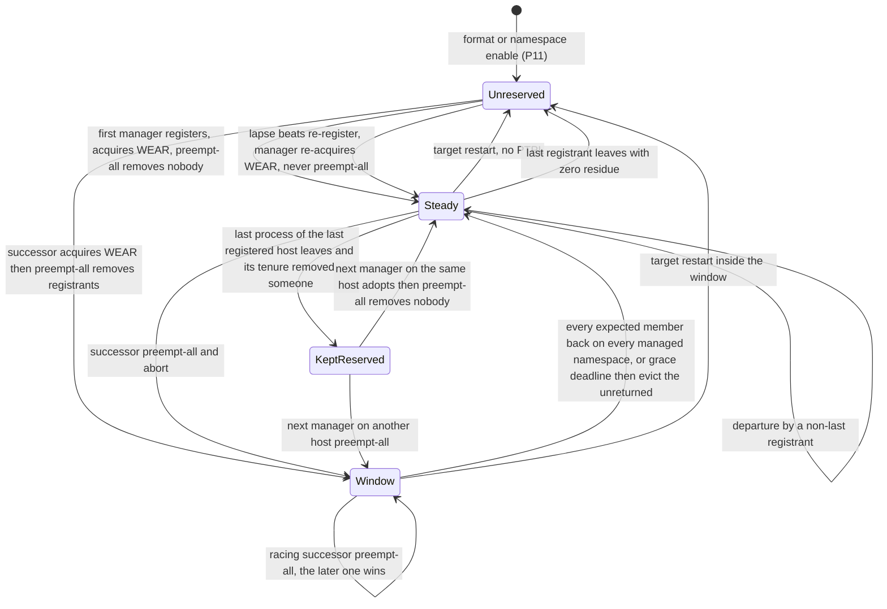
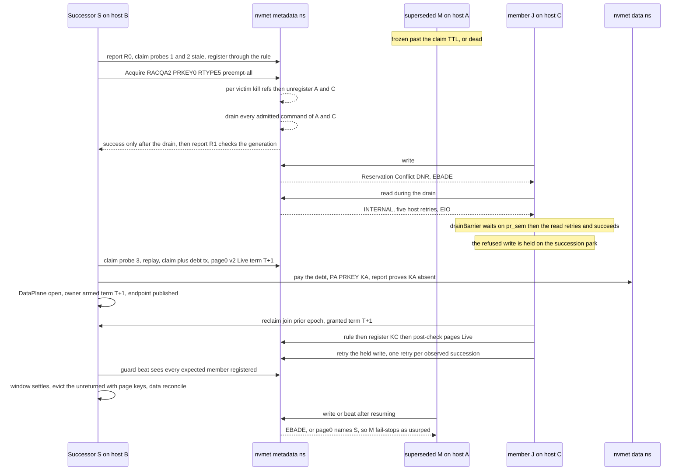
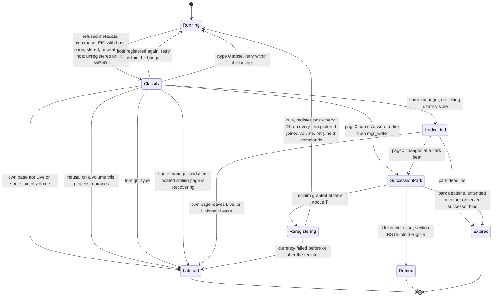
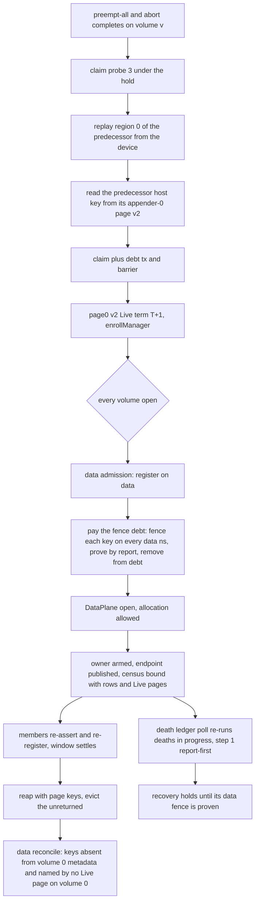

> **Decision 0004 — the approved design, revision 27, 2026-11-04/05: converged, 0 open issues after the model-driven rounds (owner ruling "option (b)", all in; decision 0003 §DO); implementation follows its PR plan below.**

# Metadata-namespace PR fencing the way data is fenced: Write Exclusive – All Registrants, and single-manager exclusion by the successor's preempt-all

| | |
|---|---|
| Author | _(placeholder)_ |
| Date | 2026-11-04 (revision 27, after the review of revision 26, which approves it; the model at `d0fae07` has no open defect; the revision rows below list each round) |
| Status | **Draft** (for the owner and an independent safety review) |
| Decision row | decision 0003 **§DO** (proposed) |
| Owner ruling | 2026-11-04, "option (b)", all in |
| Supersedes | §DF.4 (WERO on metadata); §DF.6 (release), re-derived under WEAR (§4.12); §DF.11 (the nvmet holder-preempt posture), and §DF.12's routing through the fencer (the re-fence itself stays, C4); §DF.13(a) (registry blindness, now refused: KD16, KD19) and §DF.13(h) (member-death fencing on nvmet, closed by WEAR under N and Y); §DF.14's WERO and fencer model configurations (deleted by PR-5, DC17); §DG (the fencing registrant), **except** §DG.4, §DG.14's admission rule (DC10), §DG.15, §DG.19 and §DG.20(4), which this design keeps, and the fencer-node refusal (§DG.16, §DG.20(1)), kept until PR-8 (KD10, Q2); §DJ.3 (reconcile at admission); charter §5.5 "Fencing" (metadata half) |
| Keeps | §DF.1–§DF.3; §DF.5 (the stale-sibling rule); §DF.7; §DF.8, amended (a member refused by a succession re-admits, §4.5 and G-c; a co-located sibling's death stays a fail-stop, Q4); §DF.9 (the merged-head refusal, unchanged); §DF.10; §DF.12's re-fence, now the manager's own `fence(k)` (C4); §DF.13(b)–(g) and (i)–(m); §DF.15 (the lapse re-acquire, now `acquire` WEAR, §4.9) and §DF.16; §DG.4 (the own-key guard); §DG.14's rule that a preempt is issued only while this host is admitted (DC10); §DG.15 and §DG.20(4) (serialized PR commands, DC11); §DG.19 (the lapse claim re-read, DC6); §DJ (data, except DJ.3's timing); §DL; §DM; §DN |
| Repo state read | `dev` = `ea36e5c` (a docs-only handoff commit on top of `b43bd14`; the code is identical); kernel `/build/kernel/linux-mainline-v7.3` (kernel.org 7.3.1) |
| Revision 2 | Addresses review round 1 (`grok-design-review-d3e8a48d.md` issues 1–15) |
| Revision 3 | Addresses review round 2 (issues 1–8 of the same file; see its round-2 Revision Summary) |
| Revision 4 | Addresses review round 3 (issues 1–8; see its round-3 Revision Summary) |
| Revision 5 | Addresses review round 4 (issues 1–3; see its round-4 Revision Summary) |
| Revision 6 | Addresses review round 5 (issues 1–5) |
| Revision 7 | Incorporates the owner's decisions of 2026-11-04 on Q9 (KD19: all four blind-rule refusal shapes accepted, each naming its reason) and Q10 (KD20: an unmount during a pending re-registration waits, `--force` skips) |
| Revision 8 | Addresses review round 6 (issues 1–4) and states the held mechanism's liveness as ONE rule, **L** (§4.5.7, DC19), with every word that can be `pending` listed against it and the model's stranding invariants made general |
| Revision 9 | Addresses review round 7 (issues 1–3): the metadata hook's two deferral paths store `pending` (rule L's table completed); the model's liveness invariants anchored to environment events, plus `ClearedAfterEstablish`; R-1 on every `cleared` that observes rather than establishes |
| Revision 10 | Addresses review round 8 (issues 1–3): R-1 is three-valued (unreadable leaves the word `pending`, never `terminal`); W43 is paired with its precondition so it is reachable; W42's arms, `ClearedAfterEstablish`'s check point and the `elapsed` trim are pinned |
| Revision 11 | Addresses review round 9 (issues 1–3) and a self-consistency pass over the whole model specification (new §7.5): how the first error is decided (depth-first; an acceptable set per weakening), every invariant's definition, exemptions and check order, five definition pins the as-built configurations need in order to hold, every weakening's configuration and acceptable set, and every named step. W3, W5, W7–W9, W15, W17, W24, W30, W35, W40, W43 and W44 corrected; W36 moved to Holds; W45 (`KilledCurrent`) and W46 (`WroteOverLiveClaim`) added; the missing configurations and threads named in §7.2 |
| Revision 12 | Addresses review round 10 (issues 1–3). A5 and A2 join the accepted-window list, and rows 4, 6 and 7 count metadata writes only. **The explorer gains an opt-in quiescence check** (`stuck()`, in PR-1 with its own unit): a reachable state where some thread is unfinished and no step changes anything fails as `StrandedAtQuiescence` instead of being accepted silently. With it come a quiescence `tick`, `elapsed` for each premise's frozen or stalled words, JA's loop per observed succession, `Window{.fair}` and W47 (`reregister = false`). I8 is restated as the model checks it. The §7.5 pass was re-run over everything this round touches |
| Revision 13 | Addresses review round 11 (issues 1–2, both nits). The quiescence check's precondition, an acyclic state graph, is stated and **checked**: a model that declares `stuck()` also fails on a back edge (`error.CycleViolated`), and the explorer's unit shows a blocked waiter beside a ping-pong caught that way. PR-1 declares `stuck()` in the re-based `data_fence_model` configurations that §DO cites, with a triage rule for what it finds. Q11 keeps only `host_fence_model` |
| Revision 14 | Addresses review round 12 (issue 1, a nit). The replay that names a failing schedule's error mirrors the explorer: `CycleViolated` when the schedule revisits a state on its own path, and `stuck()` only at a quiescent end. It moves into `explorer.zig` as one helper shared by `meta_fence_model` and the re-based `data_fence_model`, with its own unit. The memo's on-path mark is pinned (set on entry, "done" on exit, the back-edge test before the early return) |
| Revision 15 | Addresses review round 13 (issue 1, a nit): the Date row reads the current revision. The Supersedes and Keeps rows are made exact against decision 0003's §DF and §DG rows: §DG is superseded except the rows this design keeps (§DG.4, §DG.14's admission rule, §DG.15, §DG.19, §DG.20(4)) and the fencer-node refusal until PR-8. §DF.6, §DF.12, §DF.13(a)/(h) and §DF.14 are split between the two rows as the design treats them, and §DF.8 and §DF.9 are now listed |
| Revision 16 | **The model's findings** (PR-1, built from revision 15: `docs/evidence/rung-10-metadata-wear-model.md`, decision 0003 §DO.7). Four as-built failures of the design are fixed in the mechanism: D3 (the page check and the mutation it guards become one critical section under the host's registry lock), D7 (a conflicting lapse re-acquire is a takeover, never this manager's), D8 (a metadata change inside the synchronous data arm answers `held`, never `decline`) and D10 (a withdrawal waits for its own admitted commands before it unregisters). Three are spec corrections: D1 (W2's acceptable set gains `WroteOverLiveClaim`, with its reason), D2 (the retry budget counts this host's unregistrations, not changes of `mgr_writer[v]`) and D9 (the store-then-recheck alone is not a guarantee; the periodic tick is). N1 aligns §4.5.3 with §7.1. The model's eight definition pins are adopted (§7.5.2). Each former behaviour becomes a weakening that must keep failing (W48–W52). §7.4 carries the measured state counts, and the trims and the gate cost are ruled. **§7.6 lists each defect → fix → model change** |
| Revision 17 | Addresses the review of revision 16 (issues 1–4) and two findings of this round's own pass. **The manager's section waits on a new short registration lock**, not the registry flock: a rule holds it only around its register and re-judge (issue 2). **DC22's wait is bounded** (10 s), and on timeout the registration stays for the next fence to drain; the synchronous data arm no longer withdraws (issue 1). **The full lock order** has five locks (issue 3). The A2 residue is bounded by one manager section, one key per section (issue 4). **G1:** a lapse rule whose read preceded a successor's acquire re-admitted a superseded manager, which revision 16's model hid behind an A3 exemption of PR mutations; the re-judge now checks the manager's re-acquire mark (DC24), and A3 no longer exempts a PR mutation. **G2:** DC21 relies on nvmet's non-holder acquire conflict, which a conformant target lacks (Q12, an owner decision). **§7.6.1 lists exactly what the model changes relative to revision 16** |
| Revision 17.1 | **Q12 resolved** by the orchestrator's decision of 2026-11-04, pending owner objection: **the WEAR posture is scoped to nvmet, never silently** (KD22). D7's fix and PR-2's canary leg are kept. A runtime **target-semantics probe** at a fresh register (§4.4.6, DC26) makes the set refuse the posture by name on the success answer of a spec-conformant target. The manager alone reads `unverified` until the first probe. The target-independent design is stated as a follow-up that gates any non-nvmet target. The registration-lock decision is renumbered KD24. The model is unchanged: the probe is outside its device semantics. |
| Revision 18 | Addresses the review of revision 17.1 (issues 1–4) and the model's report at `4a0dec9` (D11, D12, the `Debt{.ja}` bound). **Issue 1:** the co-located kill's lock-free path drains the victim's metadata and data nodes, because for a co-located death the kill and the drain are the fence. **Issue 2:** a stale verdict under the registration lock sends its SIGKILL and releases the lock; the exit wait, the drains and any withdrawal run outside it. **Issue 3:** the unmount's release takes the registry flock, then the registration lock (R19 names the 40 s delay). **Issue 4:** a refusing successor withdraws its registration, and `meta_pr_posture_refused` is cleared only by an offline verb. **D11:** the claim re-read is load-bearing in `.lapse` too, so W18 fails there; no cheaper mechanism closes the case, and its availability residual is named (R21). **D12:** the registration lock stays. Behind the model's atomic re-read it is defense in depth (W49 holds there); the product's re-read and register are two commands, and a new configuration `Succession{.lapse, .split_register}` shows the lock's load (W49) and the mark clause's (W55). **G4 (this round's pass):** a lapse ends only by the manager's own acquire, so a report showing WEAR before it stands the manager down, and its PR mutations wait (W56). **The `Debt{.ja}` family** is split by operation. **§7.6.2 lists the model's changes relative to `4a0dec9`** |
| Revision 19 | Addresses the review of revision 18 (issues 1–6) and the model's report at `7f50e8f` (D11, D12, the `Debt{.ja}` bound and G4 closed; D13 new). **Issue 1:** a manager's section refuses and retries during a lapse, never waits under the registration lock; every lapse acquire is exempt, whatever volume is in a lapse; each holder takes the lock through its own open file description. **Issue 2:** the model's re-judge kill path takes the product's order (kill and release, then the withdrawal), and W57 shows the order is load-bearing. **Issue 3:** the lock-free co-located kill drains the data nodes only, as the locked path does; its exit wait is bounded. **Issue 4:** `claim posture-reset` takes the `convert-pr` door: its refusals, the takeover sequence, both superblock copies. **Issue 5:** the manager's own lapse rule applies G4 at its re-read and its post-register report; during a lapse the report is classified before the claim refresh; a lost acquire answer is re-issued and a conflict checked with one report. **Issue 6:** the D3 row annotated; DC21, G4 and R21 name a superseded manager's own lapse acquire as a third acquirer; the 40 s registry-lock bound is a waiter's. **D13:** W39's witness spans both operations, so it runs on the full `Debt{.ja}` form, whose failing search stops within the bound. **§7.6.3 lists the model's changes relative to `7f50e8f`** |
| Revision 20 | Addresses the review of revision 19 (one minor, three nits). The model at `d0fae07` has no open spec defect: every as-built configuration holds, and every weakening W1–W57 fails inside its set. **Issue 1:** a frozen holder of the registry flock or the registration lock can hold a lapse open. The co-located kill takes neither lock-order position nor a section, so it always runs; during a lapse an unadmitted joiner frozen in a register section is killed after one member-death bound; A3's bound is widened to match; an unmount in mid-lapse waits for the lapse's end, and `--force` is named. **Issue 2:** after a conflict, only rtype 5 stands the manager down, rtype 0 re-runs the lapse, and an unreadable report or a twice-lost answer retries next beat with the mutations still refused. **Issue 3:** `posture-reset` runs claim probe 2 before its takeover, withdraws its registrations on a refusal, and registers and probes every volume before it clears any flag. **Issue 4:** five consistency fixes, including the model's one over-approximation recorded as such. **No model change** (§7.6.4) |
| Revision 21 | Addresses the review of revision 20 (two minors, one nit). **Issue 1:** the frozen joiner is killed only when the same holder (pid and start ticks) held the lock across the whole bound and is proven frozen (state `T`/`t`, or a frozen cgroup). Legitimate long holds run in `R`, `S` or `D`, and a series of holders resets the count. **Issue 3's closure is adopted:** after any kill that releases the registration lock over an unjudged registration, the manager checks its hold on every joined volume with its own same-type acquire, a no-op for nvmet's holder. That closes revision 20's double fault on nvmet and lets the joiner kill run outside a lapse too. **Issue 2:** both takeover verbs refuse over any live process of the set on this host, the manager's `m` line included, since the preempt-all never fences the issuer's host (P4). `convert-pr` re-reads and re-stamps bit 4 after its preempt-all. Both verbs say what a later-volume refusal leaves. **Issue 3:** A9's third case is in A9's list, §4.13, I1 and the ledger. **No model change** (§7.6.5) |
| Revision 22 | Addresses the review of revision 21 (two minors, one nit). **Issues 1 and 2:** the hold check is keyed on evidence instead of on the manager's kills. Every rule leaves a marker for its register section, and a marker left by a rule that ended mid-section, however it ended, makes the manager check its hold on every joined volume. The check therefore covers crashes, OOM kills and operators' kills, which revision 21 missed. It never waits on a victim's exit: a victim that held no lock leaves no marker and triggers no check. A9's third case is now closed on nvmet for every death mid-rule; the manager's writes until its next beat are A5's. **Issue 3:** the restart case between the check's report and its acquire is A9's only, and that acquire writes the mark; the check's unknowns get §4.9's bound; the freeze proof reads every thread's state, or the cgroup's flag. **No model change** (§7.6.6) |
| Revision 23 | Addresses the review of revision 22 (one minor, one nit). **Issue 1:** a marker no rule will remove can no longer starve the manager. A refusal's withdrawal marker (`.wd-`) is renamed abandoned on DC22's timeout or a lost unregister answer, and a withdrawal marker older than its longest legitimate span (50 s, derived) counts as abandoned. Dead and abandoned markers trigger the hold check and never refuse it or the lapse acquire; a live withdrawal marker refuses both, for at most that span. Every marker names its boot, volume and sequence. **Issue 2:** the check removes only the markers it judged; why a dead rule's in-flight register is harmless (the claim TTL's own derivation); A5's bound with unknown answers; only metadata rules make markers. **No model change** (§7.6.7) |
| Revision 24 | Addresses the review of revision 23 (two minors). **Issue 1:** every marker transition that can expose a registration runs under the registration lock. The abandon rename does; `.reg` → `.wd` comes strictly before the release, with its time and checksum written before the rename. A time a reader cannot read counts as abandoned. A tmpfs listing spanning several `getdents` calls can no longer miss a rename. **Issue 2:** revision 23's claim premise is withdrawn. For a dead `.reg` marker, the check's acquire counts once one NVMe I/O timeout has passed since the manager first saw the marker dead, so no register of that rule is still in flight in the host's view. nvmet's FIFO `pr_sem` covers the target's view. Slow but landing refreshes never starve the check or count toward a fail-stop. **No model change** (§7.6.8) |
| Revision 25 | Addresses the approving review of revision 24 (one nit, four points). **(a)** `pr_sem`'s FIFO covers a register already waiting on it. One still queued behind its own target queue's command can be overtaken, and there the claim law is the backstop, with no threshold needed. **(b)** The check runs only once its wait is over: its report, then its acquire, back to back under the lock. **(c)** A section marker is empty and judged by its name alone. Only a withdrawal marker carries a time and checksum, written before the rename that publishes it. **(d)** A check whose re-read finds nothing to judge is dropped, and its volumes released. **No model change** (§7.6.9) |
| Revision 26 | Addresses the approving review of revision 25 (one nit, two points). **(a)** The check judges and removes only markers whose own wait is over. A dead `.reg` first seen at the check's re-read keeps its own 30 s and gets its own check. **(b)** The two "cannot happen" marker states get tripwires (AGENTS.md): a live `.reg` met under the registration lock, and a `.wd` aged past 50 s whose rule is not proven frozen. A frozen rule's legitimate aging gets its own counter. **No model change** (§7.6.10) |
| Revision 27 | Addresses the approving review of revision 26 (one nit). **(a)** A live `.reg` met under the registration lock, the tripwired state, now holds off everything a live withdrawal marker does, the hold check and the lapse acquire included. It is named as the one exception to the 50 s bound and to A3's. **(b)** A `.wd` aging past 50 s is no longer a must-stay-0 tripwire, since a `D`-state stall or a throttled rule under host stress is an expected residue. Three ordinary counters split it by the rule's state (frozen, uninterruptible, other), and the last is the alarm. **No model change** (§7.6.11) |

---

## 1. Overview

Today a set's metadata namespaces are reserved **Write Exclusive – Registrants Only** (WERO, rtype 3) by the manager, so the device keeps one holder and arbitrates the manager role. Data namespaces are reserved **Write Exclusive – All Registrants** (WEAR, rtype 5). nvmet 7.3 ignores PRKEY when a WERO holder preempts (`nvmet_pr_preempt`, `holder == reg`, `drivers/nvme/target/pr.c:592-598`), so the manager cannot fence a dead member on metadata itself. §DG added a write-free second NVMe identity, the "fencer", to send that preempt. The fencer needs a per-path character node, which stock kernels create only under `nvme_core.multipath=N`. Under production `multipath=Y`, member-death fencing on metadata is therefore detection-only today.

This design gives metadata the same discipline as data:

* **Registration.** Every metadata namespace becomes WEAR. Every member host registers there under its host key before its first metadata write.
* **Member death.** A dead member is fenced by the manager's own **Preempt-and-Abort(PRKEY = victim key)**. On nvmet 7.3 that command takes the All-Registrants arm (`pr.c:575-590`), which runs before the quirky holder arm. It therefore follows the spec under both `multipath=N` and `multipath=Y`, with no fencer.
* **Manager exclusion.** WEAR has no single holder, so single-manager exclusion moves to the moment of succession. Every manager takeover issues **Preempt-and-Abort with PRKEY 0 and RTYPE 5**, called *preempt-all* below. It makes the sender the only registrant (`pr.c:578-586`) and unregisters every other host id, each after its controllers' per-namespace refs are killed. It completes only after the commands those hosts had admitted have drained (`pr.c:618-639`).
* **The winner.** The last preempt-all wins. The claim's three probes, which stay as they are, still decide who may send it. The successor replays from the device under its own registration.
* **The manager's identity check.** A manager stays a manager only while appender 0's Live page on each of its volumes names its incarnation. It checks this on every beat and before every PR mutation it issues. Under WEAR a superseded manager whose host is re-admitted must not read "ours" (§4.4.2). Only a positive mismatch fail-stops; an unreadable page withholds mutations for a bounded number of beats.
* **Liveness of held work: one rule, L** (revision 8, §4.5.7). Every word that can be `pending` has (a) a re-examiner on every tick, (b) a deadline of its own, independent of any park, and (c) a `cleared` store on every path that establishes or finds its registration, with store-then-recheck by whoever stores `pending`. A `cleared` that only observes a registration first proves this incarnation current (R-1). It stores `terminal` only on a positive not-Live proof; an unreadable R-1 leaves the word `pending`. The model checks L through two general liveness invariants, `RegisteredButPending` and `PendingPastDeadline`, anchored to environment events no weakening can remove, plus the safety invariant `ClearedAfterEstablish` (revision 9).
* **What the model changed** (revision 16, §7.6). PR-1's model found four places where the design itself failed as built. Each is fixed in the mechanism:
  * a manager's page check and the PR mutation it guards run as one critical section under the host's registry lock, the lock every rule's register already takes (D3);
  * a lapse re-acquire that conflicts is a successor's takeover, and the manager stands down (D7);
  * a metadata change inside the synchronous data arm answers `held` (D8);
  * a member withdrawing a fresh registration first waits for its own admitted commands (D10).

  The retry budget counts this host's unregistrations (D2).

  **Revision 17**, after the review of revision 16:
  * the manager's section waits on a short **registration lock**, never on the registry flock that rules hold for seconds;
  * DC22's wait is bounded;
  * the synchronous data arm keeps its registration;
  * a rule judges its host's manager again at its register (G1);
  * one lock order is fixed.

  **Revision 18**, after the review of revision 17.1 and the model's report on it:
  * a stale verdict under the registration lock holds it only to send its SIGKILL, and the co-located kill's lock-free path drains as the locked path does;
  * a lapse ends only by the manager's own acquire, so a report showing WEAR before it stands the manager down (G4);
  * the claim re-read after a lapse acquire is load-bearing in two cases (D11), and the registration lock earns its place where the product's re-read and register are two commands (D12).

  **Revision 19**, after the review of revision 18 and the model's report on it:
  * during a lapse the manager's sections refuse and retry, every lapse acquire is exempt, and the manager's own lapse rule never re-admits its host under a reservation it did not acquire;
  * `claim posture-reset` takes `convert-pr`'s door;
  * W39's witness spans both data operations, so it runs on the full `Debt{.ja}` form (D13).

  **Revision 20**, after the review of revision 19 (no model change):
  * a frozen co-located lock holder can no longer hold a lapse open indefinitely, and A3's bound says so;
  * an unmount in mid-lapse waits for the lapse's end;
  * `claim posture-reset` re-checks the claim before its takeover and probes every volume before it clears any flag.

  **Revision 21**, after the review of revision 20 (no model change):
  * a frozen joiner is killed only on proof that it is frozen;
  * after any kill that releases the registration lock over an unjudged registration, the manager checks its hold on every joined volume, which closes the last kill-related double fault on nvmet;
  * the two takeover verbs refuse over any live process of the set on their own host, and `convert-pr` re-stamps bit 4 after its preempt-all.

  **Revision 22**, after the review of revision 21 (no model change): a rule that ends between its register and its re-judge, however it ends, leaves a marker. The manager acts on the marker by checking its hold on every joined volume, never on a kill or an exit.

  **Revision 23**, after the review of revision 22 (no model change): a marker no rule will remove is handed to the manager as abandoned, so no marker holds the manager off for longer than a bounded withdrawal.
* **Target scope** (revision 17.1, KD22). The WEAR posture is for nvmet, whose single holder pointer makes a non-holder's acquire conflict, and DC21 relies on that. A probe at a fresh register learns the target's answer at runtime. On a spec-conformant target the set refuses the posture by name, and a set with no probe yet reads `unverified`. Supporting other targets is gated on a target-independent design (a follow-up, §4.4.6).
* **Blind rules refused.** The stale-sibling rule refuses what it cannot judge: a daemon whose host registry root is not the host's, and a live sibling under another hostname. That closes the §DF.13(a) blindness (§4.4.2). The owner accepted all four refusal shapes on 2026-11-04 (KD19): its own `/run`, two hostnames, a hostname change until the old daemons restart, and an unreadable `/proc/1/root`. Each refusal names its reason.
* **Joiner keys verified.** A joiner's claimed host key is verified against the device's report at `JoinAppender` before it goes onto the page (§6.1).
* **Member re-registration.** Every live member host then **re-registers** through the existing stale-sibling rule. It does so while its pages are Live on every joined volume, and after it has re-asserted with the new owner.
* **Refused I/O during the drain.** Members' refused metadata commands are never latched. During the drain, writes are refused (EBADE). Reads see `NVME_SC_INTERNAL`, which the host turns into EIO after its retries. Both are handled at the metadata device's two completion points.
* **Where a member waits.** The completion-point hook **never waits for re-registration**, and that includes the data device's write-outcome funnel (revision 5). A refused write answers **`held`**: the caller drops its locks and retries from its existing retry point once the re-registration is done. A member waits only at the park's pre-admission gate, where it holds no lock (revision 3). **An unmount during a pending re-registration waits for it**, up to the park deadline, with progress logged each beat; `squeezefs umount --force` skips the wait. This is the owner's decision of 2026-11-04 (KD20).
* **The succession window.** The reservation never leaves WEAR, so a re-registered member is a holder again by registration alone. The manager closes the window when every live member is back on every managed namespace. "Live member" means one listed by the predecessor's rows **or** by a Live page on the device, merged into one expected set when the owner arms. Otherwise the window closes at the grace deadline. Then the same set is reaped with page keys, the unreturned are evicted, and only then does the data reconcile run.
* **Data.** The superseded manager's host is fenced on data at the successor's admission, as today. A durable *fence debt* carries its key across chains of successions.
* **Deletions.** The fencer, its udev rule, its multipath=Y refusal and the holder-preempt detection posture are deleted.

## 2. Background and motivation

### 2.1 Today's posture

| Plane | Reservation | Member-death fence | Manager election | Under `multipath=Y` (production) |
|---|---|---|---|---|
| Metadata (§DF/§DG) | WERO held by the manager | The manager host's **fencer** (a second host id under the host key) sends PA(victim). The holder's own PA is a no-op on nvmet 7.3. | The device keeps one WERO holder. A successor preempts the holder's key (`holdReservation`, plain RACQA 1). | **No fencer** (`fencer.stand` refused, `pr_fencer_absent`): member death is **detection-only with possible loss** (§DF.11, §DG.3). |
| Data (§DJ/§DL/§DN) | WEAR, every member host registered | The manager's own client sends PA(victim) (All-Registrants arm). | None needed: allocation is arbitrated by metadata. | Works: the host's identity rides every path and the head's char node routes PR commands. Not yet run on the venue. |

The owner's standing rules close every other route:

* No kernel patches (§DB).
* No deprecated interfaces, so `NVME_IOCTL_IO_CMD` on `/dev/nvmeX`, the only per-controller I/O passthrough under Y (§DG.3), is excluded.
* `multipath=Y` is mandatory in production (ruling 2026-10-18).
* One host identity per host (§DF, option C).
* The upstream nvmet fix (`~/tmp/nvmet-pr-preempt-bug.md`) is unsent, and the product must not depend on it.

### 2.2 Device facts this design rests on (kernel.org 7.3.1, re-verified for revision 2)

All line numbers refer to `/build/kernel/linux-mainline-v7.3/drivers/nvme/target/pr.c` unless another file is named.

| # | Fact | Source |
|---|---|---|
| P1 | There is one registrant per **host id**. A Register from a registered host id with another key conflicts. Co-located mounts share the registration. | `nvmet_pr_register` :228-259 (:242-247) |
| P2 | Under WE-RO/WEAR, a write-group command (write, write zeroes, DSM, flush, zone) from a host id with **no registrant** gets Reservation Conflict + DNR. Reads are never restricted. With no reservation, every host is admitted. For an I/O command, the access check runs at parse time, **then** the per-controller namespace ref is taken. A PR command returns from parsing before both steps. | `nvmet_pr_check_cmd_access` :961-1014 (:971-972, :990-994); `core.c:1141-1145`, `:1166-1172` |
| P3 | Acquire by a registrant that is not the holder pointer conflicts, even at the same rtype. Under WEAR the first registrant acquires; the rest are admitted by registration alone. | `nvmet_pr_acquire` :443-461 (:451-452) |
| P4 | **Preempt with PRKEY 0 under an All-Registrants reservation:** the sender becomes the holder with the command's RTYPE. Then every registrant of **another host id** is unregistered. The sender's host id stays, and the reservation is kept. | `nvmet_pr_preempt` :575-587; `nvmet_pr_set_new_holder` :221-226; `nvmet_pr_unreg_all_others` :530-547 |
| P5 | Preempt with PRKEY k ≠ 0 under All-Registrants unregisters every registrant of k, including the sender, and keeps the reservation. If nobody holds k, it conflicts. This arm runs **before** the single-holder `holder == reg` arm. | :588-589; `nvmet_pr_unreg_all_host_by_prkey` :486-507 (:490, :496) |
| P6 | Preempt with **no reservation** runs `unreg_all_host_by_prkey`. PRKEY 0 matches nobody, so it conflicts. An unreserved namespace therefore needs an Acquire before the preempt-all. | :571-573 |
| P7 | Single-holder types: the holder's own preempt only re-types its hold and ignores PRKEY (the quirk). A preempt of the holder's key moves the hold, with the command's RTYPE, and unregisters every other registrant of that key. PRKEY 0 from a non-holder is Invalid Field. | :592-598, :600-610, :615 |
| P8 | The sender of any Acquire must be registered under (its host id, CRKEY). **A host that has been preempted cannot preempt.** | `nvmet_execute_pr_acquire` :703-711 |
| P9 | **Preempt-and-Abort, per victim host, in order:** kill that host's per-controller namespace refs and wait for the confirm (:471-484, inside :538-543), **then** unregister it (:543). The command completes only after every command those controllers had **admitted** on the namespace has completed (`nvmet_pr_do_abort` :618-639). `pr_sem` is held until then: the refs are resurrected at :633 before `up(pr_sem)` at :637 (:713-718). **What a victim's new I/O sees:** see P9a–P9c. | as cited |
| P9a | **Writes and flushes** arriving after the victim's unregistration fail the access check: Reservation Conflict + DNR, which is **EBADE**. This holds for the rest of the drain and after it. | :990-994 |
| P9b | **Reads**, which the access check never restricts, fail `percpu_ref_tryget_live` for the **whole drain**: `NVME_SC_INTERNAL` without DNR (:1016-1026). | as cited |
| P9c | A write that passes the access check in the per-victim **instant** between the ref kill and the unregister also gets INTERNAL. That includes an RCU reader of the registrant list already in flight at `list_del_rcu`. | as cited |
| P9d | **PR commands** take no per-controller ref (P2) and never see INTERNAL. Register, Acquire and Release wait on `pr_sem` for the drain. Report does not. | as cited |
| P10 | Unregistering the holder pointer under All-Registrants passes it to the first remaining registrant. The reservation ends with the **last** registrant. Under single-holder types it ends at once. | `nvmet_pr_unregister_one` :261-291 (:275-283) |
| P11 | **No PTPL.** The report always carries `ptpls = 0`. A namespace enable starts with no registrant and no holder, and a disable frees everything. | :864; `nvmet_pr_init_ns` :1135-1138; `nvmet_pr_exit_ns` :1160-1182 |
| P12 | Registrations outlive their controllers. | `nvmet_ctrl_destroy_pr` :1108-1125 |
| P13 | Under All-Registrants the report marks **every** registrant holding, so under WEAR the report never names the manager. | `nvmet_execute_pr_report` :884-886 |
| P14 | A Reservation Report takes no `pr_sem`: a report during a drain reads the state after the unregistration. | :830-900 vs :241, :371, :703, :814 |
| P15 | **Register-Replace with IEKEY 0 and CRKEY = NRKEY = own key** takes `pr_sem`. If this host id is registered under that key, it rewrites the same key and succeeds; if the registrant is the holder pointer, its struct is replaced with an identical one. If this host id is unregistered, it conflicts. It has **no other side effect**: nothing is registered, unregistered or reserved. Combined with P9, this makes it a **drain barrier**: it returns only once any preempt-and-abort drain on the namespace has finished. | `nvmet_pr_replace` :355-400 (:371, :373-379, :382-397) |
| P15a | **The barrier can fail without an answer.** When this host's registrant is the holder pointer, the copy is allocated `GFP_ATOMIC` and a failed allocation returns `NVME_SC_INTERNAL`. The host does not retry it: passthrough requests are failfast. A drain that outlasts the passthrough timeout ends in a timeout and a controller reset. So the barrier has **three** outcomes: registered, unregistered, **unknown**. | `pr.c:337-340`; `host/core.c:765` (`REQ_FAILFAST_DRIVER` on passthrough) |
| P16 | **Generation:** Register, Unregister and Replace bump the generation on success (:438-439), and so does Preempt (:664-666). A plain Acquire does **not** (:650-652 goes to `out`, skipping the bump). The report carries it (:863). | as cited |
| P17 | **Unverified race (review issue 11):** `nvmet_ctrl_free` frees each controller's per-namespace refs under `subsys->lock` (`core.c:1761-1767`; `pr.c:1117-1123`). `nvmet_pr_do_abort` walks those refs holding only `pr_sem`, then waits, re-inits and resurrects them (:628-635). Nothing orders the two, so a victim controller torn down during a drain may be a target-side use-after-free. The same exposure exists **today** in §DJ's data fence. Pinned by a PR-2 leg (§8.2). | as cited |
| H1 | **Host side:** a status without DNR is retried up to `nvme_core.max_retries` (5) times with no delay (no CRD from nvmet), then completes as `BLK_STS_IOERR`, which is **EIO**. Reservation Conflict + DNR maps to `BLK_STS_RESV_CONFLICT`, which is **-EBADE**. | `drivers/nvme/host/core.c:72`, `:408-431`, `:327-344`, `:286-325` (:314-315, :322-323); `block/blk-core.c:163` |
| H2 | Under `multipath=Y` there is no per-path char node; the head's char node routes uring_cmd passthrough over any path. `multipath` is 0444 (boot-only). INTERNAL is not a path error, so under Y it is retried on the same path, not failed over. | `host/core.c:4332-4333`; `host/ioctl.c:804-810`; `host/multipath.c:38`; `host/core.c:421-424` |

The NVMe Base Specification 2.x "Preempting a Reservation or Registration" rules for All-Registrants types agree with P4 and P5. Only P7's single-holder arm deviates.

### 2.3 What the reviewers broke before: the design constraints

| DC | Constraint | Origin |
|---|---|---|
| DC1 | Two successors must never both bind. The device must arbitrate, either with one holder or with a last-writer-wins command that removes the loser. | review 2 **N1** (rtype 5 with a plain preempt of the claim's key: both successors bound) |
| DC2 | No registration and no write before the claim is read (a private replay). | review 3 major 2 |
| DC3 | Never preempt a manager whose claim is fresh: the claim is re-read right before the hold. | review 5 major 1 |
| DC4 | A writer whose claim landed between that probe and the hold is taken over when this open's preempt fenced it: the third probe, under the hold. | review 4 minor 4 |
| DC5 | A hold that removed anyone stays at the incarnation's last clean unmount (the kept law). | review 4 blocker 2 |
| DC6 | After a lapse, re-acquire only over this incarnation's own claim, and re-read the claim under the hold. | review 3 major 3; §DG.19 |
| DC7 | The rule re-judges after its register. Recovery re-fences after the page goes Recovering. | review 1 B2 |
| DC8 | A departure never drops the reservation. | review 1 B3 |
| DC9 | Joined lines name their page: (appender id, term, volume). | review 4 blocker 1; review 5 minor 1 |
| DC10 | A preempt is issued only while this host is admitted, under the client's sequence lock. Models are step-faithful: every PR command is its own step. | fencer review M1; §DG.14 |
| DC11 | Only one PR command is in flight per Device. | fencer review M2; §DG.15 |
| DC12 | Only stable facts mean "absent". | data review MAJOR 1 |
| DC13 | Lapse beats re-register on every joined volume; the grace ends early by census. | data review MAJOR 2; §DL; §DN |
| DC14 | The membership owner takes one lock. | §DM |
| DC15 | A re-join re-admits data in two phases. | §DN.9 |
| DC16 | The manager's role must rest on a device fact that is **independent of the host registry and of PR registration**, because the registry is blind across mount and UTS namespaces (§DF.13(a)). | design review issue 3 (WERO gave this for free; WEAR does not) |
| DC17 | A model of the metadata plane must not outlive the semantics it models. | §DF rounds 3–4; design review issue 4 |
| DC19 | **The liveness rule L** (§4.5.7). Every word that can be `pending` has: **(a)** a re-examiner on a bounded cadence, which re-reads the device and resolves it; **(b)** a bounded deadline, independent of any park, at which the re-examiner stores `terminal`; **(c)** a `cleared` store (gen++) on **every** path that establishes, or finds, the registration it waits for. A setter of `pending` re-checks after its store. A `cleared` that only **observes** a registration runs R-1 first. It stores `terminal` only on a positive not-Live proof; an unreadable R-1 leaves the word `pending` (revisions 9–10). | the held mechanism's major issue in three consecutive review rounds (round 4's data park, round 5's lost wake-up, round 6's stranded `pending`) |
| DC18 | **No wait for member-side progress below the pre-admission gate**, at **every** completion point that can meet a succession: the two metadata points **and the data device's write-outcome funnel** (`nvme_dev.Device.readmitted` / `refusedWith`). An I/O completion may wait only for something that depends on the target alone, such as the drain. It must never wait for something that needs the member's own beat, reclaim, carriage or rule to run, because its caller may hold locks those paths take. | design review round 2, issue 1; data point added in round 4, issue 1 |
| DC20 | **A manager's page check is atomic with the PR mutation it guards** (revision 16, D3; revision 17). The check, `admittedHere` and the command run inside the set's **registration lock** (`<run>/hosts/set-<key>/.register`). Every rule holds it from its last re-read before `register` through its re-judge, so host A's registration cannot be re-made in between. The long registry flock is no longer in the manager's path. | PR-1's model, D3; round-16 review issue 2 |
| DC21 | **A conflicting lapse re-acquire is a takeover** (revision 16, D7). After a restart a reservation comes only from an acquire: an open's, or (revision 19) a superseded manager's own lapse acquire (R21). Another host's hold therefore means a successor passed its probe 2, or a superseded manager acquired first. The manager stands down either way and never counts that acquire as its own; a conflict is first checked with one report: rtype 0 is another restart and re-runs the lapse, and only rtype 5 stands the manager down (revisions 19–20). On a conformant target every registrant's same-type acquire succeeds, so this signal is nvmet's (revision 17, G2). The posture is scoped to nvmet and a conformant target refused by name (KD22, DC26). **Since revision 18 (G4)** a report showing WEAR before the manager's own acquire is the same takeover: a lapse ends only by that acquire, and the manager's PR mutations refuse and retry until then (revision 19). | PR-1's model, D7; revision 18's pass, G4; round-18 review issues 1, 5, 6 |
| DC22 | **A metadata withdrawal drains its own commands first, within a bound** (revision 16, D10; bounded in revision 17). The withdrawing process closes its gate and waits, at most the drain bound (10 s), for its per-(process, volume) in-flight count to reach zero, then unregisters. At the bound it does not unregister: the registration stays, and the next C4 re-fence or death fence drains at the target. A plain unregister drains nothing (P10), and C4's report-first skip trusts that nothing admitted under an absent key is still in flight. | PR-1's model, D10; round-16 review issue 1 |
| DC23 | **A metadata change inside the synchronous data arm keeps the arm's data registration** (revision 16, D8; revision 17). Own death or a positive fence declines. An unreadable input answers `held`. Otherwise the registration stands: the arm stores `cleared` and retries. The arm never withdraws. | PR-1's model, D8; round-16 review issue 1 |
| DC24 | **A rule judges its host's manager again at its register** (revision 17, G1). Under the registration lock, the rule re-reads the report right before `register`, and "reserved with this host unregistered" judges the manager stale, as at the read. A re-read that found the namespace unreserved is checked again at the re-judge. If the namespace is now reserved and the manager's line carries no **re-acquire mark** since that re-read (a manager's successful lapse re-acquire writes one under the registration lock), another host acquired, and the manager is stale. **A stale verdict at either point** sends the SIGKILL before the lock is released; the exit wait, the drains and any withdrawal run outside it (revision 18). | revision 17's pass, G1; round-17.1 review issue 2 |
| DC25 | **One lock order:** the data fence's lock → the registry flock → the registration lock → the client's sequence lock → the Device's issue lock, with a debug-build rank rail. | round-16 review issue 3 |
| DC26 | **The target's All-Registrants acquire semantics are probed, and a conformant target is refused by name** (revision 17.1, KD22). At a fresh register with another host's reservation standing, an Acquire of type 5 inside the register section, which never changes the reservation, tells nvmet's conflict from a spec-conformant target's success. On success the set refuses the posture by name; until a probe runs, the posture reads `unverified`. | Q12, the orchestrator's decision |

### 2.4 Pre-existing gaps found while designing (closed by this design)

* **G-a: today's takeover does not drain.** `host_fence.holdReservation` takes over with `c.preempt(victim)`, which is RACQA 1 and so has no abort (`host_fence.zig:1248`). A write the superseded manager had already admitted at the target when the preempt landed can complete after the successor's replay read the same blocks. The window is the target's in-flight time. Its likeliest trigger is two live racing successors (DC4). This design's takeover is always Preempt-**and-Abort** (P9).
* **G-b: a grace-reaped death carries no key.** `wire_plane.rosterKey` returns 0 (`wire_plane.zig:2046-2048`). A predecessor's member that never re-asserts is reaped with `pr_key = 0`, and its recovery then skips both the metadata preempt (`.no_key`) and the data fence (`recovery.zig:577-578`). Its host stays registered while its region is released, so a frozen member can resume and write into reallocated space. A second variant: a member whose row never became durable (its manager died within the flush interval after the join) is not even expected. This design puts the host key on the **appender page** (§6.1) and builds the expected set from the device as well (§4.6).
* **G-c: the superseded manager's co-located joiners fail-stop at every takeover.** This is §DF.8's owed fence-triggered re-admission, in the takeover case. It is closed by the member side (§4.5), which can land on today's WERO code first (PR-4).

## 3. Goals and non-goals

**Goals**

1. Device-grade member-death fencing on metadata namespaces under `multipath=N` **and `multipath=Y`** on stock nvmet 7.3, with no second identity and no deprecated interface.
2. Single-manager exclusion arbitrated by the device. A superseded incarnation is refused at the device after its successor's preempt-all. Where a host is re-admitted, it is refused by the manager's page-based identity check (§4.4.2).
3. Every window the device does not enforce is named, bounded and modelled (§4.13).
4. No live member is fail-stopped by a succession that completes within its park's deadline: it parks and re-registers. The mechanisms:
   * §4.5;
   * the progress-based park extension (§4.5.6);
   * the per-succession retry budget (§4.5.3);
   * the two completion points (§4.16);
   * the no-wait-below-the-gate rule with its lock audits, metadata (§4.16) and data (§4.16b): DC18;
   * the data side's `held` while the metadata re-registration is pending (§4.5.5), so a **busy** co-located joiner of a superseded manager survives (round-4 issue 1).
5. The data reconcile never fences a live member, except through the per-host cost of a co-located sibling's death. The superseded manager's host is fenced on data before the successor allocates (§DJ.3's law).
6. One code path for every target.
7. The fencer, and everything that exists only because of it, is deleted (AGENTS.md: no dead code).

**Non-goals**

* Mixed-version sets: refused by construction (§6.4).
* Flat `--single-writer` volumes keep Write Exclusive (rtype 1): they have no members, and the takeover is P7's holder-key arm.
* Fencing inside one host: flock, T_self, the frame screen and the recoverer's kill (§DJ.6).
* The DF.8 re-admission of a sibling fenced by a **co-located sibling's death**: stays a fail-stop (Q4).
* PTPL: nvmet has none (P11). The lapse machinery stays.
* Upstreaming the nvmet patches: independent, and the owner sends them (Q8, which now also covers P17 if it reproduces).

## 4. Proposed design

### 4.1 The discipline in one paragraph, and its invariants

Every metadata namespace of a symmetric set is reserved **WEAR**. A host writes metadata only while it is registered under its host key and a WEAR reservation stands (P2).

Registrations are made **only** through the stale-sibling rule (§DF.5), and only by:

* (a) a writer open, after its claim probes;
* (b) a joiner's admission;
* (c) a lapse beat (§DJ.17, §DN);
* (d) **the succession re-registration** (§4.5.4).

Hosts are unregistered **only** by:

* (i) a successor's preempt-all;
* (ii) the manager's death preempt PA(k);
* (iii) a departure that is not the last registrant (P10, DC8);
* (iv) a target restart (P11);
* (v) a re-judge withdrawing its own fresh registration.

A manager acts as manager only while **appender 0's Live page names its incarnation** (writer id and bound term) on that volume (DC16).

| ID | Invariant (the model's name in §7) |
|---|---|
| I1 | At most one bound manager incarnation writes or issues PR mutations after any successor's preempt-all has landed. The exceptions are the accepted windows A3 and A9; A9 is now confined to the test seam, a post-bind double fault (the page check unreadable), and a rule that ends between its register and its re-judge on a target that is not nvmet's, which the hold check its leftover marker triggers closes on nvmet (revisions 21–22) (§4.4.2) (`TwoManagers`). |
| I2 | No write by a superseded, fenced or replay-stale incarnation lands over metadata a later manager acked (`OverwroteAcked`, `FencedWrote`). |
| I3 | No open preempts the host of a manager whose claim is fresh and that can still write (`PreemptedLive`, `WroteOverLiveClaim`). |
| I4 | A Live, current member is never killed by a rule (`KilledCurrent`). It is never left fenced by a succession that completes within its park deadline (`LiveFenced`). |
| I5 | No metadata or data write of a dead member lands after its region was released or its blocks reallocated (`FencedMemberWrote`, `StaleDataWrite`, `ReallocatedUnfenced`). |
| I6 | A namespace is never unreserved while its current manager lives, except for a target restart (A3) (`UnreservedUnderManager`). |
| I7 | The data reconcile never preempts the key of a host that carries a current member, except the per-host cost of that host's own death fence (`ReconcileFencedLive`). |
| I8 | A death-fenced host is re-admitted only by a rule's register (`FencedHostRegistered`). That the rule first proved the dead incarnation dead, or killed it and drained its queues (the re-judge, C4), is checked by its effect: no write of the dead incarnation lands after recovery read its region or reallocated its blocks (`FencedMemberWrote`, `StaleDataWrite`; W16, W43; §7.5.2 row 8; round-10 issue 3). |

### 4.2 Command vocabulary

| Name | NVMe command | nvmet arm under WEAR | Used by |
|---|---|---|---|
| `register` | Register, RREGA 0, NRKEY = host key | P1 | the rule (all four registration paths) |
| `acquire` | Acquire, RACQA 0, RTYPE 5 | P3 (the holder pointer, only if unreserved) | the successor on an unreserved namespace; the lapse re-acquire |
| **`preemptAll`** | **Acquire RACQA 2, PRKEY 0, RTYPE 5**, CRKEY = own key | **P4 + P9** | every manager takeover, and nothing else |
| `fence(k)` | Acquire RACQA 2, PRKEY k, RTYPE 5 | P5 + P9 | recovery step 1 and its re-fence (metadata); step 2c (data); the fence debt and the reconcile (data) |
| `unregister` | Register, RREGA 1, CRKEY = own key | P10 | departures; withdrawal of a fresh registration |
| **`drainBarrier`** | **Register RREGA 2 (Replace), IEKEY 0, CRKEY = NRKEY = own key** | **P15** | the members' EIO handling (§4.5.3): it orders "the drain is over" and answers "is this host registered" in one side-effect-free command |
| `report` | Reservation Report (EDS) | P13, P14, P16 | every judgement |

The preempt-all carries **RTYPE 5**, so the reservation never leaves WEAR. A re-registered member host is a holder again by registration alone (KD3).

### 4.3 The metadata reservation state machine



| State | Device | Who writes metadata |
|---|---|---|
| **Unreserved** | No holder, possibly registrants (P10, P11). | Anyone (P2). This is the accepted lapse window, bounded after a target restart. |
| **Steady** | WEAR. The manager's host and every live member host are registered. | Registrants. The manager writes only while its page check holds. |
| **Window** (per volume) | WEAR. The successor's host and the member hosts re-registered so far. | Registrants. Unregistered members' writes are refused (EBADE) and **held**; their reads see INTERNAL→EIO during the drain only (P9b). |
| **KeptReserved** | WEAR. One departed host is still registered (§4.12). | The departed host only, and nobody lives there. |

#### 4.3.1 Transitions in detail

| Event | Sequence | Device effect | Daemon law |
|---|---|---|---|
| **First manager mounts** (fresh set) | claim probe 1 (absent) → `registerBeforeWrites` (rule, register) → claim probe 2 → `acquire` → `preemptAll` → claim probe 3 → replay → gate commit (claim + debt tx) → `AppenderSet.open` (page v2, `host_key`) → `enrollManager` | WEAR, sole registrant | `HoldOutcome.acquired` (§4.4 step 6, by generation) → zero-residue release allowed |
| **Joiner mounts** | claim probe (fresh foreign: no takeover) → `Joiner.admit` (adopt if the host is registered, else rule + `register`) → `JoinAppender` (carries the host key into the page) → `j <slot> <wid> <aid> <term> <vol>` | adds its host | `joinAsRegistrant` requires rtype 5 or 0 (it was 3) |
| **Co-located mount** | the host is registered → **adopt** (no device mutation) | none | the flock serializes one writer per volume per host (§5.7) |
| **Steady state** | manager beat: `report` → WEAR ∧ own host registered, **and** appender 0's Live page names this incarnation → ours | none | §5.3 |
| **Member death** (§4.8) | ledger poll → `fence(k)` (report first; k = the record's key, cross-checked against the page's `host_key`) → page Recovering → re-fence → data fence → … → release | k unregistered; X's admitted commands drained (P9) | no fencer; own-key guard; the page check |
| **Manager death or freeze** (§4.4) | members park at T_self → successor S: probes, rule, `preemptAll`, probe 3, replay, bind | every other host unregistered; admitted commands drained | the succession window opens (§4.5–§4.6) |
| **Target restart** (§4.9) | everything forgotten → lapse beats → re-acquire = `acquire` | Unreserved → Steady | **never** a preempt-all at a re-acquire |
| **Clean leave or unmount** (§4.12) | data first, then metadata; the host's last process of the set: `unregister` unless it is the last registrant | P10 | DC8, the kept law |

### 4.4 Succession: the successor's open

Steps run per metadata volume, in `KvBackend.open`'s order (`backend.zig:581-623`). Only steps 6, 9, 10 and 11 change.

1. **flock** (layer A).
2. **Claim probe 1** (`Guard.freshClaimEarly`). A fresh foreign claim refuses: nothing registered, nothing written (DC2).
3. **`registerBeforeWrites`.** Adopt if this host is registered (P1). Otherwise rule → `register` → re-judge (DC7). The `p` line is written under the lock.
4. **Claim probe 2.** A fresh foreign claim refuses **without** a preempt (DC3).
5. Seam `SQUEEZEFS_TEST_EARLY_HOLD_PARK` (existing).
6. **`Early.takeSuccession`**, under the client's sequence lock (DC10/DC11):
   1. **R0 := `report`.** Branch on R0's rtype:
      * rtype 0: `acquire`. On a conflict, re-read; it must now show WEAR, or the open refuses.
      * rtype 5: nothing yet. If R0 shows this host unregistered, a racing successor preempted it and the open refuses.
      * Any other rtype: **refuse loud** (§6.4).
   2. **`preemptAll`.** A conflict means a racing successor's preempt-all unregistered this host between R0 and now (P8). The open refuses without retrying.
   3. **R1 := `report`.** It must show WEAR with this host registered.
   4. **The outcome** (review issue 10). `HoldOutcome.acquired` only if **all** hold: R0 was unreserved; R0 listed no registrant of another host id; and `R1.generation == R0.generation + 1`. The plain Acquire bumps nothing and the preempt-all bumps once (P16), so any registration, unregistration or preempt that landed between R0 and our preempt-all shows as a larger gap. Otherwise `.preempted`, so `keep_hold = true` (DC5). "When in doubt, keep."
   5. **Victims** (counted) are the other host ids in R0, plus `max(0, gap − 1)` uncounted events.
7. **Claim probe 3**, under the hold (DC4).
8. Ledger, held tail, **ring replay**. After the preempt-all, every admitted command of every victim has landed (P9), so the replay sees it (closes G-a).
9. **`Guard.prepare`** adopts the early registration. It reads the **predecessor's host key from the predecessor's appender-0 page** (page layout v2's `host_key`, §6.1), using the newest valid slot as replayed. The claim's writer id tells probe 3 who the predecessor was.
10. **Cover, then `Guard.commit`.** One transaction holds the claim (unchanged, V1) and, on volume 0, **the fence debt**: `debt := debt ∪ {predecessor.host_key} \ {own key, 0}` (§4.7, §6.3). Then the barrier. **A target restart between R1 and the commit** lets the commit land with no reservation standing, inside A3 (revision 18, D11). A superseded manager whose lapse acquire then finds no holder is stopped by its claim re-read (§4.9 step 5).
11. **`AppenderSet.open`.** Appender 0's page goes Live under this identity at term T+1 (`Manager.holdLease`), with `host_key` = this host's key. Then the checkpoint. **From here the predecessor fails the page check** (§4.4.2).
12. **`enrollManager`**, the checkpoint thread and the heartbeat. The volume's guard enters `succession_open` when step 6 returned `.preempted`.

Then, set-wide: the **data admission** (register through the rule, **pay the fence debt**, defer the general reconcile, §4.7), then `DataPlane.open`, then the wire plane. The owner arms at T+1 with the predecessor's roster plus the device-derived expected set (§4.6), and `Guard.bindCensus` binds the census.



#### 4.4.1 Two successors racing

| Interleaving | Outcome | Why |
|---|---|---|
| S1 PA-all, then S2 PA-all | S2's command conflicts and its open refuses | S2 was unregistered (P4) and cannot preempt (P8) |
| S1 PA-all → S2 registers afresh → S2 probe 2 (S1's claim not yet landed) → S2 PA-all | S2 wins. S1 is unregistered **after its admitted writes drained** (P9). S1's next write is refused, so S1 never binds. If S1 got as far as its page write, it fails its page check too. | last preempt-all wins |
| S1 PA-all, probe 3, bind; S2's probe 2 sees S1's fresh claim | S2 refuses with **no** preempt | DC3 |
| S1's claim lands between S2's probe 2 and S2's PA-all | S2 takes over at probe 3. S1's admitted writes drained before S2's replay. S1's acked-but-unsynced RAM ops are lost. | DC4; §DF.13(m), A6 |
| S2 frozen between probe 2 and PA-all while S1 binds and serves | S2 resumes, preempts the live S1, and takes over at probe 3. S1's unsynced acks are lost. | Same as today's WERO instant. A6, stretched by the freeze; not a split brain. |

The model weakening `takeover = .preempt_pred_key` reproduces N1 (`TwoManagers`, §7).

#### 4.4.2 A frozen superseded manager resuming, and the manager's identity check

M's host A was unregistered by the preempt-all:

* Its in-flight writes from before the freeze landed long ago. Anything it had admitted was drained (P9).
* Its next write is refused (P9a) and **latches the fence class** (§DF.16). A manager's refusal is never re-admitted (§4.5.3, arm R-0).
* Its beat reads WEAR with its host unregistered, which is `usurped`, and it fail-stops.

**DC16: a check that does not depend on the registry or PR.** Under WEAR, PR registration alone cannot tell a superseded manager it lost (P13). If anything re-registers host A, M would read "ours" and pass the PR gate before its own mutations, and under All-Registrants its `fence(K_S)` would unregister the live successor (P5). Normally the re-registration is a co-located joiner JA's rule, which judges M's `m` line **stale** ("reserved and unregistered", `host_fence.zig:589-590`) and SIGKILLs and drains it before registering. But the rule is blind in the §DF.13(a) cases (another mount namespace's `/run`, another UTS hostname). Those cases are now refused (see below).

So a manager acts as manager only while **appender 0's Live page on that volume names its writer id and bound term**:

* **When it is checked** (`Guard.identityHolds()`): at the start of every beat, before the claim refresh; and before every manager-side PR mutation. It reads pages through the Pool only.
* **Mutations covered:** recovery's `fence(k)` and re-fence, step 2c's data fence, the debt payment, the reconcile, the lapse re-acquire, and the kept-law release.
* **Three outcomes** (round-2 issue 7):
  * **Ours:** proceed.
  * **A positive mismatch** (a valid page names another writer id, or this writer at another term): **fail-stop as usurped** (`writer_guard_identity_failures`). Only a positive mismatch proves usurpation.
  * **Unreadable** (no valid slot decodes; a read error): **not proven, but not usurped.** The beat skips its claim refresh, and every manager PR mutation is withheld:
    * recovery returns `.failed` and re-runs at the next poll;
    * the debt payment, which runs **once**, inside the successor's data admission, does not refuse at the first unreadable read. It **re-reads the page at the beat cadence, up to the same 5-attempt budget**, and refuses the open only on a positive mismatch or when the budget is exhausted (round-3 issue 7). A refused open is retried from step 1, which means another preempt-all and another window for every member, so a transient read error must not cost that;
    * the reconcile is deferred.

    Counted in `writer_guard_identity_unreadable_beats`. **Bounded by one claim TTL of consecutive unreadable beats** (ceil(45 s / 10 s) = 5, the bound §DF.15 / review 5 minor 3 gave the lapse probe), then fail-stop. A readable page resets the count. An unproven manager lets its claim age, the conservative direction: a successor may take over after the TTL.
* **Cost:** one newest-valid read of four page slots (4 × 4 KiB) per check. Checks run at beat cadence, not on any I/O path.

**After the bind.** The successor writes its page at step 11, before its owner arms. After S binds, M cannot pass the check.

**The check and the mutation are one critical section** (revision 16, D3; narrowed in revision 17; DC20). Revision 15 ran the page check and the mutation as separate steps. PR-1's model showed a check that read "ours" before the successor's bind followed by a mutation landing after it:
* in `Succession{.lapse}`, M0's `fence(K_B)` landed inside JA's lapse-register window, and JA's re-judge then withdrew the last registrant (len 30);
* in `Succession{.m0_unlisted}`, M0's `fence(K_B)` landed after S1's bind (`TwoManagers`, len 29).

**The registration lock** (revision 17; round-16 review issue 2). This is a second flock in the set's registry directory, `<run>/hosts/set-<key>/.register`, beside the registry's own `.lock`. It is held only around what re-makes host A's registration, or relies on it not being re-made:
* **a rule:** from its last re-read before `register`, through the register and its re-judge's reads and verdict. It creates its **marker** before its register and removes it once that registration is judged or withdrawn (revision 22, "Frozen holders" below). A stale verdict at either point sends the stale process's SIGKILL before the lock is released (revision 18, below). The judgement, the wait for the exit, the node drains and any withdrawal (DC22) stay outside it, under the registry flock as today;
* **a manager's section**, around every manager-side PR mutation:
  1. take the registration lock, and list the set's rule markers. Any marker refuses this section, because an unjudged registration of this host stands; a dead or abandoned marker also sets the hold check (revisions 22–23, below). The hold check's and the lapse acquire's report and acquire are refused only by a live withdrawal marker, or by a live section marker met under the lock (a state that cannot happen, tripwired; revision 27). Their acquire waits out a dead `.reg` marker's one I/O timeout (below);
  2. the page check (`identityHolds`);
  3. `admittedHere`. **While any joined metadata volume is in a lapse, or awaits a hold check (revisions 21–22, below), the section refuses and releases the lock. A lapse acquire, or a hold check's acquire, is exempt whatever volume is in a lapse** (revisions 18–19, G4; round-18 review issue 1; §4.9). A refused mutation retries at its next poll after the lapse ends. A section never waits under this lock, because the manager's own lapse rule and its acquire need it, and one target restart lapses every volume it serves at once;
  4. the command, waiting for its completion;
  5. for the lapse re-acquire, the re-acquire mark (DC24);
  6. release.

**Every holder takes the registration lock through its own open file description** (revision 19; round-18 review issue 1c), opened per acquisition as `Registry.lock` opens its file (`host_fence.zig:288`). A flock excludes only separate open file descriptions, so this is what makes the lock exclude the manager's own threads. The beat sets a volume's lapse flag before its lapse rule takes the lock, and a section reads the flag under the lock, so a section after the lapse rule's register always sees it.

**During its tenure the manager never takes the registry flock for a mutation.** The flock's long holds (a stale sibling's kill wait ≤ 10 s, each node drain ≤ 10 s, a withdrawal ≤ 10 s) therefore never delay its mutations. It waits only on the registration lock, which a rule holds for one report, the page reads, one register command, the re-judge's reads and, on a stale verdict, one signal.

**The one exception is the unmount's kept-law release** (revision 18; round-17.1 review issue 3). It must count the host's siblings of the set and remove its own registry line, so it takes, in DC25's order:
1. the registry flock, for `leaveRegistration`'s sibling count and the line's removal;
2. then the registration lock, for the page check, `admittedHere` and the release command.

A co-located holder of the registry flock can therefore delay a manager's unmount: a frozen holder, or a rule in a legitimate long hold (§4.5.4). The unmount waits at most the flock's waiter bound (40 s), then refuses loudly and is retried; R19 names this.

**Why that makes the check atomic with the mutation.** Inside the section, host A's metadata registration can be removed (a preempt-all, a restart) but never re-made, because every register holds the registration lock. The command passes P8 only if host A stayed registered since `admittedHere`. A successor binds only after its takeover reached host A (M3).
* **Takeover during the section:** host A is unregistered when the command arrives, and P8 refuses it.
* **Takeover before the section:** host A's registration at the check was re-made after the takeover, by a rule's register. There are four cases:
  * **The rule read the namespace reserved with host A unregistered.** It judged M stale and killed it before registering.
  * **The rule read the namespace unreserved,** after a restart. It then judges a manager line by the page, which still names M before the bind, and the successor's takeover landed between its read and its register. Revision 17 closes this case (G1, DC24) in two steps:
    1. **At the register.** Under the registration lock, the rule re-reads the report right before `register`. If the namespace is now reserved with host A unregistered, the classic verdict applies, and M is stale. **The kill's waits happen outside the registration lock** (revision 18; round-17.1 review issue 2):
       1. the rule sends M's SIGKILL through its pidfd, the pid verified by its start ticks: a signal, with no wait;
       2. it releases the registration lock;
       3. it awaits M's exit and drains its nodes under the registry flock, as for any stale sibling;
       4. it re-takes the registration lock and re-reads before registering.

       After the rule's three rounds (`REJUDGE_ROUNDS`, its existing bound), it refuses. So a kill's wait and its drains never hold the registration lock, and never delay a manager's section.
    2. **At the re-judge.** If that re-read still found the namespace unreserved, but it is reserved after the fresh register, a successor's acquire landed between the re-read and the register. The re-judge then checks the manager's **re-acquire mark**:
       * after a restart only an open, this host's manager, or a superseded manager's own lapse acquire acquires (R21; revision 20). In the last case the clause kills the current manager: the safe direction, and R21's outcome;
       * the manager writes its mark under the registration lock, which the rule holds;
       * so no mark since the re-read means another host acquired, which is a takeover. The rule judges M stale and kills it, as for any sibling a re-judge finds stale.

       **A stale verdict at the re-judge** (revision 18; review issue 2) takes the same four steps, with the fresh registration's withdrawal (DC22; today's `registerUnderRule` withdraws there, `host_fence.zig:879-883`) after the release. The SIGKILL must go first, under the lock, because the rule has registered host A: once the lock is free, a section of M could pass `admittedHere` on that registration. A process with a pending SIGKILL never returns to user space, so a section of M blocked on the lock dies in `flock` and issues nothing. The writes M had in flight before the kill and the withdrawal are A5's, as today.
    * **Revision 16's model hid this case.** M1 exempted a superseded manager's PR mutation in A3. Revision 17 removes that exemption (§7.5.2 row 4).
  * **The rule cannot see M.** That is A9's premise, below; a blind registry has its own lock files.
  * **The rule was M's own lapse rule** (revisions 18–19, G4). A rule never judges its own process, so this case is closed in the lapse path. M's own lapse rule applies G4 at its re-read and its post-register report. Behind it, a lapse ends only by M's own acquire, and M's sections refuse and retry until then (§4.9).

**What the registration lock is for, after the model** (revision 18, D12). In the model, DC24's re-read is atomic with the register and kills every superseded manager a rule would re-admit, so the manager's section without the lock (W49) holds in every atomic configuration: there the lock is defense in depth. The product's re-read and register are two commands, and a successor's acquire and preempt-all can land between them. The register then re-admits host A under the successor's reservation with a superseded M alive, until the re-judge's mark clause kills M.
* **The lock keeps M's sections out of that register-to-re-judge window,** however long a freeze stretches it. Without it, M's check can read "ours" before the successor's bind and its fence can land after it (`TwoManagers`). The kill is sent before the lock is released (above), so no section follows the window either.
* **`Succession{.lapse, .split_register}` models the two commands** (§7.2). There W49 fails `TwoManagers`, and so does W55, the re-judge without its mark clause. So the lock and the mark clause each have a discriminating witness.
* **The lapse acquire's own section** is DC20's rule for every manager PR mutation, and it orders the mark with every rule's window. With one restart the manager's acquire always follows its own lapse rule, which the lock already orders, so its witness needs a second restart between that rule and the acquire: a §8.1 unit pins it.
* **The cost** is unchanged since revision 17: one short section, whose frozen holders R19 bounds.

**Lock order** (revision 17; round-16 review issue 3; DC25). The order is: the data fence's lock → the registry flock → the registration lock → the client's sequence lock (DC10) → the Device's issue lock. Every path takes a subsequence of it:
* **The data beat's `registerDataUnderRule`:** the data fence's lock, then the registry flock, then the registration lock for the register.
* **The co-located kill** (recovery's step 2c, own-key branch): the data fence's lock, then the registry flock, or past the flock's bound neither (the lock-free path below). **It takes no registration lock and runs in no manager section** (revision 20; round-19 review issue 1a). It issues no PR command, and the own-key branch is decided before any section, by comparing the victim's key with this host's (`data_fence.zig:766-770`, `recovery.zig:577-581`). So step 3's lapse refusal never reaches it, and a frozen holder of the registration lock cannot block the kill that removes it.
* **A metadata rule** (the member-fence beat, a lapse beat, a joiner): the registry flock, then the registration lock. Its data-node drains read block-queue state (`host_fence.zig:742-758`) and take no data-fence lock.
* **The manager's metadata section:** the registration lock only.
* **The manager's data mutations** (step 2c's data fence for a foreign key, the debt payment, the reconcile): the data fence's lock, under which `fenceDead` and its peers run, then the registration lock. Recovery's metadata section and its step 2c are two sections in sequence, never nested.

A debug-build rail records each lock's rank and trips on an inversion (PR-5).

**Frozen holders, in both directions** (revision 17; R19):
* **A manager frozen inside its section** holds the registration lock. Host A's rules wait on it, refuse at their bound and retry at their next beat (review major 10's class). The section is one page read, one report and one PR command.
* **A co-located member frozen inside its register section** holds the registration lock, and the registry flock with it. The manager's mutations refuse at their bound and retry at the next poll. **During a lapse it also holds the lapse open** (round-19 review issue 1): the lapse rule needs both locks, and the acquire needs the registration lock, so the namespace stays unreserved until the holder is gone. A3's bound widens by this removal's bound (§4.13).
  * **It is removed within the member-death bound.** The holder stops beating, so it is declared dead. Its recovery is a co-located one: the own-key guard withholds the device fence.
  * **The co-located kill of a recorded death no longer depends on the registry flock** (revision 17). Past the flock's bound it proceeds without it:
    1. it reads the victim's registry line lock-free;
    2. it verifies the pid by its start ticks;
    3. it kills through a pidfd and awaits the exit **for at most 10 s, then refuses** (revision 19; `killSibling`'s bound, `host_fence.zig:730-737`): recovery holds and retries at its next poll;
    4. **it drains every data node, as the locked path does** (`host_fence.zig:974-981`; revision 19 corrects revision 18, round-18 review issue 3). Each drain is ≤ 10 s and reads block-queue state, which needs no lock.
       * **The data drain fences reallocation.** For a co-located death the own-key guard withholds the device fence, an exit does not wait for the process's untracked io_uring block writes, and data carries no frame screen (recovery's step 2c precedes the ring read).
       * **A late metadata frame is the frame screen's** (`suspendLessee`; §4.13's co-located row: flock, T_self and the frame screen; A8). So no metadata-node drain is needed. One would also count the recovering manager's own journal writes on that queue, and on a busy host it could hold recovery.
       * A drain that cannot read its state, or does not finish, refuses: recovery holds and retries at its next poll, as on the locked path;
    5. it defers the entry's removal to the next locked prune.

    The exit releases every lock the victim held. A reconnect-requeued request is idle and uncounted by the drain: §DF.13(g)'s accepted A8 residual, unchanged.
* **A joiner frozen inside its own register section before its admission** has no row, so no death bound applies to it. **It is killed once it is proven frozen** (revisions 20–21; round-19 review issue 1b, round-20 review issue 1).
  * **The trigger has two parts.**
    1. A manager path (a section, the lapse rule or the lapse acquire) refused at its lock's bound (the registry flock's or the registration lock's), or on a live rule marker (revision 22). At every refusal across one member-death bound, `/proc/locks` or the marker named **the same holder**, with the same pid and start ticks.
    2. At the end of that bound **the holder is proven frozen**: every thread in `/proc/<pid>/task/*/stat` reads `T` or `t` (stopped or traced), or its cgroup's `cgroup.events` reads `frozen 1`. This is review major 10's class, a SIGSTOP or a freezer. Revision 22 reads every thread (round-21 review issue 3c): a ptrace stop is per thread, so the leader's state alone says nothing about the thread that holds the lock.
  * **A legitimate long hold is never selected.** A rule's kill-and-drain rounds (§4.5.4) run in state `R`, `S` or `D`, and so does a register command sleeping in the device through a path flap. A series of different holders resets the count. CPU-time progress is not used as a proof, because a process asleep in the device shows none, yet it is not frozen.
  * **A holder asleep in `D` state** cannot be killed by any signal until its sleep ends. It stays the named residue (R19), and the manager's mutations refuse meanwhile.
  * **The kill:**
    1. read the holder's registry line, lock-free;
    2. proceed only if the line is an **unadmitted joiner of this set** (no row, no page);
    3. kill through a pidfd and await the exit for at most 10 s, else refuse and retry at the next beat.

    **No drain is needed:** an unadmitted joiner has written nothing (no page, lease or appender). The exit releases both locks. `host_fence_frozen_joiner_kills` counts it.
  * **In or out of a lapse** (revision 21). The dead joiner's marker triggers the hold check on every joined volume, so the kill is safe in or out of a lapse, and revision 20's restriction to a lapse is lifted.
* **A rule that ends between its register and its re-judge leaves a marker, and the manager then checks its hold on every joined volume** (revision 22; round-21 review issues 1 and 2). Revision 21 keyed the check on the manager's kills, which missed deaths it did not cause and waited on exits it did not need. This revision adopts the reviewer's marker.
  * **The marker.** Every **metadata** rule, under the registration lock, creates `set-<key>/.reg-<id>` (tmpfs, `O_CREAT|O_EXCL`) after its re-read passes and before its register command. **A section marker is empty and is judged by its name alone** (revision 25; round-24 review issue 1c): its boot id, pid and start ticks, through §DA's alive proof. Revision 24 gave it a time that nothing read any more. A lock-free reader could also meet the file between its `O_CREAT|O_EXCL` and that write, misread it as abandoned, and set a needless check. Only a withdrawal marker carries a time, below.
    * **`<id>` is `<boot id>-<pid>-<start ticks>-<volume>-<sequence>`** (revision 23; round-22 review issues 1a and 2b). The boot id (`/proc/sys/kernel/random/boot_id`) makes pid and start ticks unique across reboots. The metadata volume and a per-process sequence make every rule's marker distinct, so `EEXIST` cannot happen; it trips `host_fence_marker_exists` and refuses the rule.
    * **It removes the marker once its registration is judged or withdrawn:**
      * after its re-judge's verdict, and on a stale verdict after its SIGKILL is sent, before it releases the lock;
      * or, on a refusal after the register (an unreadable re-judge, the probe's verdict), it turns the marker into a **withdrawal marker** `.wd-<id>`, because DC22's wait can put the unregister after the release (§4.5.4). **Strictly before it releases the lock** (revision 24; round-23 review issue 1), it writes the withdrawal's start time (`CLOCK_BOOTTIME`) and an xxh3-64 checksum over it (`core/checksum.zig`) into the file, then renames it. So the `.wd` name appears only with its record complete: the rename is the publication, and no reader ever meets a `.wd` without its time (revision 25). The record is never rewritten. A record that is unreadable or fails its checksum can therefore only be a fault, never a race; it reads as abandoned, and the check re-reads it under the lock before judging. It removes the withdrawal marker once its unregister has succeeded.
    * **So a marker stands exactly while a registration made by a rule stands unjudged.** It outlives its rule only when the rule's process ended in that window: by the manager's kill, a crash, the OOM killer or an operator's `kill -9` alike.
    * **Data rules make none** (round-22 review issue 2e). `registerDataUnderRule` registers only while this host is registered on metadata (§DJ, `HostFenced`), and the manager's data mutations read host A's metadata registration in their section (§4.4.2, "Data mutations"). So a data registration left unjudged admits no superseded manager's mutation, and a data marker would trigger only a pointless metadata check.
  * **A marker no rule will remove becomes abandoned** (revision 23; round-22 review issue 1a). Two exits of a withdrawal never reach the unregister's success:
    * DC22's timeout, which issues no unregister (§4.5.4 step 4);
    * an unregister whose answer is lost.

    On either, the rule renames its withdrawal marker `.abandoned-<id>`, **under the registration lock** (revision 24), and does nothing more with that registration. The withdrawal already holds the registry flock, so DC25's order holds. A frozen lock holder delaying the rename only lets the `.wd` age into abandoned.
    * **Why under the lock** (round-23 review issue 1). In 7.3, tmpfs lists a directory with `offset_readdir` under the directory's `i_rwsem`, held shared for one `getdents` call only (`fs/libfs.c:448-469`, `:554-571`). A same-directory rename moves the dentry to the head of the children list (`__d_move`, `fs/dcache.c:3124-3126`), behind a resumed walk. So a listing that spans several 8 KiB `getdents` calls (`DirWalk`) can miss a marker renamed between them under both names. A section that missed a `.wd` exactly as it became abandoned would pass `admittedHere` on a registration whose withdrawal never happened.
    * **Every transition that can expose a registration now runs under the registration lock,** and a section lists the directory while holding that lock: the `.reg` creation, its removal, `.reg` → `.wd`, `.wd` → `.abandoned`, the check's removals, and the locked prune's, which takes the registration lock as well. **The one transition outside it** is the rule's removal of its `.wd` after a successful unregister. A section that misses that removal is correct, because the registration is gone. The beat's lock-free listing can miss any transition, which costs at most one beat.
    * **The age bound.** A withdrawal marker older than its withdrawal's longest legitimate span also counts as abandoned, and is logged loudly. **How it is counted** (revisions 26–27; round-26 review issue 1b). Ordinary counters, by its rule's state at the judgement:
      * **`host_fence_marker_wd_aged_frozen`:** every thread `T`/`t`, or a frozen cgroup, as for the frozen-joiner kill;
      * **`host_fence_marker_wd_aged_uninterruptible`:** some thread in `D`, outside the frozen case. Under host stress, memory reclaim or another file system's stuck I/O can stall a rule there, an expected residue (R19);
      * **`host_fence_marker_wd_aged_other`:** neither, for example a rule runnable but CPU-throttled by its cgroup. It is the alarm counter: under normal load it stays 0. A rise means extreme host stress, an exit this text has not named, or a broken assumption such as `nvme_core.io_timeout` above 30 s. It is logged loudly.

      **No state here truly cannot happen, so none is a must-stay-0 tripwire.** Revision 26's `host_fence_marker_wd_aged_unexplained` tripwire is withdrawn: it would have fired under host stress without any defect. Either way the marker counts as abandoned, and nothing panics. That span is `MARKER_WITHDRAW_MAX_S` = T_withdraw (10 s) + `NVME_IO_TIMEOUT_S` (30 s) + `HEARTBEAT_INTERVAL_S` (10 s) = 50 s, a derived constant whose tie test restates the formula. Like the claim TTL, it assumes `nvme_core.io_timeout` ≤ 30 s, and the tie test says so (revision 24). Above that, the late-unregister race widens from a freeze between test and issue to every slow unregister. It catches a withdrawing rule that froze, and any exit this text has not named.
    * **The rule's own guard.** It issues its unregister only while its withdrawal marker still stands under its own name. Finding it abandoned or removed, it takes its terminal path instead, because the manager has judged that registration. The one race left is a freeze between that test and the unregister's issue, followed by a resume past the age bound. That late unregister removes this host's registration and costs availability only: the manager's next report reads `.usurped` or rtype 0. R19 names it.
  * **How the manager treats each marker: on its own host, in every section (under the lock) and at every beat (a lock-free directory listing).**
    * **Dead** (its process fails §DA's alive proof, or its boot id is not this boot's) **or abandoned** (renamed, or a withdrawal marker past its age bound): it sets the hold check on every joined metadata volume. At the beat this bounds the manager's own writes on the dead rule's registration (A5, below). **The check removes only the dead and abandoned markers it judged, never a live one** (round-22 review issue 2a), once every joined volume's check has answered. It judges only markers whose own wait is over (revision 26, "When the check runs").
    * **Live:** it never triggers the check, whether its rule is slow or frozen. A live section marker (`.reg-`) never meets a holder of the lock, since its rule holds the lock throughout its section; the beat sees it and leaves it. **Meeting one under the lock trips `host_fence_marker_live_reg_locked`** (revision 26; round-25 review issue 1b), labelled per site (section, check, prune). It must stay 0, and it never panics. **The marker then holds off everything a live withdrawal marker does** (revision 27; round-26 review issue 1a): every section, and the hold check's and the lapse acquire's report and acquire. It triggers no check and is not removed.
      * **Why this is the safer choice.** The state means the registration lock has stopped excluding (a `.register` file replaced under running mounts, say). Every judgement taken under the lock would then race a rule mid-section, and the mark clause's ordering would be gone. Waiting costs availability; judging could kill a current manager or lean on a registration about to be withdrawn.
      * **The wait ends** when the rule's section ends and removes the marker, when its process exits (a recorded death, or the frozen-joiner kill keyed on the marker's pid), or when an operator removes the marker.
      * **It is the one exception** to the 50 s bound below and to A3's bound (§4.13), and the tripwire is its alarm. A live withdrawal marker (`.wd-`) refuses every manager section, and also the hold check's and the lapse acquire's report and acquire, until its rule removes it or it ages into abandoned. Its rule is withdrawing a fresh registration of this host, and an acquire that leaned on that registration would lose its hold to the unregister (the hand-off, `pr.c:281`).
    * **The exemption** (round-22 review issue 1b). A dead or abandoned marker never refuses the hold check's or the lapse acquire's report and acquire, because they are the device's judgement it waits for. A dead `.reg` marker only delays their acquire, by one NVMe I/O timeout since it was first seen dead (revision 24, "A dead rule's in-flight register" below). It refuses every other section until the check has answered.
    * **So nothing waits on a marker past `MARKER_WITHDRAW_MAX_S`,** except in the tripwired state above, and A3's bound widens by at most that under a live withdrawal marker (§4.13).
    * **A frozen marker holder** counts as a holder for the frozen-joiner kill's trigger, keyed on the marker's pid and start ticks. Were a marker misjudged dead, the action would be the check, which for the holder is a device no-op.
    * **Members' rules** leave a marker in place. On a host with no manager of the set, the registry's locked prune removes a dead or abandoned marker along with its line: there is no manager on that host for the marker to protect, and a stale member there falls to its recorded death's kill.
    * **Markers lost at a reboot are harmless** (round-22 review issue 2b). Every process that could use this host's registration died with the boot, and the registration a dead rule left on the target is met by the next open's preempt-all, or by a rule that judges every line. A registry on persistent storage (the test seam `SQUEEZEFS_TEST_HOST_REGISTRY_DIR`) keeps markers across a reboot, and their foreign boot id makes them dead, so they cost one check.
  * **No special case for kills** (round-21 review issue 1). A victim that held no registration lock left no marker, so no check follows its kill, and a co-located victim asleep in the device holds only its own recovery. A victim that holds the lock with its marker keeps both until its exit, and every section waits on that lock anyway (R19's `D`-state residue). The check runs as soon as a holder of the lock can see the marker.
  * **While a volume awaits its check,** step 3 refuses every manager section, as during a lapse, and the check's acquire is exempt.
    * G4's report rule does not apply: the reservation the check meets may be this incarnation's own from before.
    * On a volume already in a lapse, the lapse's own rules decide (G4 included), and the check adds nothing.
    * Once every joined volume's check has answered, the check removes, under the lock, the dead and abandoned markers it judged (above).
  * **When the check runs** (revision 25; round-24 review issues 1b and 1d). Once its wait is over (a dead `.reg` marker's 30 s since the first sighting), the check:
    1. takes the registration lock;
    2. re-reads the markers;
    3. runs its report, then its acquire, back to back.

    It never holds the lock through a wait and never releases it between the report and the acquire, so the argument that only a blind rule can re-register this host in between stands (below). **The check judges, and removes, only the markers whose own wait is over** (revision 26; round-25 review issue 1a). A dead `.reg` first seen at the check's re-read belongs to a rule that died after the check was triggered. It keeps its own 30 s from that first sighting, keeps refusing the sections, and gets its own check; removing it now would reopen its in-flight-register window. **If the re-read finds no dead or abandoned marker whose wait is over, the check is dropped and its volumes released,** unless a marker still waiting keeps them. That happens after a lock-free misreading at the beat, or after another check already judged and removed the markers.
  * **The check, per volume, under the registration lock, starts with a report:**
    * rtype 0 is a lapse, and the lapse path runs from step 1;
    * rtype 5 with this host unregistered is `.usurped`;
    * rtype 5 with this host registered: this incarnation's own acquire (RTYPE 5), with three outcomes.
      * **Success** means this host's registrant is the holder. On nvmet, the holder's same-type acquire succeeds and changes nothing, with no generation bump (`pr.c:451-456`, `:650-652`). The current manager's host is the holder pointer from its open's acquire or preempt-all, or from its last lapse acquire, until a takeover. The successful acquire writes the re-acquire mark, as the lapse acquire does (revision 22). Then the claim re-read under the hold (§4.9 step 5) ends the volume's check; it catches a hold handed to this host after a successor bound and left (`pr.c:281`).
      * **A conflict** means another host's registrant holds. DC21's one report decides.
      * **An unknown answer** retries at the next beat, within §4.9's bound: one claim TTL of unreadable beats, then the volume's fail-stop, after which it no longer holds the other volumes' sections (revision 22; round-21 review issue 3b).
    * **A dead rule's in-flight register** (round-22 review issue 2c; revised in revision 24, round-23 review issue 2). PR commands ride `IORING_OP_URING_CMD`, and an exit does not wait for an untracked io_uring request, so a dead rule's register can still be in flight.
      * **Only a dead `.reg` marker can have one.** A `.wd` or abandoned marker's register answered before its refusal, and an in-flight *unregister* is the named availability race.
      * **For a dead `.reg` marker, the check's acquire counts only once `NVME_IO_TIMEOUT_S` (30 s) has passed since the manager first saw the marker dead.** Until then, the sections the marker refuses stay refused. The rule submitted any register before it died, and so before that first sighting. So by then the register has landed, or failed, or timed out in the host's view: passthrough is failfast.
      * **The 30 s is the host's view.** At the target, a register queued on nvmet's `pr_sem` behind an abort drain can run after the host gave up. That semaphore hands off in arrival order, directly to its first waiter (`kernel/locking/semaphore.c:271-293`, `:346-353`). So a register already waiting on `pr_sem` still runs before any successor's PR command that arrives after it, and the check's acquire, which arrives later still, judges the result.
      * **A register not yet at `pr_sem`** (revision 25; round-24 review issue 1a). nvmet-tcp executes a command inline in its queue's `io_work` (`tcp.c:1142`). So a register queued behind another command of its own target queue, itself blocked on `pr_sem` behind an abort drain (P9, R4), reaches the semaphore only once that command completes. A later command from another host's queue can be queued ahead of it, and even during the queue's release the running `io_work` keeps receiving until `cancel_work_sync` returns (`tcp.c:1638-1640`). **There the claim law is the backstop:** a takeover needs a successor's probe 2 to find the manager's claim stale, and a manager that keeps refreshing its claim cannot be taken over at all. No threshold is needed, but the backstop is the claim law, as for every takeover.
      * **Why the first sighting, not the marker's own time.** The marker's time could be rewritten right before the submit, but a rule frozen between that write and its submit would make the time older than its submit. The first sighting of the death bounds every submit. The wait is per manager incarnation, so a new incarnation that finds the marker waits again, which is conservative.
      * **Revision 23's claim-age premise is withdrawn.** The check has no condition on the claim's age, so slow but landing refreshes never starve it, and its position relative to the beat no longer matters. Only the check's unknown PR answers count toward §4.9's fail-stop bound, never a wait or a slow refresh. The cost is at most 30 s of refused sections after a rule dies holding a `.reg`.
      * **The lapse acquire waits the same way.** The lapse acquire too is a judgement that a late register must not follow. Under a dead `.reg` marker it counts only once the same 30 s have passed since the first sighting. No threshold on the claim's age is used anywhere, and the claim law stays the backstop for a register not yet at `pr_sem` (above). A3's bound widens by at most one I/O timeout under a dead `.reg` marker (§4.13).
    * **A restart between the report and the acquire** makes the acquire a non-registrant's conflict, and rtype 0 then re-runs the lapse. The check holds the registration lock from its report to its acquire, so only a blind rule (A9) can re-register this host in between (round-21 review issue 3a). Then the acquire takes the unreserved namespace and writes the mark, and the claim re-read decides. That skips the lapse's early end, which costs availability only.
  * **What it closes.** A successor whose acquire landed in a dead rule's gap, under a restart this manager never observed, holds the namespace. So the check's acquire conflicts, and the manager stands down before any section passes on the dead rule's registration. That holds whatever ended the rule, and on every joined volume. **A9's third case is closed on nvmet.** The manager's writes on that registration until its next beat are A5's: the dead rule's register window, which closes at the manager's check instead of a re-judge.
  * **What it leaves:** a target that answers every registrant's same-type acquire with success (a conformant one), where the check proves nothing. That is G2's residual, which KD22's probe refuses by name once it runs (R20). There the case stays A9's third case.
  * **The cost:** one directory listing (tmpfs) per section and per beat. After a dead rule's marker, add one report, one acquire and one claim read per joined volume, during which the manager's mutations refuse and retry.
* **The claim refresh never waits on a lock.** The beat's page check and claim refresh are metadata reads and writes outside every lock, and a lock refusal in the lapse path never skips them (§4.9).

**Data mutations.** The section also covers the manager's data mutations, and for those it also reads host A's metadata registration on every joined volume. A successor's preempt-all that landed before the section therefore refuses them. **The debt payment and the reconcile run one section per key** (revision 17), so each data command has its own fresh checks.
* **The residue** (revision 17; round-16 review issue 4). A preempt-all that lands *during* a section can let that section's single data command land after the successor's bind, because host A stays registered on data until the successor pays its debt.
  * It is bounded by **one manager section**: one page check, one metadata registration read per joined volume, one data command.
  * The widest case is one reconcile command, which unregisters one member host on data.
* **That instant belongs to A2.** A data mutation only removes a registration and never writes. Its victim's next data writes are refused, answer `held` (DC18), and the data beat re-registers it through the data rule.
* **Not in the model.** The trim ledger records this.

**Blind rules are refused** (round-2 issue 8). §DF.13(a) is no longer an accepted limit; it becomes two refusals:
1. **A daemon whose host registry root is not the host's** is refused at `host_fence.plan`, by name. The check compares the `(st_dev, st_ino)` of its registry root (`journal_tail.HeldDir.runtimeOf(.hosts)`) with the same path under `/proc/1/root`. That path is reachable because the daemon is already required to run in the initial pid namespace. A mismatch means its own `/run`, typically a container's, so its siblings are invisible to it and it to them. Its PR-capable mounts refuse, as for a daemon outside the initial pid namespace (`pr_stale_sibling_refusals`, reason **`registry_root`**). This refusal shape is accepted by the owner (KD19).
   * **How it compares** (round-3 issue 6):
     1. The daemon **first creates** its own registry root (`Registry.mkdirs`, as today) and opens it `O_DIRECTORY`.
     2. It opens the pid-1 view by **`openat2(root1, <the registry root path without its leading "/">, &.{ .flags = O_DIRECTORY|O_CLOEXEC, .resolve = RESOLVE_IN_ROOT | RESOLVE_NO_MAGICLINKS })`**. Here `root1 = open("/proc/1/root", O_PATH|O_DIRECTORY)`, and the path is `run/squeezefs/hosts` for root or `run/user/<uid>/squeezefs/hosts` otherwise (`journal_tail.zig:598-607`) (round-4 issue 2).
        * **Why `openat2`:** plain `openat` resolves an **absolute** symlink met during the walk from the **calling process's** root. A host whose `/run`, or any component, is an absolute symlink would then walk the pid-1 lookup back into the daemon's own root and compare its private registry with itself, a false pass. `RESOLVE_IN_ROOT` makes absolute targets and `..` resolve inside pid 1's root, and `RESOLVE_NO_MAGICLINKS` refuses procfs magic links on the way.
        * `openat2` is stock since Linux 5.6, not deprecated, and well below the 7.3 floor. It is a raw `std.os.linux` syscall with an `open_how` struct.
        * The daemon's own view is opened with a plain `open` of its absolute registry path, which resolves in its own root, which is what we want.
     3. It `fstat`s both fds and compares the final directories' `(st_dev, st_ino)`.
   * **Every failure to compare refuses** (KD19). "Can't compare" never counts as a pass, and **each refusal names its reason**:
     * the pid-1 side's `ENOENT`: a private `/run` whose registry the host never saw. Reason **`registry_root`**, the same as a mismatch;
     * `EACCES` or `EPERM` on `/proc/1/root` (procfs `hidepid`, or LSM confinement), and any other `openat2`, `open` or `fstat` error, including `EXDEV` or `ELOOP` from the resolve flags and `ENOSYS` (impossible on the floor, but refused rather than passed). Reason **`registry_root_unreadable`**, with the errno named.
   * **The remedy in the log:**
     * `registry_root`: run the daemon with the host's `/run`;
     * `registry_root_unreadable`: grant the daemon ptrace-read access to pid 1, or lift the `hidepid`/LSM restriction.
   * Units pin `ENOENT`, an unreadable `/proc/1/root`, a symlinked registry path that resolves differently in the two views (refused) or identically (accepted), and **an absolute-symlink component in the pid-1 view**. It resolves inside pid 1's root under `RESOLVE_IN_ROOT`, so a private `/run` behind it is refused, where plain `openat` would have falsely passed. The test seam `SQUEEZEFS_TEST_HOST_REGISTRY_DIR` exempts a rig that shares one root by construction. A private **mount namespace that keeps the host's `/run`** (systemd `PrivateTmp=`, `ProtectSystem=`) passes, because the registry is the same inode. That is why the check compares the registry root and not the mount-namespace inode.
2. **A live registry entry whose node token differs from this process's** (same `/run`, another UTS hostname) makes the rule **refuse to register**, by name. The rule judges pages by node token, so it cannot judge that entry. Each entry file gains its writer's node token. It is written at `append` and read by `judge`. All shapes are accepted by the owner (KD19), and **each names its reason**. The rule tells the first two apart by the sibling's UTS namespace: `/proc/<pid>/ns/uts`'s inode against this process's.
   * **Another UTS namespace** (two hostnames for one set on one host): reason **`node_token_hostname`**. If the sibling's namespace cannot be read, it is reported under this reason, noting that.
   * **The same UTS namespace with a different token:** the host's name changed while that sibling runs. Reason **`node_token_renamed`** (below).
   * **No token at all:** reason **`node_token_missing`** (below).

   Two consequences are stated (round-3 issue 5):
   * **A runtime hostname change.** The node token is hash(boot id, hostname). After `hostnamectl set-hostname` on a running host, daemons started before keep the old token and every new daemon computes the new one. Every new mount, and every kill -9 remount beside surviving siblings, refuses until the old daemons exit. That is correct for safety: the new token cannot judge the old daemons' pages. It is named in R14 and accepted by the owner (KD19). The refusal names its reason, **`node_token_renamed`**, and its log line says:

     > a live sibling of the set runs under the host's previous name (node token …); the host's name changed while siblings run: restart them (or restore the name) before mounting again
   * **An entry with no node token** (written by a binary before this field; mixed versions are otherwise refused by bit 4) is **unjudgeable**, which is a refusal (reason **`node_token_missing`**). It is never judged under this process's token.

**What remains of A9** (§4.13):
* a re-admission whose rule was blinded by the test seam. Since revision 16 this includes the stale manager's PR mutation **whose page check read "ours" before the successor's bind** while host A's registration came from that blind rule. A blind rule's registry is another directory, so it does not share the registration lock. A mutation with no such check is never A9 (W19);
* a double fault after the bind: M re-admitted **and** its page check unreadable, for at most the unreadable bound above;
* **a rule that ends between its register and its re-judge** (revisions 21–22; round-20 review issue 3, round-21 review issue 2), whatever ends it: a kill, a crash, the OOM killer or an operator. The registration it leaves was never re-judged. **On nvmet, the hold check its leftover marker triggers closes it** (§4.4.2, "Frozen holders"); the manager's writes until its next beat are A5's. On a target that answers every registrant's same-type acquire with success, the check proves nothing. There it stays revision 20's double fault, inside G2's residual, which KD22's probe refuses by name once it runs (R20);
* the lapse window A3.

**Model:** `Succession{.m0_unlisted}` keeps the page check's load-bearing proof (W19: without it, `TwoManagers`). `Succession{.lapse, .split_register}` keeps the lock's (W49: without it, `TwoManagers`; revision 18, D12). Rows F15 and F16 pin the two refusals.

#### 4.4.3 A successor on a host with live joiners

Step 3 **adopts** host B's registration, and the preempt-all skips S's own host id (P4). JB is untouched; it re-asserts with S, finds its host registered, and settles at once.

#### 4.4.4 The superseded manager's own co-located members

JA runs on host A beside M. Host A was unregistered on metadata by the preempt-all and on data by the fence debt (§4.7). The debt is paid at S's data admission, **before** S's owner arms, so JA cannot yet have re-registered on metadata. **A busy JA's data writes are refused in that window**: its in-flight DMAs, write-cache promotions and dirty-data drains keep issuing, because its metadata gate stops only new metadata commits (round-4 issue 1). JA:

1. **answers `held` on every data refusal in the window** (§4.5.5). Its data device does not latch, and each data writer unwinds to its own retry point;
2. parks and re-asserts with S;
3. re-registers host A on metadata through the rule, which kills M and drains the metadata and data nodes;
4. re-registers host A on **data** through the data rule (`registerDataUnderRule`, on the data fence's beat, kicked by the metadata re-registration). That sets the data resolution word to `cleared`, and the held data writes retry once;
5. survives, even while busy. This closes G-c.

#### 4.4.5 Same-host restarts take the same path

**Always preempt-all; one path** (KD2). Under WEAR, "my host is registered" does not identify the predecessor (P13), so the model weakening `skip_if_registered` fails `TwoManagers`. The cost is one rule and one register per member host per volume, at each manager restart.

#### 4.4.6 The target-semantics probe (revision 17.1; KD22, DC26)

**Why.** DC21 rests on nvmet's single holder pointer: a non-holder registrant's same-type Acquire conflicts (`pr.c:450-452`). The NVMe base specification makes every All-Registrants registrant a holder, so the same Acquire succeeds. On such a target, DC21's stand-down never fires and G2's residual remains (§4.9).

**The decision.** By the orchestrator's decision of 2026-11-04 (KD22), the WEAR posture is scoped to nvmet, but never silently: the set learns its target's answer at runtime, and refuses the posture by name on a conformant target.

**When a process probes.** Inside a rule's register section, with the registration lock held, right after a **fresh** register of this host on metadata volume v, when all four hold:
1. **The reservation stands.** The re-read before the register (DC24) and a report right after it show rtype 5.
2. **Another host is registered.** At least one other host id is on the report.
3. **Only this register happened.** The generation moved by exactly one across the register. So nvmet's holder pointer predates this host's registration and cannot be this host's: it never acquired, and a hand-off goes to the oldest remaining registrant (`pr.c:254`, `:261-290`), while a new registrant is appended last.
4. **No verdict yet.** This process has no verdict for v.

**Where the opportunities arise:**
* a joiner's admission on a host not yet registered;
* a member's fresh re-registration after a succession or a lapse;
* a successor's open at step 3, when its fresh register finds another host's reservation standing. This comes before probe 2, R0 and its preempt-all.

A process that adopts its host's existing registration never probes, because its host may be the holder.

**The probe.** Reservation Acquire (RACQA 0, RTYPE 5, CRKEY = this host's key), then a report.

**It never changes the reservation:**
* **On nvmet,** the holder is another host's registrant, so the answer is `RESERVATION CONFLICT` and nothing changes (`pr.c:450-452`).
* **On a conformant target,** this registrant already holds the All-Registrants reservation. A holder's same-type Acquire is not an error and changes nothing.
* **It can never create a reservation.** It is sent only after a report showing rtype 5, and inside the register section, so no co-located process can re-register this host between that report and the probe. A target restart in between drops this host's registration, and a non-registrant's Acquire conflicts (P8), so nothing changes.
* **It bumps no generation** (P16), so a successor's outcome rule (R1 = R0 + 1) is untouched.

**Classification.** The report after the probe must show rtype 5, the same registrants and the same generation as the report before it; otherwise the result is inconclusive.
* **`RESERVATION CONFLICT` → `nvmet_holder`.** The posture's premise holds, and the verdict is cached for this process and volume.
* **Success → `conformant_all_registrants`.** The set refuses the posture (below).
* **Inconclusive** (a changed report, an I/O error, an unreadable report) → no verdict. The next opportunity probes again.

**Who refuses what, on `conformant_all_registrants`:**
* **A joiner** refuses its own admission by name and withdraws its fresh registration (DC22). The join exchange carries the refusal to the manager.
* **A successor's open** refuses by name at step 3, before its probe 2, and **withdraws its fresh registration under DC22, as a joiner does** (revision 18; round-17.1 review issue 4a). It has preempted nothing, so the set is as it was, with no lingering registrant left on a target the set no longer mounts.
* **A member re-registering** keeps running and carries the verdict to the manager at its next re-assertion. Nothing it does relies on the posture's premise until a takeover.
* **The manager**, on its own verdict or a carried one:
  * sets the superblock flag **`meta_pr_posture_refused`** (beside incompat bit 4), which every open reads before it registers anything;
  * refuses every join;
  * logs the refusal at every beat.
* **Every later open refuses by name** before touching the device, whether a successor's or the manager's own remount. The running manager and its members keep running until they unmount: G2's residual needs a takeover, and none follows. The set cannot be mounted again on that target.
* **The flag is permanent until an operator clears it** (revision 18; round-17.1 review issue 4b).
  * **The verb:** `squeezefs claim posture-reset --all-mounts-down`. It is a D0 door (`Mode.posture_reset`), on the `claim clear` and `convert-pr` precedent, and PR-8 keeps it because it is not migration-only. Its door skips only the flag's own refusal (revision 19; round-18 review issue 4).
  * **How "every mount down" is proven:** `convert-pr`'s refusals. A fresh claim refuses, because a manager is up somewhere. So does **any registry line of this set on this host whose process passes §DA's alive proof** (revision 21; round-20 review issue 2a). That includes the manager's own `m` line, which is not a member row, and excludes the verb's own line. The preempt-all never fences the issuing host (P4), so a manager frozen on this host would otherwise stay registered, and its resumed superblock write-back would land over pass 3's clear.
  * **In three passes over the set's metadata volumes,** so no flag is cleared before every volume has passed its checks (revision 20; round-19 review issue 3):
    1. **every volume:** rule, then `register` (adopt if registered). A discriminating fresh register runs the probe (DC26). On a conformant target the verb refuses by name, withdraws every fresh registration it made (DC22), and clears nothing;
    2. **every volume:** claim probe 2 (DC3), then the takeover sequence of §4.4 step 6 (R0, an acquire if unreserved, the preempt-all, R1). A manager that committed its claim since the entry check refuses the verb before any preempt, if this is the first volume. **A pass-2 refusal on a later volume** (revision 21) leaves the earlier volumes taken over, each keeping its hold under the kept law; the fresh registrations on the rest are withdrawn, and no flag is cleared. A manager frozen past its TTL on another host is fenced before the write: its resumed superblock write is refused (EBADE). One on this host is refused at entry, above;
    3. **every volume:** the flag cleared on both superblock copies (DUR-5's backup first) with a barrier.

    Then it leaves under the kept law (§4.12). A run interrupted in pass 3 leaves some flags set. Every open still refuses on any set flag (the safe direction), and the verb is idempotent, so a re-run completes it.
  * **Why this door and not `appender clear`'s:** offline superblock writes already take a D0 door (`config set-*`, `tune`). A door without the preempt-all would leave a manager frozen past its TTL able to resume and write its superblock image, with the flag set, over or under the verb's read-modify-write.
  * **When:** after the set's namespaces are moved to an nvmet target, or to dismiss a verdict believed mistaken.
  * **What it does:** it clears `meta_pr_posture_refused` and logs that it did. The posture then reads `unverified`, and the next discriminating probe decides again. On a conformant target the flag is set again.
* **The refusal names the decision:** *metadata WEAR posture refused: the target answered a non-holder's All-Registrants acquire with success (a spec-conformant target). Decision 0003 §DO KD22 (was Q12) scopes this posture to nvmet. A target-independent design is required for this target. To mount this set again, move its namespaces to an nvmet target and run `squeezefs claim posture-reset --all-mounts-down`.*

**The manager alone.** A single-member set has no non-holder to probe from: the manager's host is the holder, and one host has one identity.
* **The posture is `unverified`.** `.stats` shows it, and it is logged once per mount, so it is never silent.
* **The first opportunity decides:** another host's joiner, or a successor whose fresh register finds the reservation standing.
* **The remaining exposure.** A conformant target whose set never had a second host register, met by a lapse inside a succession whose successor found the namespace unreserved. That is G2's residual, bounded by one beat, and flagged `unverified` throughout.

**Observability.**
* **`.stats` field** `meta_pr_target_semantics` per metadata volume: `unverified`, `nvmet_holder` or `conformant_refused`.
* **Counters:** `meta_pr_target_probes`, `meta_pr_target_probe_conflicts`, `meta_pr_target_probe_successes`, `meta_pr_target_probe_inconclusive`, `meta_pr_posture_refusals`.

**Tests.**
* **Units on the fake.** PR-2's `fake_nvme` gains a `conformant_all_registrants` answer mode. The units cover:
  * the conflict answer → `nvmet_holder`, with no state change;
  * the success answer → `conformant_refused`: the joiner's refusal by name, the manager's superblock flag, and the next open's refusal before it registers;
  * a successor's open refusing at step 3 with nothing preempted;
  * a restart injected between the report and the probe → the probe conflicts (unregistered), no reservation is created, and the result is inconclusive;
  * an adopting co-located process never probes;
  * a single-member set reads `unverified`.
* **Fidelity:** PR-2's canary leg pins nvmet's conflict itself. As a note for PR-5's rows: on the venue's nvmet, a joiner's admission probes and `.stats` reads `nvmet_holder`.

**Outside the model.** The model's device semantics are nvmet's (§7.1). The probe and the posture refusal are not modelled (the trim ledger).

**The target-independent design: a follow-up, not built.** Supporting any non-nvmet target is gated on it. The options considered:
1. **A successor intent record.**
   * **How:** after probe 2, the successor writes an intent into the claim before its acquire. A manager's lapse claim re-read then sees it and stands down. The successor's preempt-all comes after the intent, so a manager that registered before the intent is removed.
   * **Cost:** it changes the claim protocol. Probes must read an intent as a fresh claim, and an abandoned intent ages like a claim.
2. **Re-establishing exclusivity after a restart by a preempt-all.**
   * **How:** a successor whose R0 found the namespace unreserved issues one more preempt-all after its bind, removing any host registered since.
   * **Cost:** it leaves the window between the bind and that preempt-all, and it costs every member one more drain per lapse inside a succession.
3. **Per-term registration keys.**
   * **How:** a manager's registration carries a term-salted key, so a superseded manager's commands fail the device's CRKEY check. That is device-arbitrated on any target.
   * **Cost:** it changes how every death fence, the debt and the reconcile name keys (KD8, KD18).

**Recommendation when the follow-up is taken up:** option 1, the only one that closes the interleaving with no window and no re-keying.

### 4.5 The re-registration protocol (member side)

The joiner's per-volume metadata PR state moves from `data_fence.zig` (`MetaVol`, `metaLapseBeat`, `current`) into **`src/meta/guard/member_fence.zig`**: the member's PR state across every joined metadata volume. `DataFence` keeps the data half.

#### 4.5.1 How a member learns of a succession

| Signal | Source | Used for |
|---|---|---|
| S1 membership | The park loop's reclaim against the successor named by the rendezvous is **granted at owner term T′ > T**. | The authoritative "re-registration **pending**" (C1) |
| S2 device, at a refusal | A write-group command gets EBADE, or a command gets EIO and the drain barrier then shows this host unregistered (P9b/P9c, P15). | The refusal classifier (§4.5.3) |
| S3 device, at the beat | The member beat (one report per joined metadata volume; §DN.5 already pays it) sees WEAR with this host unregistered. | The same classifier, so an **idle** member parks before its first write |

Each member records `mgr_writer[v]` for each joined volume v. It is the writer id named by appender 0's Live page when the member joined v, or when it last saw itself registered on v.

#### 4.5.2 The member's state machine (per process)



**What "park" means here** (revision 3, DC18). "SuccessionPark" and "Undecided" are states of the member's **pre-admission gate**: new commits wait there, holding no lock. Operations that were already in flight when the refusal arrived got `held` from the completion-point hook. They released their locks. Each one waits on the volume's resolution word: on `cleared` it retries at its own retry point; on `terminal` it takes its existing failure path (§4.5.3, §4.16). Nothing below the gate waits for the member's own beat, reclaim, carriage or rule.

#### 4.5.3 The refusal classifier

**How it reads its inputs.** Arms are evaluated **in this order** (round-1 issue 9: own death before any retry arm). The classifier reads only single commands:
* `report` and `drainBarrier`, each under the PR Device's per-command issue lock (§DG.15, a leaf lock held for one command);
* page reads through the Pool's **raw** read (`Pool.readAtRaw`), which **bypasses `MetaReadmit`**, so the classifier never re-enters the hook from inside a running hook (round-3 issue 3).

It **never** takes the client's multi-command sequence lock and never waits for member-side progress (DC18).

**When its own page reads fail.** The classifier often runs **during** a preempt-all's drain, where a victim's reads get INTERNAL → EIO (P9b). On an EIO from a raw read, it does **one** `drainBarrier` and **one** re-read, both inside this hook. If the input is still unreadable, or the barrier answers unknown:
* a **write** refusal answers **`held`** without a classification. **Before returning, it stores `pending` on `resolution[v]`** (round-7 issue 1). That store is a CAS from any non-`terminal` state; the generation was already captured at the refusal. It then does rule L's store-then-recheck. So the held operation is inside the word's re-examiner and its deadline from the start. The member-fence beat then classifies **off the I/O path** at its next tick, with the same raw reads, and resolves the word from there;
* a **read** never needs the classifier (§4.5.3's table: barrier, then retry).

So there is no nested hook, no second budget account, and one verdict per call.

**Arms:**
* **R-0. Manager.** If this process manages volume v, a refusal there is a fence. Latch (`writer_guard_fenced`); a manager never re-admits.
* **R-1. Own death.** If any joined volume shows this incarnation's page not Live under its writer id, node token and term, latch. §BS decides between re-join and fail-stop. This check runs before every retry arm, including the lapse arm.
* **R-2. `report` → reservation type.**
  * **rtype 0 (a lapse):** retry, within the budget (§DL.3's arm, now behind R-1).
  * **The current metadata rtype, with this host registered:** someone re-registered it. Retry, within the budget.
  * **Any other rtype:** latch loud (`writer_guard_foreign_rtype_refusals`).
  * The current metadata rtype is a parameter, `meta_rtype`: 3 (WERO) until PR-5, 5 afterwards (round-1 issue 6). The arms below are identical under both, so PR-4 runs on today's WERO code, and PR-5 deletes the 3.
* **R-3. `meta_rtype` with this host unregistered:**
  1. **Succession.** Appender 0's Live page on v names a writer other than `mgr_writer[v]`. Answer **`held`** and mark the volume **pending a succession**. The member's **succession park** engages: a new `park_reclaim.ParkGate` reason, which reuses its pre-admission gate and its acks-held semantics.
  2. **A co-located sibling's death fenced this host.** This is the case when a page on v of **another** incarnation under this node token is **Recovering**, **and** both filters below pass. Latch, as today (DF.8 owed, Q4).
     * **The page is new since this host's last confirmed registration on v.** The member records `recovering_seen[v]` (the set of (appender id, term) Recovering under its node token) each time it observes itself registered on v under the reservation: at its join, at every re-registration, and at every beat that finds it registered. Only a page outside that set counts. This rules out a long-held recovery (`DataUnfenced`, §DJ.4) that already stood while this host was legitimately registered beside it (round-2 issue 4a).
     * **No `r` line of this process covers the page.** This rules out the member's own retired predecessor after a §BS re-join, which shares the node token and the writer id (round-2 issue 4b).
     * **Timing.** The death preempt lands before the sibling's page goes Recovering. A refusal that arrives in between falls to arm 3 and resolves here at the next park beat.
  3. **Otherwise, undecided.** The successor has preempted but not yet written appender 0's page, or the fence is not yet visible. Answer **`held`**. The park engages, a renewal is kicked, and the member re-classifies at every park beat until the park deadline.

**Retry budget** (round-1 issue 8; restated in revision 16, D2). A held command is retried **once per unregistration of this host that the member observed and repaired**. Each re-registration of v that follows an observed unregistration grants one credit (`retry_credits[v]`), and each retry of a held command spends one. That covers each takeover (by successor) and each restart that unregistered the host. The budget is bounded by the park deadline. A refusal that finds this host registered, with no credit left, is a fence and latches.

**Why not changes of `mgr_writer[v]`.** Revision 15 counted those, and PR-1's model showed that budget failing `LiveFenced` (len 63, `.chain_after_reregister`). A member can re-register under a newer successor's reservation before that successor's page appears. C1 then passes on the superseded but still alive predecessor, because C1 is precision and not safety. `mgr_writer[v]` does not change, so the retry spends the only budget, and the newer succession's refusal latches. The model's budget (M7) is the one stated here. The old reading is weakening W48.

**Where it runs** (round-1 issues 1 and 2; round-2 issue 1; §4.16 lists every site with the locks its caller holds). The hook **`MetaReadmit`** sits at the metadata device's **two completion points**:

1. The **`uring_fs.Pool` waiter side** (`readAt`, `writeAt`, `writeAtBatch`, `fdatasync`), for every path registered as a PR-fenced metadata device in `registerMetaDevice`.
2. The **journal lane's run and barrier completions** (`journal_lane.zig`, its own ring).

At both points the hook runs **before** `FailureLatch.classifyFence` and **before** `noteFailure`, with the errno preserved.

**The hook answers at once; it never parks** (DC18; round-2 issue 1). Its verdict is one of:
* **`retry`**: re-issue now. For example, the host is registered again, or a read follows a finished drain.
* **`latch`**: a fence. Today's latching path.
* **`held`**: a re-registration is pending. The Pool returns the new error **`error.Held`** to the caller. It is not an I/O-class error and is never counted. **The caller drops whatever locks it holds and retries from its existing retry point once `MemberFence.reregistrationPending(v)` clears** (§4.16's table gives each caller's retry point).

**The two waits allowed inside the hook:**
* **`drainBarrier`**, which depends only on the target (P9, P15) and takes only the Device's leaf issue lock;
* page reads.

**Where a member does wait for its re-registration:** only at the park's **pre-admission gate**, where it holds no lock. New commits stop there. In-flight operations that got `held` have already released their locks and re-arm when the pending flag clears; the flag is a futex word, so there is no sleep.

**How held operations end** (round-3 issue 1). Every held operation waits on one **resolution word** per volume, `resolution[v]`, which has three values.

* **`pending`**: still waiting.
* **`cleared`**: the re-registration finished. Every held operation retries once, within the retry budget.
* **`terminal`**: the member left the succession park other than by re-registering. Every held operation is released **into its existing failure path**, exactly as if the original refusal had been a fence. The member sets this value when it enters:
  * **Latched**: R-1 own death, a fence with no budget left, or currency failed at the re-registration;
  * **Expired**: the park deadline;
  * **Retired**: §BS, after `UnknownLease`.

What `terminal` does to each caller:

* **The journal lane:**
  * a held **acked** window runs the conveyor's acked-window arm. The volume fail-stops by the fence class, and the window stays in the supervisor's held tail for the next mount (§BR);
  * a held window not yet acked rolls back;
  * barrier waiters hear `VolumeFailed`.

  Then the lane drains, so unmount and §BS do not wait on a run that can never land.
* **A held handover** runs its rollback, and the cadence stops on the failed latch.
* **A held checkpoint cycle** ends as a failed cycle on a latched volume, which writes nothing.
* **A held leave** answers its caller with the volume's failed state; the leave over a poisoned volume is today's path.
* **A held retire** finds the incarnation not eligible, because a window is un-landed, and takes §BS's poison.

**A dismount while a re-registration is pending** (round-5 issue 4; **owner decision 2026-11-04, KD20**). `terminal` is otherwise stored only on Latched, Expired or Retired.

* **The default: the dismount waits.** An operator's unmount during a pending succession waits on the held metadata runs, the held data writes and `staging.promoteAllAtDismount`'s held promotions, until `cleared` or **the words' deadlines** (rule L(b), §4.5.7). Those hold for data words too, with no metadata park engaged (round-6 issue 1). Extended once per observed bind, that deadline can be minutes.
  * **Progress is logged each beat.** One line names the pending succession, the volumes still pending, the time waited and the deadline (`dismount_succession_waits`, and a gauge of the current wait). `.stats` shows the wait.
  * **Why wait:** when the succession completes, normally in seconds, every acked write lands. That includes acked-but-unsynced data whose custody is only in RAM on a mount without a write cache, so the dismount stays lossless (the owner's "never discard acked state" rulings).
  * **At the words' deadlines,** `terminal` is stored, and the dismount continues through the failure paths below.
* **The escape: `squeezefs umount --force`** skips the wait. It stores `terminal` at once, and held work takes its failure paths:
  * acked metadata windows go to the supervisor's held tail;
  * staged residents stay in staging (supervisor-held) for the next mount;
  * acked-but-unsynced data held only in RAM custody, on a mount without a supervisor, is lost (the fence-drop arm publishes nothing). That is the operator's explicit choice.
  * It is counted in `dismount_forced_terminal` and logged with the count of held operations released.
* **How each unmount spelling behaves** (round-6 issue 4). The flag is spelled `--force`, by the owner's decision (KD20). Its meaning differs from `umount(8)`'s `-f`, so the usage text says so:

  > `squeezefs umount [--lazy|-l] [--force] <mountpoint>`: `--force` stops waiting for a pending succession re-registration and fail-stops held work (acked metadata goes to the held tail and staged data stays in staging, but acked-but-unsynced data held only in memory on an unsupervised mount is lost). It does not mean umount(8)'s -f.

  * **`squeezefs umount --force`** first sends the daemon an admin-lane request (`admin_lane`) to store `terminal` on every `pending` word. It then unmounts as today.
  * **The log line** names what was dropped: the count of held metadata runs (to the held tail), of held data writes (fence-dropped) and, separately, of RAM-only acked data operations lost.
  * **`--lazy` without `--force`** detaches the mountpoint at once (`MNT_DETACH`), as today. The **daemon keeps waiting** under the default, with its per-beat progress lines, and finishes its dismount when the words resolve or reach their deadlines. The command returns without waiting.
  * **`--lazy --force`** is accepted: it detaches at once **and** stores `terminal` at once.
  * **Plain `umount(8)`, `umount -f`, and `fusermount -u`** cannot carry `--force`. The daemon sees an ordinary dismount, or a FUSE connection abort for `umount -f`, and **always takes the default wait**, bounded by the words' deadlines. Only `squeezefs umount --force`, or the admin request it sends, stores `terminal` early.
* **Unchanged:** the supervisor's existing escalation ladder (§4) still bounds a daemon that stops responding altogether.
* **Units** (`HUNG TEST`):
  * a dismount during a pending re-registration completes once `cleared` arrives, with every held write landed;
  * a dismount whose succession never completes ends at the words' deadlines through `terminal`, a data word included when no metadata park is engaged;
  * `--lazy` returns at once while the daemon keeps waiting; `--lazy --force` detaches and stores `terminal`; a plain `fusermount -u` takes the default wait;
  * a forced dismount returns at once, with held acked windows in the held tail.

**Ordering.** `terminal` is set **before** the latch's own wake-ups. Each caller therefore meets a latched volume when it resumes and never re-submits. Safety holds as before: nothing is re-submitted without C2. A unit drives a held lane run through park expiry, and another through `UnknownLease`; each ends in a clean unmount with no hang (`HUNG TEST` oracle).

**The word's transitions** (round-4 issue 3). Each resolution word, `resolution[v]` and the data words `data_resolution[d]` of §4.5.5 alike, is **one 64-bit atomic packing `{state: u2, gen: u62}`**.
* **`terminal` is absorbing.** Every store is a compare-and-swap loop that refuses to leave `terminal`. A re-registration still in flight on the member-fence beat, whose post-check passes after the park deadline stored `terminal`, attempts its `cleared` CAS and **fails**. It then withdraws its fresh registration (§4.5.4), counted in `meta_pr_late_cleared_refused`. No held caller ever sees `cleared` after `terminal`.
* **Every `cleared` is observed once.**
  * Each transition to `cleared` **increments `gen`**.
  * **The generation is captured *before* classification** (round-5 issue 1). The completion point, whether metadata hook or data funnel, snapshots the word's `{state, gen}` **once, when the refusal arrives, before any classifier read**. It passes that `gen` out with its verdict: `afterError` and `readmit` return `{verdict, gen}`. A held operation waits (futex on the word) until `state == terminal` **or** `gen` has advanced past the **captured** one with `state` having been `cleared` at that generation.
    * Any `cleared` stored after the refusal arrived advances past the capture. That includes one stored while the classifier was still reading, or before the caller reached its wait.
    * Recording the generation only after the `held` verdict would lose that `cleared` forever. The word is then `cleared`, not `pending`, so neither its re-examiner nor its deadline (rule L, §4.5.7) would ever touch it again. The member, now Running, has no park deadline to rescue it either, and a held journal-lane run would wedge the volume.
  * **The second guard: a pre-sleep re-check, coalesced per (word, generation)** (round-6 issue 3). Before its first futex wait, a held operation re-reads the word.
    * If `gen` has moved past its capture, it acts on that (retry, or the failure path).
    * Otherwise it consults the word's **re-check cache**, one atomic `{gen, verdict}` beside the word. Only the **first** held operation of a generation issues the report (single command, the Device's issue lock), with R-1's page reads, and stores `registered@g` or `unregistered@g`. **An unreadable report or R-1 read stores no verdict**: `unreadable` never becomes `registered@g` or `unregistered@g` (round-8 issue 1). It stores a short **negative entry, `unreadable@(g, t)`**, valid only until the re-examiner's next tick (round-9 issue 3c). Held operations of generation g that find it sleep without re-reading, and leave the retry to the re-examiner at the next tick. The entry expires at that tick. That avoids a re-check storm during a drain, exactly when reads fail. The others read the cache.
    * `registered@g` means the re-check **stores `cleared`** (gen++, L(c)), which wakes every waiter, and retries. `unregistered@g` means sleep: the re-examiner, or a later `cleared`, moves `gen`.
    * A burst of thousands of held operations at a succession therefore costs **one report per generation**, not one per operation. The member-fence beat's own PR commands on the same Device are not queued behind a re-check storm (`meta_pr_recheck_coalesced`).
  * Chained successions (W22) can move the word `pending → cleared(g) → pending` before a waiter runs. Such a waiter still sees `gen > recorded` and retries once. If its retry meets the second succession's refusal, that is a new `held` against the new `gen`, within the per-succession budget.
  * A stale wake (the word changed, but not to a newer `cleared` or to `terminal`) re-checks and waits again.
  * A capture that already reads `cleared` from an earlier succession is harmless. The new succession's `cleared` will carry a newer `gen`, and a retry against the old registration that is refused again is a new `held` with a fresh capture.
* **Ordering.** Release on the store, acquire on the wait. They pair with the member fence's write of `pending[v]` and the re-registration's result, so a waiter that sees `cleared` also sees the registration that produced it.
* **Units:**
  * a late `cleared` after expiry (refused, registration withdrawn, the held run takes its failure path);
  * two back-to-back successions while one held operation sleeps (it retries exactly once per observed `cleared` and never misses one);
  * **a `cleared` stored between the classifier's verdict and the caller's wait** (round-5 issue 1): the held operation still retries, with no hang (`HUNG TEST`). The red is a build that records the generation after the verdict.

| Class | Command | Hook action | Why |
|---|---|---|---|
| **EBADE** (P9a, and every fence) | write, flush | The classifier: `retry`, `latch` or `held`. | — |
| **EIO** on a PR-fenced metadata path | **read** | **`drainBarrier`** (P15), then **retry the read once**. The barrier's answer goes to the member fence as an S2 signal, so an unregistered host's park engages before its first write. If the barrier answers **unknown** (P15a), re-issue it on its **own bound, independent of any park** (round-6 issue 2): at most 5 attempts on a `write_retry.Ladder` (base 10 ms, cap 1 s), each bounded by the passthrough timeout, and at most one claim TTL (45 s) in total. While inside that bound it never falls through to today's EIO handling (round-2 issue 5). **When the bound is exhausted, the original EIO surfaces through today's handling**: a failed node read, counted, which never latches (`meta_pr_barrier_unknown_exhausted`). | Reads need no registration (P2), so after the drain they pass. P9b is the common drain case. |
| **EIO** on a PR-fenced metadata path | **write or flush** | `drainBarrier`. **Unregistered:** the EIO came from P9c, so classify it as a refusal. **Registered** (revision 16, N1): **re-issue once**, the EIO's own retry, outside the succession budget. A P9c EIO whose host re-registered before the barrier ran then lands, as §7.1 says. A genuine EIO fails again, and that second EIO takes today's handling (latch). **Unknown:** store `pending` on `resolution[v]` (a CAS from non-`terminal`; the generation already captured), store-then-recheck, then answer `held`. The member-fence beat re-issues the barrier off the I/O path at its next tick, as part of re-examining that `pending` word (round-7 issue 1). | P9c's instant |
| any other error | any | today's handling | — |

#### 4.5.4 The re-registration and its currency conditions

On volume v, in the beat (or kicked by S1), while **pending[v]** holds:

| # | Condition | Checked | Role |
|---|---|---|---|
| C1 | Re-asserted: the latest grant came from an owner at term T′ > the term recorded with `mgr_writer[v]`, and appender 0's Live page on v names that owner's incarnation | before | **Precision.** Attributes the unregistration to a succession and bounds churn. The model's `reassert_gate = false` holds (availability only). |
| C2 | A page of this incarnation is Live under its writer id, node token and term on **every** joined volume (§DN.2) | **before and after** | **Safety.** An evicted or recovering member never re-registers, and the post-check withdraws a fresh registration (DC7). |
| C3 | The stale-sibling rule under the host's set registry: entries judged by v's pages and lines; stale ones (a superseded manager's `m` line included) proven dead (§DA) or SIGKILLed and awaited; the metadata node and every **data** node drained; `register`; re-judge | during | **Safety** (DF.5, DC7, I8) |
| C4 | The recovery's re-fence after Recovering (§DF.12) | manager side | **Safety.** The backstop for C2's step 1→2 interval. |

Withdrawal applies only to **this beat's fresh** registration (§DL.7's finding).

**A withdrawal drains this process's own commands first, within a bound** (revision 16, D10; bounded in revision 17; DC22).

**Which withdrawals.** Every **metadata** withdrawal: the post-check's, the re-judge's, and a refused late `cleared`'s. The synchronous data arm no longer withdraws (§4.5.5, revision 17).

**The steps:**
1. **Close the gate.** The process closes its admission gate on v.
2. **Wait, bounded.** It waits until its in-flight count on v reaches zero, at most **T_withdraw**, the drain bound (10 s).
   * The count is per (process, volume). It is incremented when a command is submitted and decremented when its completion is reaped, by whichever thread reaps it (the Pool's waiter, the journal lane).
   * The waiting thread is the member-fence beat or the rule's thread, never a completion thread, and it waits on the counter's futex.
3. **At zero,** it issues the unregister.
4. **At the bound, it does not unregister** (`member_withdraw_timeouts`; round-16 review issue 1). The fresh registration stays standing.
   * **An incarnation that is not current** (a failed post-check, a refused late `cleared`) takes its terminal path.
   * **A current one whose re-judge found a stale sibling** keeps the registration: the sibling is killed and its node drained before the rule ends.
   * **Either way,** a later C4 re-fence or death fence finds the key present, and its preempt-and-abort drains the command at the target.

**Under which lock.** The wait runs while the rule still holds the registry flock. An unregister after releasing it could remove a registration that a co-located rule had meanwhile adopted. It does **not** hold the registration lock, so it never delays a manager's section. The registry flock's wait bound becomes 40 s (`lockWaitMs(.set)`). **It bounds a waiter, not a holder** (revision 19; round-18 review issue 6d). A rule's legitimate hold can be longer: up to `REJUDGE_ROUNDS` rounds, each a kill (≤ 10 s) and 1 + D node drains (≤ 10 s each), plus a withdrawal (≤ 10 s). A waiter past 40 s refuses and retries at its next beat, which costs liveness only (R19).

**Why.** Revision 15's plain unregister drains nothing (P10). PR-1's model found the gap in `Window{.late_clear}` (len 25):
1. recovery's step 1 ran before J.beat's register (A4);
2. the tick's observing `cleared`, with the page still Live, released J.op's write, which was admitted;
3. J's post-check, with the page now Recovering, withdrew the fresh registration by a plain unregister;
4. C4's report-first re-fence found the key absent and did not drain;
5. the tail scan ran, and then J's write landed (`FencedMemberWrote`).

**After the fix**, a write admitted under the fresh registration lands while that registration still stands:
* either C4's report sees the key and its preempt-and-abort drains the write;
* or the write has already landed before the key disappeared, which is before C4's report and so before the tail scan;
* or the bound expired and the key never disappeared, so C4, or the death fence that follows a terminal incarnation, drains it at the target (revision 17).

A rule's withdrawal already killed and drained the stale sibling (C3), so this covers the withdrawing process's own commands. Held commands are released once **every** joined volume where this host was unregistered has re-registered. pending[v] clears when the member sees itself registered on v under WEAR.

#### 4.5.5 The data side during the window (rewritten for round-4 issue 1)

Member hosts stay registered on data, so their data writes keep landing. The exception is hosts fenced by the debt (§4.7): the superseded manager's host, and with it its co-located joiners. Revision 4 still declined their refusals while the metadata re-registration was pending, and a decline latches the data device (`data_fence.readmitAfterRefusal`: `if (!registered) return declined(…)`, `data_fence.zig:1158-1159`). So a busy JA would fail-stop. DC18 now covers the data device's write-outcome funnel too.

**The data verdict.** `nvme_derive.Readmit.readmit` returns `Verdict { retry, held, decline }` instead of a bool. `Device.readmitted` maps them:
* `retry`: issue once more, as today;
* **`held`**: return the new **`DeviceError.Held`**. **No latch, no custody poison, no `data_pr_write_refusals` count.** The refused command never executed (P2: a conflict is answered at parse time);
* `decline`: `refusedWith`, which latches the fence class and poisons custody, as today.

**`DataFence.readmitAfterRefusal(vol_tag)`** decides, **in this order**. Its inputs are single PR commands and raw page reads, never a wait for member progress:
1. **Own death** (R-1, on every joined metadata volume) → `decline`.
2. **The data namespace unreserved** (a data lapse) → `retry`, as today.
3. **Ask the member fence to classify** on every joined metadata volume: `MemberFence.classifyForData()`, which runs §4.5.3's R-2/R-3 with raw reads.
   * The data refusal is often the **first** sign of a succession a member sees. The debt fences host A on data after S's page write, and JA may not have issued a metadata write since.
   * So when, and **only when**, this call answers **`metadata_pending`** (R-3.1 or R-3.3 on some joined volume), it **also sets `pending[v]` for that volume, engages the succession park and kicks the member-fence beat**, as an S2 signal (round-5 issue 3a). A `metadata_settled` answer is a data-only fence (a reconcile, or §DJ.12(b)'s stray preempt). It touches no metadata state and does not stop the member's metadata commits.
   * **Unreadable inputs** (round-5 issue 3b), meaning a raw page read or a report that fails, typically during a drain. Exactly as in the metadata hook, the classifier tries one `drainBarrier` and one re-read. If an input is still unreadable, or a barrier answers unknown, the verdict is **`held`**, with `data_resolution[d]` set `pending`. The data fence's beat classifies **off the I/O path**, with the same raw reads, **at its next periodic tick** (L(a); not only on a kick). It resolves the word: `cleared` after a re-registration or on finding the host registered; `terminal` on a fence or at the deadline. An unreadable input never becomes a `decline`.

   It answers:
   * **`metadata_pending`** (succession, undecided, or a lapse pending on some joined volume, with this host not yet registered there) → **`held`**. The data volume's word `data_resolution[d]` is set `pending`. Its `gen` was **captured by the funnel when the refusal arrived**, before this classification, and travels with the verdict (round-5 issue 1).
   * **`metadata_settled`** (registered under the reservation on every joined metadata volume, and current) → §DL.3's synchronous data re-admission: the data rule (currency, metadata registration on every joined volume, the rule with the data node's drain, register, re-judge). Then **store `cleared` on `data_resolution[d]`** (L(c)) and `retry`.
     * **If its metadata re-check fails after its data register** (revision 16, D8; simplified in revision 17; DC23), the arm re-reads once with raw reads:
       * **own death** (R-1 not Live) or **a positive fence** (R-3.2, a foreign rtype) → `decline`. The data registration is left to step 2c's data fence, which drains;
       * **an unreadable input** → `held`, with the word `pending`, as in step 3;
       * **otherwise** (a newer succession or a lapse took the metadata registration meanwhile) → **the data registration stands**. The arm stores `cleared` on `data_resolution[d]` and retries, as for any data refusal whose host now holds d (L(a)).
     * **Why the registration may stand.** A member host registered on data during a succession window is the window's normal state (this section's first paragraph). A debt payment or the W_end reconcile removes it, with a drain, if it must go.
     * **The arm never withdraws** (revision 17; round-16 review issue 1). It runs on the data writer's thread under the data fence's lock, where DC22's wait on its own completions could deadlock with the thread that reaps them. A stale sibling found by its re-judge is killed and its data node drained before the arm returns, and the registration then stands.
     * **Why.**
       * **Revision 15 declined.** PR-1's model put S2's preempt-all between the arm's data register and its re-judge in `Debt{.ja}`, and JA's data device latched (`LiveFenced`, len 48; W51).
       * **Revision 16 withdrew, then answered `held`.**
       * **Revision 17 keeps the registration,** which removes both the wait and the held path.
   * **`fenced`** (R-3.2 a co-located sibling's death, a foreign rtype, no budget) → `decline`.
4. **Terminal.** Once the member fence has stored `terminal` on any joined volume, every data verdict is `decline`, and every held data operation is released into its failure path (below).

**Who resolves a data word, and when** (rule L, §4.5.7; round-6 issue 1).

*The re-examiner (L(a)).* The data fence's beat runs on **every periodic tick** (`HEARTBEAT_INTERVAL_S`, `data_fence.zig:944-946`) **and** on every kick. A metadata `cleared` kicks it. Each run re-examines **every** data word that is `pending`. Kicks only shorten the wait; the periodic tick is what guarantees one. Per `pending` word it acts as follows:
* this host is **registered** on d under a standing reservation, or the namespace is **unreserved** → store `cleared`;
* this host is registered on every joined metadata namespace (§DN.3) and current (C2), and unregistered on d → `registerDataUnderRule`. On success it stores `cleared`. A refusal leaves the word `pending`, and the next tick retries until the deadline;
* the classification inputs were unreadable → re-run the off-I/O classification with raw reads;
* the word's **deadline** has passed (L(b)) → store `terminal`.

This runs on the data fence's own thread, which holds no data-plane lock.

*Every establishing path stores `cleared` (L(c)):*
* **§DL.3's synchronous arm.** When `readmitAfterRefusal`'s `metadata_settled` arm registers the host on data (`fresh`), or finds it already registered (`!fresh`), it stores `cleared` in `data_resolution[d]` (gen++) **before** returning `retry` for its own command. Earlier held writers on d therefore wake too, instead of sleeping on a word only the beat could clear (case 2).
* **`classifyForData` stores, then re-checks.** After storing `pending`, it re-reads with raw reads, once, the metadata registration on every joined volume and this host's registration on d. If d already holds the host, or holds it unreserved, it stores `cleared` itself. If metadata is settled but d does not hold the host, it kicks the data beat. It never returns `held` against a word whose registration it just saw hold (case 1: the beat's kick that ran before the `pending` store). **Its single re-read can be the word's unreadable read**, and then only the periodic tick resolves the word (L(a)). The store-then-recheck is a latency path, and the tick is the guarantee (revision 16, D9: W38's kick-only half alone fails, as W40 does).
* **Unreadable inputs** are re-classified by the beat at its next periodic tick, not only on a kick (case 3).

*The deadline (L(b)).* Each data word carries its own deadline from its first `pending` of the generation. **It holds whether or not a metadata park is engaged** (case 4), so fsync's custody wait and KD20's dismount stay bounded.

**Data callers on `held`.** Each releases its data-plane locks (the per-(inode, block) flush lock, block guards) and waits for `data_resolution[d]` to reach a newer `cleared` or `terminal`, at its existing retry point. §4.16's data audit lists each one. The wait is on the futex word, never a timed sleep, and it comes from the same word mechanism as the metadata side (§4.5.3).
* **On `cleared`:** retry once. A second refusal re-enters the verdict.
* **Wake-all and fsync** (round-5 issue 2). `cleared` wakes every held data waiter at once, the covered writes and a held fsync barrier alike, so the order cannot rest on wake order. fsync's own order rests on its structure, stated in §4.16b: custody landed first, then the barrier. A held barrier restarts fsync from its custody step. A unit wakes a held flush together with its held covered writes, and fsync's success must follow both the writes' completions and a barrier issued after them; on `terminal`, it gets EIO.
* **On `terminal`:** the caller's existing fence arm (`WriterGuardFenced` → fence drop: publish nothing, free nothing), and the data device latches through `refusedWith`.

**Unchanged from revision 3:** R-1 runs first, the tightening of §DL.3; the re-admission's data rule; and the per-volume `lapse_pending` flag, folded into `metadata_pending`.

#### 4.5.6 Bounds, and the progress-based park extension

A member's held operations retry at their own retry points on `cleared`, or take their failure paths on `terminal` (Latched, Expired, Retired; §4.5.3), so none outlives the park (§4.16). Its new admissions wait at the park's pre-admission gate until the re-registration or the **park deadline** (round-1 issue 13). Under rule L (§4.5.7), the park deadline **is** the earliest deadline of the metadata words that engaged the park, never a separate clock. Data words carry their own deadlines whether or not a park is engaged.

* **Base:** `T_park_max = failover_bound + grace`, ≈ 46.5 s + 45 s (`park_reclaim.tParkMaxMs`), from its park.
* **Extension, once per observed successor:** when a park beat sees appender 0's Live page on volume 0 name a writer ≠ `mgr_writer[0]`, the deadline becomes `max(deadline, t_observed + T_owner + grace)`. That page is device evidence the successor has bound (step 11). Its owner then arms within its remaining bring-up and admits reclaims for one grace. The extension is counted as `meta_pr_park_extensions`.
* **Why the extension is safe:** while parked, a member admits nothing new, its in-flight entries have already landed, and its refused commands are held. A longer park delays only the poison. It changes nothing a device or a peer sees.
* **What it fixes:** a slow successor bring-up (three private probes of a 1 GiB ring ≈ 3 GiB of reads, §DF.13(l), plus replay) no longer poisons every member, as long as the successor does bind.

The manager-side hard bound is §4.6's grace deadline: T_owner after the owner arms. The soak measures B_succ on the largest supported ring (§8.3).

#### 4.5.7 The held mechanism's liveness rule L (revision 8)

The held/waiter mechanism produced the major issue in three consecutive review rounds: round 4's data park, round 5's lost wake-up, round 6's stranded data `pending`. Each was a special case of one missing property. It is now stated once, as **rule L (DC19)**, and every word that can be `pending` is listed against it.

**Rule L.** Every word that can be `pending` has:
* **(a) a re-examiner on a bounded cadence.** A named thread re-reads the device facts behind the word on **every** periodic tick, not only on kicks. Its period is at most one heartbeat beat (`claim.HEARTBEAT_INTERVAL_S`). It stores `cleared` when the registration the word waits for holds, and attempts to establish it where that is its job.
* **(b) a bounded deadline, independent of any park.** When the word turns `pending`, at the start of its current generation, it records a **deadline** = `pending_since + T_park_max`. That deadline is extended at most once, by `T_owner + grace`, on device evidence that a successor bound (§4.5.6's rule). At the deadline the re-examiner stores `terminal`. A park is **never** the only bound.
* **(c) a `cleared` store on every establishing path.** Every path that **establishes** the registration, or **finds** it already held, stores `cleared` (gen++). That includes:
  * a beat's re-registration;
  * a synchronous re-admission;
  * a lapse beat;
  * a hook or pre-sleep re-check that finds the host registered;
  * finding the namespace unreserved, where writes pass;
  * a co-located sibling's registration, which this process observes as "registered" at its next re-examination.

  No path may establish the registration and leave the word `pending`.

  **Observing is not establishing** (round-7 issue 3). Some paths only **observe** a registration they did not make under C2:
  * a re-examiner finding the host registered;
  * the pre-sleep re-check cache's `registered@g`;
  * the hook's R-2 "registered again";
  * a co-located sibling's adopt or admission;
  * finding the namespace unreserved.

  Each of these first runs **R-1**: this incarnation's page is Live under its writer id, node token and term on every joined volume. R-1 uses raw reads, and is coalesced per (word, generation) in the same re-check cache as the report. **R-1 is three-valued** (round-8 issue 1), like the manager's page check (round 2 issue 7: only a positive proof fail-stops):
* **Live** on every joined volume → store `cleared`.
* **Not Live**, a positive proof read from a valid page: this incarnation's page is Recovering, Recovered or Free, or names another term → store **`terminal`**.
* **Unreadable** (a raw page read fails: EIO during a drain (P9b), a path flap, an unknown barrier) → **leave the word `pending`**. No `terminal`, and no verdict cached: the re-check cache keeps only the short negative entry `unreadable@(g, t)`, which expires at the next tick and never stands in for `registered@g` or `unregistered@g` (§4.5.3, round-9 issue 3c). The next `tick` retries, and the word's own deadline (L(b)) bounds persistent unreadability.

So no held operation retries without proof that **this** incarnation is current, and no live member is fail-stopped because a read failed, whatever other mechanism made the host registered. The paths that **establish** the registration need no extra check, because C2 runs before and after their register: the beat's re-registration, the data rule in §DL.3's synchronous arm and in the data beat, and the lapse beat. Today this redundantly covers two facts outside the word mechanism: a sibling's registration runs the stale-sibling rule, and recovery holds reallocation while a data namespace is unreserved. It keeps holding if either of those ever changes.
* **Store-then-recheck.** Whoever stores `pending` then re-reads the registration once, with raw reads. If it already holds, the storer stores `cleared` itself. This closes the store-after-kick race at once; (a) would close it within one tick anyway.

**What L guarantees.** By (a) and (c), a held operation whose host is registered, and whose incarnation is current (R-1, checked on every observing `cleared`), resumes within **one re-examiner tick**. By (b), no word stays `pending` past its deadline. So every wait built on the words is bounded: lane runs, data writes, fsync's custody wait, KD20's dismount, and the park gate (which is derived from them).

**Every word, against L:**

| Word | Set `pending` by | (a) Re-examiner, cadence | (b) Deadline | (c) Paths that store `cleared` |
|---|---|---|---|---|
| **`resolution[v]`** (member, per joined metadata volume) | the hook's R-3.1/R-3.3; **the hook's deferred classification (inputs unreadable after one barrier and one re-read)**; **a write/flush EIO whose `drainBarrier` answers unknown** (both added in round-7 issue 1); `classifyForData`'s `metadata_pending`; the beat (S3) | the **member-fence beat**, every heartbeat tick plus kicks (S1, refusals). Each tick it re-reads the report and appender 0's page for every `pending` volume, **re-runs any deferred classification, and re-issues any unresolved barrier** | its own `pending_since + T_park_max`, extended once on bind evidence | the beat's re-registration (§4.5.4); the lapse beat's re-registration (§DJ.17/§DN); the beat finding the host registered (a sibling's adopt or a fresh joiner's admission on this host); the hook's R-2 "registered again"; the pre-sleep re-check finding the host registered. **The observing paths run R-1 first: `terminal` only on a positive not-Live proof; an unreadable R-1 leaves the word `pending` for the next tick** (round-7 issue 3; round-8 issue 1) |
| **`data_resolution[d]`** (member, per data volume) | `DataFence.readmitAfterRefusal` via `classifyForData` (`metadata_pending`, or unreadable inputs) | the **data fence's beat** (`data_fence.zig:944-946`, every `HEARTBEAT_INTERVAL_S` tick **and** every kick). Each tick it re-examines **every** `pending` data word, not only after a metadata `cleared`: it registers through the data rule when metadata is settled and the host is current, and it re-runs the off-I/O classification for unreadable inputs | its own `pending_since + T_park_max`, extended once on bind evidence. **It holds whether or not a metadata park is engaged** (round-6 issue 1, case 4) | the data beat's `registerDataUnderRule`; **§DL.3's synchronous arm** on success, and on finding the host already registered (`!fresh`) (round-6 issue 1, case 2); the beat finding the host registered; finding the data namespace unreserved; `classifyForData`'s store-then-recheck (case 1); the off-I/O classification (case 3); the pre-sleep re-check finding the host registered. **The observing paths (finding the host registered, finding the namespace unreserved, `registered@g`) run R-1 first: `terminal` only on a positive not-Live proof; an unreadable R-1 leaves the word `pending` for the next tick** (round-7 issue 3; round-8 issue 1) |
| **The succession park gate** (member) | derived: engaged while any `resolution[v]` is `pending` for a succession | derived from `resolution[v]`'s re-examiner | the **earliest deadline** of the engaging metadata words; the park's expiry is that word reaching `terminal`, never a separate clock | released when every engaging word is `cleared` |
| **`succession` window** (manager, per managed volume) | step 12 | the guard beat and the wire plane's cadence tick, every tick | the grace deadline (`T_owner` after the owner arms), then W_end | settled on a complete census with every key registered (§4.6) |
| **KD20's dismount wait, fsync's custody wait** | derived waits on the words above | — | inherited from the words' (b) | inherited |
| **The unknown-barrier loop** (a read's `drainBarrier` answering unknown) | a target-only loop, not a word | the loop itself | **its own bound** (round-6 issue 2): at most 5 attempts on a `write_retry.Ladder` (base 10 ms, cap 1 s), each bounded by the passthrough timeout, and at most one claim TTL (45 s) in total; then the original EIO surfaces through today's handling | — |

**On reaching the deadline:**
* **A metadata word** → `terminal`: the member's Expired path (§4.5.3).
* **A data word** → `terminal`: that data volume's held writes take their fence arm, and the data device latches. The member keeps running on metadata and on its other data volumes. This covers a data-only stall with metadata settled, such as a data rule that keeps refusing (a sibling that cannot be killed) or inputs that stay unreadable. `data_pr_word_deadline_terminals` counts it.
* **In the model, a deadline's own `terminal` is the accepted end of a stall** (revision 11): `LiveFenced` never counts an Expired path, a data latch or a fail-stop that follows `elapsed(w)` for the word that caused it (§7.5.2). A stall the design causes itself is caught earlier, at the refusal no succession, death fence or restart explains (W17).

**The model enforces L generally** (§7.3). Its liveness invariants are **anchored to environment events that no weakening can remove** (round-7 issue 2). A weakening may remove only the implementation's **reaction** to an event, never the event itself.

**The environment events:**
* **`tick`:** a model-wide clock event. It is always enabled while some word is `pending` or some waiter waits, and bounded to N_tick occurrences per run (2 by default, 3 where the bound allows) to keep the space finite. At each `tick`, every word's re-examiner **reacts** in the same step: it re-reads, and stores `cleared` (an observing path, after R-1) or `terminal` (a passed deadline, or R-1's positive not-Live proof). Where it must **establish** the registration (a rule's register), the tick step **kicks** its beat thread, and the establishing arm runs as that thread's own steps (register, re-judge, post-check, `cleared`), so it interleaves like any other step (revision 11). A kick-only weakening keeps the `tick` but makes the tick's reaction a no-op: no re-read, no store, no kick. It **keeps the deadline reaction**, which W41 removes on its own, so the two weakenings stay orthogonal (revision 11). **Past its budget**, `tick` stays enabled at a state where no other thread's step can change the state: a **quiescence tick** (revision 12). The budget counter saturates there, so a quiescence tick whose reaction has nothing to do is a no-op step. A budget artifact therefore never looks like a strand: a word only a tick can resolve is resolved at quiescence, and a state is quiescent only when not even a tick can move it. Kicks are level flags, cleared by a beat only when its arm changes a word or a registration. An attempt that changes nothing, such as a data rule that keeps refusing, keeps its kick, so its step is a self-loop and repeated ticks cannot cycle. The explorer checks this since revision 13 (§7.5.1).
  * **Read failures** (round-8 issue 1; widened in round-9 issue 2): **every R-1 evaluation** may meet the word's one unreadable read, **at most once per word per run**. That covers:
    * a re-examiner's reaction at a `tick`;
    * a store-then-recheck after a `pending` store;
    * a pre-sleep re-check (the `registered@g` path);
    * the hook's R-2 arm.

    Persistent unreadability is left to `elapsed(w)`. On an unreadable read, the intact R-1 leaves the word `pending`. A `tick` whose re-examiner reaction met the unreadable read is an **unreadable tick** for that word.
  * **The deadline reaction does not depend on `readable`** (round-9 issue 3a). After `elapsed(w)`, the reaction at the next `tick` stores `terminal` whether or not that tick's reads succeeded, so the intact design never trips `PendingPastDeadline` on an unreadable post-deadline tick.
* **`elapsed(w)`:** a one-shot event per word, enabled while the word is `pending`, and **bound to that pending generation g** (revision 11). It means "generation g's deadline has passed". The deadline reaction stores `terminal` at the next `tick` only if the word is still `pending` at g. A later `pending` generation, after a `cleared` (a second succession), carries a fresh deadline, as L(b) records it. A no-deadline weakening keeps `elapsed(w)` but drops the reaction.

**The invariants:**
* **`RegisteredButPending`** (liveness, anchored): a word is `pending`, or a held operation on it is **blocked**, while its host is registered under a standing reservation on that namespace and this incarnation is current, **after a `tick` that was readable for that word has occurred since the registration held**. That is "registered and still waiting past one readable beat"; an unreadable tick does not count (round-8 issue 1). **Blocked** means the waiter's wake predicate is false: the word's generation has not moved past its capture, and the word is not `terminal`. A waiter whose predicate is already true, but which has not yet run its retry step, is not blocked (revision 11).
* **`PendingPastDeadline`** (liveness, anchored): a word is still `pending` at the generation g that `elapsed(w)` was bound to, or a waiter blocked since generation g or earlier is still blocked, **after `elapsed(w)` and a later `tick`** (per generation since revision 11).
* **`ClearedAfterEstablish`** (safety, makes L(c) checkable on its own): its word is not `pending` **at the establishing arm's completion step**. That is the step that returns `retry` or ends the arm's processing of that word: after `register`, the re-judge, the post-check and the `cleared` store. It is **not** right after the `register` sub-step, where the intact design is still between `register` and `cleared` (round-8 issue 3b). The establishing arms are the beat's re-registration, §DL.3's synchronous arm (`fresh` and `!fresh`), the data beat's data rule, and the lapse beat's re-registration. The same holds at the completion step of an observing arm whose R-1 read Live.

* **`StrandedAtQuiescence`** (progress, revision 12; round-10 issue 2). The explorer's opt-in quiescence check (`stuck()`, §7.5.1) evaluates it at a reachable state where some thread is unfinished and no thread's step, a quiescence `tick` included, changes the state. Every such state is a strand: a waiter on a word nothing will resolve, or a thread waiting on one.
  * **The only waits that may end by a deadline** are the ones a configuration's premise freezes or stalls. Each configuration enables `elapsed(w)` for those words: a frozen non-returner's, `.data_stall`'s data word, `.late_clear`'s J.
  * **"A current member never re-registers although it could" fails here.** A timing-free model cannot tell slow from never wherever a deadline (`elapsed`, or the window's grace deadline) may end the wait. So the class is checked where neither can:
    * the base configurations, with `elapsed` off for that word;
    * `Window{.fair}`, whose grace deadline fires only once every member that can return has returned.
  * **A progress invariant anchored to ticks cannot replace this.** Depth-first search assumes no fairness between threads, so ticks may be scheduled back to back while a multi-step establishing arm has not yet run, and any "after k ticks" bound would fail the intact design. Quiescence is the point where "could but didn't" is decidable without timing.

**Every instance of stranding then surfaces as one of these**, not as a special-case invariant per path, and no weakening can make the liveness pair vacuous:
* W35 (round 4's missed `cleared`, an ABA on a state-only compare; revision 11) and W37 (round 5's lost wake-up) fail `RegisteredButPending`.
* W38 and W40 (a kick-only reaction) fail `RegisteredButPending`; the `tick` still occurs.
* W41 (no deadline reaction) fails `PendingPastDeadline`; `elapsed` still occurs.
* W39 (the synchronous arm without `cleared`) fails **`ClearedAfterEstablish`** directly. Against an intact periodic re-examiner the liveness pair would hold, since the next `tick` clears the word.
* W42, W43 (round 7) and W44 (round 8) fail as listed in §7.3. W43 is reachable only paired with `rejudge = false` for the sibling's registration: its rule read X's page Live before step 2, and its register lands after C4's re-fence (the A4 window stretched past C4). R-1 is defense in depth behind the re-judge and C4 (revision 11; round-9 issue 1).
* W47, a beat that never re-registers (round-10 issue 2), fails **`StrandedAtQuiescence`** in `Succession{}` and `Window{.fair}`. Where a deadline may end the wait, pin 1 (§7.5.4) accepts that end.

### 4.6 The manager's side of the window

**Open.** Per managed volume v, the guard sets `succession = { since_ns, settled = false }` at step 12 when step 6 returned `.preempted`. A flat volume never opens one.

**Expected set** (round-1 issue 7; **one set**, round-2 issue 2). When the owner arms, `Grace.expected` is built as the **union** of two sources, and each entry carries its key:

* the predecessor's writer rows, filtered by `expectsReassertion` as today;
* **every Live non-manager page on every managed volume's appender directory**, by `writerMemberId(node token, mount slot)`. The manager reads these from its RAM directory, which the open's census already loaded.

`Grace.expected: []Expected{ id: MemberId, key: u64 }`:
* **The key** is the Live page's `host_key` when a page names the identity, else 0 (a row with no page owns no region).
* **A same-host page identity whose writer the §DA writer-id proof shows dead** is not expected. It is recorded as a **pre-dead** entry and shipped to the death sink, with its page key, **right after `bindDeathSink`** (once the ledger and the fan-out exist) and **before the listener starts**. So it is recovered without waiting out the grace, and no death is lost to an unbound sink (round-3 issue 8). Today the wire plane arms the owner first and binds the sink after (`wire_plane.zig:877-887`); the pre-dead list is carried from `priorRoster` to just after that bind.
* **A Live page with no row opens the grace by itself.** `Owner.arm` opens a grace whenever the merged set is non-empty; today it opens one only for a non-empty roster.
* The keys are read from the pages **before** `arm`, outside the owner's lock (the §DM order), so the reap needs no callback.

One set drives the census, `nextUnreasserted` and the reap. So a member whose row was lost (its manager died within the flush interval after the join), or whose row is stale (§DM.8), cannot make the census complete early. If it is frozen and never re-asserts, it is reaped at the deadline like any expected member, with its page key. A page-only identity that is alive re-asserts like any expected member: `Owner.join` admits a reclaim with a prior epoch during the re-assertion half.

**Census: two modes** (round-2 issue 3).
* **While a succession grace stands:** `shard.Owner.successionCensus(gpa, now)` returns
  * `.pending` while some entry of `Grace.expected` has neither re-asserted nor a standing death record, and the deadline has not been reaped;
  * otherwise `.complete(keys)`: every listed writer's host key, distinct and ≠ 0.
* **With no succession grace** (a lapse in steady state): there is nothing to re-assert. The owner, the term and the leases are unchanged. §DL's early end requires the union **`Owner.writerKeys` ∪ the `host_key` of every Live non-manager page on this volume that has no standing death record** to be registered on this volume's namespace (round-3 issue 4). The page arm is device truth. It covers a member that is not listed yet:
  * one between its `JoinAppender` (page Live) and its membership join, which `startJoinedHalfPost` runs after the listener is up;
  * one whose membership join was refused, before its leave frees the page.

  Without the page arm, the early end could return the hold before such a member's lapse beat re-registered its host, and it would park to expiry.
  * A Live page whose member is dead is in recovery and has a death record, so it is excluded.
  * A page key whose host never comes back simply leaves §DL's grace bound in force: no early end, no loss.
  * A unit pins that a lapse's early end still fires with no succession.
* **A lapse inside a succession window** uses `successionCensus`. Its early end waits for the census, and it falls back to `LAPSE_GRACE_S` if the census is not complete by then (§DL's bound).
* Both modes are read under the owner's one lock (DC14).

**Settle, per volume.** The guard beat during the window, also kicked by every granted re-assertion: when the census is `complete(keys)` and the report shows every key registered on **this** volume's namespace, the volume is settled.

**End (W_end).** It runs on the wire plane's cadence tick, when every managed volume is settled or at the grace deadline:

1. **At the deadline, the reap.** Every entry of `Grace.expected` that has not re-asserted and has no death record is shipped as a death with its carried key: the Live page's `host_key`, or 0 for a row with no page, which means no region and nothing to recover. This closes G-b, the lost-row variant included (round-2 issue 2). The sink is called outside the lock, one entry per hold, as today.
2. **Evict** every listed writer whose key is not registered on every managed namespace, as a death record with its key (`writer_guard_succession_evictions`).
3. **Kick the data reconcile** (`DataFence.endSuccession`, §4.7).
4. Clear `succession` and log.

**While any managed volume's window is open,** the data reconcile is **suppressed** wherever it would run (`data_pr_reconciles_deferred`). Tripwire `data_pr_reconcile_in_window` must stay 0.

### 4.7 Ordering: the old region, data, and deaths in progress



* **The predecessor's region.** The successor is region 0's continuation. It replays after the drain (step 8).
* **The fence debt** is a durable tree-0 control record on volume 0 (§6.3) of superseded managers' host keys not yet proven fenced on data.
  * It is written in the successor's claim transaction (step 10). The key comes from the predecessor's appender-0 page.
  * It is paid at the data admission, before `DataPlane.open`: `fence(k)` on every data namespace of the set config, then a report proving WEAR with k absent (§DJ.4, §DJ.14, §DJ.15). Each paid key is removed in a transaction.
  * The own key and 0 are never debts. A predecessor page with `host_key` 0 exists only after `convert-pr` (§6.4), whose tenure writes no data.
  * An unproven key **refuses the admission**.
  * **Co-located joiners of the superseded manager** are fenced on data by the debt **before** they can re-register on metadata. Their data refusals in that window answer `held` (§4.5.5), and their data fence beat re-registers them on data once their metadata re-registration clears (round-4 issue 1).
  * Chains keep every key. This is §DJ.3's law, independent of the metadata report.
* **The general reconcile** (`DataFence.reconcile`) runs **only at W_end**, or at a lapse re-reservation when no window is open. As defense in depth for I7, it **never preempts a key that a Live page on volume 0 names** (`data_pr_reconcile_live_page_skips`). Such a host either carries a current member, or its death is being recovered with proof (§DJ.4).
* **Deaths in progress at the succession** are re-run from the durable ledger. Step 1 is report-first, and an absent key counts as proven. The successor's clients pass `admittedHere` and the page check. A frozen recovery thread of the old manager is withheld by its page check or by `admittedHere`, or is refused at the device (P8). A data preempt it sends after resuming can only fence a dead host, which is availability only (§DJ.12(b)).

### 4.8 Member death under WEAR (no fencer)

`fencing.preemptDeadRegistrant(meta_pr, page_check, victim_key)`:

1. **The key.** The death record's key. If the record carries 0, use the dead page's `host_key` (`appender_recovery_key_from_page`). If both are non-zero and differ, hold the recovery: tripwire `appender_recovery_key_mismatch`.
2. Own-key guard (§DG.4).
3. Page check (§4.4.2), then `admittedHere`, under the sequence lock (DC10, DC16).
4. **Report first.** Key absent → `.fenced` (`appender_recovery_keys_absent`). This skip is sound because every removal of the dead host's registration either drains (a preempt-and-abort, a rule's kill and drain) or follows the completion of every command admitted under it (a withdrawal, DC22; revision 16, D10). A withdrawal whose bound expires does not remove the registration at all, so the next fence finds the key and drains (revision 17). C4's re-fence uses the same skip.
5. `fence(k)` (P5).
6. Report. Key absent → `.fenced`. Key still present → tripwire `meta_pr_preempt_kept`, then `.failed` (full tail scan).

`.ignored`, `appender_recovery_preempts_ignored`, the skip-after-ignored special case (`recovery.zig:562`) and every fencer argument are deleted. `refenceAfterRecovering` stays. Step 2c uses the same key and the page check.

### 4.9 Target restart (lapse) under WEAR, including inside the window

The guard's lapse path (`gate.zig:846-924`) keeps its structure, plus the page check first:

1. the device claim check (DC6);
2. re-register through the rule;
3. the early end by §4.6's census mode: `writerKeys` when no succession grace stands (unchanged from §DL), `successionCensus` while one stands;
4. **`acquire` WEAR** (revision 16, D7; DC21).
   * **It succeeds:** when the namespace has no holder, or when the holder is this host's own registrant (nvmet answers that host's acquire with success, `pr.c:451-456`). This incarnation has re-acquired.
   * **It conflicts:** the holder is another host's registrant. After a restart a reservation comes only from an acquire: members only register (step 2), the probe never creates one, and the restart dropped every older hold. So a successor's open passed its probe 2 and took the namespace, or (revision 19; round-18 review issue 6b) a superseded manager, frozen since a takeover and never killed by a co-located rule, acquired first in its own lapse path. **The manager stands down** either way: it fail-stops as superseded (M3; R21 for the second case), and never counts that acquire as its own.
   * **A conflict is first checked with one report** (revision 19; review issue 5c; revision 20, round-19 review issue 2). **Only rtype 5 stands the manager down. rtype 0 re-runs the lapse path from step 1,** whatever this host's registration: after a conflict, rtype 0 can only mean another restart. With this host unregistered, the restart dropped the registration inside the acquire's section (a non-registrant's acquire conflicts, P8). With it registered, the restart came and a rule re-registered it, because a successor's reservation otherwise vanishes only through its host leaving, and then the hold passes to this host (`pr.c:281`). The re-run lapse carries every lapse protection. **Any other rtype is `.usurped`.**
   * **An acquire whose answer is lost** (a transport error or a timeout around the restart's path flaps) is re-issued before any report is classified, never inferred, as `drainBarrier`'s unknown is: nvmet answers a holder's same-type re-acquire with success (`pr.c:451-456`), so the re-issue tells (revision 19; review issue 5c).
   * **What stays unknown retries at the next beat** (revision 20; round-19 review issue 2): an unreadable follow-up report, or a re-issued answer lost again. Meanwhile the lapse stays in progress, so the manager's mutations stay refused (§4.4.2 step 3). The claim refresh proceeds as for any unreadable report: never withheld. The lapse's unreadable bound (one claim TTL of beats, then the fail-stop) bounds the retries.
   * **Why.** Revision 15 counted it as its own when the report showed WEAR with this host registered. PR-1's model showed M0 re-registering host A after S1's acquire and preempt-all, counting S1's acquire, passing the claim re-read before S1's bind, and both managers able to write (`Succession{.lapse, .kept_law}`, `TwoManagers`, len 25; W50).
   * **The report cannot say who holds the reservation:** every WEAR registrant reports `rcsts = 1` (`pr.c:884-888`). Only the acquire's own answer tells;
5. the claim re-read under the hold (§DG.19). **It is load-bearing whenever this manager's acquire succeeds after a successor bound** (revision 18, D11). That happens:
   * when the hold passed to this host because the holder left: nvmet hands the hold to the first remaining registrant (`pr.c:281`), for example after a bound successor's clean unmount (W18 in `.lapse, .kept_law`);
   * when a successor bound inside the lapse with no hold at all, so this manager's acquire finds no holder (W18 in `.lapse`; PR-1's D11, len 27): the restart landed after the successor's R1 and before its commit (§4.4 step 10). Revision 16 listed W18 in `.lapse` as holding, which was wrong;
   * **no cheaper mechanism closes the second case** (revision 18). A successor-side hold check before its commit still leaves the instant between the check and the commit, because no NVMe write is conditional on a reservation. It would also have no weakening that fails while this re-read stands;
   * **its availability residual** (revision 18; R21). If this manager's acquire lands before the bound successor's own, the successor's next beat reads WEAR without its host (`.usurped`), or its acquire conflicts (DC21), and it stands down too. The set then has no manager until the next open, about one claim TTL. Both stand-downs are logged, and a §8.1 unit pins the sequence. The model does not show it, because S1 runs no beat after its bind outside `.page_unreadable`;
6. the data kick.

**The lapse path's locks** (revision 17, DC25):
* **The rule (step 2)** runs under the registry flock, with its register under the registration lock.
* **The acquire (step 4)** runs under the registration lock. A successful acquire writes the manager's **re-acquire mark** (the restart it answered and the acquire's time) into its registry line before releasing the lock (DC24).

**The lapse ends only by this incarnation's own acquire** (revision 18, G4; extended in revision 19; DC21). The lapse spans beats: step 2 registers on one beat, and step 4 waits for the early end or the grace. A successor's acquire and preempt-all can land before step 2's register (or between its re-read and its register), with no victim, since the restart dropped this host. Revision 17's lapse rule then re-admitted host A under the successor's reservation. The next beat read "WEAR with this host registered" as `.ours` and ended the lapse with no acquire, and the recovery thread's sections passed `admittedHere` meanwhile.

**After a restart a reservation this incarnation did not acquire is another's**: an open's, or a superseded manager's own lapse acquire (R21). In either case this incarnation stands down (proven, M3, when an open acquired; R21's residual when a superseded manager did). Three places apply that rule:
* **the lapse rule itself** (revision 19; round-18 review issue 5a). Its re-read before the register and its report right after it (DC24's) run under the registration lock. A reservation this incarnation did not acquire skips the register, or withdraws the fresh one (DC22), and the manager stands down. So the lapse never re-admits host A under another's reservation: no probe runs on such a register, and the manager's writes stop at that reservation (EBADE) instead of landing in another's tenure;
* **every report during the lapse.** A report showing WEAR before this incarnation's own acquire stands the manager down. This is the backstop for a registration no judging rule made (a blind rule's, A9). During a lapse **the beat classifies the report before it refreshes the claim** (revision 19; review issue 5b), so a manager about to stand down never refreshes its claim into a successor's open, where DC4's probe 3 would refuse that open. A report takes no lock, so the refresh still waits on none, and an unreadable report never withholds it;
* **the manager's PR mutations refuse and retry until the lapse ends** (§4.4.2's section, step 3; revision 19, review issue 1). Every lapse acquire is exempt, whatever volume is in a lapse, so all the volumes of one restarted target re-acquire.

A blind rule's registration stays A9's. In the model, W56 removes the report rule. The lapse rule's own check, the refusal during the lapse, the multi-volume exemption, the lost answer and the conflict's report are §8.1 units, because the model's M0 runs its lapse, its writes and its recovery in sequence on one namespace (§7.4).

**A lock wait never skips the claim refresh** (round-16 review issue 2). The beat's page check and claim refresh run first, as metadata reads and writes outside every lock, and they land during a lapse (P2); only during a lapse does the report's classification come before the refresh (revision 19, above). A lapse attempt that refuses at a lock's bound retries at the next beat, and the claim never ages because of it.

**DC21 relies on nvmet** (revision 17, G2). On a conformant target every registrant holds an All-Registrants reservation, so a registrant's same-type acquire succeeds (NVMe base specification, Reservation Acquire) and the conflict never arises. There, the D7 interleaving remains: a frozen superseded manager's own lapse register lands after a victimless preempt-all, and its acquire succeeds. It is bounded by the manager's next page check (one beat). **Resolved in revision 17.1 (KD22):** the posture is scoped to nvmet, and a conformant target is detected at runtime and refused by name (§4.4.6). Supporting it is gated on the target-independent follow-up.

**A re-acquire is never a preempt-all** (KD9, W17). Inside a window, lapse beats re-register every host with a Live page through the rule, whether or not it has re-asserted. The rule judges manager lines with no reservation by appender 0's page (`host_fence.zig:591-593`). Settle still needs the census, and the reconcile stays suppressed. The successor's pre-bind writes, and a superseded M resuming into the unreserved namespace, fall in the **accepted lapse window** (A3).

### 4.10 Multi-volume sets

* **Successor.** It preempts-all on each volume at that volume's open.
* **Members.** They keep pending[v] and `mgr_writer[v]` per joined volume. C2 reads every joined volume, and C3 runs per volume. Held commands are released once **every** joined volume where the host was unregistered has re-registered.
* **W_end** requires every managed volume settled, and the expected set spans every managed volume's Live pages.
* **The reconcile** reads volume 0's metadata namespace. A host registered on volume 0 but not on volume k at the deadline is evicted at W_end, before the reconcile.
* **A successor whose open fails on vk after v0's preempt-all.** The set is managerless until the next successor, whose preempt-all on v0 removes the failed successor's host, which wrote nothing past its claim. Members wait out their park deadline. The failed successor's bind evidence never appears, so no extension applies.
* **Modelled** (`Window{.volumes = 2}` and `.vk_open_fails`, §7).

### 4.11 Re-join in place (§BS, §DN.9)

Unchanged in shape:

* The evicted predecessor's page is Recovering or Recovered, and its `r` line covers it, so it is judged retired.
* The successor incarnation registers through the rule if its host is unregistered.
* Data is re-admitted in two phases (§DN.9).
* During a window, it waits for the successor's owner.
* Incarnations evicted at W_end take exactly this path.

### 4.12 Clean unmount, leave, and the kept law re-derived under WEAR

| Law today | Under WEAR | Why |
|---|---|---|
| §DF.6: a holder keeps the hold while another registrant stands | **Unregister** when another host id is registered (P10 keeps the reservation) | Under WEAR an unregister releases nothing while others remain. |
| §DF.6 / DC5: a hold taken by a preempt, or inherited, stays | The host's last process, **when this host is the last registrant**, keeps its registration unless the tenure's `HoldOutcome` is `.acquired` (§4.4 step 6, generation-checked) and it fenced nobody | Unregistering the last registrant unreserves the namespace (P10). That would re-admit every fenced host (review 4 blocker 2). |
| §DF.6 B3: a joiner's departure never unregisters a key that holds | `departUnregisters` = no sibling of the set on this host **and** another host id registered | DC8 |
| §DG.5: the fencer's preempts keep the hold | **Deleted** | — |
| §DJ.8 (data) | Unchanged | — |
| Order | Data leaves before metadata; the claim is deleted first | Unchanged |

`host_fence.leaveRegistration(c, keep)`:

* `report` → this host unregistered: nothing;
* another host id registered: `unregister`;
* last registrant: `keep` ? stay : release + `unregister`.

The page check runs before the release (§4.4.2).

**An unmount in mid-lapse** (revision 20; round-19 review issue 1c). The release is a manager section, so it refuses while a lapse is in progress (§4.4.2 step 3).
* **The unmount waits for the lapse's end,** keeping its beat running and logging progress each beat, as KD20's wait does. There are two ends:
  * the lapse's own acquire, after which `leaveRegistration` keeps or releases the re-acquired hold under the kept law, as for any tenure;
  * the lapse's fail-stop (a foreign reservation, or one claim TTL of unreadable beats), after which the volume releases nothing and its claim ages.
* **The wait is bounded by the lapse's own bound** (§4.13's A3, widened in revision 20 for frozen lock holders).
* **`umount --force` in mid-lapse skips the wait.** The volume leaves without re-acquiring, so the namespace stays unreserved (A3) until the next open re-acquires. That is the operator's explicit trade, as KD20's `--force` is, and it is logged by name.

### 4.13 What the device enforces vs what the daemon must, window by window

| Phase | Device enforces | Daemon must enforce | Accepted window, bound and model witness |
|---|---|---|---|
| Steady | Only registered hosts write (P2). PA(k) by any registrant, and only by a registrant (P5, P8). | Only the manager sends PA(k), and only while its page check holds. Own-key guard; registration only through the rule; the death screen (§DF.7, §DM.4). | — |
| Member death, step 1 → Recovering | X's host unregistered, its admitted commands drained (P9) | report-first proof; re-fence after Recovering (C4); the data fence before reallocation | **A4 re-admission window.** A rule or a C2 check that saw X's page Live before step 2. Bounded by step 2b's re-fence (one report plus one PA). Witness: `Strict.readmit_window`. |
| Succession, before the preempt-all | Old M's host still registered on metadata and data | claim probes 1 and 2 (DC2, DC3) | **A6 probe instant** (§DF.13(m)). A writer that commits its claim there is fenced and taken over, and its unsynced acks are lost. Bounded by one report on the code path; stretched by a freeze of the candidate. Witness: `Strict.probe_instant`. |
| Succession, the preempt-all's drain | Victims' admitted commands complete first. Their new writes get EBADE (P9a). Their reads get INTERNAL (P9b). A write in the kill→unregister instant gets INTERNAL (P9c). | `MetaReadmit` at both completion points: `drainBarrier` then retry the read; a write EIO with the host unregistered counts as a refusal; a barrier that answers unknown (P15a) is re-issued, never read as a genuine EIO (§4.5.3) | **A7 drain window, liveness only.** Bounded by the slowest admitted command of any victim. A partitioned victim's TCP write awaiting data waits until the target's keep-alive teardown (R4); and see P17 (R12). |
| Succession, preempt-all → successor's bind | Only S's host writes | probe 3 (DC4); replay after the drain; the two blind-rule refusals (§4.4.2) | **A9 registry-blind re-admission (residual).** The §DF.13(a) shapes are refused (a foreign registry root; a node-token mismatch). What remains: (i) a rule blinded by the test seam `SQUEEZEFS_TEST_HOST_REGISTRY_DIR`, including M's PR mutation whose page check read "ours" before the bind (revision 16; a blind registry does not share the registration lock, DC20); (ii) after the bind, M re-admitted **and** its page check unreadable, bounded by 5 unreadable beats. In (ii) M's mutations are withheld. (iii) (revisions 21–22) a rule that ends between its register and its re-judge, whatever ends it. The hold check its leftover marker triggers closes it on nvmet, with the manager's writes until its next beat counted in A5; on a conformant target it stays inside G2's residual (KD22). Witness: `Strict.blind_window` in `Succession{.m0_unlisted}` for (i); §8.1's units for (iii), which the model does not reach (no frozen lock holder). |
| Succession, preempt-all → data debt paid | **Old M's host still registered on data** | no allocation before the debt is paid (`DataPlane.open` comes after the admission) | **A2 data debt window.** M's writes land only in blocks it still owns. Bounded by the successor's admission. Since revision 16 it also holds DC20's data residue: the one data command of a manager section that a successor's preempt-all overtook. It is bounded by **one manager section** (one page check, one metadata registration read per joined volume, one data command). The debt payment and the reconcile run one section per key, so the widest case is one reconcile command unregistering one member host on data. It never writes: its victim's data writes answer `held` and the data beat re-registers it through the data rule (revision 17). Witness: `Debt` (M's data writes; the data mutation is not modelled, see the trim ledger). |
| Window | Unregistered members' writes refused (P2) | `held` on metadata **and on data** (§4.5.5), never latch, never a wait below the pre-admission gate (DC18); one retry per observed succession; C1–C3; settle against one expected set (rows ∪ Live pages) and reap it; evict the unreturned; reconcile suppressed | **A1 succession window, availability.** Members' metadata acks are held. Bound: B_succ + one reclaim + one rule per member. Hard bound: T_owner after the owner arms (evictions). Per member: the park deadline, extended once per observed bind. Witness: `Window`, `LiveFenced` final. |
| W_end → reconcile | — | the reconcile only after the evictions are recorded, skipping keys named by Live pages on volume 0 | — |
| Lapse (target restart) | **nothing** (P11) | DC6; page check; re-register through the rule; `acquire`, never preempt-all | **A3 lapse window.** Anything resumed writes. ≤ two beats from the target's return when every live host comes back; one beat + `LAPSE_GRACE_S` otherwise (§DF.13(k), §DL). **Revision 20:** under a frozen co-located holder of the registry flock or the registration lock, add the member-death bound and its removal: for a member with a row, one recovery poll, the flock's 40 s and the kill's ≤ 10 s; for an unadmitted joiner proven frozen (revisions 21–22: the same holder across the bound, every thread `T`/`t` or a frozen cgroup), the kill's ≤ 10 s. A holder asleep in the device (`D` state) holds it for its sleep's length. A live withdrawal marker holds the lapse acquire for at most `MARKER_WITHDRAW_MAX_S` (50 s; revision 23), and a dead `.reg` marker for one NVMe I/O timeout (30 s) since it was first seen dead (revision 24). **The one exception** (revision 27) is a live `.reg` met under the registration lock, a state that cannot happen and is tripwired. It holds the lapse acquire until that marker goes: its rule's section ends, its process exits, or an operator removes it. `umount --force` in mid-lapse leaves it open until the next open. Witness: `Strict.lapse`. |
| A rule's register → its re-judge | — | re-judge and withdraw (DC7) | **A5 register window** (µs) (§DF.13(k)). A rule that ends before its re-judge leaves a marker, and its window then closes at the manager's hold check: at most one beat later, plus, for a dead `.reg` marker, one NVMe I/O timeout since the manager first saw it dead (revision 24). When the check's answers are unknown, it closes within §4.9's unreadable bound (one claim TTL of beats, then the volume's fail-stop). The manager's writes, which are not sections, go on meanwhile (revisions 22–24). Witness: `Strict.register_window`. |
| Co-located | **nothing inside one host** | flock, T_self, the frame screen, the recoverer's kill and drain (§DJ.6) | **A8 intra-host class** (§DF.13(g): requeues are invisible to the drain). Not modelled (ideal drain). |
| Leave | P10 | the kept law (§4.12) | — |

### 4.14 The fencer retired: what is deleted, what detection stays

**Deleted:**

* `src/meta/guard/fencer.zig` and its tests;
* in `gate.zig`: `Guard.fencer`, `fencer_absent`, `standFencer`, `fencerClient`, `fencerReregisterBlocking`, `test_fencer`;
* `Mount.fencer` and the fencer arguments in `fencing.zig`, `recovery.zig` and `volume_bind.zig`;
* `scripts/udev/60-squeezefs-fencer.rules` and its install in both provisioning scripts;
* the README and QUICKSTART text about it;
* counters: `pr_fencer_registrations`, `pr_fencer_preempts`, `pr_fencer_unavailable`, `pr_fencer_unheld_unregistered`; the `.stats` `pr_fencer {…}` and `pr_fencer_absent` objects;
* `appender_recovery_preempts_ignored` and `.ignored`;
* `Facts.holder_ours` (§5.2 gives the rationale);
* the WERO and fencer configurations of `host_fence_model.zig` and the WERO-metadata configurations of `data_fence_model.zig` (DC17; §7.0);
* the §DG fidelity rows;
* the multipath=Y refusal of the fencer.

**Kept, as defense in depth:**

* the report after every PA, now the tripwire `meta_pr_preempt_kept`;
* the frame screen;
* `pr_preempts_unheld_refused`;
* the **fencer-node refusal** in `uring_fs.registerMetaDevice` (`error.FencerNode`), against old-code crash residue (§DG.17(3)). Retiring it is Q2 and PR-8.

### 4.15 Hot paths and cost

* **Success paths:** unchanged. The target enforces. Error arm: one hook call on EBADE, and on EIO from a PR-fenced metadata path.
* **Manager:** the page check, one four-slot page read, runs per beat per volume and per manager PR mutation. Those happen at beat or recovery cadence.
* **Target per-write cost:** the target walks the registrant list for a write from any host other than the holder pointer (`pr.c:973-974`). Under WEAR the holder pointer is the manager's registrant after its preempt-all, so the manager's writes usually take the fast path. That is a performance remark, not a property. P10 moves the pointer when the holder's registrant goes, for example across a lapse; after that the manager walks the list like any member, which costs O(registrants) per write.
* **Per succession:** one preempt-all per volume, one rule plus register per member host per volume, one data PA per debt key per data namespace, and one `drainBarrier` per read EIO.
* **Removed:** the fencer's controller per (host, metadata subsystem).
* **Benchmarks:** no I/O path changes, so no A-B-B-A is required. The orchestrator decides.

### 4.16 Every metadata I/O site a member reaches, the locks its caller holds, and its retry point (round-1 issue 2; round-2 issue 1)

**The lock audit (DC18).** The resolution path of a pending re-registration takes these locks:
* the member beat;
* the park loop's reclaim over the wire;
* the carriage it delivers (`join_ladder.carriageSink`; an offered slot's install takes **`smo_lock`** in `slots/plane.zig:911` `joinedImagesMoved`, and the **handover lock** in `acquire.zig:772` on a transfer);
* the member-fence beat's rule (the registry flock), `register`, the page reads (Pool), the report (the PR Device's issue lock);
* the held-window declaration.

Every caller below that holds **`smo_lock`** or the **handover lock** at its I/O would therefore deadlock if the hook parked it. So **no caller parks** (§4.5.3). On `held`, each one unwinds through its existing retry point.

| Site | Kind | Path today | Locks held at the I/O | Error mapping today | Covered by | On `held` |
|---|---|---|---|---|---|---|
| Journal lane entry writes and barriers (`journal_lane.zig:1820-1865`) | W, flush | the lane's own ring | the lane's own state (not taken by the resolution path) | `classifyFence` then `noteFailure` | point 2 | The lane keeps the run **pending** and does not run the conveyor's rollback hook (an acked window must still land). It re-submits the same bytes to the same LBA on `cleared`. On `terminal` it runs the acked-window fail-stop arm (the window kept in the supervisor's held tail), rolls back un-acked windows, and drains (round-3 issue 1). The lane thread keeps serving other completions. New admissions are already stopped at the park's gate. |
| `device_loader`: node append and image, ledger slot, page sink, `barrier` (`device_loader.zig:218-224`, `:295-299`), inside the **checkpoint cycle** | W, flush | `uring_fs.Pool` | **`smo_lock`** (`backend.zig:859`, `task.serial`) | `ioFailed` → `classifyFence` | point 1 | `ioFailed` returns `error.Held`, uncounted. The cycle unwinds as **not this tick** (its RAII rollback restores the RAM words, as for any write failure) and releases `smo_lock`. The checkpoint task re-runs the cycle at its next tick after the flag clears. |
| `device_loader` node **read** (FUSE op, cache miss) | R | Pool | the node cache's per-node or leaf latch | a node read never latches; `error.Io` to the op | point 1 | Not applicable: reads get `drainBarrier` plus one retry (target-only wait). |
| `JoinedSet.writePages` (`joined.zig:995-1003`) via `writeRegionCorePages` in a **slot handover** (`slots/plane.zig:1275-1297`, `:1840-1850` `releaseForCadence`; `transferFn`) | W (+ `dev.barrier`) | `pool.writeAt` direct | **handover lock** | `error.Io`, class lost | point 1 | `handover.transfer` maps `Held` to `HandoverDeferred` and runs its existing rollback. The handover lock is released. `releaseForCadence` logs "did not land this tick" and the cadence retries; a requester's transfer answers `Deferred`, which is retryable. |
| `JoinedSet.writePages` from the **checkpoint's page** (`joined.zig:1021`, `onCheckpoint`) | W | direct | `smo_lock` (inside the cycle) | `error.Io` | point 1 | As the checkpoint cycle: not this tick. |
| `JoinedSet.writePages` in the **leave / retire** (`joined.zig:1383`, `:1392`, `:1476`) | W | direct | the leave's sequence (no lock the resolution path takes) | `error.Io` | point 1 | A leave answering `Held` waits at the park (it is a member-level operation outside any lock) and retries. A retire (§BS) treats `Held` as "not eligible yet" and re-judges at its next poll. |
| **GrowRing** (`joined.zig:1278` `growRingIfDue` on the checkpoint task; `bind.zig:786-799` zero fill) | W | direct | `smo_lock` | `error.Io` → "retried next cycle" (`joined.zig:1358-1359`) | point 1 | Its existing "did not land this cycle, retried next cycle" arm. |
| `slots/tails_spill.zig:119` | W | via bind / joined | handover lock (inside a release) | `error.Io` | point 1 | As the handover. |
| `kvda_home.zig:68`, `:129` (data bitmap pages on metadata) | W | direct | the bitmap's ordering lock | `error.Io` | point 1 | The bitmap mutation fails retryably (`Deferred`) and the lock is released; the delta stays in the ring and is retried. |
| `volume_bind.zig:746`, `:1493`, `:1546` (recovery: the manager only) | W | `pool.writeAt` | recovery's sequence | `error.Io` | point 1 | Never: R-0 latches (a manager does not hold). |
| `backend.zig:1964` (held tail), `:3326`, `:3349` (bring-up) | W | `pool.writeAt` | the open's sequence | logged / `error.Io` | point 1 | The open fails retryably; the mount or supervisor retries. |
| `JoinedSet.devicePages`, the rule's and census's page reads, `gate.probeClaim`, the rendezvous tree-0 read, `appenders.OfflineVolume` | R | Pool | none the resolution path needs (the rule's own reads run inside the registry flock, a different lock) | `error.Io` / refused probe | point 1 | Reads: `drainBarrier` plus one retry. |

**The `Held` rails** (made transitive in round-3 issue 2). A rail over the direct `pool.*` call sites alone would miss the wrappers that collapse every error into `error.Io` before the retry point. On `dev` today these are:
* `joined.zig:1021` (`self.writePages(true) catch return error.Io`);
* `bind.zig:351` (`self.writePages(r, true) catch return error.Io`);
* `slots/tails_spill.zig:119`;
* `manager.zig:1000`, `:1014` (`vol.vt.writePages(...) catch return error.Io`).

The manager.zig sites run only on a manager, which R-0 never holds, but the rail covers them anyway. There are two rails:
1. **Explicit error sets, checked at comptime.** Every function on a §4.16 path, from the `pool.*` call to the retry point, declares an **explicit** error set that contains `Held`; none is inferred. Today that is `JoinedSet.writePages`, `AppenderSet.writePages`, `manager.Volume`'s `writePages` vtable slot (`manager.zig:471`, today `error{Io}!void`, so it widens to `error{ Io, Held }!void`), `device_loader`'s sinks, `writeRegionCorePages`, `handover.transfer`'s step functions, and `tails_spill.spill`. A comptime assertion beside each (`errorSetHas(@TypeOf(f), error.Held)`) fails the build if `Held` is dropped from the set.
2. **No blanket catch, checked lexically** (`tests/rails.zig`). The rail reads a **named list** of those functions, maintained beside it and cross-checked both ways:
   * every listed function's error set has `Held`, by the comptime assertion;
   * every function under `src/meta` whose explicit error set names `Held` is listed.

   It scans every call to a listed function, and every direct `pool.writeAt` / `writeAtBatch` / `fdatasync` / `readAt` on a metadata path. It goes red on a handler that does not name `error.Held`: `catch return …`, `catch |_| …`, `catch {}`, `catch unreachable`, or a `switch` with an `else` arm that would absorb it.

An exhaustive `switch` (`slots/plane.zig:1281-1285` today) needs no rail: a new `error.Held` in the set makes it fail to compile until it is mapped.

**Rows.**
* **F12** (§8.2) drives a member's slot handover, a ring growth and a node read into a window.
* **F14** drives a held handover **while the member's beat must deliver a carriage offer (whose install takes `smo_lock`) and reclaim**. The oracle is the gate's `HUNG TEST` watchdog: the shard's hang limit, with every thread's stacks on a hang.

#### 4.16b The data completion point: sites, locks, retry points (round-4 issue 1)

**The funnel.** All data writes leave through `DataPlane.deviceWrite` → `nvme_dev.Device.writeBlock` / `submitWrite` / barrier, with refusals funnelled through `Device.readmitted` / `refusedWith` (`nvme_dev.zig:1451-1465`, `:1567`, `:1596`, `:1804`, `:1861`). The plane maps device errors through `mapDma` (`data/plane.zig:3060-3069`).

**Plumbing `Held` through:**
* `DeviceError` gains `Held`.
* `seams.DmaError` (`layout.DmaError`) gains `Held`.
* `mapDma` **names `error.Held` explicitly** (its `else => error.InputOutput` arm would otherwise absorb it). Every consumer of `DmaError` maps it to its retry point, never to the fence-drop arm.

**What the resolution path takes.** The data fence's beat, which re-registers on data, takes the data fence's own lock, PR commands under the Device issue lock, the host registry lock, Pool page reads and the data node's in-flight drain (a kernel count). It takes **no** data-plane lock, so a waiter that released its data-plane locks cannot deadlock with it. The member-fence beat takes none either.

| Data writer | Locks held at the DMA (released on `held`) | Retry point on `held` | On `terminal` |
|---|---|---|---|
| Writeback flush (`data/writeback.zig`, its requeue on `write_retry.Ladder`) | the per-(inode, block) flush lock (lock level 3) | the writeback requeue; the custody stays dirty. It waits on `data_resolution[d]` instead of the ladder's backoff while `held` | the existing `WriterGuardFenced` arm (`writeback.zig:280`) |
| Write pipeline upload (`data/write_pipeline.zig`) | the upload's slot and staging reservation | re-queued to the pipeline; custody kept | the fence-drop arm (`write_pipeline.zig:226`) |
| Device overlay DMA and settle (`data/device_overlay.zig`) | the overlay record's inflight range claim | **`SettleError.Transient`** (`device_overlay.zig:865`), the settle ladder's existing class; the record stays Open/Frozen | the fence-drop arm (`device_overlay.zig:1571`) |
| Rewrite epoch close (`data/write_epoch.zig`) | the epoch's close lock | the close re-armed for the next window | the existing arm (`write_epoch.zig:681`) |
| Accumulate / write admission flushes (`data/accumulate.zig:1680`, `data/write_admit.zig:1799`) | the block guard of the flushed range | the flush re-queued; the write's custody kept (acked writes are never dropped) | the existing `WriterGuardFenced` arms |
| Sole-owner patch (`data/sole_owner_patch.zig:305`) | the patch's block guard | the patch retried by its caller | the existing arm |
| `fsync` (`data/fsync.zig:690-722`: `flushParked` → `flushBornBy`, then `barrierLeg`'s `device.flush`) | none at the wait | **order stated** (round-5 issue 2): (1) wait until every covered custody has **landed**; a held covered write lands only by its retry after `cleared`; (2) only then issue the barrier. **A barrier answered `held` restarts fsync from step (1) after `cleared`**; the flush is never re-issued alone. A flush completion that does not follow every covered write's landing never counts. Bounded by the data word's own deadline (L(b)), with or without a metadata park (round-6 issue 1). | EIO, the existing `WriterGuardFenced` mapping |
| Data superblock writes at admission (`data/data_superblock.zig:476`) | the admission's sequence | the admission fails retryably | the admission refuses |
| **Data reads** (`devRead`, `plane.zig:3140`), during a data drain naming this host: S's debt payment `fence(K_A)` with abort drains host A's data commands, so JA's data reads get INTERNAL → EIO, as P9b does on metadata (revision 6, found while auditing round-5 issue 5) | the read's leaf latch | **a data `drainBarrier`** (the data client's Register-Replace, P15/P15a), then **retry the read once**. Unknown is re-issued on the loop's own bound: at most 5 attempts / one claim TTL, then the original EIO surfaces through today's read handling (round-6 issue 2). Reads need no registration, so after the drain they pass. | not applicable (reads are never refused by a reservation) |

**The rails reach the data side.** The transitive `Held` rails (§4.16) extend to the data error sets. A comptime assertion checks `DeviceError` and `DmaError` contain `Held`.
* **The named list:** `Device.writeBlock`, `Device.submitWrite`, the barrier, `DataPlane.deviceWrite`, and **every entry of the plane's device seam** (`device_vtable`, `plane.zig:3058`): `devWrite`, **`devWriteFixed`** (fixed-buffer writes) and **`devFlush`** (the barriers fsync and epoch close use) (round-5 issue 5). `devRead` is checked for its EIO arm.
* **The no-blanket-catch rule** then covers:
  * `mapDma`'s `else` arm;
  * **fsync's `barrierLeg`** (`else => error.InputOutput`, `fsync.zig:715-721`), which must name `Held` and restart fsync (above);
  * **the ENOSPC ladder's `ctx.device.flush(...) catch {}`** (`fsync.zig:702`). That flush only orders the parked supply's close, so a held flush may be skipped there, but explicitly: `error.Held => {}`;
  * every `switch` on `DmaError` / `StoreError` / `SettleError` in `src/data`.

**Row.** **F10** is extended to a **busy JA**: continuous data writes, write-cache promotions and fsyncs across the takeover, with S's debt fencing host A on data while JA is mid-flight. JA must end with no data fence latch (`data_pr_write_refusals` stays 0 for it), every fsynced byte back, and `data_pr_refusals_held` ≥ 1.

## 5. API and interface changes

### 5.1 `pr.Client` (`src/meta/guard/pr.zig`)

```zig
/// RACQA 2, PRKEY 0, RTYPE 5 (P4 + P9): the sender becomes the holder with
/// rtype 5 and every registrant of another host id is unregistered, each
/// after its controllers' refs were killed; completes after their admitted
/// commands drained. Our own host id stays.
pub fn preemptAllAndAbort(self: *Client) Error!void {
    var payload: [16]u8 = undefined;
    self.stats.preempt_alls += 1;
    return self.issue(.io, &nvme.reservationAcquire(self.nsid, nvme.RACQA_PREEMPT_AND_ABORT, nvme.RTYPE_WEAR, self.key, 0, &payload));
}

pub const Barrier = enum { registered, unregistered, unknown };
/// Register-Replace, IEKEY 0, CRKEY = NRKEY = our key (P15): waits on the
/// namespace's pr_sem — so it returns only after any preempt-and-abort drain
/// ended — and has no side effect but the generation. One command under the
/// Device's issue lock only, never the client's sequence lock (DC18).
/// `unknown` (P15a): any other status (INTERNAL from a failed GFP_ATOMIC
/// copy, failfast, unretried) or a transport error / passthrough timeout —
/// the caller re-issues, never reads it as either answer.
pub fn drainBarrier(self: *Client) Barrier { ... }

/// This host — our key under our wire host id — is registered under a
/// standing WEAR reservation (P13). Renames `holdsHere`.
pub fn admittedHere(self: *Client) Error!bool { ... }
```

* `Client.rtype` is `RTYPE_WEAR` on symmetric metadata. Flat volumes keep `RTYPE_WRITE_EXCLUSIVE`.
* `preempt()` (RACQA 1) remains only for the flat takeover.
* `nvme.Report.generation` (already parsed, `nvme_cmd.zig:307`) feeds §4.4 step 6.

### 5.2 `host_fence` (`src/meta/guard/host_fence.zig`)

```zig
pub const Succession = struct {
    outcome: HoldOutcome, // .acquired iff R0 unreserved ∧ no other host id ∧ R1.gen == R0.gen + 1
    victims: u16,         // other host ids R0 named
    unseen_events: u32,   // R1.gen − R0.gen − 1 (registrations/preempts that landed between)
};
pub fn takeSuccession(c: *pr.Client, path: []const u8) error{Refused}!Succession;
```

* `Early.takeHold` → `Early.takeSuccession`; `holdReservation` deleted; `HoldOutcome.inherited` deleted.
* **`Facts.holder_ours` deleted** (review issue 15, corrected rationale). Today it covers a holder key equal to ours under another host id: the fencer, or a lapse re-acquire race in which our own key is the holder while the report shows this host unregistered. The rule runs **only when this host is unregistered**. Under WEAR, a reservation that stands while this host is unregistered means this host is not admitted, whatever the holder pointer names: P13 makes every registrant a holder, and P10 moves the pointer. The fact therefore adds nothing to the judgement, and the manager-line verdict is "stale while reserved and unregistered; by appender 0's page while unreserved".
* `leaveRegistration` and `departUnregisters` follow §4.12.
* `RuleContext.drain_data_nodes: []const []const u8`: the succession and lapse re-registrations also drain the data nodes after a kill (C3).
* **Blind-rule refusals** (round-2 issue 8):
  * `plan` refuses a registry root whose `(st_dev, st_ino)` differs from the same path under `/proc/1/root`, or that it cannot compare: `RefuseReason.registry_root` for a mismatch or the pid-1 side's `ENOENT`, `RefuseReason.registry_root_unreadable` (with the errno) for every other failure;
  * `Entry` gains `node_token` (written by `append`);
  * `judge` returns a new verdict **`.unjudgeable`** for a live entry whose node token differs from this process's, or that has none. `registerUnderRule` refuses on it (`error.SiblingUnjudgeable`) with `RefuseReason.node_token_hostname`, `.node_token_renamed` or `.node_token_missing`, chosen by the sibling's UTS-namespace inode and the entry's token (KD19).

### 5.3 `Guard` (`src/meta/guard/gate.zig`)

```zig
pub const SuccessionWindow = struct { since_ns: u64, settled: bool = false };
succession: ?SuccessionWindow = null,
bound_term: u64,             // appender 0's page term this incarnation bound at
pub const Identity = enum { ours, usurped, unreadable };
/// DC16: appender 0's Live page on this volume names this incarnation
/// (writer id, bound term). Newest-valid of its four slots. `usurped` only on
/// a positive mismatch; `unreadable` withholds mutations and skips the claim
/// refresh, fail-stop after one claim TTL of consecutive unreadable beats
/// (round-2 issue 7).
pub fn identityHolds(g: *Guard) Identity;
/// The admission's one-shot form (round-3 issue 7): re-reads at the beat
/// cadence while `unreadable`, up to 5 attempts; refuses only on `usurped` or
/// an exhausted budget.
pub fn identityHoldsBounded(g: *Guard) Identity;
unreadable_identity_beats: u32 = 0,
pub fn successionSettledHere(g: *Guard) bool;
```

* `prRecheckBlocking`:
  1. `identityHolds()`:
     * `.usurped` → `.usurped`;
     * `.unreadable` → skip this beat's refresh and count it; at the bound, fail-stop;
  2. report: WEAR with this host registered → `.ours`, except during a lapse this incarnation has not ended by its own acquire, where it is `.usurped` (revision 18, G4); during a lapse the report is classified before the claim refresh, and an acquire of unknown answer is re-issued first (revision 19);
  3. WEAR without it → `.usurped`;
  4. rtype 0 → `.lapse`;
  5. any other rtype → `.usurped` (logged).
* `reacquireBlocking`: `acquire`, inside the manager's registration-lock section. Success writes the re-acquire mark (DC24). **On a conflict, one report decides** (DC21; revisions 19–20): only rtype 5 stands the manager down; rtype 0 re-runs the lapse; another rtype is `.usurped`. A lost answer is re-issued. An unreadable report or a twice-lost answer retries at the next beat, with the claim refresh proceeding and the mutations refused. Revision 18 corrected this line, which still described revision 15's counting.
* New `Mode.convert_pr`.

### 5.4 Membership (`shard.zig`, `wire_plane.zig`)

```zig
pub const Expected = struct { id: MemberId, key: u64 };
/// `expected` = the predecessor's rows (filtered by `expectsReassertion`) ∪
/// every Live non-manager page on every managed volume, keys from the pages
/// (0 for a row with no page), read outside the lock before the call. A
/// non-empty merged set opens the grace (round-2 issue 2).
pub fn arm(gpa: Allocator, io: Io, clocks: LeaseClocks, home_volume: u16, term: u64, prior_term: u64, expected: []const Expected, now_ms: u64) error{ StaleTerm, OutOfMemory }!Owner;
pub const Census = union(enum) { pending, complete: []u64 };
/// While a succession grace stands: complete once every `Grace.expected`
/// entry re-asserted or has a standing death record, or the deadline was
/// reaped. Under the lock. With no grace standing §DL keeps `writerKeys`
/// (round-2 issue 3).
pub fn successionCensus(self: *Owner, gpa: Allocator, now_ms: u64) error{OutOfMemory}!Census;
/// Ships every unreasserted `Grace.expected` entry with its carried key, one
/// entry per hold, the sink outside the lock.
pub fn reapGraceDeadline(self: *Owner, now_ms: u64) u32;
```

* `rosterKey` is deleted, and the `roster_key` callback is gone: the key travels in `Grace.expected`.
* `WirePlane.priorRoster` builds the merged set and a `pre_dead` list: same-host page identities proven dead by the §DA writer-id proof. `startManagerHalf` ships the `pre_dead` list with its page keys **right after `m.owner.bindDeathSink(...)`** and before `Listener.start` (round-3 issue 8). A unit pins that each is recorded exactly once and never before the sink is bound.
* **The lapse census outside a succession** (round-3 issue 4): the guard's early-end check takes `writerKeys` plus the volume's Live-page keys without death records (`Guard.everyLiveMemberRegistered` gains the page arm).
* **Census modes:** the lapse beat binds `writerKeys` when `graceOpenForReassert` is false, and `successionCensus` otherwise.
* `WirePlane` drives W_end and kicks every managed guard on each granted re-assertion.

### 5.5 Member side (`member_fence.zig`, new) and the two completion points

```zig
pub const Verdict = enum { retry, latch, held };
pub const Class = enum { conflict, eio };
pub const Op = enum { read, write };
/// Consulted at both metadata completion points (the `uring_fs.Pool` waiter
/// for a path registered PR-fenced, and the journal lane's ring) BEFORE
/// `classifyFence` and `noteFailure`. NEVER waits for member-side progress
/// (DC18): the only waits are drainBarrier (target-only, the Device's leaf
/// issue lock) and page reads. Read EIO: drainBarrier (re-issued while
/// `unknown`, at most 5 attempts / one claim TTL, then the original EIO),
/// retry once. Write EIO:
/// drainBarrier; unregistered ⇒ a refusal; unknown ⇒ held. Conflict: the
/// classifier (§4.5.3) → retry | latch | held. `held` = the caller gets
/// `error.Held`, drops its locks, retries at its retry point (§4.16) once
/// `reregistrationPending(v)` clears; at most one retry per observed
/// succession or lapse.
pub const MetaReadmit = struct {
    ctx: *anyopaque,
    /// `gen` = `resolution[v]`'s generation snapshotted when the refusal
    /// arrived, BEFORE any classifier read (round-5 issue 1); a `held` caller
    /// waits for a `cleared` past it, after one pre-sleep re-check.
    afterError: *const fn (ctx: *anyopaque, vol: u16, op: Op, class: Class) struct { verdict: Verdict, gen: u62 },
};
```

* `uring_fs.registerMetaDevice` gains an optional `MetaReadmit` per registered path. `Pool.readAt`, `writeAt`, `writeAtBatch` and `fdatasync` consult it on the waiter side.
* `JournalLane` gets the same hook, from the backend.
* `uring_fs.Error` gains **`error.Held`**: class `retryable`, never mapped to EIO, never counted by `noteFailure`.
* `uring_fs.Pool.readAtRaw`: a read that **bypasses `MetaReadmit`**, used only by the classifier and the member-fence beat. Inside the hook, an EIO there gets one `drainBarrier` and one re-read, then `held` for a write (round-3 issue 3).
* `MemberFence` owns `metas`, `pending[v]`, `mgr_writer[v]`, `recovering_seen[v]` (round-2 issue 4), `retry_credits[v]` (revision 16, D2: one credit per re-registration after an observed unregistration), the classifier, the beat, the park extension, and a per-volume futex word **`resolution[v]`** (`pending`, `cleared`, `terminal`; round-3 issue 1) that the held callers' retry points wait on or poll. Entering Latched, Expired or Retired stores `terminal` **before** the latch's wake-ups.
* **The word's type** (round-4 issue 3):

```zig
/// {state: u2, gen: u62} in one atomic; `terminal` absorbing (every store a
/// CAS loop that never leaves it); each `cleared` bumps `gen`. Release on
/// store, acquire on wait (paired with the re-registration's result).
pub const Resolution = struct {
    word: std.atomic.Value(u64) = .init(0),
    pub const State = enum(u2) { pending, cleared, terminal };
    pub fn snapshot(self: *const Resolution) struct { state: State, gen: u62 };
    pub fn clear(self: *Resolution) bool;     // false: already terminal
    pub fn terminate(self: *Resolution) void;
    pub fn reopen(self: *Resolution) bool;     // cleared → pending (a new succession); false if terminal
    /// Waits (futex) until terminal, or a `cleared` with gen > `since`.
    pub fn awaitPast(self: *Resolution, io: Io, since: u62) State;
};
```
* **The data side** (round-4 issue 1):
  * `nvme_derive.Readmit.readmit` returns `{ verdict: Verdict { retry, held, decline }, gen: u62 }`, where `gen` is `data_resolution[d]`'s generation captured at the refusal, before classification (round-5 issue 1);
  * `nvme_dev.DeviceError` and `seams.DmaError` gain `Held`, and `DataPlane.mapDma` names it;
  * `DataFence` owns one `Resolution` per data volume (`data_resolution[d]`);
  * `MemberFence.classifyForData()` returns `{ metadata_pending, metadata_settled, fenced }`, using raw reads. It also sets `pending[v]` and kicks the member-fence beat;
  * the member fence kicks `DataFence.beat` on every metadata `cleared`.
* `DataFence.readmitAfterRefusal` asks `MemberFence.reregistrationPending(v)`, and runs R-1 before every arm.
* `park_reclaim.ParkGate` gains the reason `.succession` and a once-per-observed-bind `extendTo(ms)`.

### 5.6 Data fence (`data_fence.zig`)

* `admitSet` calls `payDebt()` instead of `reconcile()`.
* `endSuccession()` runs `reconcile()` at W_end.
* `reconcile` skips keys named by a Live page on volume 0.
* `volumeBeat` suppresses the reconcile while any window is open.
* The page check guards `payDebt`, `reconcile` and `fenceDead`.

## 6. Data model changes

### 6.1 Appender page layout v2 (`src/meta/sym/appender_page.zig`), replacing revision 1's claim V2 and member row V2

* `LAYOUT_VERSION = 2`.
* **`host_key u64` at @296**: the registration key of the incarnation's host, or the incarnation key under the per-mount seam, or 0 with no PR posture.
* `FIXED_LEN = 304`.
* **`SLOT_PAGE_BUDGET` stays 108**: (4088 − 304) / 35 = 108 r 4, because the v1 layout had 12 B of slack. The comptime asserts restate it.
* Who writes it:
  * appender 0's page: the manager, at `AppenderSet.open`;
  * a joiner's page: the manager, at `JoinAppender`, from a new `host_key` field of the `JoinAppender` request. The member's own page writes keep it.
* **The manager verifies the claimed key before it writes the page** (round-2 issue 6). The joiner registers before its `JoinAppender` (§DF.4), so its registration must already be on the device. The manager reads the metadata report of the volume being joined and requires **some registrant to hold the claimed key with `key == hostKey(registrant's wire host id, set uuid)`**.
  * A mismatch, an absent key or a zero key refuses the join loudly (`STATUS_REJECTED`, `meta_pr_join_key_refusals`), naming the claimed key and the host ids that hold it.
  * The page key is therefore a function of a host id the device itself reports. A joiner's wrong key cannot reach the death fence, the reap, the reconcile skip or the expected set.
  * Under the per-mount test seam (incarnation keys), the check reduces to "some registrant holds the key".
  * A joiner with no device fence (a file substrate) carries 0, and nothing is checked.
  * A death preempt that lands between the joiner's registration and its `JoinAppender` leaves the key absent, so the join is refused. That is correct: the host is fenced.
  * Cost: one report per `JoinAppender`, which is rare.
* **The wire change** (named, PR-3):
  * `wire/verbs.zig`'s `JoinAppenderReq` (`verbs.zig:404-411`) gains `host_key: u64` (LE). It is **appended**: the struct's reserved words (`reserved u16`, `reserved2 u32`) are only 6 B. The request grows from 40 B to 48 B (`WireIdentity` is 24 B), which changes its size row and its round-trip unit (`verbs.zig:2093`);
  * `wire/screen.zig` screens it (non-zero iff the requester's posture carries a device fence; the report check above follows the screen);
  * new codec rows for the request's encode and decode and the screen's refusals.
  * Mixed-version wire peers are already a non-goal (§6.4).
* Who reads it:
  * §4.4 step 9 (the debt's predecessor key);
  * §4.6 (reap keys, the expected set);
  * §4.8 (recovery's key fallback and cross-check);
  * §4.7 (the reconcile's Live-page skip).
* Compared with revision 1: **the claim and the member row stay V1**, so the coupling of `MemberRow` to `claim.CLAIM_LEN` that review issue 12 noted no longer changes. The page also carries the key for members whose row was lost, which rows could not.
* **Transition:** the decoder accepts layout 1 as `host_key = 0` from PR-3 until PR-8. Live regions rewrite their pages at every checkpoint. `convert-pr` rewrites every remaining v1 page (§6.4). PR-8 deletes the v1 arm (a decision 0002 row).

### 6.2 Claim and member rows

Unchanged (V1).

### 6.3 The fence debt (`control_records`, tree 0 of **volume 0**)

* **Key:** `ControlKey.prefix(.meta_fence_debt)`, a new `Kind`, singleton.
* **Value:** `extern struct { magic "MFDB", version 1, n u16, reserved, keys [n]u64 LE, csum xxh3-64 }`, n ≤ 64. A longer chain refuses the takeover loud.
* **Written** only in a manager's claim-commit transaction on volume 0 (add) and in its debt-payment transaction (remove). Typically it holds 0 or 1 keys.

### 6.4 Format and migration

* **Incompat bit 4 `META_PR_ALL_REGISTRANTS`**, with a **new presence class `required`** (review issue 12):
  * The bit table's two classes do not fit. `format_time` is "never a mount gate on its own". `stamped_later` is "never at format". This bit is set at format **and** by the one conversion verb, and it **is** a mount gate.
  * Definition: **`required`: set by `format` and by the one conversion verb, never by a mount; a symmetric volume without it refuses the writer open** (`superblock.zig:134-163`). The table test is extended.
  * Old binaries refuse the bit (`superblock.zig:282-283`).
* **New code on a symmetric volume without bit 4** refuses the writer open before any registration, naming `squeezefs claim convert-pr <meta-uri>`.
* **New code meeting rtype ∉ {0, 5}** on a stamped volume refuses loud.
* **`squeezefs claim convert-pr <meta-uri> --all-mounts-down`** is the D0 door in `Mode.convert_pr` (the `claim clear` precedent). It is offline and requires the operator's attestation flag.
  * **Refuses** over a fresh claim, or over **any registry line of this set on this host whose process is proven alive** by the §DA dead-pid proof. That includes the manager's own `m` line, which is not a member row (revision 21; round-20 review issue 2a). The preempt-all never fences the issuing host (P4), so a manager frozen on this host would otherwise survive the verb and write its in-memory superblock back.
  * **Does not refuse over other rows** (review issue 12):
    * A crashed member's row persists because rows are written on change only (`shard.zig:6-11`), so a row proves nothing about liveness across hosts.
    * The verb's preempt-all fences any such host at the device, so a still-running old-code member there can no longer write.
    * The next manager's grace expects the row; its member never re-asserts and is reaped, keyed from its page once rewritten, else key 0 under the attestation.
  * **Per metadata volume:**
    1. Rule, then `register`. Under WERO a registrant may write (P2). Then claim probe 2 (DC3; revision 20, as `posture-reset`'s door): a manager that committed its claim since the entry check refuses the verb, before any preempt on the first volume. **A refusal on a later volume** (revision 21) leaves the earlier volumes converted, each keeping its hold under the kept law. The half-converted set (bit 4 on some volumes only) refuses both binaries until a re-run completes it; the verb is idempotent.
    2. Stamp bit 4 on both superblock copies and barrier.
    3. Convert the reservation:
       * WERO held under another key: preempt the holder's key with **RTYPE 5** (P7's second arm sets the holder with rtype 5 and removes the old host and its fencer).
       * Held under our own key: our preempt re-types to 5 (P7's first arm).
       * Unreserved: `acquire` WEAR.
    4. `preemptAll`, which removes every other host id, including other hosts' fencer registrations.
       * **then re-read both superblock copies and re-stamp bit 4, with a barrier** (revision 21; round-20 review issue 2b). A frozen old-code manager on another host, still registered under WERO until step 4, can resume between steps 2 and 4. It may then stamp one of bits 1–3 from its in-memory image (`superblock.zig:139-148`), which writes the superblock back without bit 4. After the preempt-all no other host can write, so the re-stamp is final. Step 2's early stamp stays, for crash ordering: rtype 5 never stands without bit 4.
    5. **Rewrite every directory page and the four appender-0 slots to layout v2**, with `host_key` 0 where unknown.
    6. Leave under the kept law.
  * The verb is idempotent. It disconnects fencer-prefixed controllers on its own host.
* **Offline verbs under WEAR** (review issue 12):

| Verb | Door | PR behaviour under WEAR |
|---|---|---|
| `mount` (writer) | D0 | §4.4 (preempt-all) or joiner admission |
| `claim clear`, `claim convert-pr` | D0 (`.claim_clear`, `.convert_pr`) | the takeover sequence of §4.4 step 6; the kept law at exit |
| `claim posture-reset --all-mounts-down` (revision 18; its door revision 19) | D0 (`.posture_reset`), with `convert-pr`'s refusals | the takeover sequence of §4.4 step 6; the flag cleared on both superblock copies with a barrier; the kept law at exit (§4.4.6) |
| `fsck` with repair; offline `config set-*` / `tune` writes | D0 writer open | as `mount`'s manager path |
| `clone`, `staging promote` | D0 + data admission | as `mount`, including the debt payment |
| **`appender clear`** (`cli/appenders.zig`, `OfflineVolume`, raw page writes) | **raw** | **Revised:** it **registers through the rule** (adopt if the host is registered; never a preempt-all: it is not a manager) before its raw page write, and departs under §4.12. Today it writes unregistered, and is refused under any kept reservation, WERO included. |
| `format` | none | refuses over a namespace reserved by another host (§DJ.12(c), unchanged); stamps bit 4 |
| `df`, `status`, `clients`, `holders`, `fsck` read-only | read | none (reads are never restricted, P2) |

* Data namespaces are unchanged. Decision 0002 gets a ledger row.

## 7. The model (the first landing)

### 7.0 Scope and DC17

PR-1 adds **`src/meta/guard/meta_fence_model.zig`**. It also **re-bases the metadata half of `data_fence_model.zig`** (review issue 4):

* Today `Succession`'s takeover is "the holder's key preempted" (`data_fence_model.zig:621-626`), `Lapse`'s re-acquire is "the WERO re-acquire" (`:803`, `:825`), and the per-volume metadata state is "reserved (WERO by MG)" (`:882`).
* PR-1 adds a `meta` configuration axis:
  * `.wero_holder`: the code until PR-5;
  * `.wear_preempt_all`: this design. The takeover is a preempt-all; the lapse re-acquire is `acquire`; the early end uses `successionCensus`; the reconcile runs at W_end with the Live-page skip.
* Every existing data-model configuration and weakening runs under both values: `Death`, `Succession` **including the leaver** (review issue 14), `Lapse`, and `Lapse{.meta_volumes = 2}`.
* **Under `.wear_preempt_all`, the re-based configurations declare `stuck()`** (revision 13; round-11 issue 2). §DO cites their liveness, `LiveFenced`'s final part included, which a run whose remaining threads all block would never reach. A configuration whose premise is a stall gets a one-shot environment step that ends it, as pin 7 does for the metadata model. The triage of anything found is in PR-1.
* **PR-5 deletes the `.wero_holder` axis and `host_fence_model`'s WERO and fencer configurations** (DC17). It lands an evidence-note table mapping each code step to its model step. Each code step cites its model step in a comment: the takeover sequence, the beat, the classifier, the W_end driver.

### 7.1 Device semantics

The device semantics are pure functions of the model state (step-faithful, DC10):

* `register` (P1); `acquire` (P3, P6); `fence(k)` (P5, P8, P9); `unregister` (P10); lapse (P11); P7 (for the WERO weakenings).
* `preemptAll` (P4 + P9). Per victim, the ref kill and the unregister are **two steps**, and the drain is an **enabling condition**: no victim may have an admitted command.
* **What a victim's I/O sees:** a write after the unregister → EBADE (P9a); a read while drain-killed → INTERNAL (P9b); a write between its kill and its unregister → INTERNAL (P9c).
* **Write EIOs are transient** (round-9 issue 3b). A write meets INTERNAL→EIO only at a preempt-all's P9c instant, once per write; its retry is then admitted, or refused (EBADE), by the registration state at that time, and never meets EIO again. Reads meet INTERNAL only while a drain runs (P9b). A persistent genuine EIO is outside these configurations: it latches through today's handling, and units pin that (§8.1).
* `drainBarrier` (P15, P15a): blocked while a drain runs; then returns registered, unregistered, or (nondeterministically, in `.barrier_unknown`) unknown.
* The generation (P16).
* **The holder pointer** (revision 16, D7):
  * an `acquire` sets it (P3), or answers success when the sender's registrant already holds (`pr.c:451-456`), and conflicts otherwise;
  * a preempt-all makes the preemptor the holder (P4);
  * when the holder unregisters, nvmet hands the hold to the first remaining registrant in registration order (`pr.c:261-290`);
  * a restart clears it (P11);
  * the report cannot show it under WEAR (`pr.c:884-888`), so only an acquire's answer reveals it.
* **A host's page reads fail during its own drain** (P9b; model pin M6).
* **The model stays nvmet** (revision 17.1). The device semantics above are nvmet's: the single holder pointer and a non-holder's conflict. KD22's target-semantics probe and the posture refusal (§4.4.6) answer the question of which target the set runs on. That question lies outside these semantics, so the model does not contain them.
* **The registration lock** (revision 16's flock, narrowed in revision 17, D3) is model state in `Succession`, the only family where a superseded manager issues PR mutations.
  * **Who holds it:**
    * M0's recovery section (page check, `admittedHere`, the command);
    * **M0's lapse acquire with its mark, in `.split_register` only** (revision 18), for fidelity with the product's section. With one restart, M0's acquire always follows its own lapse rule, which the lock already orders with every other rule's window, so no weakening discriminates it (§4.4.2; §7.4's ledger). The atomic configurations put no lock on it, as at `4a0dec9`;
    * a rule, from its register (atomic configurations) or its re-read (`.split_register`) through its re-judge. On a stale verdict it releases the lock in the step that kills (revision 18, review issue 2). A re-judge's withdrawal of its fresh registration is a later step, after the release, as in the product (revision 19; W57). The drain wait and the next attempt's re-take come after; its read stays outside.
  * **A killed or fail-stopped M0's lock is released with it** (revision 16's §7.6; PR-1's §DO.10(4)). This is the product's semantics, not only a modelling convenience: a flock is released when its holder's descriptors close at exit, and a fail-stopped section refuses and leaves.
  * **Blocking:** a step that needs it while another holds it is a blocked step.
  * **A blind rule** (`.m0_unlisted`) uses its own registry and does not share it.
  * **Not modelled:** the registry flock, which only rules share with rules, and which the unmount's release takes first (revision 18, review issue 3).

### 7.2 Models, threads and events

**`Succession`** (hosts A, B, C; one metadata namespace):

| Thread | Role | Steps |
|---|---|---|
| 0 M0 | host A's manager, frozen past its TTL, resuming anywhere | write (admit; land), beat (page check; report), lapse register (through the rule, under the registration lock), in `.split_register` a grace report (revision 18, G4), lapse acquire (its answer by the holder pointer: success, or a conflict that stands M0 down, D7), claim re-read, second write (admit; land), recovery mutation (**under the registration lock**: take it, page check, `admittedHere`, `fence(K_S)`, release; D3) |
| 1 S1 | successor on host B | probe 1, register, probe 2, acquire-if-unreserved, R0, **preemptAll**, R1 (generation), probe 3, replay, cover write (admit; land), bind (claim + debt; page0 := S1) |
| 2 S2 | successor on host C | the same, pausable anywhere |
| 3 JA | joiner co-located with M0 | metadata write (EBADE or admitted), read (INTERNAL during a drain), classify → park, await re-assertion, rule read (judge M0), register, re-judge, retry (budget). A new `held` within the budget loops back to classify (revision 12) |
| 4 L | lapse (configuration) | one step |
| 5 U | S1's clean unmount (configuration) | one step |
| 6 JA2 | a fresh joiner on host A (`.ja2`) | rule read, register, re-judge, post-check |

**Revisions 16–18 in `Succession`'s steps** (§7.6, §7.6.1, §7.6.2):
* **The registration lock.** Every non-blind rule holds host A's registration lock from its register through its re-judge: JA's, JA.beat's and JA2's, and M0's lapse register. M0's recovery section holds it. A blind rule (`.m0_unlisted`) does not share it. **Since revision 18** a rule's stale verdict releases it in the killing step, before the drain wait. **Since revision 19** a re-judge's withdrawal of its fresh registration is a separate, later step: the product's order is kill and release, then withdraw.
* **The register's re-read** (revision 17, DC24). Each rule's `register` step re-reads atomically: "reserved with host A unregistered" judges M0 stale, which kills it and waits for its drain before registering. The model's register step is atomic with that re-read, except in `.split_register` (revision 18), which splits them and adds DC24's mark clause.
* **The withdrawal's wait.** Every withdrawal of a fresh registration waits until the withdrawing process's admitted write has completed (DC22), or until the withdrawal-timeout alternative fires (revision 17). It then does not unregister, and a non-current incarnation latches. That covers JA.beat's post-check withdrawal and the late-`cleared` refusal's withdrawal.
* **The retry budget** is M7's.

**JA's split** (revision 11; round-9 issue 2). In `.drain_reads` (and its `.barrier_unknown` and `.ja2` variants) and in `.chain_after_reregister`, JA is **two threads**:
* **JA.op**, the held operation: issue; admit and land, or the refusal (EBADE) or the EIO; capture; verdict; `pending` store; store-then-recheck; the **pre-sleep re-check** as two steps, its report and its R-1 read; wait; retry (budget). A new `held` within the budget loops back to the capture;
* **JA.beat**, the member-fence beat's establishing arm: await re-assertion, rule read (judge M0), register, re-judge, post-check, `cleared` store. It loops once per observed succession (revision 12).

The beat's tick reaction (re-read, R-1, `terminal` at a passed deadline, the kick) runs inside the `tick` step (§4.5.7). JA2 registers host A through its own rule without touching JA's word. Elsewhere JA stays one thread, with these steps in sequence.

Configurations:

* `.m0_unlisted`: JA's rule does not see M0. JA is a **fresh joiner admission** on host A, so it does not wait for re-assertion.
* **`.fresh_ja`** (revision 11, W21): JA is a fresh joiner admission on host A, as in `.m0_unlisted`, but its rule sees M0. S2 off.
* `.chain_after_reregister`: S2 preempts-all after JA re-registered under S1 and before JA's retry. M0 off; JA split.
* **`.drain_reads`**: M0 off (dead); JA's read steps on; JA split.
* **`.lapse`**: adds L; S2 off. JA stays on unless the bound forces it off (§7.4's trim moves the co-located re-registration under a lapse to `Window{.lapse}`).
* **`.kept_law`**: adds U; S2 and JA off.
* **`.lapse, .kept_law`** (revision 11, W25): L and U together; S2 and JA off.
* **`.lapse, .split_register`** (revision 18, D12 and G4): `.lapse` with the product's two commands; S2 off.
  * **A non-blind rule's register is three steps.** The re-read takes the lock and applies the atomic re-read's verdict (a stale M0 is killed, and the lock released). Otherwise it records whether the namespace was unreserved, and adopts if host A is registered. Then the register. Then the re-judge, which adds DC24's mark clause: unreserved at the re-read, reserved now and no M0 mark since → M0 stale.
  * **M0's grace report**, between its lapse register and its acquire: the next beat's report inside the lapse grace. WEAR before M0's own acquire stands M0 down (G4); unreserved goes on to the acquire. M0's own lapse register stays atomic and judges nothing, as at `4a0dec9`.
  * **M0's lapse acquire and its mark** take the lock; the mark is set in the acquire's step.
* **`.ja2`** (with `.drain_reads, .barrier_unknown`): adds JA2; S2 off (W42).

**`Window`** (S on host B, J on host C, X frozen non-returner on host D; data namespace D0):

* S: preemptAll, bind, owner armed, settle (census over rows ∪ Live pages, report), W_end (reap with page keys, evict, reconcile with the Live-page skip), X's recovery (report-first, page Recovering, re-fence, data fence, release, reallocate).
* J: refused write → park; read during the drain → `drainBarrier` → retry; reclaim; rule, register, post-check; retry; one data write.
* X: data write (issue, admit, land) and metadata write; never re-asserts. X's frozenness is the premise, so `elapsed` is on for X's words in every `Window` configuration (revision 12).

Configurations:

* `.colocated_x`: J on host D.
* `.row_missing`: J's row absent, so J is expected only through its Live page.
* **`.row_missing_frozen`** (round-2 issue 2): **X**'s row absent, and X never re-asserts. X is expected only through its Live page, from the merged `Grace.expected`, and must be reaped at the deadline with its page key.
* **`.stale_recovering`** (round-2 issue 4): before the succession, a long-held Recovering page of a dead sibling under J's node token (data fence held, `DataUnfenced`), plus J's own retired predecessor page (Recovering, covered by J's `r` line). J's refusal lands in the undecided interval.
* `.volumes = 2`: J joined both volumes, held until both re-register.
* `.vk_open_fails`: S's open fails on v1 after its preempt-all on v0; S2 takes over later; X off.
* `.lapse`: adds L.
* **`.late_clear`** (W36): J is split as JA is (J.op, J.beat). Since revision 16, J.beat's post-check withdrawal waits until J.op's admitted write has completed before it unregisters (DC22, D10). Since revision 17, a withdrawal-timeout alternative may end that wait: no unregister, J latches, and S's C4 or its later fence drains the write. J's park can expire while J.beat's re-registration is in flight, and W_end can evict J. S's recovery then runs on J's region with X's steps (step 1, page Recovering, C4's re-fence, data fence, release). X off.
* **`.evicted_after_sibling`** (W43): J_D, a member on host D, in place of J. X is frozen with one held metadata write, its only write; X's data write off. J_D's rule read and its register are separate steps, so the rule can read X's page Live before step 2 and register after C4's re-fence (the A4 window stretched past C4); J_D's re-judge closes it. W43 and its intact-R-1 companion run with `rejudge = false` for J_D.
* **`.lapse_evicted`** (revision 11, W24): X is evicted and recovered before L's target restart. X's one metadata write was refused before the restart and is classified after it. J off, and S's own writes after the recovery off, so X's write is the only one that can land in A3.
* **`.all_elapsed`**: the as-built companion with `elapsed` enabled for every word (§7.4).
* **`.fair`** (revision 12, W47; round-10 issue 2): S's grace deadline (W_end's eviction) is enabled only once every member the configuration does not freeze is registered on every managed volume, or dead. `elapsed` is on only for X's words. So J can end its wait only by returning, and a J that never returns is a quiescent strand.

**`Debt`** (M on host A, S1 on host B, S2 on host C; plus JA with `.ja`): M's data write; S1's bind with debt {K_A}, freezable before paying; S2's bind with debt ∪ {K_B}, paying both, reallocating.
* **Revision 18: `Debt{.ja}` split by operation** (§7.4, §7.6.2). `op = .two` runs op 2 alone. `op = .one` runs op 1 alone with M's data write off. The `.unreadable` and `.all_elapsed` companions are op-1 forms, the latter with N_tick = 1 and S1's data write off (revision 19). The full `.both` forms are one-off measurements, except that W39 runs on the full form (revision 19, D13).
* **Revision 17 in `Debt{.ja}`** (D8, §7.6.1). A failed metadata re-check in op 2's synchronous arm keeps the data registration, stores `cleared` and retries. No withdrawal, no wait, no held path: revision 16's op-2 waiter and capture are removed. The data beat's re-judge keeps the registration after killing a stale sibling.
* **`.bind_race`** (revision 11, W3): S2's probe 2 and probe 3 are separate steps, and S1's bind (claim and debt {K_A}) can land between S2's probe 2 and S2's preempt-all. S1 then freezes with a data write before paying. S2 names its predecessor from probe 3 (§4.4 step 9).
* **`.unreadable`** (with `.ja`) and **`.all_elapsed`** (with `.ja`): the unreadable-inputs variant and the as-built companion (§7.4).
* **Revision 5 re-sequences `.ja`** (round-4 issue 1). JA's data write is issued **at any point**, including **after the debt fence and before its metadata re-registration**. A refusal there answers `held` (JA's data word `pending`). JA then re-asserts, re-registers on metadata (the rule kills M), its data fence beat re-registers on data (the data rule), `cleared`, and the held write retries once.
* **`LiveFenced`** now also checks that JA ends with its data device unlatched.
* **Revision 8 adds three steps to `.ja`** (round-6 issue 1):
  * **the data fence beat as a re-examiner thread** with repeating steps: its kick reactions and its establishing arm (the data rule's register as two steps). Its periodic tick reaction runs inside the `tick` step, which kicks this thread where it must establish (§4.5.7, revision 11);
  * **a second data refusal** that takes §DL.3's synchronous arm after JA's metadata re-registration;
  * **an unreadable-inputs variant** of the first refusal.

  `classifyForData`'s `pending` store and its store-then-recheck are separate steps, and so are the kick and the store.

**`Window{.data_stall}`** (revision 8): metadata settled, while d's data rule keeps refusing (a sibling that cannot be killed). It must hold `PendingPastDeadline` through the data word's own deadline (W41).

**`Death`** (replaces `host_fence_model.Member`): MG; X frozen re-joined member; Y leaving; S joiner (rule) on X's host; Z JoinAppender reusing the lowest Free pair; W co-located with MG. The key comes from the record, or from the page. MG runs a beat (page check; report) after each recovery (W15). Configuration **`.joiner_key`** (round-2 issue 6): Z claims a key other than its host's at its `JoinAppender`.

**Configurations added to `Succession` in revision 3:**
* **`.page_unreadable`** (round-2 issue 7): S1's page check may read "unreadable" at any beat, a nondeterministic step bounded by the 5-beat rule. S1's beats are a bounded sequence, each advancing S1's program counter, so a readable page that resets the unreadable count never revisits a state (acyclic, §7.5.1; revision 13).
* **`.barrier_unknown`** (round-2 issue 5, with `.drain_reads`): JA's `drainBarrier` may answer unknown before it answers.

**Added to the re-based data model in revision 4:** `Lapse{.meta = .wear_preempt_all, .unlisted_joiner}` (round-3 issue 4), in which J's page is Live before its membership join lands. With the Live-page arm of the early end it holds; W33 removes the arm. Estimate: as today's `Lapse` (≈ 1.1 M); if it exceeds the bound, drop X from it.

**Outside the explorer's domain** (round-2 issue 1). The lock graph between a held caller and the member's resolution path is not an interleaving of PR commands, so the explorer does not cover it. The no-park rule (DC18) is pinned instead by:
* the static rail (§4.16);
* units: each §4.16 caller maps `Held` to its retry point;
* fidelity row **F14**, with the gate's `HUNG TEST` watchdog as the oracle.

The models treat `held` as "the operation is retried after the re-registration", the same as revision 2's hold.

### 7.3 Invariants, accepted windows, weakenings

**Invariants:** `TwoManagers`, `OverwroteAcked`, `FencedWrote`, `WroteOverLiveClaim`, `PreemptedLive`, `KilledCurrent`, `LiveFenced` (final), `FencedMemberWrote`, `StaleDataWrite`, `ReallocatedUnfenced`, `UnreservedUnderManager`, `ReconcileFencedLive`, `FencedHostRegistered`, `RecoveryStuck` (final), **`ManagerFailStoppedUnproven`** (liveness; every configuration with a manager since revision 11), **`StrandedAtQuiescence`** (progress, checked at an unfinished quiescent state by `stuck()`; revision 12), and rule L's invariants: the liveness pair **`RegisteredButPending`** and **`PendingPastDeadline`**, anchored to the environment events `tick` and `elapsed(w)`, and the safety invariant **`ClearedAfterEstablish`** (revisions 8–9, §4.5.7). `LiveFenced` has a step part and a final part. **§7.5 pins each invariant's definition, exemptions and check order, and each weakening's configuration and acceptable set of first errors** (revision 11).

**Accepted windows**, counted; `Strict` makes each a violation and a test shows each reachable:

* `lapse` (A3)
* `register_window` (A5)
* `readmit_window` (A4)
* `probe_instant` (A6)
* `debt_window` (A2)
* `blind_window` (A9)

The third column names each weakening's first error. **§7.5.3 gives every row's configuration and its full acceptable set**, which PR-1 checks with `expectBreaks` (revision 11). Where a row names no configuration, §7.5.3 names it.

| # | Weakening (configuration) | Expected first failure | Shows |
|---|---|---|---|
| W1 | `takeover = .preempt_pred_key` | `TwoManagers` | N1 under WEAR |
| W2 | `abort = false` | `OverwroteAcked` / `WroteOverLiveClaim` (revision 16, D1: S1's cover write admitted before S2's plain preempt-all lands after S2's bind; row 3 counts an open's write over a live claim and precedes row 6) | P9's drain (G-a) |
| W3 | `probe_under_hold = false` (`Debt{.bind_race}`: S2 takes its predecessor from probe 2's reading, so S1, which bound after that probe, never enters the debt) | `ReallocatedUnfenced` (S2 reallocates S1's blocks while host B is still registered on data). **Revision 11:** in `Succession{}` it holds, because the preempt-all fences every foreign host and layer A's flock excludes a second writer on the successor's host, so probe 3's verdict is always "take over". Under WEAR, probe 3's load is the predecessor's identity, whose page key enters the debt (§4.4 step 9) | DC4 |
| W4 | `currency = false` (no C2, no post-check; `Window{}`: J's reclaim passes, then W_end evicts J before its register) | `FencedMemberWrote` / `StaleDataWrite` / `ReallocatedUnfenced` (J's register is a rule's register, so `FencedHostRegistered` is not set) | an evicted member re-admits its host |
| W5 | `rule = false` (`Succession{}`; and `Death{}`, where S registers X's death-fenced host) | `FencedWrote` (`Succession{}`); `FencedHostRegistered` (`Death{}`, at S's register; revision 11) | C3 |
| W6 | `reconcile_at_admission = true` | `ReconcileFencedLive` | the reconcile must wait |
| W7 | `debt = false` (`Debt{}`) | `ReallocatedUnfenced` (revision 11, was `StaleDataWrite`: M can still land when S1 reallocates, and the flag is set at the reallocation, as `data_fence_model.zig:386`) | the superseded manager's data |
| W8 | `debt_chain = false` (`Debt{}`) | `ReallocatedUnfenced` (revision 11: M can still land when S2 reallocates) | durable debt |
| W9 | `reap_key = false` (`Window{.colocated_x}`: the reap carries no key and recovery has no page fallback, revision 1's G-b) | `ReallocatedUnfenced` (revision 11) | G-b |
| W10 | `reconcile_in_window = true` | `ReconcileFencedLive` | §4.6's suppression |
| W11 | `skip_if_registered = true` (`Succession{}`: R0 shows S1's own host registered after step 3, so S1 never preempts-all) | `TwoManagers` (at S1's bind, M0 can still write) | KD2 |
| W12 | `keep_law = false` | `UnreservedUnderManager` / `OverwroteAcked` | DC5 |
| W13 | `window_rtype = .wero` (nvmet semantics) | `FencedMemberWrote` | KD3 |
| W14 | `meta_rtype = .wero_holder`, no fencer (`Death`) | `FencedMemberWrote` | why the redesign |
| W15 | `own_key_guard = false` (`Death{}`: MG fences its own key for the co-located W) | `ManagerFailStoppedUnproven` (revision 11, was `FencedWrote`): MG unregisters its own host, and its next beat reads `usurped` and fail-stops with no successor and no page mismatch. `FencedWrote` is unreachable, because the abort drains MG's admitted writes and its later writes get EBADE | §DG.4 |
| W16 | `refence = false` / `rejudge = false` (`Death`) | `FencedMemberWrote` (under `rejudge = false` the re-judge's step stays as A5's closing marker, so X's write after it is outside A5; revision 12) | DC7 |
| W17 | `lapse_preempt_all = true` (`Window{.lapse}`) | `LiveFenced` (J's write is refused after the re-acquire's preempt-all, a refusal no succession, death fence or restart explains; revision 11) | KD9 |
| W18 | `lapse_claim_reread = false` (`Succession{.lapse}` and `{.lapse, .kept_law}`. Revision 18, D11: the re-read carries two loads, a successor bound inside A3 with no holder, and the hold handed to host A when the bound S1 unmounts, `pr.c:281`) | `OverwroteAcked` | DC6 |
| **W19** | `manager_page_check = false` (`.m0_unlisted`) | `TwoManagers` (M0's `fence(K_S)` lands after S1's bind, with no check that read "ours"; revision 16: A9 covers only a mutation whose check read "ours" before the bind, so W19 now discriminates) | DC16 (review issue 3) |
| **W20** | `probe_before_preempt = false` | `PreemptedLive` | DC3 (review issue 5a) |
| **W21** | `judge = .page_only` (`Succession{.fresh_ja}`: a fresh joiner on host A before S's bind) | `FencedWrote` | review issue 5b; round 3 major 1 under WEAR |
| **W22** | `retry_budget = .once` (`.chain_after_reregister`) | `LiveFenced` | review issue 8 |
| **W23** | `expected = .rows_only` with `reconcile_live_page_skip = false` (`.row_missing`) | `ReconcileFencedLive` | review issue 7 (with either fix alone it holds) |
| **W24** | `classifier_order = .rtype_first` (`Window{.lapse_evicted}` under `Strict.lapse`: X's refusal, classified after the target restart, reads rtype 0 before its own death and retries into the unreserved namespace) | `LapseWindow` (revision 11, was `FencedMemberWrote`): X's write lands in A3, which the intact classifier never lets X reach, since it reads its page Recovering first and stores `terminal`. A write in A3 counts as the A3 hit, never as `FencedMemberWrote` (§7.5.2), and `.lapse_evicted` is a configuration whose intact run holds under `Strict.lapse` | review issue 9 (outside `Strict` it is inside A3, and holds) |
| **W25** | `outcome_by = .r0_only` (`Succession{.lapse, .kept_law}`: a lapse registration between R0 and the preempt-all) | `UnreservedUnderManager` / `OverwroteAcked` | review issue 10 |
| **W26** | `release_after_all_volumes = false` (`.volumes = 2`) | `LiveFenced` (a write to v1 before v1 re-registered latches) | §4.10 |
| **W27** | `read_eio = .latch` (drain reads not retried) | `LiveFenced` | review issue 1 |
| **W28** | `reap_scope = .rows_only` (`.row_missing_frozen`: the Live-page arm feeds the census but not the reap) | `RecoveryStuck` (final); the frozen X is never recovered | round-2 issue 2 |
| **W29** | `sibling_filter = false` (`.stale_recovering`: any Recovering page under this node token latches) | `LiveFenced` | round-2 issue 4 |
| **W30** | `join_key_verify = false` (`Death{.joiner_key}`) | `FencedMemberWrote` (Z's death preempts the wrong key, so Z's host is never fenced, and Z's write lands after recovery's tail scan). Revision 11: `FencedHostRegistered` is unreachable here, because no fence of Z's host lands | round-2 issue 6 |
| **W31** | `unreadable_failstop = true` (`.page_unreadable`: fail-stop on the first unreadable check) | `ManagerFailStoppedUnproven`, a new liveness invariant: the current manager is not fail-stopped while no positive mismatch was read and fewer than 5 consecutive unreadable beats have passed | round-2 issue 7 |
| **W32** | `barrier_unknown = .as_eio` (`.barrier_unknown`: an unknown barrier read as a genuine EIO) | `LiveFenced` | round-2 issue 5 |
| **W33** | `lapse_early = .writer_keys_only` (in the re-based data `Lapse{.meta = .wear_preempt_all, .unlisted_joiner}`: a joiner whose page is Live but whose membership join has not landed when the target restarts) | `LiveFenced` (the early end returns the hold before its lapse beat re-registers) | round-3 issue 4 |
| **W34** | `data_refusal = .decline_while_pending` (`Debt{.ja}`: a data refusal while the metadata re-registration is pending declines, revision 4's behaviour) | `LiveFenced` (the busy JA's data device latches) | round-4 issue 1 |
| **W35** | `resolution_gen = false` (`Succession{.chain_after_reregister}`, JA split: the wait predicate compares only the state) | **`RegisteredButPending`** (revision 11, was `LiveFenced`). JA.op captures the word `cleared` from its re-registration under S1, and its retry meets S2's refusal. S2's `pending`, then JA.beat's `cleared`, complete before the compare. `cleared` equals the captured state, so JA.op blocks while host A is registered and JA current, past a readable `tick`. A waiter has no clock of its own (its expiry is the word's `terminal`), so "parks to expiry" was not reachable | round-4 issue 3 |
| **W36** | `terminal_absorbing = false` (`Window{.late_clear}`: J's re-registration post-check passes after its park expired; the late `cleared` overwrites `terminal`) | **Holds** (revision 16, after D10's fix). **Revision 15's reason was wrong.** PR-1's model showed W36, and the as-built configuration with it, failing `FencedMemberWrote` (len 25): J's post-check withdrawal by a plain unregister drained nothing, and C4's report-first skip found the key absent. With DC22, a late `cleared` leaves J's fresh registration standing, and C4's re-fence (key present) drains J's admitted write. A withdrawal waits for that write before the key disappears, so it lands before the tail scan either way. `terminal` stays absorbing for KD15's contract, which units pin (§8.1) | round-4 issue 3 |
| **W37** | `gen_capture = .after_verdict` (`Succession{.chain_after_reregister}` and `Debt{.ja}`, with the verdict and the record as **two** steps: a held operation records the generation after its `held` verdict, so a `cleared` can land in between) | **`RegisteredButPending`** (rule L's general invariant, §4.5.7; revision 6's special-case `HeldStranded` is retired) | round-5 issue 1 |
| **W38** | `store_then_recheck = false` together with `data_beat = .kick_only` (`Debt{.ja}`: the beat's kick runs before `classifyForData` stores `pending`; every later `tick` still occurs, but the beat does not react to it) | **`RegisteredButPending`** (anchored: a `tick` occurred while the host was registered) | round-6 issue 1, case 1. **Revision 16 (D9) corrects revision 15's claim that either guard alone holds.** The periodic tick alone (`store_then_recheck = false`: W38a) holds once D8 is fixed. The store-then-recheck alone (`data_beat = .kick_only`: W38b) fails `RegisteredButPending` (len 44), because its single re-read can be the word's unreadable read, after which nothing re-examines the word (W40's mechanism, in `Debt{.ja}`). The tick is the guarantee (L(a)); the re-check is a latency path |
| **W39** | `sync_arm_clears = false` (`Debt{.ja}` with both operations, revision 19, D13: op 1's held verdict makes the data word `pending`, then a later data refusal takes §DL.3's synchronous arm, registers the host on data and retries only its own command, without storing `cleared`) | **`ClearedAfterEstablish`** (safety: right after the synchronous arm's establishing step the word is still `pending`). **Retargeted in revision 9** (round-7 issue 2): against an intact periodic re-examiner, the liveness pair would hold, because the next `tick` clears the word | round-6 issue 1, case 2; L(c) |
| **W40** | `data_beat = .kick_only` (`Debt{.ja, .unreadable}`: the tick's reaction for the data beat is a no-op, so it acts only on a metadata `cleared` kick; the deadline reaction is kept; the classification inputs are unreadable at the refusal) | **`RegisteredButPending`**. The metadata `cleared` kick runs the data beat's registration before JA's refusal stores `pending`, and the store-then-recheck meets the word's one unreadable read. No later tick reacts, so host A is registered on data while the word stays `pending` past a readable `tick`. **Revision 11:** the `PendingPastDeadline` arm is dropped, because `.kick_only` keeps the deadline reaction (W41 removes it on its own) | round-6 issue 1, case 3; L(a) |
| **W41** | `data_deadline = .park_only` (`Window{.data_stall}`: the data rule keeps refusing on d, a sibling that cannot be killed, while metadata is settled, so no park is engaged; the deadline **reaction** is removed, while `elapsed(w)` still occurs) | **`PendingPastDeadline`** (a held data write and fsync wait past `elapsed(w)` and a `tick`) | round-6 issue 1, case 4; L(b) |
| **W42** | `meta_defer_pending = false` (`Succession{.drain_reads, .barrier_unknown, .ja2}`: JA's **write** refusal whose classifier inputs stay unreadable, and a write EIO at the P9c instant whose barrier answers unknown; the hook answers `held` **without** storing `pending` on `resolution[v]`). **The registering path** (round-8 issue 3a): **JA2**, a fresh joiner admitted on host A through its own rule, which registers host A without touching JA's word, after the barrier answered unknown in the EIO arm. JA.beat then finds the host registered (no S3), so nothing makes the word `pending` | **`RegisteredButPending`** (host A registered and JA current, JA.op still blocked after a readable `tick`, on a word that was never `pending`). **No `PendingPastDeadline` arm:** under W42 the word is never `pending`, so `elapsed(w)` is never enabled (round-8 issue 3a). Intact: the EIO is transient (§7.1), so the retry after `cleared` lands (round-9 issue 3b) | round-7 issue 1 |
| **W43** | `observed_clear_currency = false`, **paired with the precondition R-1 defends against** (round-8 issue 2; re-paired in revision 11, round-9 issue 1): in `Window{.evicted_after_sibling}`, J_D runs **with `rejudge = false`**. Its rule reads X's page Live before step 2; X is evicted, S's step 1 preempts K_D, X's page goes Recovering, and C4's re-fence passes; J_D's register then lands, a rule's register, so `FencedHostRegistered` is not set. X is frozen with **one held metadata write in its own region, its only write**. X's re-examiner observes host D registered, and W43 stores `cleared` without R-1. X's held write retries and lands after recovery read its ring | **`FencedMemberWrote`**. **Intact R-1** (with `rejudge = false` still on) reads X's page Recovering, a positive not-Live proof, stores `terminal`, and the held write takes its failure path: that configuration holds every invariant. With the re-judge intact, J_D's re-judge reads X's page Recovering and SIGKILLs and drains X before its registration stands, so the configuration holds **even under W43**. That is why R-1 is defense in depth, and why W43 is reachable only paired with `rejudge = false` (revision 10's pairing with `rule = false` set `FencedHostRegistered` at J_D's register first) | round-7 issue 3 |
| **W44** | `r1_unreadable = .terminal` (`Succession{.drain_reads}`, JA split; round-9 issue 2). The witness: JA.op's held write captures g; JA.beat's register lands, and before its `cleared` store, JA.op's pre-sleep re-check finds the word still `pending` at g, reports host A registered, and runs R-1, whose raw page read is the word's one unreadable read (a drain-time EIO, P9b). W44 treats it as not Live and stores `terminal` | **`LiveFenced`** (a current JA's held operations take their failure paths on a read error). Intact: the unreadable R-1 leaves the word `pending`, JA.op sleeps, and JA.beat's `cleared` wakes it | round-8 issue 1 |
| **W45** | `judge = .registration_only` (`Window{.colocated_x}`: J's rule judges every line stale when its host is reserved and unregistered, round 3's judgement) | **`KilledCurrent`** (J SIGKILLs X while X's page is Live and X is not evicted) | revision 11 (every invariant reached by a named weakening); as `host_fence_model.zig:1290` |
| **W46** | `claim_first = false` (`Succession{}`: S2 registers and runs its replay and cover write before claim probe 1) | **`WroteOverLiveClaim`** (S2's cover write lands while the bound S1's claim is fresh) | DC2; revision 11 (every invariant reached by a named weakening) |
| **W47** | `reregister = false` (`Succession{}`, with `elapsed` off for JA's word; and `Window{.fair}`): the member-fence beat never runs its re-registration arm, although the successor bound, its owner armed, and the member's rule and currency checks would pass | **`StrandedAtQuiescence`**. The refusals are explained and the host stays unregistered, so neither `LiveFenced` nor `RegisteredButPending` fires, and nothing latches. In `Window{.fair}` the grace deadline waits for J, so J is never evicted. The run reaches a quiescent state with the waiter blocked | round-10 issue 2 |
| **W48** | `retry_budget = .per_mgr_writer` (`Succession{.chain_after_reregister}`: revision 15's literal budget, one retry per change of `mgr_writer[v]`) | **`LiveFenced`**: JA re-registers under S2's reservation before S2's page appears, C1 passing on the alive S1; the retry spends the only credit, and S2's refusal latches (len 63) | revision 16, D2 |
| **W49** | `mutation_lock = false` (`Succession{.lapse, .split_register}`: M0's page check, `admittedHere` and `fence(K_B)` outside the registration lock) | **`TwoManagers`** (revision 18, D12): S1's acquire and preempt-all land between JA's re-read and its register. M0's section runs inside JA's register-to-re-judge window, checks "ours" before S1's bind, and its fence lands after it. **Alone in the atomic configurations W49 holds** (Holds, below): DC24's atomic re-read kills every superseded M0 a rule would re-admit. With W54 as well, it fails `TwoManagers` in `.lapse` (PR-1: len 29) | revision 16, D3; revision 18, D12 |
| **W50** | `lapse_conflict = .counts_as_reacquire` (`Succession{.lapse, .kept_law}`: revision 15's §4.9 step 4) | **`TwoManagers`**: M0 re-registers host A after S1's acquire and preempt-all, counts S1's acquire as its own, passes the claim re-read before S1's bind, and both can write at S1's bind (len 25) | revision 16, D7 |
| **W51** | `sync_arm_failure = .decline` (`Debt{.ja}`: revision 15's synchronous arm) | **`LiveFenced`**: S2's preempt-all lands between op 2's data register and its re-judge; the metadata re-check fails and the arm declines, latching JA's data device (len 48) | revision 16, D8 |
| **W52** | `withdraw_drains = false` (`Window{.late_clear}`: a withdrawal by a plain unregister) | **`FencedMemberWrote`**: D10's schedule (len 25) | revision 16, D10 |
| **W53** | `withdraw_timeout = .unregister` (`Window{.late_clear}`: at DC22's bound, unregister anyway) | **`FencedMemberWrote`**: the timeout fires with J.op's write admitted, the plain unregister drains nothing, C4's report-first skip finds the key absent, and the write lands after the tail scan | revision 17, round-16 review issue 1 |
| **W54** | `register_reread = false` (`Succession{.lapse}`: revision 16's rule, judging M0 only at its read) | **`TwoManagers`**: JA's lapse rule reads the namespace unreserved and judges M0 Live by the page; S1 acquires and preempts-all (no victims); JA registers host A without re-reading, and its re-judge, which judges by the page, spares M0; M0's section checks "ours" before S1's bind and its `fence(K_B)` lands after it | revision 17, G1 |
| **W55** | `rejudge_mark = false` (`Succession{.lapse, .split_register}`: the re-judge without DC24's mark clause) | **`TwoManagers`**: JA's re-read finds the namespace unreserved; S1 acquires and preempts-all (no victims); JA registers host A; its re-judge spares M0 (host A registered, the page still M0's); M0's section checks "ours" before S1's bind, and its fence lands after it | revision 18, D12 |
| **W56** | `lapse_end = .on_report` (`Succession{.lapse, .split_register}`: revision 17's beat, for which WEAR with host A registered is `.ours` during the lapse) | **`TwoManagers`**: S1 acquires and preempts-all (no victims) before M0's lapse register, which re-admits host A under S1's reservation. M0's grace report ends the lapse with no acquire, and M0's section checks "ours" before S1's bind; its fence lands after it | revision 18, G4 |
| **W57** | `rejudge_kill = .after_release` (`Succession{.lapse, .split_register}`: the re-judge's stale verdict releases the lock one step before its kill) | **`TwoManagers`**: M0's beat runs before L; JA's re-read finds the namespace unreserved; S1 acquires and preempts-all in JA's gap; JA registers host A, and its mark clause judges M0 stale. Released before the kill, the lock lets M0's section pass the page check (S1 unbound) and `admittedHere` on JA's fresh registration; S1 binds, and M0's fence lands | revision 19, round-18 review issue 2 |

**Holds, as availability findings or defense in depth:** `reassert_gate = false` (in its single-successor configurations, revision 16's trim ruling, §7.4); a refusing probe 3; since revision 11, **W3 in `Succession{}`**, **W36** in `Window{.late_clear}` (after D10's fix) and **`rejudge = false` for J_D alone** in `Window{.evicted_after_sibling}` (R-1 stores `terminal`: W43's intact-R-1 companion); **W38a**, W38's `store_then_recheck = false` alone (after D8's fix); **W49 alone in the atomic configurations** `Succession{.lapse}`, `{}`, `{.fresh_ja}`, `{.lapse, .kept_law}` and `{.page_unreadable}` (revision 18, D12: defense in depth behind DC24's atomic re-read; PR-1 measured each). **W18 in `Succession{.lapse}` no longer holds** (revision 18, D11). Removing either `expected`'s Live-page arm **or** the reconcile's Live-page skip alone also holds (defense in depth); W23 removes both. **The invariant list gains `ManagerFailStoppedUnproven`** (liveness): the current manager is not fail-stopped while no successor's preempt-all landed, no positive page mismatch was read, and fewer than 5 consecutive unreadable beats passed. Revision 11 checks it in every configuration with a manager (W15, W31), not only in `.page_unreadable`. Rule L's invariants (revision 8, anchored in revision 9; §4.5.7) replace revision 6's `HeldStranded`:
* **`RegisteredButPending`** (liveness): a word is `pending`, or a held operation on it is **blocked** (its wake predicate false; revision 11), while its host is registered on that namespace under a standing reservation and this incarnation is current, **after an environment `tick` readable for that word has occurred since the registration held**. An unreadable tick does not count; at most one per word per run (round-8 issue 1);
* **`PendingPastDeadline`** (liveness): a word is still `pending` at the generation `elapsed(w)` was bound to, or a waiter blocked since that generation or earlier is still blocked, **after the environment event `elapsed(w)` and a later `tick`** (revision 11);
* **`ClearedAfterEstablish`** (safety, round-7 issue 2): its word is not `pending` **at the establishing arm's completion step** (the step that returns `retry` or ends the arm's processing of that word, after `register`, re-judge, post-check and the `cleared` store), or at the completion step of an observing arm whose R-1 read Live. It is never checked right after the `register` sub-step (round-8 issue 3b).

**Anchoring** (round-7 issue 2). `tick` and `elapsed(w)` are **environment events**, separate from the implementation's re-examiner and deadline **reactions**:
* `tick` is always enabled while some word is `pending` or some waiter waits, bounded to N_tick per run (2 by default, 3 where the bound allows);
* `elapsed(w)` is one-shot per word, bound to the `pending` generation it was enabled in (revision 11).

A weakening removes only a reaction:
* `data_beat = .kick_only` keeps every `tick` but makes the tick's reaction for the data beat a no-op; it keeps the deadline reaction (revision 11);
* `data_deadline = .park_only` keeps `elapsed(w)` but drops the `terminal` store.

So no weakening can make the liveness pair vacuous by removing its precondition. They are checked in **every** configuration with a word. In `Succession{.chain_after_reregister}` and `Succession{.drain_reads}` (with its `.barrier_unknown` and `.ja2` variants), where JA is split into JA.op and JA.beat (§7.2), and in `Debt{.ja}`, these are separate steps: the capture, the verdict, the `pending` store, the store-then-recheck, the pre-sleep re-check's report and its R-1 read, the R-1 check of an observing path, and the wait. So a `cleared`, a kick, a synchronous re-admission, an eviction or a `tick` can interleave between any two of them. Any remaining stranding instance surfaces as one of the three invariants or, where no deadline can end the wait, as `StrandedAtQuiescence` (revision 12), not in review.

### 7.4 State estimates against the 2,000,000 bound, and the trim ledger

Measured anchors before PR-1: `Election` 1,786,694 (7 threads, depth 34); `Lapse` 1,124,580 (depth 48); slow member 1,917,758; `Lapse{.meta_volumes = 2}` 1,793,960 (depth 56); data `Death` 15,364 (co-located 95,277); data `Succession` with leaver 25,890.

**Revision 16: the counts PR-1 measured** (revision 15's model, Debug, one process; `docs/evidence/rung-10-metadata-wear-model.md`) replace the estimates.
* **Re-measure after the fixes.** Revision 16's fixes add a few model fields: the flock, the holder pointer, op 2's waiter and the withdrawal's wait. PR-1 re-measures every row. Each must stay under the bound, and a row that grows past ×1.5 of its revision-15 count is recorded with its reason.
* **Rows that failed as built** (marked "failed") give the states explored up to the failure. Their full counts are owed after the fix.

| Configuration | Threads | Measured (revision 15) | Estimate it replaces | Trim if over |
|---|---|---|---|---|
| `Succession{}` (M0, S1, S2, JA) | 4 | 333,950 (depth 61) | 0.6–1.8 M | M0's second write off; S2's probe 1 + register merged (not under W46) |
| `Succession{.drain_reads}` (JA split) | 4 plus `tick` | 578,858 (depth 67) | 0.3–1.2 M | S2 off |
| `Succession{.drain_reads, .all_elapsed}` | 4 plus `tick`, `elapsed` | 1,862,984 (×3.2 the base; **7 % under the bound**) | ×1.5 of the base | **S2 off first**, if a change ever pushes it over (its race is `.chain_after_reregister`'s) |
| `Succession{.chain_after_reregister}` | 4 plus `tick` | 556,098 (depth 66) | 0.4–1.6 M | S1's cover write off; N_tick = 2 |
| `Succession{.kept_law}` / `{.fresh_ja}` / `{.page_unreadable}` | 3 | 193 / 8,651 / 28,458 | 10–60 k / 0.1–0.5 M / 0.1–0.6 M | — |
| `Succession{.drain_reads, .barrier_unknown}` / `{+ .ja2}` | 3 / 4 plus `tick` | 6,924 / 107,567 | 0.2–0.8 M / 0.3–1.2 M | — |
| `Succession{.m0_unlisted}` / `{.lapse}` | 3 / 4 | failed (D3) at 815 / 6,052 | 0.1–0.5 M / 0.2–0.8 M | M0's lapse steps off in `.m0_unlisted` |
| `Succession{.lapse, .kept_law}` | 4 | failed (D7) at 1,200 | 0.2–0.8 M | M0's second write off |
| `Window{}`, `{.row_missing}`, `{.row_missing_frozen}`, `{.stale_recovering}` | 3 | 206,868 each (depth 62; the as-built graphs are isomorphic) | 0.1–0.6 M each | X's metadata write off |
| `Window{.volumes = 2}` / `{.volumes = 2, .vk_open_fails}` | 3 | 520,764 / 18,956 | 0.5–1.6 M / 0.3–1.2 M | — |
| `Window{.all_elapsed}` | 3 plus `tick`, `elapsed` | 536,516 (×2.6 the base) | ×1.5 of the base | — |
| `Window{.fair}` / `{.evicted_after_sibling}` / `{.lapse_evicted}` / `{.data_stall}` | 3 | 28,572 / 1,760 / 18 / 23 (the dedicated configurations carry only the threads their rows name) | 0.1–0.5 M / 0.1–0.5 M / 20–150 k / 50–300 k | — |
| `Window{.late_clear}` | 3 plus `tick`, `elapsed` | failed (D10) at 921 | 0.2–0.8 M | — |
| `Window{.colocated_x}` | 3 | **2,821,934: holds, over the bound** | 0.1–0.6 M | **X's metadata write off: 225,179** (ruled below) |
| `Window{.lapse}` (X's data admit and land merged) | 4 | **4,299,151: holds, over the bound** | 0.6–1.8 M | **X's metadata write off as well: 484,276** (ruled below) |
| `Debt{}` / `{.bind_race}` | 3 | 893 / 4,661 | 20–150 k / 30–200 k | — |
| `Debt{.ja}` / `{.ja, .unreadable}` / `{.ja, .all_elapsed}`, both operations | 5 plus the environment | failed (D8) at 28,956 / 29,592 / 112,048. **Under revision 17 they hold, over the bound** (one-off, with the ledger's trims): 19,972,582 (untrimmed 32,465,658) / 17,411,527 / 150,918,967; the Holds row W38a 19,387,358 | 0.5–1.8 M each | **split by operation** (revision 18, ruled below) |
| **Revision 18's split:** `Debt{.ja, .op = .two}` / `{.ja, .op = .one}` / `{.ja, .unreadable, .op = .one}` / `{.ja, .all_elapsed, .op = .one}` | 4–5 plus the environment | **589,249 / 780,616 / 685,518 / 1,436,868** (PR-1; the op-1 forms with M's data write off; the last at revision 19, without the merged S1 open) | revision 18's trial counts: 373,786 / 479,503 / 423,792 / 3,022,762 | the `.all_elapsed` form needed N_tick = 1 and S1's data write off (revision 19 ratifies both and withdraws the merged S1 open) |
| `Succession{.lapse, .split_register}` (revision 18) | 4 | **190,801** (depth 47); 194,251 with revision 19's re-judge order | 0.3–0.7 M (×2–4 of `.lapse`'s 162,965) | M0's second write off |
| `Death{}` / `{.colocated}` / `{.joiner_key}` | 6 | 47,223 / 181,340 / 51,864 (the first two above their estimates, far under the bound) | 10–40 k / 50–150 k / 20–80 k | — |
| data `Succession` / `+ leaver` (`.wear_preempt_all`) | as today | 3,209 / 17,491 (`.wero_holder`: 2,973 / 25,890) | ≈ 3–30 k | — |
| data `Lapse` (`.wear_preempt_all`; `.unlisted_joiner`) / `{.meta_volumes = 2}` | as today | 1,124,580 / 1,793,960 | ≈ 1.1 M / ≈ 1.8 M | §DN.6's trims |
| `reassert_gate = false` (Holds row): `Succession{.page_unreadable}` / `{.drain_reads, .barrier_unknown}` | 3 | 51,393 / 34,877 | — | its two-successor forms: 2,387,367 / 5,322,148 (ruled below) |

**Trim ledger** (each trim and what it hides, recorded in the evidence note as §DN.6 did):

* **Merging a write's admit and land** hides the abort question (W2 settles it in `Succession{}`) **and the EIO-versus-EBADE split of P9a–P9c** (review issue 5). It is used only in `Window{.lapse}`, which has no preempt-all drain racing a member write. `Succession{.drain_reads}` and `Window{}` keep both splits.
* **Dropping JA from the lapse configurations** moves the co-located re-registration under a lapse to `Window{.lapse}`.
* **Dropping M0's lapse steps from `.m0_unlisted`** leaves A3 × A9 combinations to `Succession{.lapse}` plus the fidelity row F5.
* **`.vk_open_fails` with X off** leaves a dead member across a failed successor to `Window{.volumes = 2}`.
* **`elapsed(w)` enabled only for the words a configuration's weakening targets** (round-8 issue 3c) hides `PendingPastDeadline` coverage for that configuration's **other** words. Where it is applied, a companion configuration with N_tick = 2 and `elapsed` enabled for every word, but **no** weakening, must hold. It is run as the as-built check of each split (`Debt{.ja, .all_elapsed}`, `Window{.all_elapsed}`, `Succession{.drain_reads, .all_elapsed}`). Revision 15 estimated each within ×1.5 of its base. PR-1 measured ×3.2 and ×2.6, so revision 16's rule is **under the bound**, with the trim named in the table if one ever passes it. So the trim narrows only the weakening runs, never the as-built proof. **One exception since revision 19:** the op-1 `Debt{.ja, .all_elapsed}` companion itself runs N_tick = 1 with S1's data write off (the `Debt{.ja}` ruling below), so its as-built proof is trimmed. The untrimmed proof there is the full `.all_elapsed` form's one-off run (150,918,967, N_tick = 2). **Two qualifications** (revision 12):
  * The words a configuration's premise freezes or stalls always have `elapsed`.
  * The `.all_elapsed` companions cannot check progress (`StrandedAtQuiescence`), because a deadline may end any wait there. The base configurations carry that check.
* **At most one unreadable read per word per run** (round-8 issue 1; every R-1 evaluation since round-9 issue 2) leaves persistent unreadability to `elapsed(w)` and `PendingPastDeadline`, and never to `RegisteredButPending`.
* **Write EIOs only at the P9c instant** (round-9 issue 3b) hides a persistent genuine EIO on a held write's retry. Today's handling latches it, which units pin (§8.1); no weakening and no as-built configuration depends on one.
* **The quiescence tick** (revision 12) adds only the ticks a quiescent state still reacts to, a few states per quiescent end state. It trims nothing.
* **Revision 16's rulings on the trims PR-1 proposed.** All three are accepted.
  * **For all three, the full configuration is kept as a measurement.** It held when PR-1 measured it, with raised limits. The evidence note keeps that count as a one-off measurement, re-run by hand whenever the model family changes. It is not a gate test, because the bound is the explorer's default limit.
  * **`Window{.colocated_x}`: X's metadata write off** (225,179 states).
    * **Hides:** X's metadata write racing J's co-located rule (its kill and drain of host D's metadata node) and X's held metadata word when J re-registers host D.
    * **Covered by:** `Window{.evicted_after_sibling}` (X's held metadata write beside a co-located sibling's registration, with R-1) and `Death{.colocated}` (a co-located member's metadata write against the recoverer's kill and drain).
    * **Full configuration kept for:** W9, W45 and A5. Their witnesses are found far below the bound, and a failing search stops at its first error.
  * **`Window{.lapse}`: X's metadata write off**, beside the ledger's merge of X's data admit and land (484,276).
    * **Hides:** X's metadata write in A3 and under S's re-acquire.
    * **Covered by:** `Window{.lapse_evicted}` (an evicted X's write in A3, under `Strict.lapse`), `Succession{.lapse}` (a superseded manager's writes in A3 and its re-acquire) and the data model's `Lapse` (members' writes across a restart).
    * **Full configuration kept for:** W17 and A3.
  * **The Holds row `reassert_gate = false`: its single-successor configurations only**, as committed.
    * **Hides:** the two-successor churn with C1 off.
    * **Why that is acceptable:** C1 is precision. It bounds churn and is not a safety condition, and the two-successor forms held when measured (2,387,367 and 5,322,148).
* **Revision 18's ruling on the `Debt{.ja}` family: split by operation** (PR-1's §DO.12 proposal, accepted).
  * **The split:** `op = .two`, op 2 alone (W51 and D8's witness; W39 moved to the full form in revision 19, below); `op = .one`, op 1 alone with M's data write off (W34, W37's `Debt` half, W38, W38a, W38b); `{.unreadable, .op = .one}` (W40); `{.all_elapsed, .op = .one}`, the as-built companion. Each runs as built and under its weakenings.
  * **The companion's trims** (revision 19 ratifies PR-1's measurement, §DO.12). N_tick = 1 and S1's data write off (a ledger trim) bring `{.ja, .all_elapsed, .op = .one}` to 1,436,836. Revision 18's merged S1 open saved 48 states, so it is withdrawn: it hid JA's steps between S1's probes and its preempt-all for nothing.
    * **Hide:** a second budgeted tick (the quiescence tick still runs past N_tick, pin 6), and S1's frozen data write before it pays.
    * **Covered by:** `op = .one`, which keeps N_tick = 2 and S1's data write; `Debt{}` and `.bind_race`; and the full `.all_elapsed` form's one-off run (150,918,967).
  * **Hides:** op 1 and op 2 interleaving on one data word (op 2's synchronous `cleared` landing while op 1 pends or waits), and M's data write beside JA's operations in the op-1 forms.
  * **Covered by:** every weakening's witness except W39's lies within one operation, so each keeps a discriminating run (revision 18 claimed all of them; D13 corrected it). M's data write against the debt is `Debt{}`'s and `.bind_race`'s. The interleavings across operations are the full forms', **kept as one-off measurements in the evidence note** (all held; the counts above), re-run by hand whenever the `Debt` family changes, as revision 16 ruled for the other full forms.
* **W39 runs on the full `Debt{.ja}` form** (revision 19, D13; PR-1's §DO.14).
  * **Its witness spans both operations.** Only op 1's held verdict makes the data word `pending`, and op 2's synchronous arm then completes without clearing it (PR-1: len 33). On op 2 alone W39 holds (506,059 states), so that run discriminates nothing and is dropped.
  * **Why the full form fits the bound:** a failing search stops at its first error, here after 33 states. The full form's as-built run is over the bound and stays the one-off measurement above (19,972,582), just as W9, W45 and A5 run on the full `Window{.colocated_x}` beside its trimmed as-built form.
  * **If the witness is ever lost,** the run explores the full form, passes the bound and fails loudly with `StateSpaceExceeded`: never a silent hold.
* **One over-approximation: the gap between the re-judge's kill-and-release and its withdrawal** (revision 19's change 2; recorded in revision 20, round-19 review issue 4e). The model releases `lock_a` there and does not model the registry flock, which the product's rule keeps through its withdrawal (§4.5.4, "Under which lock"). So the model admits a state the product excludes: another rule adopting host A's registration before the withdrawal. No configuration reaches it today, because JA.beat and JA2 run only where M0 is off (§DO.15), and M0 is dead after the kill. **A failure there is a model artefact,** fixed by modelling the registry flock across the gap, and never answered by widening a set.
* **The rule markers, their abandonment and age bound, and the hold check are not modelled** (revisions 21–23). The check runs only on a dead rule's marker, and no model rule ends between its register and its re-judge. JA's and the other rules' sections always complete, and M0's own lapse register is one step. **Revision 21's second over-approximation is withdrawn:** the check no longer follows every co-located kill, and `Death{.colocated}`'s W never dies inside a register section, so its kill leaves no marker and MG has no check to skip. §8.1's revision-22 units pin the markers, the check and the deaths that trigger them.
* **The model's U is the forced unmount's shape** (revision 20). S1 has no lapse path, so U after L leaves without re-acquiring, which is `umount --force` in mid-lapse. The plain unmount's wait for the lapse's end is a §8.1 unit; modelling it would block U for good, because S1's lapse never ends in the model.
* **The model does not exercise a superseded manager's data PR mutation** (DC20's data residue, inside A2). `Debt` models M's data writes, not M's data fences.
  * **The bound:** one manager section, one key per section. The widest case is one reconcile command unregistering one member host on data.
  * **Why it is harmless:** it only removes a registration and never writes, and its victim re-registers through the data rule (DC18).
  * **Follow-up:** a `Debt` configuration with M's data mutation, if PR-5's safety review asks for it.
* **The model's register step re-reads and registers atomically** (revision 17) **except in `Succession{.lapse, .split_register}`** (revision 18), which models the product's two commands, the mark clause and M0's grace report. Every other configuration hides the gap between the re-read and the register; `.split_register` and a §8.1 unit (a successor's acquire injected in the gap) cover it.
* **One restart per run** (revision 18). The lapse acquire's section orders its mark with a co-located rule's window only when a second restart lands between the manager's lapse rule and its acquire. With one restart M0's acquire always follows its own lapse rule, so no weakening discriminates that section, and a §8.1 unit with two restarts pins it.
* **M0's lapse grace** (several beats between the lapse register and the acquire) is modelled only in `.split_register`, as one grace report. The atomic configurations run the lapse register and the acquire back to back, where DC21's conflict is the same verdict one step later (W50).
* **M0 runs its lapse, its writes and its recovery in sequence, on one metadata namespace**, while the product's recovery thread and writers run beside the beat over every joined volume. So these are §8.1 units:
  * G4's refuse-and-retry, and the exemption of every lapse acquire across volumes (revision 19, review issue 1);
  * the lapse rule's own G4 check (revision 19, review issue 5a). The model keeps M0's `lapse_register` without it, as at `7f50e8f`. M0's register is followed at once by its acquire (atomic configurations) or its grace report (`.split_register`), which reach the same verdict one step later, and M0 writes nothing in between. So the check would add no discriminating run there, and without it W50 and W56 keep their witnesses for the backstops (DC21's conflict, the report rule);
  * the report classified before the claim refresh, a lost acquire answer and the conflict's report (revision 19, review issue 5).
* **A successor's beats after its bind** run only in `.page_unreadable`. D11's availability residual (§4.9 step 5, R21), and R21's second trigger (a superseded manager's own lapse acquire, revision 19), are therefore §8.1 units.
* **The model does not exercise the target-semantics probe** (revision 17.1, KD22). Its device is nvmet throughout. The probe's two answers, its harmlessness and the refusals are pinned by §8.1's units on the fake and by PR-2's canary leg.
* **The model does not exercise frozen lock holders** (revision 17). Its threads always progress, so R19's bounds rest on §4.4.2's argument and the §8.1 units: the member-death bound, the co-located kill's lock-free path and its drains (revision 18, review issue 1), the frozen holder's hold on a lapse (revision 20), the frozen joiner's kill on proof of a freeze (revisions 21–22), the rule markers and the hold check they trigger (revisions 21–22), and so A9's third case (§4.13), the unmount's registry flock (revision 18, review issue 3), the claim refresh outside every lock.

**Gate cost: ruled (revision 16).** No build option.
* **The cost:** the data model's tests doubled (151 s sequential) because every configuration runs under both planes.
* **Why not gate the `.wero_holder` plane off:** that plane models the code that ships until PR-5, and PR-2 to PR-4 change that code under it. A build option that is off by default would drop it from the per-commit gate exactly while it carries weight. One that is on by default saves nothing.
* **Instead, PR-1 splits each of the three heaviest tests by plane** (the §DN test, 73.3 s; the §DL test, 46.3 s; the PTPL-less restart, 21.2 s) into one test per plane and regenerates `tests/costs/`. The runner's shards then run the halves side by side, so the wall cost returns to about one plane's.
* **PR-5 deletes the `.wero_holder` halves** (DC17). The FULL `zig build test` with both planes was 2 m 28 s wall, every test under the hang limit.
* **JA split only where rule L's steps must interleave** (revision 11): `.drain_reads` and its variants, and `.chain_after_reregister`. `Succession{}`, `.lapse`, `.m0_unlisted` and `.fresh_ja` keep JA as one thread, which hides interleavings between JA's held operation and its own beat there; `Debt{.ja}` and the split configurations cover them.

### 7.5 Self-consistency of the model specification (revision 11)

Round 9 asked for one pass over §7.1–§7.4 that checks four things:
* every invariant is reachable in a configuration that checks it;
* every weakening's expected first error is one it can trip **first** in its configuration;
* every as-built configuration, the companions included, is expected to hold under the full list;
* every step a row names exists in §7.2.

This section is the result. What the pass changed is listed in §7.5.6.

#### 7.5.1 How the first error is decided

* **The search.** The explorer is a memoised **depth-first** search, lowest thread first. It checks `invariant()` after every step and `final()` at a state where every thread is done, and it stops at the first violating state it meets (`explorer.zig:8-13`, `:93-121`).
* **The replay.** `firstError` replays that schedule and returns the first `invariant()` error along it, else the `final()` error (`data_fence_model.zig:1404-1418`). **Since revision 14 (round-12 issue 1) the replay mirrors the explorer**, so the error it names matches the one the search raised:
  * **a cycle:** after each replayed step it compares the state key with the keys already on the replayed path. A revisit returns `CycleViolated`, since the explorer recurses only into key-changing steps, so a replayed path never contains a self-loop;
  * **every step** runs `invariant()`, as before;
  * **at the end:** `final()` when every thread is done. `stuck()` only when the end state is **quiescent**, meaning no unfinished thread's step changes the key. Otherwise the replay returns `NoInvariantNamed`, as today.

  A cycle's schedule, whose last state is the back edge's target and not quiescent, is therefore never judged by `StrandedAtQuiescence`. **The helper is `explorer.replayError(Model, schedule)`**, one function in `explorer.zig` shared by `meta_fence_model` and the re-based `data_fence_model`. `host_fence_model` keeps its own until Q11.
* **Flags are sticky.** Each flag is set at the step that commits its violation, so the check order of §7.5.2 decides only between flags that one step sets together.
* **Acceptable sets.** Which violating state the search meets first depends on thread order. A weakening's expectation is therefore an **acceptable set**, checked with `expectBreaks(name, firstError(M), allowed)` (`host_fence_model.zig:1271-1306`):
  * the named error comes first in the set;
  * every other invariant the weakening can trip first in its configuration is listed, with its reason (§7.5.3);
  * an invariant reachable only after another member of the set is left out.
* **A stranded run never reaches `final()`, and today's explorer accepts it silently** (round-10 issue 2). A blocked thread's step leaves the state unchanged, so `dfs` meets the state as already seen and returns (`explorer.zig:102-103`), and with some thread unfinished, `final()` is never called (`:108-121`).
* **PR-1 adds an opt-in quiescence check to the explorer** (revision 12; the cycle check, revision 13):
  * **Blocked steps.** While `dfs` tries each unfinished thread, it notes whether any step changed the state key. A step that leaves the key unchanged is a blocked step and is not recursed into. Today it recurses and returns at once, so nothing else changes.
  * **Quiescence.** At a state where no step changed the key and some thread is unfinished, `dfs` calls the model's `pub fn stuck(self: *const Model) !void` when the model declares one, and fails with the new `error.StuckViolated` and the schedule.
  * **Cycles** (round-11 issue 1). A model that declares `stuck` is also checked to be acyclic. A step to a state on the current DFS path is a back edge (self-loops are already excluded), and it fails with the new `error.CycleViolated` and the schedule. A complete DFS meets a back edge for every cycle (white/gray/black), so this check is complete.
    * **The mark** (revision 14). Today's memo is `AutoHashMap(u64, void)` (`explorer.zig:78`, `:102-103`) and has no path notion, so its value becomes a mark, **on path** or **done**. It is set to on path when `dfs` first enters a state and to done when `dfs` leaves it. The back-edge test (found, and on path) runs **before** the early return for a key already present.
    * **False positives:** only a 64-bit key collision, the tolerance the memo already accepts.
  * **Opt-in.** A model without `stuck` keeps today's behaviour, so the existing models are unaffected.
  * **Who declares it:** `meta_fence_model` (`StrandedAtQuiescence`, §4.5.7) and, under `.wear_preempt_all`, the re-based `data_fence_model` configurations (§7.0). Both name a failing schedule's error through `explorer.replayError`, which mirrors the explorer (see "The replay" above).
  * **Pinned by** the explorer's own unit (PR-1).

  A stranding therefore shows through the `invariant()`-checked liveness pair, or at quiescence through `stuck()`, or inside a cycle through `CycleViolated`. It never shows through `LiveFenced`'s final part.
* **The precondition, stated and checked** (round-11 issue 1). The quiescence check is complete only on an acyclic state graph. A memoised DFS returns on a seen key, so a strand inside a non-progress cycle is never quiescent: two threads ping-ponging a flag, or an environment reaction that keeps toggling state while a waiter stays blocked. A model that declares `stuck` must therefore keep two properties:
  * every non-environment thread terminates or blocks within a bounded number of state-changing steps;
  * every environment event's reaction reaches a fixpoint. Here that is the saturating tick counter, kicks cleared only on effect, one-shot `elapsed`, one unreadable read per word, and monotone words and generations.

  The cycle check turns a breach of either into `CycleViolated`, so a future configuration with a cyclic thread fails loudly instead of hiding strands again. A protocol that legitimately loops, such as a retry against a persistent refusal, is modelled with a bounded budget whose counter changes the state, or as a self-loop. §4.5.7's kicks already follow that discipline, and so does the data model's recovery re-poll, which advances `round`, bounded by `ROUNDS` (`data_fence_model.zig:325-329`). The data model's other program-counter resets are checked by `CycleViolated` in PR-1 and triaged there.
* **PR-1 records** each observed first error and its schedule in the evidence note. An error outside its set is a defect of this specification, fixed here before any set is widened.

#### 7.5.2 Definitions, exemptions and check order

`invariant()` checks rows 1–18 in this order, `final()` checks the two final rows, and `stuck()` checks the quiescence row (revision 12). "Current" means, for a member, that its page is Live under its writer id, node token and term on every joined volume (an eviction ends that at step 2, as the data model's `KilledCurrent` reads the page, `data_fence_model.zig:333-334`); for a manager, additionally, that no successor's preempt-all has superseded it.

| # | Invariant | The flag is set at the step where | Exempt | Reached by |
|---|---|---|---|---|
| 1 | `KilledCurrent` | a rule's SIGKILL hits a current incarnation | — (a manager superseded by M3's takeover is not current; since revision 17 that includes a successor's acquire after a restart before the manager re-acquired, which is what DC24's kill answers) | W45 |
| 2 | `PreemptedLive` | an **open's** preempt-all unregisters the host of a bound manager that can still write and whose claim was fresh at the open's probe-2 step. A recovery's `fence(k)`, or a superseded manager's, is not an open's preempt-all (that is row 4) | A6: the claim became fresh after probe 2 | W20 |
| 3 | `WroteOverLiveClaim` | an open lands a write while another writer's claim is fresh and that writer can still write | — | W46, W1, W2 |
| 4 | `TwoManagers` | two bound incarnations, each alive and not fail-stopped, can both write metadata at one state (each host registered under a standing reservation); or a superseded one lands a PR mutation while its successor is bound and alive | A3 (per incarnation, M1), **for the state part and writes only: never a PR mutation** (revision 17); a host inside a rule's register window, A5 (M2); A9 for writes, and since revision 16 for a PR mutation **whose page check read "ours" before the successor's bind while host A's registration came from a blind rule** (DC20); a mutation with no such check is never exempt | W1, W5, W11, W19, W21, W49, W50, W54, W55, W56, W57 |
| 5 | `UnreservedUnderManager` | the namespace is unreserved while its current manager lives | A3 | W12, W25 |
| 6 | `OverwroteAcked` | a metadata write of a superseded incarnation, or of an open whose replay a later bind superseded, lands over metadata a later manager acked | A3, A9 | W2, W12, W18, W25 |
| 7 | `FencedWrote` | a manager whose host a preempt-all unregistered lands a metadata write it issued after that | A3, A9 | W5, W21 |
| 8 | `FencedHostRegistered` | after a death fence of host h landed (step 1, C4's re-fence, a death preempt), a registration of h stands that no rule's register made (as `host_fence_model.zig:1090`). A proxy for I8's prose: whether the dead incarnation was proven dead, or killed and drained, is judged by rows 9 and 11, as W16 and W43 show (revision 12) | — | W5 in `Death{}` |
| 9 | `FencedMemberWrote` | a metadata write of an evicted or dead member lands after recovery's tail scan of its region | A3 | W4, W9, W13, W14, W16, W30, W43, W52, W53 |
| 10 | `ReallocatedUnfenced` | a block is reallocated while its dead or superseded writer can still land there (as `data_fence_model.zig:213-219`, `:386`) | — | W3, W4, W7, W8, W9 |
| 11 | `StaleDataWrite` | a dead writer's data write lands on a reallocated block | A3 | W4; the re-based data model's `Lapse{.currency = false}`, `Death{.keep_law = false}` and `Death{.order = .before_recovering}` under `.wear_preempt_all` |
| 12 | `ReconcileFencedLive` | the reconcile fences the key of a host that carries a current member, beyond that host's own death fence | — | W6, W10, W23 |
| 13 | `LiveFenced`, step part | (a) a current member's write is refused, and nothing since its host's last registration explains it: a successor's preempt-all, a succession-driven data fence (debt or reconcile), a death fence of its host, a target restart, or a rule's withdrawal of a fresh registration (DC7, DC22; the synchronous data arm no longer withdraws, revision 17); or (b) a current member latches a device, takes its Expired path or fail-stops | the deadline's own `terminal` (after `elapsed(w)` for the word that caused it); a positive proof that it is not current; **a latch caused by a death fence of the member's own host** (its eviction, or a co-located sibling's death, Q4): that fail-stop is the design's (M8) | W17, W22, W26, W27, W29, W32, W33, W34, W44, W48, W51 |
| 14 | `ClearedAfterEstablish` | an establishing arm's completion step, or an observing arm's whose R-1 read Live, leaves its word `pending` | — | W39 |
| 15 | `ManagerFailStoppedUnproven` | the current manager fail-stops with no successor's takeover reaching its host (M3: its preempt-all; its acquire of a namespace a restart left without the host; or, since revision 16, the acquire the manager's own lapse re-acquire conflicts with, D7), no positive page mismatch read, and fewer than 5 consecutive unreadable beats | — | W15, W31 |
| 16 | `RegisteredButPending` | §4.5.7: a `pending` word or a **blocked** waiter, while its host is registered and the incarnation current, after a readable `tick` | an unreadable tick does not count; a tick anchors only while no resolution step of the word is in flight (an establishing arm between its register and its completion, a `pending` store before its re-check, a kicked beat with work: M4) | W35, W37, W38, W38b, W40, W42 |
| 17 | `PendingPastDeadline` | §4.5.7, per generation | — | W41 |
| 18 | `LapseWindow`, `RegisterWindow`, `ReadmitWindow`, `ProbeInstant`, `DebtWindow`, `BlindWindow` | the accepted window's hit, under `Strict` only | counted outside `Strict` | each shown reachable under `Strict`; `LapseWindow` also by W24 |
| final | `LiveFenced`, final part | at the end, a current member is unregistered on a namespace it joined, or parked, and no `elapsed` fired for its words | — | (every witness reaches the step part first) |
| final | `RecoveryStuck` | at the end, a reaped death's page is not Recovered, or its region not released | — | W28 |
| quiescence | `StrandedAtQuiescence` | (checked by `stuck()`) a reachable state where some thread is unfinished and no thread's step, a quiescence `tick` included, changes the state | — (each configuration enables `elapsed` for its premise's frozen or stalled words, §4.5.7) | W47 |

**Accepted-window hits replace their invariants**, as in `data_fence_model.zig:1090-1096` and `host_fence_model.zig:427-429`, `:527-529`. A write that lands in one of these windows counts as that window's hit and never sets rows 4, 6, 7, 9 or 11. **Rows 4, 6 and 7 count metadata writes only**; data writes are judged by rows 10 and 11 (revision 12).
* A3: unreserved after a target restart, before the lapse's re-acquire, **per incarnation** (M1): a write by an incarnation that has acquired since the restart is its re-acquire's, not A3's;
* A9: a superseded manager re-admitted by a blind rule;
* A4: a registration by a rule or C2 check that read the page Live before step 2, for a write that lands before C4's re-fence (a write after it, such as W43's, is outside A4);
* A6: the probe instant;
* **A5** (revision 12; round-10 issue 1): a write that lands between a rule's register and that rule's re-judge, by the incarnation the re-judge then kills or withdraws for. It replaces rows 9 and 11. The window opens at the register and closes at the re-judge's step, as `host_fence_model.zig:719-722`. Under `rejudge = false` that step stays as a position marker that closes A5, so W16's and W43's writes after it fall outside. In the product, a rule that ends before its re-judge leaves a rule marker, and its window closes at the manager's hold check: at most one beat later, plus one NVMe I/O timeout for a dead `.reg` marker, or within §4.9's unreadable bound when the check's answers are unknown (revisions 22–24). The model's rules always complete their sections, so the model's A5 is unchanged;
* **A2** (revision 12): the superseded manager's **data** writes before the debt is paid. They land only in blocks it still owns, so rows 10 and 11 stay unset by design, and rows 4, 6 and 7 do not count data writes.

A namespace unreserved by a release is not A3. Under `Strict`, the hit itself is the violation.

**The model's definition pins, adopted** (revision 16; decision 0003 §DO.2 gives PR-1's reasons). PR-1 had to pin eight readings §7.5.2 left open. This specification now states them, numbered M1–M8 to keep them apart from §7.5.4's as-built pins:
* **M1.** A3 is per incarnation, as `host_fence_model.Election` has it. Otherwise A3 would exempt every later write. **Since revision 17 it exempts writes and row 4's state part only, never a PR mutation.** A3 is the window in which anything resumed may write to an unreserved namespace (P2), and a fence of another host's registration is not a write. Revision 16's model let it exempt M0's `fence` and so hid G1.
* **M2.** Row 4's state part skips a host inside a rule's register window (A5).
* **M3.** Row 15's proof is a successor's takeover reaching the manager's host: its preempt-all, its acquire of a namespace a restart left without that host (a lapse inside a succession makes the takeover an acquire), or the acquire the manager's lapse re-acquire conflicts with (D7). **Since revision 17 it is also any successor's acquire after a restart that lands before the manager re-acquired** (G1, DC24): that successor has passed its probe 2 on the manager's stale claim, and on nvmet the manager's own acquire would now conflict. Rows 1 and 15 read "current" through M3. **Revision 19 (R21):** a reservation the manager did not acquire after a restart can also be a superseded manager's own lapse acquire. The stand-down on it (DC21 or G4) is then R21's availability residual, which row 15 exempts if a configuration ever gives a successor beats after its bind. None does, so the model is unchanged.
* **M4.** "Blocked" means asleep with a false predicate. A readable tick anchors row 16 only while no resolution step of the word is in flight. Otherwise every as-built run would trip row 16 between two steps of one resolution.
* **M5.** An establishing arm stores `cleared` once it sees its host registered (§4.5.4). A registration a newer preempt-all removed leaves the word to the next arm.
* **M6.** A host's page reads fail during its own drain (P9b: a page read is a read).
* **M7.** The retry budget is one retry per takeover (by successor) and per restart that unregistered the host. This is §4.5.3's budget since revision 16 (D2).
* **M8.** A latch caused by a death fence of the member's own host is that fail-stop, not `LiveFenced`. That covers its eviction and a co-located sibling's death (Q4).

#### 7.5.3 Every weakening: configuration and acceptable set

The named error comes first in each set.

| W | Configuration | Acceptable set | Why no other invariant comes first |
|---|---|---|---|
| W1 | `Succession{}` | `TwoManagers`, `WroteOverLiveClaim` | The key preempt fences neither successor, so both pass probe 3 before either binds. S2's cover write after S1's bind sets 3; otherwise the second bind sets 4. Any overwrite follows one of them |
| W2 | `Succession{}` | `OverwroteAcked`, `WroteOverLiveClaim` | Revision 16 (D1): the undrained admitted write can be an **open's** cover write. S1's, admitted before S2's plain preempt-all, lands after S2's bind, and S2's claim is fresh then. Row 3 counts it and comes before row 6 in the same step (PR-1 observed it, len 32). The write was issued before the preempt-all, so neither 4 nor 7 counts it. With the abort, P9 drains it before S2's preempt-all completes, so this is W2's own effect, not another defect's symptom |
| W3 | `Debt{.bind_race}` | `ReallocatedUnfenced` | Host B can still land at S2's reallocation, so 10 is set before any landing on a reallocated block |
| W4 | `Window{}` (J's reclaim passes, then W_end evicts J before its register) | `FencedMemberWrote`, `StaleDataWrite`, `ReallocatedUnfenced` | J's register is a rule's register, so 8 is not set. After it: J's metadata write after the tail scan (9); a data re-registration after the reallocation, then its data write (11); or one before the reallocation (10) |
| W5 | `Succession{}`; `Death{}` | `FencedWrote`, `TwoManagers`; `FencedHostRegistered` | M0's write before S1's bind sets 7. JA's register while the bound S1 lives, so that both can write, sets 4. In `Death{}`, the rule-less register sets 8 before X can write |
| W6 | `Window{}` | `ReconcileFencedLive` | The admission's reconcile is the first step that touches J's key on data |
| W7 | `Debt{}` | `ReallocatedUnfenced` | M can still land at S1's reallocation |
| W8 | `Debt{}` | `ReallocatedUnfenced` | M can still land at S2's reallocation |
| W9 | `Window{.colocated_x}` | `ReallocatedUnfenced`, `FencedMemberWrote` | The keyless reap fences nothing. Whichever comes first: X's metadata write after the tail scan (9), or the reallocation while X can land (10) |
| W10 | `Window{}` | `ReconcileFencedLive` | As W6 |
| W11 | `Succession{}` | `TwoManagers` | S1's bind, while M0 can write, sets 4. Any overwrite comes after the bind |
| W12 | `Succession{.kept_law}` | `UnreservedUnderManager`, `OverwroteAcked` | As `host_fence_model.zig:1282`: S1's release unreserves (5), or the re-admitted M0's write lands (6). A release is not A3, and S1 has left, so 4 is not set; M0's write also sets 7, in the same step and later in the order |
| W13 | `Window{}` | `FencedMemberWrote` | Under a WERO window, S's `fence(K_D)` is P7's no-op. The report shows K_D present, and recovery proceeds on `.failed` with a full tail scan (`recovery.zig:544-564`). No fence of host D landed, so 8 is not set |
| W14 | `Death{}` | `FencedMemberWrote` | As `host_fence_model.zig:1300` |
| W15 | `Death{}` | `ManagerFailStoppedUnproven` | 7 is unreachable (the row says why). MG's beat follows its recovery on every schedule, so the fail-stop comes before any `final()` check |
| W16 | `Death{}`, each half alone | `FencedMemberWrote` | As `host_fence_model.zig:1298-1299`. S's register is a rule's register, so 8 is not set. Under `rejudge = false`, X's write after the re-judge's marker is outside A5 |
| W17 | `Window{.lapse}` | `LiveFenced` | J's refusal after the re-acquire's preempt-all is unexplained: row 13(a). It sets no other flag |
| W18 | `Succession{.lapse}`; `Succession{.lapse, .kept_law}` | `OverwroteAcked` | **Revision 18 (D11).** In `.lapse` the restart lands after S1's R1, and S1 binds inside A3, so the namespace has no holder. M0's lapse register (its claim check passed before the bind) and its acquire succeed, and without the re-read M0's write lands over S1's acked metadata (PR-1: len 27). Revision 16 had listed this as holding. In `.lapse, .kept_law` the load is the hold nvmet hands to host A when the bound S1's clean unmount unregisters host B (`pr.c:281`; len 25). In both, S1 cannot write when M0's write lands (host B unregistered, or S1 gone), so 4 is not set; M0 has re-acquired, so the write is not A3's |
| W19 | `Succession{.m0_unlisted}` | `TwoManagers` | M0's `fence(K_S)` lands while S1 is bound, with no page check that read "ours" before the bind, so A9's instant does not cover it (revision 16). 2 counts only an open's preempt-all |
| W20 | `Succession{}` | `PreemptedLive` | S2's preempt-all removes S1, whose claim was fresh at S2's probe-2 step. W20 keeps that step as a position marker without its check. A claim that became fresh after the step is the A6 hit |
| W21 | `Succession{.fresh_ja}` | `FencedWrote`, `TwoManagers` | As W5 in `Succession{}`. The rule saw M0, so this is not A9 |
| W22 | `Succession{.chain_after_reregister}` | `LiveFenced` | The second refusal finds no retry left and latches: 13(b) |
| W23 | `Window{.row_missing}` | `ReconcileFencedLive` | The reconcile at W_end is the first step that touches J's key |
| W24 | `Window{.lapse_evicted}`, `Strict.lapse` | `LapseWindow` | X's write is the only write that can land in A3, and its hit replaces 9 |
| W25 | `Succession{.lapse, .kept_law}` | `UnreservedUnderManager`, `OverwroteAcked` | As W12 |
| W26 | `Window{.volumes = 2}` | `LiveFenced` | J's write to v1 latches before v1 re-registered: 13(b) |
| W27 | `Succession{.drain_reads}` | `LiveFenced` | A drain read's EIO latches JA |
| W28 | `Window{.row_missing_frozen}` | `RecoveryStuck` (final) | X is never reaped, so it stays current. `elapsed` is on for X's words (its premise), so its held write ends at its deadline, which 13 exempts, and its blocks are never reallocated. So `invariant()` and `stuck()` hold on every schedule, and every run ends at `final()` |
| W29 | `Window{.stale_recovering}` | `LiveFenced` | The stale Recovering page latches J |
| W30 | `Death{.joiner_key}` | `FencedMemberWrote` | The row says why 8 is unreachable |
| W31 | `Succession{.page_unreadable}` | `ManagerFailStoppedUnproven` | The first unreadable check fail-stops S1 |
| W32 | `Succession{.drain_reads, .barrier_unknown}` | `LiveFenced` | An unknown barrier read as a genuine EIO latches JA |
| W33 | data `Lapse{.meta = .wear_preempt_all, .unlisted_joiner}` | `LiveFenced` | The data model's own check order (`data_fence_model.zig:1373-1380`) |
| W34 | `Debt{.ja}` | `LiveFenced` | A declined data refusal latches JA's data device |
| W35 | `Succession{.chain_after_reregister}` | `RegisteredButPending` | The blocked JA.op waits on a `cleared` word, so `elapsed` is not enabled for it (17 cannot fire), and nothing latches |
| W36 | `Window{.late_clear}` | holds (after D10's fix) | The row says why. W52 keeps revision 15's withdrawal and fails |
| W37 | `Succession{.chain_after_reregister}`; `Debt{.ja}` | `RegisteredButPending` | As W35: the waiter blocks on a `cleared` word |
| W38 | `Debt{.ja}` | `RegisteredButPending` | Host A is registered on data before the `pending` store, and no later tick reacts. **W38b**, the kick-only half alone: `RegisteredButPending`, because the store-then-recheck's re-read takes the word's unreadable read (len 44, D9). **W38a**, the other half alone, holds once D8 is fixed |
| W39 | `Debt{.ja}`, both operations (revision 19, D13) | `ClearedAfterEstablish` | Only op 1's held verdict makes the data word `pending`; op 2's synchronous arm then registers and completes without clearing it (PR-1: len 33). It is checked at the arm's completion step, before any later `tick`. On op 2 alone the word is never `pending`, so W39 holds there |
| W40 | `Debt{.ja, .unreadable}` | `RegisteredButPending` | The deadline reaction is intact, so 17 cannot fire |
| W41 | `Window{.data_stall}` | `PendingPastDeadline` | J's host is never registered on d, so 16 cannot fire |
| W42 | `Succession{.drain_reads, .barrier_unknown, .ja2}` | `RegisteredButPending` | The word is never `pending`, so 17 cannot fire |
| W43 | `Window{.evicted_after_sibling}`, `rejudge = false` for J_D | `FencedMemberWrote` | J_D's register is a rule's register, so 8 is not set. X is not current, so 13 and 16 do not apply to X. A write of X's before J_D's re-judge marker would be A5's hit; the witness's write lands after it |
| W44 | `Succession{.drain_reads}` | `LiveFenced` | The `terminal` store wins its CAS. JA.beat's `cleared` CAS then fails, it withdraws its fresh registration, and its completion step finds the word `terminal`, not `pending`, so 14 holds |
| W45 | `Window{.colocated_x}` | `KilledCurrent` | The kill is the first step that changes X |
| W46 | `Succession{}` | `WroteOverLiveClaim` | S2's cover write sets 3. An overwrite in the same step is 6, later in the order |
| W47 | `Succession{}` (`elapsed` off for JA's word); `Window{.fair}` | `StrandedAtQuiescence` | The refusals are explained, so 13(a) is unset. The host stays unregistered, so 16 cannot fire. Nothing latches, and no `elapsed` is enabled for the word, so 17 cannot fire. In `Window{.fair}` the grace deadline waits for J, so J is never evicted. Every other thread finishes, and the quiescence ticks find nothing to do |
| W48 | `Succession{.chain_after_reregister}` | `LiveFenced` | JA's refusal under S2 finds no credit, because the credit followed `mgr_writer[v]`, which C1 left on S1, and JA latches (D2's witness, len 63). The refusal itself is explained (S2's preempt-all), so 13(a) is unset before it |
| W49 | `Succession{.lapse, .split_register}`; with W54, `Succession{.lapse}` | `TwoManagers`, `UnreservedUnderManager` in `.split_register`; `TwoManagers` with W54 | **Revision 18 (D12).** The witness needs a gap between a rule's re-read and its register, which only `.split_register` has: S1's acquire and preempt-all land in JA's gap, JA's register re-admits host A, and M0's section, outside the lock, checks "ours" before S1's bind; its fence lands after it, a PR mutation outside every exemption. `UnreservedUnderManager` stays in the set there: M0's fence may land before S1's bind, after which JA's mark clause kills M0 and withdraws the last registrant, and S1 binds into the unreserved namespace. With W54 (no re-read) the atomic `.lapse` has the first witness (PR-1: len 29), and the mark clause is absent, so the second cannot arise. Alone in the atomic configurations W49 holds (§7.3's Holds) |
| W50 | `Succession{.lapse, .kept_law}` | `TwoManagers` | D7's witness (len 25). M0 is out of A3 by its counted re-acquire, so S1's bind leaves two bound incarnations able to write (4). No write lands over S1's acked metadata before that bind |
| W51 | `Debt{.ja}` | `LiveFenced` | D8's witness (len 48). The decline latches JA's data device: 13(b), with no deadline and JA current |
| W52 | `Window{.late_clear}` | `FencedMemberWrote` | D10's witness (len 25). J is evicted, so 13 and 16 do not apply to J's word |
| W53 | `Window{.late_clear}` | `FencedMemberWrote` | The timeout alternative fires while J.op's write is admitted, and the forced unregister leaves C4 nothing to drain. J is evicted, so 13 and 16 do not apply to J's word |
| W54 | `Succession{.lapse}` | `TwoManagers` | G1's witness. M0's `fence` lands after S1's bind, a PR mutation outside every exemption. No earlier row is set: JA's refusals are explained, M0's writes in A3 are A3 hits, and nothing is reallocated |
| W55 | `Succession{.lapse, .split_register}` | `TwoManagers` | JA's re-judge spares M0 after S1's acquire landed in JA's gap. M0's section, under the lock but after JA's window, checks "ours" before S1's bind, and its fence lands after it. No earlier row is set: M0's writes since the restart are A3 hits, JA's refusals are explained, and host A inside JA's window is A5's (M2) |
| W56 | `Succession{.lapse, .split_register}` | `TwoManagers` | M0's grace report ends the lapse with no acquire, so M0 never leaves A3: its writes are A3 hits and row 4's state part skips it (M1). Its section's fence after S1's bind is the first violation |
| W57 | `Succession{.lapse, .split_register}` | `TwoManagers`, `UnreservedUnderManager` | The review's witness (§7.3): M0's section runs between the re-judge's release and its kill, and its fence lands after S1's bind. As for W49, `UnreservedUnderManager` stays in the set: M0's fence may land before S1's bind, after which JA's kill and withdrawal leave no registrant, and S1 binds into the unreserved namespace. M0 is superseded by S1's acquire (M3), so JA's later kill is not row 1 |

#### 7.5.4 The as-built configurations, and the pins they need

**Expected to hold** under the full list, `stuck()` included since revision 12: every configuration of §7.2 and §7.4 with no weakening.
* `Succession`: `{}`, `{.drain_reads}`, `{.lapse}`, `{.kept_law}`, `{.lapse, .kept_law}`, `{.m0_unlisted}`, `{.fresh_ja}`, `{.chain_after_reregister}`, `{.page_unreadable}`, `{.drain_reads, .barrier_unknown}`, `{.drain_reads, .barrier_unknown, .ja2}`, `{.drain_reads, .all_elapsed}`, and since revision 18 `{.lapse, .split_register}`.
* `Window`: `{}`, `{.colocated_x}`, `{.row_missing}`, `{.row_missing_frozen}`, `{.stale_recovering}`, `{.volumes = 2}`, `{.volumes = 2, .vk_open_fails}`, `{.lapse}`, `{.lapse_evicted}` (under `Strict.lapse` too), `{.late_clear}`, `{.data_stall}`, `{.evicted_after_sibling}`, `{.all_elapsed}`, `{.fair}`.
* `Debt`: `{}`, `{.bind_race}`, and since revision 18 the split forms `{.ja, .op = .two}`, `{.ja, .op = .one}`, `{.ja, .unreadable, .op = .one}` and `{.ja, .all_elapsed, .op = .one}`. The full forms with both operations held as one-off measurements (§7.4); the full `Debt{.ja}` is also W39's configuration, whose failing run fits the bound (revision 19).
* **Since revision 16:** `Succession{.m0_unlisted}`, `{.lapse}` (D3), `{.lapse, .kept_law}` (D7), `Window{.late_clear}` (D10), and `Debt{.ja}` with its two companions (D8) must now hold. PR-1's model found each failing as built under revision 15. `Window{.colocated_x}` and `Window{.lapse}` hold in their trimmed forms (§7.4).
* `Death`: `{}`, `{.colocated}`, `{.joiner_key}`.
* The re-based data model's configurations under `.wear_preempt_all`, `Lapse{.unlisted_joiner}` included, with `stuck()` and the cycle check since revision 13. Anything they find is triaged as PR-1 states.

The Holds rows of §7.3 hold as well.

**The pins.** The pass found that the as-built runs hold only with these pins (1–5 in revision 11, 6–8 in revision 12). Without each one, the run named beside it would fail on its own design.
1. **A deadline's own `terminal` is not `LiveFenced`.** `Window{.data_stall}` latches J's data device at its word's deadline by design (§4.5.7), and every `.all_elapsed` companion expires a member whenever `elapsed` fires.
2. **"Blocked", not "not yet retried".** Right after a tick clears a word, its waiter's wake predicate is true, but it has not yet run its retry step. Counting it as waiting would trip `RegisteredButPending` in every as-built run with a word.
3. **`elapsed(w)` per generation.** In `.chain_after_reregister` and the two-successor `.drain_reads`, a second succession's fresh `pending` generation would otherwise inherit the first generation's passed deadline and trip `PendingPastDeadline`.
4. **Accepted-window hits replace their invariants.** Otherwise these runs trip rows 4, 6, 7 or 9 inside windows the design accepts:
   * `.m0_unlisted` (M0's writes after JA's blind registration, A9);
   * the `.lapse` configurations (writes in A3);
   * `Death{}` and `Window{}` (a rule that read the page Live before step 2, A4);
   * `Succession{}` (the probe instant, A6).
5. **"Current" excludes the superseded, and only an unexplained refusal is `LiveFenced`.** JA's rule kills M0 in `Succession{}` while M0's page is still Live, before S1's bind. That is not `KilledCurrent`, because S1's preempt-all superseded M0. JA's writes refused after a preempt-all, a debt fence or a restart are explained.
6. **A tick budget is not a strand.** Past N_tick, the quiescence `tick` still runs. Without it, `Debt{.ja, .unreadable}` and `Succession{.drain_reads}` could stop at a state that only a tick resolves (unreadable inputs, an observing R-1 retry) and fail `stuck()`.
7. **A premise's own stall ends at its deadline.** `elapsed` is on for the words of a frozen non-returner and of a configuration's stalled word (`.data_stall`, `.late_clear`). Without it, the as-built `.data_stall` would end in `stuck()`, and W28 would never reach `RecoveryStuck`.
8. **JA loops per observed takeover or restart** (M7). A new `held` within the budget sends JA back to classify (JA.op to the capture; JA.beat to await re-assertion). Without it, a second succession in `Succession{}` would leave JA blocked at quiescence.

#### 7.5.5 Every step a row names, and where §7.2 defines it

| Step | Defined in | Used by |
|---|---|---|
| JA.op: capture, verdict, `pending` store, store-then-recheck, pre-sleep re-check (report; R-1), wait, retry | §7.2, JA's split | W35, W37, W42, W44 |
| JA.beat: rule read, register, re-judge, post-check, `cleared` | §7.2, JA's split | W22, W35, W44 |
| JA2: rule read, register, re-judge, post-check | §7.2, thread 6, `.ja2` | W42 |
| The P9c write EIO and `drainBarrier`'s unknown answer | §7.1 | W32, W42 |
| S1/S2: probes 1–3, R0, preempt-all, R1, replay, cover write, bind | §7.2, threads 1–2 | W1, W3, W11, W20, W25, W46 |
| S2's probe 2 and probe 3 as separate steps, with S1's bind between them | `Debt{.bind_race}` | W3 |
| M0: write, beat, lapse register and acquire, claim re-read, recovery mutation | §7.2, thread 0 | W5, W18, W19, W21 |
| MG's beat after each recovery; S's register on X's host | `Death` | W5, W15 |
| J_D's rule read and register as separate steps | `Window{.evicted_after_sibling}` | W43 |
| J's recovery (step 1, Recovering, C4, data fence, release) | `Window{.late_clear}` | W36 |
| X's refusal before the restart, classified after it | `Window{.lapse_evicted}` | W24 |
| The tick's reaction and the beat's kick; the data beat's register as two steps | §4.5.7; `Debt{.ja}` | W38, W40 |
| The synchronous arm's completion step | `Debt{.ja}` | W39 |
| `tick`, `elapsed(w)` (per generation), the per-word unreadable read | §4.5.7 | W35–W44 |
| The quiescence `tick`; `stuck()` at an unfinished quiescent state | §4.5.7; §7.5.1 | W47, and every as-built run |
| The explorer's on-path mark and back-edge check (`CycleViolated`) | §7.5.1 | every model that declares `stuck` (revision 13) |
| `explorer.replayError`, mirroring the search (revisit → `CycleViolated`; `stuck()` only at a quiescent end) | §7.5.1 "The replay" | every acceptable-set check, and PR-1's triage (revision 14) |
| The registration lock: taken by M0's recovery section (page check, `admittedHere`, the command); by every non-blind rule from its register (atomic configurations) or its re-read (`.split_register`) through its re-judge, and released in the killing step on a stale verdict (revision 18); and **in `.split_register` only** by M0's lapse acquire with its mark. Revision 18 reconciles revision 17's row, which listed the lapse acquire everywhere, with §7.1 and §7.6.1, which left it out: the atomic configurations keep `4a0dec9`'s lock-free acquire | §7.1; §4.4.2 (DC20) | W49, W54, W55, and every `Succession` as-built run |
| A rule's register re-reading the report and judging M0 by "reserved with host A unregistered" (atomic, except in `.split_register`) | §4.4.2 (DC24) | W54 |
| `.split_register`'s re-read, register and re-judge as three steps; the re-judge's mark clause; M0's mark, set in its acquire's step | §7.2, `.lapse, .split_register` | W49, W55 |
| A re-judge's stale verdict: the kill and the release as one step, then the withdrawal as a later step (revision 19, the product's order) | §7.1; §4.4.2 | W57, and every as-built run with a stale re-judge |
| M0's grace report: WEAR before its own acquire stands M0 down | §7.2; §4.9 (G4) | W56 |
| The withdrawal-timeout alternative | §4.5.4 (DC22) | W53 |
| The device's holder pointer and the lapse acquire's answer | §7.1; §4.9 (DC21) | W18, W50 |
| A withdrawal's wait for the withdrawing process's admitted commands | §4.5.4 (DC22) | W36, W52 |
| `Debt{.ja}` op 2's synchronous arm: a failed metadata re-check keeps the registration, stores `cleared` and retries (revision 17); run in `op = .two` since revision 18 | §7.2; §4.5.5 (DC23) | W39, W51 |
| `Debt`'s `op` axis (`.both`, `.one`, `.two`), M's data write off in the op-1 forms, N_tick = 1 and S1's data write off in the op-1 `.all_elapsed` form (revision 19) | §7.2; §7.4 | W34, W37, W38, W40, W51; W39 on `.both` |
| The retry credits (M7) | §4.5.3 | W22, W48 |
| JA's loop per observed succession | §7.2, thread 3 and JA's split | W22, W47, and every two-succession run |
| S's fair grace deadline | `Window{.fair}` | W47 |
| A rule's re-judge step as A5's closing marker, kept under `rejudge = false` | §7.5.2 | W16, W43 |

#### 7.5.6 What the pass changed

* **Definitions pinned** (§7.5.2), with the check order and the exemptions. `ManagerFailStoppedUnproven` joins the main list and is checked in every configuration with a manager. `LiveFenced` gains a step part.
* **Pins 1–5** of §7.5.4.
* **First errors corrected:**
  * W7, W8, W9 → `ReallocatedUnfenced`. The flag is set at the reallocation, before any stale landing, whenever the writer can still land then, as the data model's own tests show (`data_fence_model.zig:1440-1473`).
  * W15 → `ManagerFailStoppedUnproven`; `FencedWrote` was unreachable.
  * W24 → `LapseWindow`, in the new `Window{.lapse_evicted}`. Under `Strict.lapse` the old configuration failed its intact run too.
  * W30 drops `FencedHostRegistered`, which was unreachable.
  * W35 → `RegisteredButPending` (the ABA). A waiter has no clock, so "parks to expiry" was unreachable.
  * W40 drops its `PendingPastDeadline` arm, since `.kick_only` keeps the deadline reaction.
* **Configurations and witnesses corrected:**
  * W3 → `Debt{.bind_race}`; it holds in `Succession{}`.
  * W5 adds `Death{}` for `FencedHostRegistered`.
  * W11, W17, W21 and W25 name their configurations. W17 is caught at its unexplained refusal (row 13(a)), because its member's expiry at the deadline is now exempt (pin 1).
  * W42's EIO arm is the transient P9c instant.
  * W43 is paired with `rejudge = false` (round-9 issue 1).
  * W44 names its pre-sleep re-check (round-9 issue 2).
* **Moved to Holds:** W36, which C4 and the abort close at the device.
* **Added:**
  * W45 (`KilledCurrent`) and W46 (`WroteOverLiveClaim`), so every invariant is reached by a named weakening;
  * the configurations `.fresh_ja`, `.lapse, .kept_law`, `.ja2`, `.lapse_evicted` and `.bind_race`;
  * JA's split into JA.op and JA.beat, and the definitions of `.drain_reads`, `.lapse`, `.kept_law`, `.late_clear`, `.evicted_after_sibling` and the `.all_elapsed` companions, which §7.4 used and §7.2 lacked.
* **Revision 12 (round 10), re-running the pass over what the round touched:**
  * **Accepted windows:** A5 and A2 are listed, and rows 4, 6 and 7 count metadata writes only. A5's closing marker under `rejudge = false` keeps W16's and W43's first errors unchanged.
  * **The quiescence check:** the explorer accepted a run whose remaining threads were all blocked. PR-1 adds the opt-in `stuck()` check, and `StrandedAtQuiescence` is reached by W47 in `Succession{}` and `Window{.fair}`.
  * **Pins 6–8,** found by asking which as-built runs `stuck()` would fail: the quiescence tick, `elapsed` for a premise's stalled words, and JA's loop per succession.
  * **W28's reason** now rests on X's premise `elapsed`. Without it, W28 would end in `stuck()` before `RecoveryStuck`.
  * **First errors re-checked under `stuck()`:** the safety rows fire at their own steps before any quiescence. Every strand with the host registered meets a (quiescence) readable tick first, so `RegisteredButPending` precedes `stuck()`. W41's `PendingPastDeadline` gets its later tick from the quiescence tick. No other set changes.
  * **I8** is restated as the model checks it (§4.1, row 8).
* **Revision 13 (round 11):**
  * **The quiescence check's precondition** (an acyclic state graph) is stated and enforced by `CycleViolated`. Re-checking this round's own model against it: the tick counter saturates, kicks are cleared only on effect, `elapsed` is one-shot, the unreadable read is once per word, and words and generations are monotone. JA's loop and the data beat's repeats change a generation or a budget on every iteration. One pin was needed: `.page_unreadable`'s beats are a bounded sequence, because an unreadable count that a readable page resets would otherwise revisit a state (§7.2). So no as-built metadata configuration has a back edge, and no first error changes: a cycle check can only fail a run that already loops, and no weakening introduces a loop.
  * **The re-based data model** declares `stuck()` in PR-1, under the triage rule.
  * **Q11** narrows to `host_fence_model`.
* **Revision 14 (round 12):**
  * **The replay mirrors the explorer.** It reports a revisit of its own path as `CycleViolated` and calls `stuck()` only at a quiescent end. It lives in `explorer.zig` as one helper (`replayError`) with its own unit.
  * **The memo's on-path mark** is pinned: set on entry, done on exit, the back-edge test before the early return.
  * **No first error or acceptable set changes.** `CycleViolated` is in no weakening's set, and the replay of every `StuckViolated` schedule still ends at a quiescent state, where `stuck()` is evaluated as before.

* **Revision 16 (the model's findings):** §7.6. **Revision 17:** §7.6.1. **Revision 18:** §7.6.2. **Revision 19:** §7.6.3.

### 7.6 Revision 16/17 — the model's findings

PR-1 built the model from revision 15 (`.wt-pr1`: the explorer `2bef2b7`, the models `2bac00b`, the docs `d536ed4`; `docs/evidence/rung-10-metadata-wear-model.md`; decision 0003 §DO.2–§DO.8).

**What it found.**
* **Four failures as built.** The design itself failed in `Succession{.m0_unlisted}` and `{.lapse}` (D3), `{.lapse, .kept_law}` (D7), `Debt{.ja}` and its companions (D8), and `Window{.late_clear}` (D10).
* **Three specification errors:** D1, D2 and D9.
* **One inconsistency:** N1.
* **Three configurations over the bound.**
* **A doubled gate cost.**

**How each was checked.** Each schedule was replayed against this document's text before any change. Every fix below keeps every earlier invariant. Revision 15's behaviour survives as a weakening that must keep failing with the witness PR-1 found. Each `expectSpecDefect` pin becomes that configuration's `expectHolds` plus the weakening's `expectBreaks`.

| # | What the model showed (configuration, first error, len) | The design fix | What the model changes | Kept as |
|---|---|---|---|---|
| **D3** | `Succession{.m0_unlisted}` `TwoManagers` (29); `Succession{.lapse}` `UnreservedUnderManager` (30). M0's page check passed before S1's bind, and its `fence(K_B)` landed after it: in `.lapse` inside JA's lapse-register window, after which JA's re-judge withdrew the last registrant. The check and the mutation were separate steps (§7.2) | **DC20** (§4.4.2; revision 17 moves it to the short registration lock, §7.6.1). The page check, `admittedHere` and the command run inside the set's host-registry flock, which every rule already holds from read to re-judge. Host A's registration can then only be removed inside the section, so the command passes P8 only if no takeover reached host A meanwhile. A takeover before the section was followed by a rule that killed M, except a blind rule: A9 now names the stale mutation whose check read "ours" before the bind under a blind registration. (Revision 19 note: G1 and G4 later narrowed "a rule that killed M" to §4.4.2's four cases.) Lock order: flock, then sequence lock, then issue lock. Data mutations also read host A's metadata registration, and their remaining instant is A2's. KD14 and KD24 | `lock_a` in `Succession`. M0's `rec_page` takes it (blocked while held) and `rec_fence`'s completion releases it, as do M0's fail-stop and death. Every non-blind rule takes it at its read and releases it after its re-judge: JA's, JA.beat's, JA2's and M0's lapse register. M0's mutation sets `m_checked_ours` at a page check that read "ours". A landing `fence` with `blind_a` and `m_checked_ours` counts `hit_blind`, never row 4 | W49 (`mutation_lock = false`) → `UnreservedUnderManager` in `.lapse` (superseded: since revision 18 W49 alone holds in `.lapse` and fails in `.split_register`, §7.6.2). W19 now discriminates. A9 is reachable under `Strict.blind_window` |
| **D7** | `Succession{.lapse, .kept_law}` `TwoManagers` (25). M0's lapse re-acquire counted S1's WEAR acquire as its own (§4.9 step 4), and its claim re-read passed before S1's bind | **DC21** (§4.9 step 4). A conflicting lapse re-acquire means another host holds the reservation, and after a restart only an open acquires. The manager stands down, proven superseded (M3), and never counts it. The claim re-read stays for the hold nvmet hands to this host when the holder leaves. KD9 | `holder` in `Succession`, per §7.1: set by acquire, success on the holder's own re-acquire, the preemptor on a preempt-all, handed to the first remaining registrant when the holder unregisters, cleared by the restart. M0's `lapse_acquire`: no holder → acquire; holder A → re-acquired; another holder → `sup_a` set, then `failStopM0` (proven) | W50 (`lapse_conflict = .counts_as_reacquire`) → `TwoManagers`. W18 moves to `.lapse, .kept_law` (and holds in `.lapse`; wrong, revision 18's D11: it fails there too) |
| **D8** | `Debt{.ja}`, `{.ja, .unreadable}`, `{.ja, .all_elapsed}` `LiveFenced` (48). S2's preempt-all landed between op 2's data register and its re-judge. The metadata re-check failed, the arm declined (§4.5.5), and JA's data device latched | **DC23** (§4.5.5). A failed check of the synchronous arm withdraws the fresh data registration (DC22) and re-classifies once with fresh reads. A new succession or a lapse → `held` (data word `pending`, S2 signal); own death or `fenced` → `decline`. KD15 | op 2 captures at its refusal and has its own waiter. `sync_rejudge` on failure: withdraw if fresh (waiting while JA's data write is admitted), `d_explained_a = true`, then the `held` path: the data word pends, `mword.pend()`, store-then-recheck, pre-sleep re-check, wait, retry | W51 (`sync_arm_failure = .decline`) → `LiveFenced` |
| **D10** | `Window{.late_clear}` and W36 `FencedMemberWrote` (25). Step 1 ran before J.beat's register. A tick's observing `cleared` released J.op's write, which was admitted. J's post-check withdrew by a plain unregister, and C4's report-first re-fence found the key absent. The tail scan ran, then the write landed | **DC22** (§4.5.4; §4.8 step 4's soundness). A withdrawal closes the gate, waits for its own admitted commands, then unregisters. Either C4 then sees the key and drains, or the write already landed before the key disappeared, so before the tail scan. KD23 | `WindowLateClear`'s `B_POST` withdrawal is blocked while `jw == .admitted`. The same holds for `Succession`'s JA.beat and unsplit JA withdrawals, JA2's, and `Debt`'s data withdrawals (op 2's arm, DB's re-judge) | W52 (`withdraw_drains = false`) → `FencedMemberWrote`. W36 holds |
| **D1** | W2 (`abort = false`) `WroteOverLiveClaim` (32), outside {`OverwroteAcked`}. S1's cover write was admitted before S2's plain preempt-all and landed after S2's bind | **No mechanism change.** It is W2's own effect: the undrained write is an open's, and row 3 precedes row 6 in the same step. With the abort, P9 drains it before S2's preempt-all completes. §7.5.3's reason missed that an open's late write meets row 3 | W2's `expectBreaks` set gains `WroteOverLiveClaim`; its `expectSpecDefect` pin is removed | W2's set {`OverwroteAcked`, `WroteOverLiveClaim`} |
| **D2** | The literal budget "once per change of `mgr_writer[v]`" fails `LiveFenced` (63) in `.chain_after_reregister`. JA re-registered under S2's reservation before S2's page appeared, C1 passed on the alive S1, and the retry spent the only budget | **§4.5.3's budget restated**: one credit per re-registration that follows an observed unregistration of this host (`retry_credits[v]`), which is M7. KD5 | None: the model already applies M7 (`a_events`, `retryLeft`). The literal budget becomes `Budget.per_mgr_writer` | W48 → `LiveFenced` |
| **D9** | W38's kick-only half alone fails `RegisteredButPending` (44), although §7.3 said either guard alone holds. The store-then-recheck met the word's one unreadable read | **The claim corrected** (§7.3 W38, §4.5.5). The periodic tick is the guarantee (L(a)), and the store-then-recheck is a latency path that an unreadable read defeats. No mechanism change | W38b `expectBreaks` {`RegisteredButPending`}. W38a (`store_then_recheck = false` alone) `expectHolds` once D8 is fixed | W38a, W38b |
| **N1** | (a note) A write EIO whose barrier then answers "registered": §7.1 retried it (transient), §4.5.3 latched it. That was a product race if the host re-registered before the barrier ran | **§4.5.3's table**: "registered" re-issues once, as the EIO's own retry outside the succession budget. A second EIO is genuine and latches. §7.1 and the model already agree | None (the model's `eio_barrier` re-issues; write EIOs occur only at P9c) | a §8.1 unit |

**Bound, estimates, gate** (§7.4):
* **Trims:** all three accepted. Each full configuration is kept as a one-off measurement in the evidence note.
* **Estimates:** replaced by the measured counts.
* **The `.all_elapsed` companions:** their rule is now "under the bound". `Succession{.drain_reads, .all_elapsed}` is a watch item at 7 % under it, with S2 off as its named trim.
* **Gate cost:** no build option. The three heaviest data-model tests are split by plane.

**The §7.5 pass, re-run over everything revision 16 touched:**
* **Every invariant is kept, and each is reached.** Rows 1–18 and the final and quiescence rows are unchanged in name and order. Row 4 is reached by W1, W5, W11, W19, W21 and W50; row 5 by W12, W25 and W49; row 9 adds W52; row 13 adds W48 and W51; row 16 adds W38b.
* **Definitions sharpened, none weakened.**
  * Row 4's A9 exemption grows only by the blind-registration instant, and a mutation with no check that read "ours" stays a violation (W19).
  * Row 13's exemption gains M8, the design's own fail-stop.
  * Row 15's proof gains the conflicting acquire. A manager standing down on that conflict is device-proven superseded.
  * Row 16's anchor gains M4.
* **Every weakening's set:**
  * W2 gains `WroteOverLiveClaim` (D1).
  * W18 moves to `.lapse, .kept_law` with {`OverwroteAcked`}, and holds in `.lapse` (corrected in revision 18: D11).
  * W19 now discriminates.
  * W36 holds.
  * W38 splits into W38a (holds) and W38b ({`RegisteredButPending`}).
  * W48–W52 are added with their witnesses' first errors.
  * W25 (`.lapse, .kept_law`, {`UnreservedUnderManager`, `OverwroteAcked`}) and W34 (`Debt{.ja}`, {`LiveFenced`}) now run on configurations that hold as built, so they discriminate. PR-1 re-records their observed errors.
  * No other set changes. The fixes act only inside D3's, D7's, D8's and D10's witnesses: a rule's register racing a manager's section, a conflicting lapse acquire, a failed synchronous arm, and a withdrawal with a command in flight.
* **As-built:** the six configurations that failed are expected to hold (§7.5.4). The trimmed `.colocated_x` and `.lapse` hold with their witnesses on the full forms.
* **Named steps:** the flock, the holder pointer, the withdrawal's wait, op 2's capture and re-classification, and the retry credits (§7.5.5).
* **Not modelled, stated:** DC20's data-mutation instant inside A2 (the trim ledger).

#### 7.6.1 Revision 17: what the model changes relative to revision 16

Revision 17 answers the review of revision 16 and two findings of its own pass. For each mechanism the model mirrors, these are the exact changes **relative to revision 16**, to be relayed to the PR-1 agent. They are numbered for reference.

1. **The registration lock (D3; review issue 2).** `lock_a` keeps its name and its blocked-step semantics. Its holders change:
   * **M0's recovery section,** from `rec_page` through `rec_fence`'s completion: unchanged.
   * **Every non-blind rule** (JA's, JA.beat's, JA2's, and M0's `lapse_register`): from its `register` step **through** its `rejudge` step only. Revision 16 took it at the rule's read. The rule's read and kill steps no longer take it. A register step finding `lock_a` held by M0 is blocked.
   * **Blind rules** (`.m0_unlisted`): none, as in revision 16.

   This shortens every hold, so the blocked interleavings, and the states, can only decrease.
2. **Row 4 versus A3 (G1).** In `rec_fence`'s row-4 condition, drop `!self.inA3(M0)`. A PR mutation is never an A3 hit. Row 4's state part, and M0's writes (rows 6, 7, 9, 11), keep the A3 exemption.
3. **The register's re-read (G1, DC24).** Each non-blind rule's `register` step re-evaluates M0 atomically before registering: JA's, JA.beat's and JA2's.
   * **The verdict:** if `m0Stale()` (the read's own verdict function, so W21's `judge = .page_only` applies to it too) and `alive[M0]`, the step kills M0 (`alive[M0] = false`, the rule's killed-M0 flag set) and returns without registering. The next attempt waits for M0's drain (`m0Draining`), as the rule's read-time kill already does, then registers.
   * **What stays:** the read-time verdict at the `rule` step.
   * **What is not modelled:** DC24's mark clause covers the product's gap between the re-read and the register, which the model's atomic step does not have. It is pinned by a §8.1 unit, so the model gains no mark bit and no lock on M0's lapse acquire.
   * **Skipped** where the read-time verdict is: the rule off (W5, `cfg.rule = false`) or blind (`.m0_unlisted`). M0's own `lapse_register` never judges M0.
   * **Scope:** `Succession` only.
4. **Currency (M3).** A successor's successful `acquire` sets `sup_a = true` unconditionally. It was `if (!reg[A])`. An acquire succeeds only when M0 has not re-acquired since the restart (D7), so the change keeps rows 1 and 15 consistent with DC24's kill.
5. **The bounded withdrawal (DC22; review issue 1).**
   * **A one-shot alternative thread `WITHDRAW_TIMEOUT`.** It is enabled only while a withdrawal step is blocked on the withdrawing process's admitted write:
     * `WindowLateClear`'s `B_POST`;
     * `Succession`'s JA.beat post-check and late-`cleared` withdrawals.
   * **Its step:** no unregister; the withdrawing incarnation latches, exempt (not current, M8); the withdrawal step completes.
   * **What stays the same:** `S_FENCE`/`S_REFENCE` keep waiting for an admitted write while the key is present.
   * **Cost:** one alternative thread per family, enabled only at that step.
6. **The synchronous data arm (DC23; review issue 1).** In `Debt` op 2's `sync_rejudge`, a failed metadata re-check keeps `dreg[A]`, calls `dword.clear()` and goes to `arrive` (retry). That `clear` is the arm's L(c) store, so W39 (`sync_arm_clears = false`) removes it too and still fails `ClearedAfterEstablish`. **Revision 16's additions are removed:** the arm's withdrawal and its wait, `d_explained_a` at the arm, and op 2's own capture, waiter and held path. Op 2 returns to revision 15's shape with `clear` and retry in place of the latch. The data beat's re-judge keeps the registration after its kill. Net: fewer states than revision 16.
7. **Weakenings and acceptable sets:**
   * W49 → {`TwoManagers`, `UnreservedUnderManager`}, named `TwoManagers` (change 2 makes M0's fence after the bind row 4);
   * **W53** (new, `withdraw_timeout = .unregister`, `Window{.late_clear}`) → {`FencedMemberWrote`};
   * **W54** (new, `register_reread = false`, `Succession{.lapse}`) → {`TwoManagers`};
   * W51 is unchanged ({`LiveFenced`}: `.decline` restores revision 15's latch);
   * W36 still holds;
   * W52 is unchanged.
8. **Invariants:** no row added, removed or reordered. Row 4's exemption narrows (change 2), and rows 1 and 15 read "current" through the widened M3 (change 4).
9. **Not modelled** (the trim ledger): the registry flock, frozen lock holders, the co-located kill's lock-free path, and the lock-order rail. They are pinned by §8.1's units and PR-5's rail.
10. **Revision 17.1 (KD22): no model change.** The target-semantics probe and the posture refusal are outside the model's nvmet device semantics (§7.1).

**The §7.5 pass, re-run over everything revision 17 touched:**
* **Every invariant is still reached:**
  * row 4 by W1, W5, W11, W19, W21, W49, W50, W54;
  * row 5 by W12 and W25. W49's `UnreservedUnderManager` is now its second member;
  * row 9 adds W53.
* **Definitions narrowed, never widened:**
  * Row 4's A3 exemption shrinks to the state part and writes. That can only make weakenings fail earlier, and the as-built runs need no PR-mutation exemption: after G1's fix no superseded manager's mutation lands after a bind.
  * M3 widens "superseded", which narrows row 1's and row 15's "current". DC24 kills only a manager that M3 already calls superseded, so no as-built run trips `KilledCurrent`.
* **As-built configurations:**
  * **`Succession{.lapse}`** must hold with changes 1–4. Every schedule in which JA's register follows S1's takeover kills M0 at that register (change 3). Every schedule in which M0's section straddles a register blocks on `lock_a` (change 1).
  * **`Window{.late_clear}`** must hold with change 5's timeout. The key stays, so `S_REFENCE` drains J's write before the scan.
  * **`Debt{.ja}` and its companions** must hold with change 6.
  * **No other family uses the touched mechanisms.**
* **Weakenings re-checked against the touched mechanisms:**
  * W19 and A9 are unchanged: a blind rule takes no `lock_a`.
  * W50 is unchanged: D7's conflict precedes any re-judge question.
  * W18 is unchanged (`.lapse, .kept_law` has no JA).
  * W38a, W38b, W39 and W40 run in `Debt{.ja}` without op 2's held path. Their witnesses are op 1's and the beat's, so their sets are unchanged.
  * W44 and W42 are unchanged (JA.beat's withdrawal is not in their witnesses).
  * W5 and W21 are unchanged. W5's rule-less register does no re-read, and W21's page-only judgement is that weakening's own: its register re-read keeps judging by the page (`judge = .page_only`).
* **Named steps:** §7.5.5 lists the registration lock's holders, the register's re-read, the timeout alternative and op 2's arm.
* **State count:** changes 1 and 6 remove interleavings and states. Change 3 adds a branch inside an existing step and no state, and change 5 adds one alternative thread, live only at its step. The net is expected at or below revision 16's counts. PR-1 re-measures §7.4.


#### 7.6.2 Revision 18: what the model changes relative to `4a0dec9`

PR-1's model at `4a0dec9` (decision 0003 §DO.1–§DO.13; `docs/evidence/rung-10-metadata-wear-model.md`) mirrors revision 17 and closes every revision-15 defect (§DO.7). Its report raised D11, D12 and the `Debt{.ja}` bound, and this round's pass found G4. The exact changes, numbered for the PR-1 agent:

1. **D11: W18 fails in `Succession{.lapse}`. No mechanism change.** Replace the `expectSpecDefect("D11", …)` pin with `expectBreaks("W18 lapse_claim_reread = false (Succession{.lapse})", …, &.{error.OverwroteAcked})`, beside the `.lapse, .kept_law` row. Drop W18 in `.lapse` from the Holds rows.
2. **D12: W49 reclassified; the lock kept.**
   * Replace `expectSpecDefectHolds("D12", …)` with `expectHolds` for W49 alone in `Succession{.lapse}`, `{}`, `{.fresh_ja}`, `{.lapse, .kept_law}` and `{.page_unreadable}`: defense in depth.
   * The W49-with-W54 row's set narrows to {`TwoManagers`}, as observed (len 29).
   * W49 runs with `expectBreaks` in change 3's configuration, with {`TwoManagers`, `UnreservedUnderManager`}.
3. **The configuration `Succession{.lapse, .split_register}`**: a new `split_register: bool` in `SuccessionConfig`, used with `.lapse`; S2 off.
   * **JA's register becomes three steps** (`JStep` gains `reread` before `register`):
     * `reread`: take `lock_a` (blocked while held). Apply today's `registerRereadKills` verdict: a stale M0 is killed, `lock_a` released (change 4), and the step returns to wait for M0's drain. Otherwise record `rr_unres = (rtype == 0)` and clear `m0_marked`. If host A is registered, adopt: no register, on to `post`, as the `rule` step's adoption does;
     * `register`: register host A (fresh), with no verdict;
     * `rejudge`: today's verdict plus **the mark clause**. If the registration is fresh, `rr_unres`, `rtype == 5`, `!m0_marked` and M0 alive, M0 is stale: take the existing re-judge kill path (withdraw, kill, release `lock_a`).
   * **M0's `grace_report`** (a new `MStep` between `lapse_register` and `lapse_acquire`): the next beat's report inside the lapse grace. `rtype == 5` stands M0 down (`failStopM0`, proven: a successor's acquire set `sup_a`). `rtype == 0` goes on to `lapse_acquire`.
   * **`lapse_acquire` takes `lock_a`** (blocked while held); its success sets `m0_marked = true` in the same step, then releases the lock.
   * **Weakenings:** W49 (change 2). **W55** `rejudge_mark = false` (the re-judge ignores the mark clause) → {`TwoManagers`}. **W56** `lapse_end = .on_report` (`grace_report` with `rtype == 5` and host A registered sends M0 to `w2_admit` with no acquire, as revision 17's beat read `.ours`) → {`TwoManagers`}.
   * **Expected:** the as-built run holds. Estimate 0.3–0.7 M (×2–4 of `.lapse`'s 162,965); if over, M0's second write off.
   * **Kept as at `4a0dec9`:** M0's own `lapse_register` stays atomic and judges nothing. G4 lives in the grace report, so DC21's conflict stays load-bearing in the atomic configurations, where the register and the acquire run back to back (W50 unchanged).
4. **Issue 2: a rule's stale verdict releases `lock_a`,** in every configuration. At `4a0dec9`, `registerRereadKills` and the re-judge's kill path keep `lock_a` through the drain wait and the next register. Add `unlockA(t)` to both paths (JA's, JA.beat's and JA2's). The next attempt re-takes it after `m0Draining()` clears. M0 is dead by then, so only other rules can interleave. Expected: no as-built or weakening result changes.
5. **The `Debt{.ja}` split** (§7.4's ruling): a `DebtConfig.op` axis (`.both` default, `.one`, `.two`), `m_data_write: bool` (off in the op-1 forms) and `s1_merged: bool` (S1's steps before its bind as one step, in the op-1 `.all_elapsed` form).
   * **As built:** `{.ja, .op = .two}`, `{.ja, .op = .one}`, `{.ja, .unreadable, .op = .one}` and `{.ja, .all_elapsed, .op = .one, .s1_merged = true}` hold. If the last is still over the bound, set `ticks = 1` there and record it.
   * **Weakenings:** W39 and W51 on `op = .two`; W34, W37's `Debt` half, W38, W38a (Holds) and W38b on `op = .one`; W40 on `{.unreadable, .op = .one}`. Every acceptable set is unchanged.
   * **The full `.both` forms** leave the gate. Their one-off counts stay in the evidence note: 19,972,582 (untrimmed 32,465,658), 17,411,527, W38a 19,387,358 and 150,918,967.
6. **Confirmed: a killed M0's registration lock is released with it** (§DO.10(4)). Revision 16's §7.6 already said so ("as do M0's fail-stop and death"), and it is the product's semantics (§7.1). No change.
7. **No model change** for review issue 1 (the lock-free kill's drains: the model has no frozen lock holder), issue 3 (the registry flock is not modelled), issue 4 (the probe and `posture-reset` are outside the device semantics), G4's second rule (M0 runs its lapse and its recovery in sequence) or D11's availability residual (S1 has no beat after its bind). §8.1's revision-18 units pin each.

**The §7.5 pass, re-run over everything revision 18 touched:**
* **Invariants:** no row is added, removed or reordered, and no definition changes. Row 4 is now also reached by W55 and W56, and by W49 in `.split_register`; row 6 by W18 in two configurations.
* **Every weakening's set:**
  * W18: {`OverwroteAcked`} in `.lapse` and in `.lapse, .kept_law`. In both, S1 cannot write when M0's write lands, and M0 has re-acquired, so neither row 4 nor A3 intervenes.
  * W49: {`TwoManagers`, `UnreservedUnderManager`} in `.split_register`; {`TwoManagers`} with W54 in `.lapse`; holds alone in the atomic configurations.
  * W55 and W56: {`TwoManagers`}. Each witness's earlier steps set no row: M0's writes since the restart are A3 hits, JA's refusals are explained, and host A inside JA's window is A5's.
  * W50 and W54 are unchanged: change 3 touches only the new configuration, and change 4 only steps after M0's death.
  * The `Debt` weakenings keep their sets on their split forms, because each witness lies within one operation (§7.4).
* **As-built:** `Succession{.lapse, .split_register}` must hold.
  * A successor's acquire in JA's gap is caught by the mark clause, which kills M0 (superseded: `sup_a`, so not `KilledCurrent`) and releases the lock only after the kill.
  * A reservation M0 did not acquire stands M0 down at its grace report.
  * M0's acquire never lands inside JA's window: it follows M0's own lapse register, which the lock orders with JA's.
  * D11's schedule is stopped by the claim re-read.

  The split `Debt` forms hold as their full forms did.
* **Named steps:** §7.5.5 lists the split register, the mark clause and M0's mark, the grace report, the stale verdict's release and the `op` axis. Its registration-lock row no longer lists the lapse acquire outside `.split_register`.
* **Not modelled, stated:** in the trim ledger (§7.4) and change 7 above.
* **State count:** change 4 adds interleavings only among the remaining rules after M0's death. Change 3 is a new configuration, and change 5 replaces four configurations over the bound with four under it (the `.all_elapsed` form pending its measurement).

#### 7.6.3 Revision 19: what the model changes relative to `7f50e8f`

PR-1's model at `7f50e8f` (decision 0003 §DO.1–§DO.14; the evidence note) mirrors revision 18. It closes D11, D12, the `Debt{.ja}` bound and G4 with evidence: `.split_register` holds (190,801), W49 fails there, W55 and W56 fail `TwoManagers`, and the split forms hold under the bound. It raised D13. The review of revision 18 added one model item (issue 2). The exact changes, numbered for the PR-1 agent:

1. **D13: W39 runs on the full `Debt{.ja}` form.** Remove the D13 pin and its run on op 2 alone, which holds (506,059 states) and discriminates nothing. Keep `expectBreaks("W39 sync_arm_clears = false (Debt{.ja}, both operations)", …, &.{error.ClearedAfterEstablish})` as W39's row (len 33). Its as-built companion is the full form's one-off measurement (19,972,582). A lost witness fails with `StateSpaceExceeded`, never a silent hold.
2. **Issue 2: every re-judge kill path takes the product's order.** The kill and the release of `lock_a` are one step. The withdrawal of the fresh registration is a later step, with DC22's wait and the timeout alternative as for every withdrawal. Then the next register attempt waits for the drain and re-takes the lock. This applies to JA's, JA.beat's and JA2's paths, in every configuration (at `7f50e8f` the path withdraws, kills and releases in one step).
   * **W57** `rejudge_kill = .after_release` (`.split_register`: the release, then the kill one step later) → {`TwoManagers`, `UnreservedUnderManager`}.
   * **Expected:** no as-built result changes, because M0 is dead before the release. Counts may grow a little by the extra step; a growth past ×1.5 is recorded with its reason.
3. **The `.all_elapsed` op-1 form:** keep N_tick = 1 and S1's data write off. Set `s1_merged = false`, because the merge saved 48 states and hid interleavings. Expected about 1.44 M; if it passes the bound, keep the merge and record it.
4. **Confirmed, no change:** row 1 (`KilledCurrent`) evaluated in `Succession` (§DO.10(5)) is the specification's, since every row is checked in every configuration (§7.5.2). No run trips it, and W57's kill hits a superseded M0.
5. **Confirmed, no change:** M3's widened text (R21) needs nothing, because no successor runs a beat after its bind outside `.page_unreadable`.
6. **No model change** for:
   * review issue 1 (refuse and retry, every lapse acquire exempt, the per-description lock): M0 runs in sequence on one namespace;
   * issue 3 (the lock-free kill's data-node drains and bounded exit wait): frozen lock holders are not modelled;
   * issue 4 (`posture-reset`'s door): outside the device semantics;
   * issue 5 (the lapse rule's own G4 check, the report before the refresh, the acquire's answers): M0's `lapse_register` stays as at `7f50e8f`, for the reason in §7.4's ledger;
   * issue 6 (the third acquirer, the bounds): text and units.

   §8.1's revision-19 units pin each.

**The §7.5 pass, re-run over everything revision 19 touched:**
* **Invariants:** no row is added, removed or reordered, and no definition changes. M3's text names R21's case for a future configuration. Row 4 is also reached by W57.
* **Every weakening's set:**
  * W39: {`ClearedAfterEstablish`} on `Debt{.ja}` with both operations. Its witness's earlier steps set no row: op 1's refusal is explained by the debt fence, and its held verdict is the design's.
  * W57: {`TwoManagers`, `UnreservedUnderManager`}, the same reasoning as W49's in `.split_register`. Row 1 is unreachable, because S1's acquire superseded M0 before the mark clause can fire.
  * Every other set is unchanged. Change 2 delays only a withdrawal that follows M0's death, so its extra states have M0 dead and host A registered by a judging rule, and no row reads them differently. In W49's, W54's, W55's and W56's witnesses, M0's section runs before the re-judge, or the re-judge spares M0.
  * W50 is unchanged: no re-judge is in its witness (`.lapse, .kept_law` has no JA).
  * W51 and the op-1 weakenings are unchanged on their split forms.
* **As built:**
  * `.split_register` must still hold with change 2. The kill sits in the releasing step, so no section of M0 follows, and the later withdrawal can only meet other rules, which adopt and see their refusal explained (row 13's withdrawal clause).
  * In every configuration M0 is dead from the kill-and-release step on, so the separate withdrawal step can change no row that reads M0. The model would let another rule adopt before the withdrawal, which the product's registry flock forbids. §7.4 records that over-approximation (revision 20), and no configuration reaches it.
  * The `.all_elapsed` form must hold without the merge, since the merge only hid interleavings.
* **Named steps:** §7.5.5 adds the re-judge's kill-and-release step and its later withdrawal, and updates the `op` axis row.
* **Not modelled, stated:** §7.4's ledger (M0 in sequence on one namespace; W39 on the full form) and change 6 above.
* **State count:** change 1 replaces a 506,059-state holding run with a 33-state failing one. Change 2 adds a step to the re-judge's stale path only. Change 3 removes a trim worth 48 states.

#### 7.6.4 Revision 20: no model change relative to `d0fae07`

PR-1's model at `d0fae07` (decision 0003 §DO.1–§DO.15) mirrors revision 19, and has no open spec defect:
* every as-built configuration holds, with `Succession{.lapse, .split_register}` at 194,251 and `Debt{.ja, .all_elapsed, .op = .one}` at 1,436,868;
* every weakening W1–W57 fails inside its set: W57 `UnreservedUnderManager` in `.split_register` (len 33), and W39 on the full `Debt{.ja}`.

**Revision 20 changes no mechanism the model mirrors:**
1. **Review issue 1.** These are outside the model: the co-located kill's lock position, the frozen joiner's kill during a lapse, A3's widened bound and the unmount in mid-lapse. Frozen lock holders are not modelled, and the co-located kill takes no `lock_a` in any family. The model's U after L already has the forced unmount's shape; the plain unmount's wait is a unit (§7.4).
2. **Review issue 2.** The conflict's report and the retries are not modelled: M0's acquire answers are never lost, and L is one restart.
3. **Review issue 3.** `posture-reset` is outside the device semantics.
4. **Review issue 4.** These are text, plus one ledger record: the re-judge gap's over-approximation (§7.4). No configuration reaches that gap, and a failure there would be ruled a model artefact.

**What PR-1 does:** it marks §DO.15 and the evidence note "ruled by decision 0004 revision 20, no model change", and copies the revision-20 text into decision 0004.

**The §7.5 pass, re-run over everything revision 20 touched:**
* **Invariants and definitions:** unchanged. A3's prose bound is widened in §4.13 for frozen lock holders, but the model's A3 (M1, per incarnation) has no time bound, so no row reads differently.
* **Weakenings:** no set changes. The mark clause's premise now names the third acquirer, and no weakening's witness involves one: no configuration gives a superseded manager on another host a lapse path.
* **As built:** nothing changes. The trim ledger now names the re-judge gap as an over-approximation (unreached), and the model's U as the forced unmount.
* **Named steps:** none added.
* **Not modelled, stated:** in §7.4's ledger, each with its §8.1 unit: the frozen holders' hold on a lapse and the joiner's kill, the unmount's wait, the acquire's unknowns, and `posture-reset`'s passes.

#### 7.6.5 Revision 21: no model change relative to `d0fae07`

The model at `d0fae07` has no open defect (§7.6.4). **Revision 21 changes no mechanism the model mirrors:**
1. **Review issue 1 (the frozen joiner's trigger), and the post-kill hold check adopted from issue 3.** Frozen lock holders, their kills and the check are outside the model. No configuration freezes a lock holder, so no model kill releases the lock over an unjudged registration. The co-located kill the model has (`Death{.colocated}`, MG kills W) needs the check only to refuse MG's sections for the check's length, and for MG, the holder, the check's acquire is a device no-op. The trim ledger records the omission as an over-approximation (§7.4).
2. **Review issue 2 (the verbs' own-host refusal; `convert-pr`'s re-stamp)** is outside the device semantics.
3. **Review issue 3 (A9's accounting)** is text. A9's third case has no model witness, and §4.13 names its units.

**What PR-1 does:** it records the second over-approximation in the evidence note's trim ledger, and marks revision 21 "no model change".

**The §7.5 pass, re-run over everything revision 21 touched:**
* **Invariants and definitions:** unchanged. Row 4's exemptions (§7.5.2) list A9 by window, not by case, so the third case changes no row. I1's prose now counts it.
* **Weakenings:** no set changes. No witness involves a frozen holder or a verb.
* **As built:** nothing changes. The ledger now names two over-approximations, both in the direction of more interleavings: the re-judge gap (revision 20) and MG's sections during the hold check.
* **Named steps:** none added to §7.5.5, because the check is not modelled.
* **Not modelled, stated:** §7.4's ledger, with §8.1's revision-21 units.

#### 7.6.6 Revision 22: no model change relative to `d0fae07`

The model at `d0fae07` has no open defect (§7.6.4). **Revision 22 changes no mechanism the model mirrors:**
1. **Review issues 1 and 2:** the rule markers, and the hold check keyed on them. No model rule ends between its register and its re-judge: JA's and the other rules' sections complete, M0's own lapse register is one step, and `Death{.colocated}`'s W never dies inside a register section. So no marker is ever left, and the check never runs in the model. The markers' creation and removal have no device effect.
   * **The sections' refusal on a live marker** (this round's pass) acts only while a rule withdraws a fresh registration it has not judged, after the lock's release. In the model a rule withdraws after releasing `lock_a` only on the re-judge's stale verdict, after M0's kill. There the product removes the marker before the release, so the refusal has no model state to act in.
   * **Any configuration that ever gains such a withdrawal** over-approximates there: the model lets M0's section run where the product refuses it. A failure needing that is a model artefact, as for the re-judge gap (§7.4).
2. **Review issue 3:** the restart case's mark, the unknowns' bound and the per-thread freeze proof. They belong to the check and the frozen-holder kill, which are not modelled.

**What PR-1 does:** it withdraws, from the evidence note's trim ledger, the second over-approximation it recorded at revision 21. That over-approximation was MG's sections during a check after every co-located kill, and the check no longer follows a kill (§7.4). It then marks revision 22 "no model change".

**The §7.5 pass, re-run over everything revision 22 touched:**
* **Invariants and definitions:** unchanged in the model. A5's prose gains the dead rule's case: its window closes at the manager's check, at most one beat later. The model's A5 closes at the re-judge's step, and no model rule dies before it, so no row reads differently. I1 and A9's third case are re-worded for every death mid-rule.
* **Weakenings:** no set changes; no witness involves a dying rule.
* **As built:** nothing changes. The ledger is back to one over-approximation, the re-judge gap of revision 20.
* **Named steps:** none added.
* **Not modelled, stated:** §7.4's ledger, with §8.1's revision-22 units.

#### 7.6.7 Revision 23: no model change relative to `d0fae07`

The model at `d0fae07` has no open defect (§7.6.4). **Revision 23 changes no mechanism the model mirrors:**
1. **Review issue 1:**
   * The withdrawal marker, its abandonment and its age bound live on the refusal path: a rule that withdraws an unjudged registration after the lock's release. No model configuration has that path (§7.6.6).
   * The exemptions of the hold check and the lapse acquire concern dead and abandoned markers, and the model leaves none: no model rule dies mid-section.
   * The lapse acquire's refusal by a live withdrawal marker therefore has no model state to act in either. If a configuration ever gains such a withdrawal, the model over-approximates there, as §7.6.6 records.
2. **Review issue 2:** the markers' names, the check's removal, the in-flight register's argument and A5's prose bound are not modelled. Neither are data rules' markers, which do not exist. The model's PR commands are atomic steps, so no command of a dead rule is in flight.

**What PR-1 does:** it marks revision 23 "no model change".

**The §7.5 pass, re-run over everything revision 23 touched:**
* **Invariants and definitions:** unchanged in the model. A5's prose names the unknown-answer bound, and A3's prose names the live withdrawal marker's 50 s. The model's A3 and A5 carry no time bound, so no row reads differently.
* **Weakenings:** no set changes.
* **As built:** nothing changes. The ledger still has one over-approximation, the re-judge gap of revision 20.
* **Named steps:** none added.
* **Not modelled, stated:** §7.4's ledger, with §8.1's revision-23 units.

#### 7.6.8 Revision 24: no model change relative to `d0fae07`

The model at `d0fae07` has no open defect (§7.6.4). **Revision 24 changes no mechanism the model mirrors:**
1. **Review issue 1** (marker transitions under the registration lock; the time written before the rename; the checksum) concerns the markers, which the model does not have (§7.6.6, §7.6.7). The model's `lock_a` is unchanged: its holders and its release points stay exactly as §7.1 lists them.
2. **Review issue 2** (a dead `.reg` marker's wait; the claim-age premise withdrawn) concerns dead rules and their in-flight PR commands. No model rule dies mid-section, and the model's PR commands are atomic steps, so nothing is ever in flight from a dead thread.

**What PR-1 does:** it marks revision 24 "no model change".

**The §7.5 pass, re-run over everything revision 24 touched:**
* **Invariants and definitions:** unchanged in the model. A5's prose adds the dead `.reg` marker's one I/O timeout, and A3's prose adds the same for the lapse acquire. The model's A3 and A5 carry no time bound, so no row reads differently.
* **Weakenings:** no set changes.
* **As built:** nothing changes. The ledger still has one over-approximation, the re-judge gap of revision 20.
* **Named steps:** none added.
* **Not modelled, stated:** §7.4's ledger (the markers, their abandonment, age bound and locking, and the check), with §8.1's revision-24 units.

#### 7.6.9 Revision 25: no model change relative to `d0fae07`

The review of revision 24 approves it. Revision 25 settles its one nit, and **changes no mechanism the model mirrors:**
* **(a)** nvmet-tcp's per-queue ordering, and the claim law as the backstop for a register not yet at `pr_sem`. The model's PR commands are atomic steps with no target queues, and its takeovers already need a stale claim (probe 2). Nothing is in flight from a dead thread.
* **(b)** The check's position after its wait.
* **(c)** The section marker's content.
* **(d)** The dropped check.

(b), (c) and (d) concern the markers and the hold check, which the model does not have (§7.6.6–§7.6.8).

**What PR-1 does:** it marks revision 25 "no model change".

**The §7.5 pass, re-run over what revision 25 touched:** no invariant, definition, weakening set, as-built result or named step changes. The ledger's one over-approximation (the re-judge gap of revision 20) stands, and §8.1's revision-25 units pin the four points.

#### 7.6.10 Revision 26: no model change relative to `d0fae07`

The review of revision 25 approves it. Revision 26 settles its one nit, and **changes no mechanism the model mirrors:**
* **(a)** which markers the check judges;
* **(b)** two tripwires and a counter.

Both concern the markers and the hold check, which the model does not have (§7.6.6–§7.6.9).

**What PR-1 does:** it marks revision 26 "no model change".

**The §7.5 pass, re-run over what revision 26 touched:** no invariant, definition, weakening set, as-built result or named step changes. The ledger's one over-approximation stands, and §8.1's revision-26 units pin both points.

#### 7.6.11 Revision 27: no model change relative to `d0fae07`

The review of revision 26 approves it. Revision 27 settles its one nit, and **changes no mechanism the model mirrors:**
* **(a)** what a tripwired live `.reg` holds off;
* **(b)** how a `.wd`'s aging is counted.

Both concern the markers and the hold check, which the model does not have (§7.6.6–§7.6.10).

**What PR-1 does:** it marks revision 27 "no model change".

**The §7.5 pass, re-run over what revision 27 touched:** no invariant, definition, weakening set, as-built result or named step changes. A3's prose names the tripwired state as its one exception; the model's A3 carries no time bound. The ledger's one over-approximation stands, and §8.1's revision-27 units pin both points.

## 8. Testing

Red-first; explicit per-host pairs on tcp under the venue's `nvme_core.multipath=N`.

### 8.1 Units (fakes, every venue)

* **`fake_nvme.zig`:** P4 (today only `prkey != 0`, `fake_nvme.zig:248-256`), P6, P3, P10, P15, P16; an admitted-command queue with P9's per-victim kill → unregister steps (a seam can hold between them, for F7b's unit form) and P9a–P9c's answers.
* `host_fence.takeSuccession`: unreserved; WEAR; foreign rtype; a racing preempt-all conflict; **generation gap → `.preempted`**.
* `Guard.identityHolds` (round-2 issue 7): a page naming another writer, or another term, is `usurped` and fail-stops; `unreadable` withholds every mutation and skips the claim refresh, without fail-stopping, for up to 4 consecutive beats and fail-stops at the 5th; one readable beat resets the count.
* `member_fence`: the classifier's arms **in order** (R-1 before R-2's lapse arm); `meta_rtype` 3 and 5; the retry budget per observed succession; read EIO → barrier → retry; write EIO with the host unregistered → refusal; withdrawal of a fresh registration only; the park extension once per observed bind.
* **R-3.2's filters** (round-2 issue 4): a Recovering sibling page already in `recovering_seen[v]` does not latch; a page covered by this process's own `r` line does not latch; a sibling page that turned Recovering after the last confirmed registration does latch.
* **Barrier errors** (round-2 issue 5):
  * the fake answers INTERNAL to the Replace when the registrant is the holder pointer (an injected `GFP_ATOMIC` failure), and a transport timeout; both are `unknown`;
  * a read re-issues the barrier and then retries, never surfacing EIO while the barrier is unresolved;
  * a write answers `held`.
* **The data completion point** (round-4 issue 1):
  * a data refusal while `classifyForData` answers `metadata_pending` returns `DeviceError.Held` with no latch, no custody poison and no refusal count;
  * the same refusal with the host registered on every joined metadata volume takes §DL.3's synchronous re-admission;
  * after `terminal` it declines and latches;
  * the data refusal is the member's first signal: it sets `pending[v]` and engages the park;
  * each §4.16b data writer maps `Held` to its retry point and releases its data-plane locks;
  * `mapDma` names `Held`;
  * the data fence beat, kicked by a metadata `cleared`, re-registers through the data rule and clears `data_resolution[d]`.
* **Revision 27 units** (§7.6.11, no model change):
  * **(a)** a forged live `.reg` met under the lock (a seam) also refuses the hold check's and the lapse acquire's report and acquire, and the lapse stays open, with the tripwire raised. When the forged marker is removed, the lapse acquire proceeds within one beat;
  * **(b)** a `.wd` aged past 50 s:
    * with its rule held in `D` by a seam, it counts `host_fence_marker_wd_aged_uninterruptible`;
    * with its rule throttled runnable by a cgroup CPU quota (a seam), it counts `host_fence_marker_wd_aged_other` and logs loudly;
    * no tripwire rises in either case, and both markers are judged abandoned.
* **Revision 26 units** (§7.6.10, no model change):
  * **(a)** a second rule killed just before the check takes the lock (a seam). The check judges and removes only the first marker; the second keeps its marker and refuses the sections, and it is judged by its own check 30 s after its own first sighting;
  * **(b)**
    * a forged live `.reg` met under the lock (a seam) trips `host_fence_marker_live_reg_locked` at its site. The section refuses, no check starts, and nothing panics;
    * a `.wd` aged past 50 s with its rule SIGSTOPped counts `host_fence_marker_wd_aged_frozen`;
    * with its rule held in an uninterruptible sleep by a seam (not frozen), the same aging trips `host_fence_marker_wd_aged_unexplained` (withdrawn in revision 27: it counts `host_fence_marker_wd_aged_uninterruptible`; see the revision-27 units);
    * both are then judged abandoned.
* **Revision 25 units** (§7.6.9, no model change):
  * **(a)** a register held on the fake behind its own target queue's command, while another host's later command overtakes it (a seam on the fake's queue). The manager keeps refreshing, so a successor's probe 2 refuses on the fresh claim, and no takeover follows;
  * **(b)** during a dead `.reg` marker's 30 s, the registration lock stays free, and a rule takes it meanwhile. Afterwards the check's report and acquire run back to back under the lock;
  * **(c)** a beat listing a `.reg` right after its `O_CREAT|O_EXCL` judges it by its name, live, and sets no check; a `.wd` is never seen without its record;
  * **(d)** a check whose re-read finds no dead or abandoned marker is dropped, and its volumes' sections pass at once.
* **Revision 24 units** (§7.6.8, no model change):
  * **Issue 1:**
    * a set directory large enough that a section's listing spans several `getdents` calls. A seam attempting the abandon rename during that listing blocks on the registration lock until the section ends, and the section still refuses on the `.wd`;
    * `.reg` → `.wd` lands before the lock's release: a seam stopping the rule right after the release finds `.wd`, never a live `.reg`;
    * a lock-free reader that meets a `.wd` record failing its checksum (a fault seam; since revision 25 a race cannot cause one) reads abandoned and triggers a check. The check re-reads under the lock, finds the `.wd` live and young, judges and removes nothing, and is dropped.
  * **Issue 2:**
    * a rule killed right after submitting its register (a seam): the dead `.reg` holds the sections and the check's acquire for 30 s since the manager first saw it dead, and a register delayed at the fake past the host's timeout runs before a later successor's PR command;
    * under sustained slow metadata writes, with refreshes landing late but landing, a dead marker's check counts after its wait and never fail-stops the manager;
    * the lapse acquire under a dead `.reg` marker waits the same 30 s, inside A3's widened bound;
    * a dead `.wd` or abandoned marker's check does not wait.
* **Revision 23 units** (§7.6.7, no model change):
  * **Issue 1:**
    * a refusal's withdrawal reaching DC22's timeout (a seam holds its own write) renames its marker `.abandoned-`; the check runs, removes it, and the sections resume;
    * an unregister whose answer is lost (a seam) is handled the same way;
    * a withdrawal marker whose rule is frozen past `MARKER_WITHDRAW_MAX_S` is judged abandoned and logged loudly. When that rule resumes, it finds its marker gone and takes its terminal path without unregistering;
    * a dead marker's check is not refused by that marker, and neither is the lapse acquire;
    * a live withdrawal marker refuses the lapse acquire until it clears, inside A3's widened bound;
    * the same process's next rule on another volume, or with the next sequence, creates its own marker without `EEXIST`.
  * **Issue 2:**
    * a live withdrawal marker present while the check removes a dead one is left in place;
    * a marker with a foreign boot id (a persistent seam registry across a reboot) is judged dead;
    * a dead rule's register delayed in flight past the check's report (a seam on the fake) lands without effect;
    * (superseded in revision 24: the claim-age condition is withdrawn; see the revision-24 units)
    * `registerDataUnderRule` creates no marker.
* **Revision 22 units** (§7.6.6, no model change):
  * **Issue 1:** a co-located victim asleep in `D` state through several polls, holding no registration lock. It leaves no marker, so no check runs; its own recovery holds, and the other recoveries' fences proceed.
  * **Issue 2:**
    * a seam holds a member's rule between its register and its re-judge, and an operator's `kill -9` ends it. The next section finds the marker under the lock and refuses until the check answers; with no section, the next beat finds it lock-free;
    * a joiner's rule aborted by a seam in the same window gets the same treatment;
    * with a restart and a successor's acquire injected in that gap, the check conflicts, the manager stands down, and no section passes;
    * a live slow rule's marker, seen by the beat, does not trigger the check;
    * a rule whose re-judge reads the report unreadable refuses, and its withdrawal's wait runs past the lock's release (a seam): a manager section in between finds the live marker and refuses, and passes once the unregister and the marker's removal land;
    * on a host with no manager, the locked prune removes a dead rule's marker (`host_fence_rule_markers_left`).
  * **Issue 3:**
    * a blind-registry seam re-registers host A between the check's report and its acquire, after a restart. The acquire takes the namespace and writes the mark, and the claim re-read decides;
    * an unreachable target during a check fail-stops that volume after one claim TTL of unreadable beats, after which the other volumes' sections run;
    * a ptrace-stopped leader with a running lock-holding thread is not killed; a SIGSTOPped process, every thread in `T`, is.
* **Revision 21 units** (§7.6.5, no model change):
  * **Issue 1, the trigger:**
    * a joiner in a legitimate long registry-flock hold during a lapse (kill-and-drain rounds, state `S`/`D`) is not killed;
    * a series of different holders across the bound does not trigger;
    * a SIGSTOPped joiner (state `T`) and a cgroup-frozen joiner are each killed after the bound, in a lapse and outside one;
    * a holder asleep in `D` state through the bound is not killed, and the manager's mutations keep refusing.
  * **The hold check** (since revision 22 triggered by a dead rule's marker, never by a kill as such):
    * after a dead rule's marker, every joined volume's check runs. The current manager's acquire succeeds with no change (the generation unchanged), the claim re-read passes, and its sections resume;
    * a restart this manager never observed, plus a successor's acquire injected in a frozen joiner's gap (seams), with that joiner then killed: the check's acquire conflicts, its report shows rtype 5, and the manager stands down before any section passes (`host_fence_hold_checks`, by outcome);
    * a joiner killed while registering a joined volume that is not in the lapse: that volume's check judges what it left.
  * **Issue 2:**
    * a frozen manager on the verb's own host (its `m` line alive) refuses both `posture-reset` and `convert-pr`;
    * a superblock write-back without bit 4, injected between `convert-pr`'s stamp and its preempt-all, is re-stamped before the page rewrite;
    * a pass-2 refusal on `posture-reset`'s second volume leaves the first taken over under the kept law, withdraws the rest and clears no flag;
    * `convert-pr`'s refusal on a later volume leaves a half-converted set that both binaries refuse until a re-run.
* **Revision 20 units** (§7.6.4, no model change):
  * **Issue 1:**
    * a member frozen in its register section during a lapse (a seam). The lapse refuses at the lock's bound until the member's recorded death; its co-located kill, which takes no registration lock and no section, removes it; the lapse then ends by its acquire, inside the widened A3 bound;
    * a joiner frozen in its register section during a lapse is killed after one member-death bound (`host_fence_frozen_joiner_kills`), and the lapse rule then judges the registration it left. Revision 21 adds the trigger's proof and lifts the restriction to a lapse (its units above);
    * an unmount in mid-lapse waits for the lapse's acquire, then keeps the re-acquired hold under the kept law. `umount --force` in mid-lapse leaves without re-acquiring and logs it.
  * **Issue 2:** after a conflict:
    * a report showing rtype 0 with this host registered re-runs the lapse;
    * another rtype reads `.usurped`;
    * an unreadable follow-up report retries at the next beat, with the claim refresh landing and a queued recovery fence still refused.
  * **Issue 3,** `posture-reset`:
    * a manager committing its claim between the entry check and pass 2 (a seam) refuses the verb before any preempt;
    * a conformant verdict on the second volume, after the first registered: every fresh registration is withdrawn, and no flag is cleared;
    * a run interrupted in pass 3 (a seam): every open still refuses, and a re-run completes.
* **Revision 19 units** (§7.6.3):
  * **Issue 1:**
    * two metadata volumes on one restarted target: both lapses re-acquire, each exempt from the other's lapse. A recovery fence queued during the lapse refuses and retries, and runs after both;
    * a section refused during the lapse releases the registration lock at once, so the manager's own lapse rule and its acquire never wait behind it;
    * two threads of one process exclude each other on the registration lock (one open file description per acquisition).
  * **Issue 3:** with the recovering manager's own journal writes in flight on the metadata queue, the lock-free co-located kill completes on its data-node drains alone.
  * **Issue 4,** `claim posture-reset`'s door:
    * it refuses over a fresh claim and over a member row proven alive on this host;
    * a manager frozen past its TTL (a seam) is fenced by the verb's preempt-all, and its resumed superblock write is refused;
    * both superblock copies carry the cleared flag after the barrier;
    * on the conformant fake with a reservation standing, the verb's discriminating register probes and refuses by name, and the flag stays;
    * it leaves under the kept law.
  * **Issue 5:**
    * the manager's lapse rule re-reading a reservation it did not acquire stands down without registering, and no probe runs;
    * a successor's acquire injected between that rule's re-read and its register: the post-register report withdraws the fresh registration and stands the manager down;
    * during a lapse, a beat whose report shows a takeover does not refresh the claim. A seam holds a successor between its probes 2 and 3, and the successor's open proceeds;
    * a lost acquire answer (a seam drops it after the fake executed the acquire) is re-issued, answered with success, and the lapse ends normally (`meta_pr_lapse_acquire_reissues`);
    * a restart inside the acquire's section: the conflict's report shows rtype 0 with this host unregistered, and the lapse path runs again (`meta_pr_lapse_conflict_restarts`).
  * **Issue 6:**
    * R21's second trigger: a superseded manager, frozen since a takeover, acquires first in a later lapse. The current manager stands down, the superseded one stands down at its claim re-read, both are logged, and the next open succeeds;
    * a co-located victim that does not exit within 10 s of the lock-free SIGKILL (a seam holds it in D state) refuses, and recovery retries;
    * a rule holding the registry flock legitimately past 40 s (kill-and-drain rounds): a waiting unmount refuses at 40 s, and its retry succeeds.
* **Revision 18 units** (§7.6.2):
  * **Issue 1:** the lock-free co-located kill drains every data node after its exit (revision 19: no metadata-node drain). A data write held in the victim's block queue (a seam) lands before the region's blocks are reallocated. An unreadable block-queue state, or a drain past 10 s, refuses, and recovery retries at its next poll.
  * **Issue 2:**
    * a rule whose re-read judges the manager stale holds the registration lock only to send the signal. A seam holding the victim's exit for 10 s shows the lock free meanwhile, and the rule then re-takes it, re-reads and registers. Three stale rounds refuse;
    * a stale verdict at the re-judge sends the SIGKILL before releasing the lock: a manager section blocked on the lock never issues its command, and the fresh registration is withdrawn after the release.
  * **Issue 3:** the unmount's kept-law release takes the registry flock, then the registration lock. With a frozen co-located flock holder (a seam) it refuses loudly after 40 s, and a retry succeeds once the holder is gone.
  * **Issue 4:** a successor refusing at step 3 on the conformant fake withdraws its fresh registration. `claim posture-reset --all-mounts-down` clears `meta_pr_posture_refused` and logs, and the next open reads `unverified` (its door: revision 19's units).
  * **D11:** a restart injected between a successor's cover write and its commit. The superseded manager's acquire finds no holder, and its claim re-read stands it down. The successor's next beat reads `.usurped` and stands down too; both are logged, and the next open succeeds.
  * **D12:** a successor's acquire and preempt-all injected between a lapse rule's re-read and its register. A manager section waiting on the lock never issues its command, because the re-judge's mark clause kills the manager first.
  * **G4:**
    * the manager's lapse rule completes; a successor's acquire and preempt-all follow; then a blind-registry seam re-registers host A. The next beat's report (WEAR, no acquire of its own) stands the manager down (`meta_pr_lapse_foreign_reservation`). Revision 20 re-scoped this unit to the blind registration: the lapse rule's own re-read now catches the earlier order (revision 19's unit);
    * the recovery thread's fence during the lapse refuses, releases the lock and retries until the lapse ends.
  * **The lapse acquire's section, with two restarts:** a second restart between the manager's lapse rule and its acquire, and a co-located rule's register window. The acquire waits on the lock, and the rule's re-judge never kills the manager.
* **Revision 17.1 units** (KD22, §4.4.6): on the fake's two answer modes:
  * conflict → `nvmet_holder`, with no state change;
  * success → `conformant_refused`, with the joiner's refusal by name, the superblock flag, and the next open refusing before it registers;
  * a successor refusing at step 3 with nothing preempted;
  * a restart injected between the report and the probe → no reservation is created, and the result is inconclusive;
  * an adopting co-located process never probes;
  * a single-member set reads `unverified`.
* **Revision 17 units** (§7.6.1):
  * **Issue 1:**
    * a metadata withdrawal with a command of its own held in a simulated requeue past T_withdraw does not unregister and takes its terminal path (`member_withdraw_timeouts`); a following re-fence finds the key and drains it;
    * the in-flight counter is decremented by the reaping thread while the withdrawing beat waits on its futex;
    * the synchronous data arm never withdraws: a metadata loss after its data register stores `cleared` and retries.
  * **Issue 2:**
    * the manager's section takes the registration lock and never the registry flock;
    * a rule holding the registry flock through a 10 s kill wait does not delay a manager's fence;
    * a co-located member frozen inside its register section (a seam holds it) blocks the manager's fence until its recorded death's co-located kill proceeds without the registry flock and kills it;
    * the beat's claim refresh lands while the lapse path waits on a lock.
  * **Issue 3:** the rank rail trips on each inversion of DC25's order.
  * **G1:**
    * a lapse rule's register after a successor's acquire re-reads and kills the manager;
    * a successor's acquire injected between that re-read and the register is caught by the re-judge's mark check (`host_fence_lapse_rejudge_kills`);
    * a manager whose own re-acquire wrote its mark is spared.
* **Revision 16 units** (the model's findings, §7.6):
  * **D3:**
    * a manager's recovery mutation takes the registration lock (revision 17; revision 16's set-registry flock) before its page check and holds it through the command's completion;
    * a rule's register waits on it;
    * a lapse rule's register cannot land between a manager's page check and its `fence` (a seam holds the manager between the two);
    * the lock order (flock → sequence lock → issue lock) has a rail;
    * a frozen holder refuses the rule after 30 s, loudly.
  * **D7:** a lapse re-acquire that conflicts fail-stops the manager as superseded (`meta_pr_lapse_acquire_conflicts`). A re-acquire answered "success" because the hold was handed to this host proceeds to the claim re-read.
  * **D8:** the synchronous arm whose re-judge finds the metadata registration gone keeps its data registration, stores `cleared` and retries, and the data device does not latch (revision 17; `data_pr_sync_arm_kept`).
  * **D10:** a withdrawal with a command of its own in flight waits for its completion before the unregister (`member_withdraw_drain_waits`). A fake target shows a plain unregister leaving the command admitted.
  * **D2:** a re-registration under a newer successor's reservation before its page appears keeps the credit for that succession's refusal.
  * **N1:** a write EIO whose barrier answers "registered" is re-issued once, and a second EIO latches (`meta_pr_eio_reissues`).
* **Revision 11 units** (round 9):
  * **The negative re-check entry** (issue 3c): an unreadable report or R-1 read stores `unreadable@(g, t)`. A second held operation of generation g sleeps without a raw read, and the entry expires at the next tick, whose re-examiner retries. `meta_pr_recheck_negative_hits` counts the sleeps.
  * **The deadline reaction ignores `readable`** (issue 3a): with every raw read failing after the deadline passed, the next tick still stores `terminal`.
  * **A transient write EIO** (issue 3b): a held write whose EIO came at a drain's kill-to-unregister instant, with the barrier answering unknown, retries after `cleared` and lands. A persistent genuine EIO on that retry latches through today's handling.
  * **`terminal` absorbing** (W36 holds in the model, revision 11): a late `cleared` CAS after `terminal` fails, the fresh registration is withdrawn, and no held caller retries after another took its failure path.
* **Revision 10 units** (round 8):
  * **A three-valued R-1** (issue 1). A transient EIO on an observing path's R-1 read leaves the word `pending` (no `terminal`, no verdict cached: only the short negative entry of revision 11), and the next readable tick clears it. A positive not-Live read stores `terminal`. A persistently unreadable R-1 reaches the word's deadline.
* **Revision 9 units** (round 7):
  * **The metadata deferral setters** (issue 1): a write refusal whose classifier inputs stay unreadable, and a write EIO whose barrier answers unknown, each store `pending` on `resolution[v]` before answering `held`; the member-fence beat's next tick re-runs the classification or re-issues the barrier; the held write resumes, or reaches the word's deadline.
  * **R-1 on observing paths** (issue 3): an evicted incarnation, its page Recovering, whose re-examiner finds the host registered (a sibling's admission) stores `terminal`, not `cleared`; its held write takes the failure path and is never re-submitted. A current incarnation's observing path stores `cleared`. The R-1 reads are coalesced per (word, generation).
* **Revision 8 units** (round 6; rule L):
  * **Store after kick** (case 1): the data beat's kick runs, then `classifyForData` stores `pending`. Its store-then-recheck sees the host registered, or kicks the beat, and the held writer resumes within one tick.
  * **The synchronous arm clears** (case 2): a later data refusal's synchronous re-admission registers the host, stores `cleared`, and releases the earlier held writers.
  * **Unreadable inputs** (case 3) are resolved by the data beat's next **periodic** tick with no kick.
  * **The data word's deadline** (case 4): metadata settled and the data rule refusing; the word reaches `terminal` at its own deadline, and fsync and a dismount end.
  * **Coalesced re-check** (round-6 issue 3): 1,000 held operations of one generation issue exactly one report. `registered@g` stores `cleared` and wakes them all.
  * **Unknown-barrier bound** (round-6 issue 2): a target answering every Replace with INTERNAL, or timing out, makes a metadata read and a data read surface their original EIO after 5 attempts or one claim TTL, outside any park.
  * **The unmount spellings** (round-6 issue 4): the CLI parses `[--lazy|-l] [--force]` in either order; `--lazy` returns while the daemon waits; `--lazy --force` stores `terminal` through the admin lane; the usage text carries the `--force` warning.
* **Revision 6 units** (round 5):
  * **The generation capture.** A `cleared` stored between the classifier's verdict and the caller's wait, on the metadata hook and on the data funnel: the held operation retries, with no hang. A `cleared` stored between the refusal's arrival and the classifier's first read: the retry happens too. The pre-sleep re-check retries at once when the word is already `cleared` and the host is registered.
  * **`classifyForData`.** A `metadata_settled` answer sets no `pending[v]` and engages no park; the member's next metadata commit is admitted. Unreadable inputs answer `held` with `data_resolution[d]` `pending`, never `decline`, and the data fence's beat later resolves them off the I/O path.
  * **fsync ordering.** A held barrier and its held covered writes wake together on `cleared`. fsync's success follows both the writes' completions and a barrier issued after them, a restart from the custody step. On `terminal`, fsync gets EIO.
  * **The dismount** (owner decision, KD20). A dismount during a pending re-registration completes once `cleared` arrives. One whose succession never completes ends at the words' own deadlines (rule L(b)), a data word's included when no park is engaged. `squeezefs umount --force` returns at once, with held acked windows in the held tail. `HUNG TEST` is the oracle.
  * **The data read drain.** A data read during a fake data drain naming this host gets EIO, takes a data `drainBarrier` and one retry, and succeeds; an unknown barrier is re-issued.
  * **The data rails.** A planted blanket catch on `devWriteFixed` or `devFlush`, and fsync's `barrierLeg` absorbing `Held`, each go red.
* **The resolution word** (round-4 issue 3):
  * a late `cleared` after `terminal` fails its CAS, the fresh registration is withdrawn, and the held operation takes its failure path;
  * two back-to-back successions while a held operation sleeps: it retries exactly once per observed `cleared`, never misses one, and a stale wake re-checks;
  * the release/acquire pairing is exercised under the test runner's shard concurrency.
* **Terminal release of held operations** (round-3 issue 1):
  * a held lane run (acked) driven through park **expiry** runs the acked-window fail-stop, stays in the supervisor's held tail, and the unmount completes;
  * the same run driven through **`UnknownLease`** (§BS, not eligible) ends the same way;
  * a held handover and a held checkpoint cycle each take their failure path on `terminal`;
  * nothing is re-submitted after `terminal`;
  * the gate's `HUNG TEST` watchdog is the oracle for "no hang".
* **The hook's own reads** (round-3 issue 3): during a fake drain, the classifier's raw page reads get EIO, take one barrier and one re-read inside the hook, and yield a verdict, or `held` when the input stays unreadable. No nested `MetaReadmit` call happens (a re-entrancy tripwire in the test build), and the member-fence beat later classifies the held operation off the I/O path.
* **The `Held` rails** (round-3 issue 2): a planted `catch return error.Io` on a listed wrapper turns the rail red; a listed function whose error set drops `Held` fails the comptime assertion; an unlisted function that names `Held` fails the reverse cross-check.
* **The no-park rule** (round-2 issue 1):
  * each §4.16 caller is driven into `error.Held` and checked to release its lock (handover lock, `smo_lock`) and to retry at its stated point;
  * the journal lane keeps a held run pending without running the rollback hook, and re-submits it;
  * no caller waits on member progress while holding a lock (`Owner.test_hook`-style seams at each site).
* `uring_fs.Pool` + `MetaReadmit`: an EBADE on `writeAt` is held then retried; a read EIO is retried after the barrier; neither counts toward `noteFailure`.
* `shard.successionCensus`: pending on a Live-page-only identity; complete after its re-assertion or its death; keys from pages.
* **The merged set** (round-2 issue 2): `arm` with no rows and one Live page opens a grace; the reap ships a page-only identity with its page key. A same-host page identity proven dead is shipped **right after `bindDeathSink`, exactly once, never before the sink is bound** (round-3 issue 8).
* **Census modes** (round-2 issue 3; round-3 issue 4):
  * A lapse with no succession grace ends its grace early as soon as every key in `writerKeys` ∪ the volume's Live-page keys without a death record is back. This keeps §DL's unit and its fidelity row "the lapse grace ends early once every live host is back".
  * **An unlisted joiner** (page Live, membership join not yet landed) holds the early end until its lapse beat re-registers.
  * A dead member's page with a death record does not hold it.
  * A lapse inside a succession window waits for `successionCensus` or `LAPSE_GRACE_S`.
* **`JoinAppender` key verification** (round-2 issue 6): a claimed key held by no registrant, a key that differs from `hostKey(registrant host id, set)`, or a zero key with a device fence, each refuses; under the per-mount seam, "some registrant holds it" suffices. Plus the request codec round trip at 48 B.
* **Blind-rule refusals** (round-2 issue 8; round-3 issues 5, 6; the four shapes accepted in KD19). Each refusal asserts **its reason name**:
  * `plan` refuses a registry root that differs from pid 1's (`registry_root`), and accepts a private mount namespace sharing the host's `/run`.
  * **Every failure to compare refuses:**
    * the pid-1 side's `ENOENT` (`registry_root`);
    * an unreadable `/proc/1/root`: `EACCES`, `EPERM` (`registry_root_unreadable`, the errno named);
    * a symlinked registry path resolving differently in the two views (`registry_root`);
    * **an absolute-symlink component in the pid-1 view**, resolved inside pid 1's root by `openat2(…, RESOLVE_IN_ROOT | RESOLVE_NO_MAGICLINKS)`, so a private `/run` behind it is refused (`registry_root`; round-4 issue 2).

    The same symlinked path resolving identically is accepted.
  * `judge` returns `.unjudgeable` for:
    * a live entry with another node token in **another** UTS namespace (`node_token_hostname`);
    * one in **this** UTS namespace (`node_token_renamed`, whose log names the restart-or-restore remedy);
    * one **with no node token** (`node_token_missing`).

    The rule refuses on each.
* **The admission's page check** (round-3 issue 7): an unreadable appender-0 page at the successor's debt payment is re-read up to 5 times at the beat cadence; the open is refused only on a positive mismatch or an exhausted budget, and succeeds when a later read is ours.
* `data_fence`: `payDebt` proof; refusal on an unproven key; the reconcile's Live-page skip; in-window suppression.
* Codecs: appender page v2 (budget 108; v1 decodes as `host_key = 0` until PR-8), the debt record, incompat bit 4 presence `required`.

### 8.2 Fidelity rows (nvmet tier, venue `multipath=N`)

| Row | Shape | Pins | PR |
|---|---|---|---|
| **F1** succession re-registration | M (host A) manages, J (host C) writes and fsyncs; M SIGKILLed or SIGSTOPped past the TTL; S (host B) mounts | `writer_guard_preempt_alls` 1, victims ≥ 2; J: parks ≥ 1, re-registrations 1, readmissions ≥ 1, `writer_guard_fenced` 0; S: early settle 1, `data_pr_debt_preempts` 1, reconcile after W_end preempts nothing else; bytes back; fsck 0 | PR-5 |
| **F2** two successors | rewrite of "stale sibling" with `SQUEEZEFS_TEST_GATE_ARBITRATED_HOLD` | P1 never binds; one manager; host A's joiner kills B's frozen manager at its re-registration | PR-5 |
| **F3** frozen superseded manager | rewrite of "never wins the hold back" | M0 refused at its first write and beat (`writer_guard_fenced` 1); the kept law reads regctl 1, rtype **5** | PR-5 |
| **F4** member death, no fencer | replaces the §DG rows, plus the in-flight variant (`…_LANDING_HOLD_AT_WRITE` / `…_RELEASE`) | `appender_recovery_preempts` 1, `meta_pr_preempt_kept` 0; X's held windows refused (EBADE) | PR-5 |
| **F5** lapse in the window | subsystems wiped and restored after S's preempt-all, before J re-registers | J re-registers via the lapse path; `writer_guard_preempt_alls` stays 1; settles; one reconcile | **PR-5** (moved from PR-6) |
| **F6** two metadata volumes | `twoMetaSet`, J joined both | S preempts-all both; per-volume re-registrations 1/1; held writes released only after both | **PR-5** (moved) |
| **F7a** the drain's **read** EIO | metadata namespace on **null_blk** (`memory_backed=1`, `completion_nsec=50000000`); J has a write in flight at S's preempt-all and issues a node read during the drain | J's read sees EIO after 5 host retries; `meta_pr_drain_barriers` ≥ 1, `meta_pr_read_retries_after_drain` ≥ 1; **no error surfaced** to the FUSE op; `writer_guard_preempt_all_ns` ≥ 50 ms | **PR-5** (moved) |
| **F7b** a **write** during the drain | same rig, J's write issued during the drain | J's write ends **EBADE** (P9a) and is held, re-registered and retried. P9c's EIO instant cannot be forced at the target without a kernel change: it is the unit in §8.1, plus PR-2's statistical leg | **PR-5** (moved) |
| **F8** migration | a set formatted without bit 4 (seam `SQUEEZEFS_TEST_FORMAT_WITHOUT_META_WEAR`), reserved WERO by the pr legs | the new mount is refused by name; `convert-pr --all-mounts-down` converts (rtype 5, bit 4, pages v2); a second run is a no-op | PR-5 |
| **F9** reaped member fenced (G-b) | X frozen through a manager restart, never re-asserts | its death carries its page's `host_key`; metadata and data preempts before release; X resumed is refused | PR-3 |
| **F10** co-located joiner of the superseded manager survives, **busy** (G-c; WERO in PR-4, WEAR in PR-5; round-4 issue 1) | JA on host A keeps continuous data writes, write-cache promotions and fsyncs running across the takeover. S's admission fences host A on data (the debt; on WERO, today's reconcile) while JA is mid-flight. | JA's refused data writes answer `held` (`data_pr_refusals_held` ≥ 1, `data_pr_write_refusals` 0, no data fence latch). JA kills M at its metadata re-registration, its data fence beat re-registers on data (`data_pr_succession_reregistrations` 1), the held writes retry, every fsynced byte is back, and fsck is 0. | PR-4 |
| **F11** a successor beside a live joiner on its host | | JB is never refused | PR-5 |
| **F12** a member's page, growth and read meet a window (review issue 2) | under WERO in PR-4 (JA on host A), under WEAR in PR-5 (any member); the member held unregistered by `SQUEEZEFS_TEST_SUCCESSION_REASSERT_HOLD` while it runs a slot handover (`writeRegionCorePages`), a `GrowRing`, and a node cache-miss read | all three complete after the re-registration; no FAILED, no `noteFailure` count, no EIO surfaced | PR-4, PR-5 |
| **F13** registry-blind superseded manager (review issue 3) | M0's registry entry hidden from JA by a test seam (`SQUEEZEFS_TEST_HOST_REGISTRY_DIR` pointed elsewhere for M0; the seam is the only way left to blind the rule); S binds; JA re-registers host A | M0 resumed fails its page check at its first beat (`writer_guard_identity_failures` 1); none of its recovery or reconcile mutations is issued | PR-5 |
| **F14** a held handover beside the member's carriage and reclaim (round-2 issue 1) | J holds slots. The succession is armed with `SQUEEZEFS_TEST_SUCCESSION_REASSERT_HOLD`. J's cadence release (`releaseForCadence`, under the handover lock) and a checkpoint cycle (under `smo_lock`) meet the window. Meanwhile S offers J a slot over the carriage (its install takes `smo_lock`) and J's park loop reclaims. | The handover and the cycle answer `Held` and release their locks. The carriage install and the reclaim complete, J re-registers, and both operations land at their next tick. Oracle: the gate's `HUNG TEST` watchdog (no hang) and J's counters (`meta_pr_held_returns` ≥ 2; no FAILED). | PR-4 (WERO, JA on host A), PR-5 (WEAR) |
| **F15** a daemon with its own `/run` is refused (round-2 issue 8; KD19) | A mount started under `unshare -m` with a private tmpfs over `/run`, so its registry root is not pid 1's | Its writer and joiner opens refuse by name (`pr_stale_sibling_refusals` reason `registry_root`) before any registration. A second mount under `unshare -m` keeping the host's `/run` is accepted. | PR-5 |
| **F16** a registry entry under another hostname is refused (round-2 issue 8; KD19) | Two mounts of one set on this host sharing `/run`, the second under `unshare -u` with another hostname (another node token) | The second's registration refuses by name (reason `node_token_hostname`) while the first lives; once the first leaves, it registers | PR-5 |
| **F16b** a hostname change while a sibling runs (KD19) | Two mounts of one set started inside **one** `unshare -u` namespace sharing `/run`. After the first starts, the namespace's hostname is changed, then the second mounts. | The second refuses by name (reason `node_token_renamed`; the log names the remedy: restart the old daemons or restore the name). It registers once the first is remounted under the new name. | PR-5 |

**PR-2 legs on the real target** (pr-matrix, loop and tcp):

* the preempt-all's P4 / P6 / P7 / P8 answers;
* **read EIO and write EBADE during a null_blk slow drain** (P9a / P9b);
* a **write storm across 50 preempt-alls**, recording how many writes saw P9c's INTERNAL→EIO (expected rare; it checks the classification of whichever class arrives);
* the **drain barrier** (P15) blocking until the drain ends and conflicting for an unregistered host;
* **the teardown race (P17, review issue 11):** a slow drain with a victim controller deleted mid-drain from the victim host (`nvme disconnect`), and a variant with the victim's keep-alive expiry. The outcome is recorded in the evidence note. If it reproduces (an oops or KASAN report), the owner's upstream report gains it, and the product mitigation of R12 applies.

### 8.3 Loaded runs and churn (PR-6)

* F1, F2, F4, F7a and F7b ×3 under `cpu+smoke` load.
* **Succession soak** (`tests/soak/succession.sh`, `SQZ_VENUE_SLOT=1`): 20 successions alternating SIGKILL, SIGSTOP past the TTL, and a clean manager unmount; two joiners on two hosts writing and fsyncing throughout; one data writer. **Run twice:** at the derived ring, and at the **largest supported ring** (`--meta-journal-mb 1024`, review issue 13). Assertions:
  * 0 member fail-stops; `appender_park_expiries` 0;
  * `writer_guard_succession_settles` 20 (≥ 18 early);
  * every fsynced byte back; fsck 0;
  * `meta_pr_preempt_kept` 0; `data_pr_reconcile_in_window` 0.
  * Recorded as counter deltas and exact-sum histograms (no timing benchmarks): the bring-up phases (claim probes, replay, bind, owner armed), `meta_pr_park_extensions`, the window length per succession. The large-ring run asserts that no member's park reached its deadline.
* The 27 eviction / re-join / KILL rows ×3; the §DM churn unit.

### 8.4 The production posture, `multipath=Y` (PR-7)

1. A **third boot entry**: `linux-mainline-sqz` + `nvme_core.multipath=Y` (the last occurrence wins; boot-only, H2). The owner reboots into it for the Y pass.
2. The **Y posture**: `SQZ_VENUE_MULTIPATH=Y` accepted. The single-identity rows run (fidelity-mount, guard-tcp, co-located, **multipath-tcp**, the data rows, F11). The two-identity rows skip by name.
3. The **cross-host Y rig** (`scripts/dev/y-rig`): two KVM guests on the stock 7.3.1 image under Y, with two tcp paths each to the laptop's nvmet target and the repo virtiofs-mounted at the same path. F1–F5, F7a and F13 run there. Alternatively kamrui on ≥ 7.3.
4. **Release criterion:** the Y posture and the cross-host rows green once per release, on the exact shipped kernel.

## 9. Observability

**New counters and gauges:**

| Family | Name | Meaning |
|---|---|---|
| `guard.stats` | `writer_guard_preempt_alls` (replaces `writer_guard_preempts` on symmetric volumes) | takeovers that landed |
| | `writer_guard_preempt_all_victims`, `writer_guard_preempt_all_unseen_events` | registrants removed; generation-gap events (§4.4 step 6) |
| | `writer_guard_preempt_all_ns` (exact-sum) | the drain's length (A7) |
| | `writer_guard_succession_open` (gauge, per volume) | 1 while a window is open |
| | `writer_guard_succession_settles`, `_early_settles`, `_evictions` | window outcomes |
| | `writer_guard_identity_failures` | the page check read a positive mismatch: usurped (DC16) |
| | **`writer_guard_identity_unreadable_beats`** (and the gauge of the current run) | the page check could not read (round-2 issue 7) |
| | `writer_guard_foreign_rtype_refusals` | |
| `member_fence.stats` | `meta_pr_succession_parks`, `meta_pr_succession_undecided_parks`, `meta_pr_succession_reregistrations` (+ per volume in `.stats` `member_fence_meta_volumes`), `meta_pr_refusal_readmissions`, `meta_pr_refusal_readmissions_declined` | |
| | **`meta_pr_drain_barriers`**, **`meta_pr_read_retries_after_drain`**, **`meta_pr_write_eio_reclassified`** | P9b / P9c handling |
| | **`meta_pr_park_extensions`**, **`meta_pr_retry_budget_refills`** | §4.5.6, §4.5.3 |
| | **`meta_pr_held_returns`** (sharded by caller class: lane, checkpoint cycle, handover, GrowRing, bitmap, leave, open) | `held` verdicts and where they unwound (round-2 issue 1) |
| | **`meta_pr_barrier_unknowns`** | `drainBarrier` answered unknown and was re-issued (round-2 issue 5) |
| | **`meta_pr_recovering_filtered`** | R-3.2's filters spared a stale Recovering page (round-2 issue 4) |
| | **`meta_pr_held_terminal_releases`** (sharded by caller class) | held operations released into their failure paths on `terminal` (round-3 issue 1) |
| | **`meta_pr_classifier_unreadable_holds`** | the classifier's own inputs stayed unreadable inside the hook, so the write answered `held` and was classified off the I/O path (round-3 issue 3) |
| | **`writer_guard_admission_page_rereads`** | the admission's bounded page re-reads (round-3 issue 7) |
| `data_fence.stats` | **`data_pr_refusals_held`**, **`data_pr_held_terminal_releases`**, **`data_pr_succession_reregistrations`** | data refusals held while the metadata re-registration is pending; held data writes released into their fence arms on `terminal`; data re-registrations after a succession (round-4 issue 1) |
| `member_fence.stats` | **`meta_pr_presleep_rechecks`** | held operations that found the word already `cleared` before sleeping (round-5 issue 1) |
| `data_fence.stats` | **`data_pr_classifier_unreadable_holds`**, **`data_pr_read_retries_after_drain`** | data refusals held because the classification inputs were unreadable; data reads retried after a data drain barrier (round-5 issue 3; revision 6) |
| `member_fence.stats` / `data_fence.stats` | **`meta_pr_deferred_pending`** (the hook's deferral paths storing `pending`, round-7 issue 1), **`meta_pr_observed_clear_currency_failures`** / **`data_pr_observed_clear_currency_failures`** (an observing `cleared` path whose R-1 read **not Live**, which stored `terminal`; round-7 issue 3), **`meta_pr_observed_clear_unreadable`** / **`data_pr_observed_clear_unreadable`** (an R-1 read that failed, leaving the word `pending`; round-8 issue 1), **`meta_pr_word_deadline_terminals`**, **`data_pr_word_deadline_terminals`**, **`data_pr_pending_rechecks_resolved`** (store-then-recheck resolved at once), **`data_pr_sync_arm_clears`**, **`meta_pr_recheck_coalesced`**, **`meta_pr_recheck_negative_hits`** (held operations that slept on an `unreadable@(g, t)` entry; round-9 issue 3c), **`meta_pr_barrier_unknown_exhausted`** | rule L's (a)/(b)/(c) at work (round-6 issues 1–3) |
| `gate.stats` / `host_fence.stats` / `member_fence.stats` / `data_fence.stats` (revisions 16–17) | **`writer_guard_registration_lock_waits`** (a manager's section waiting on the registration lock, DC20), **`meta_pr_lapse_acquire_conflicts`** (a lapse re-acquire that conflicted and stood the manager down, DC21), **`host_fence_frozen_joiner_kills`** (an unadmitted joiner frozen in a register section, killed once proven frozen across one member-death bound; revisions 20–21), **`host_fence_hold_checks`** (a hold check per volume, by outcome: held, stood down, lapse, retried, fail-stopped; revisions 21–22), **`host_fence_rule_markers_left`** (a dead or abandoned marker found, by finder, section or beat, and by kind, dead, renamed abandoned or aged; revisions 22–23), the tripwire **`host_fence_marker_exists`** (a marker's `EEXIST`, which cannot happen; revision 23), the tripwire **`host_fence_marker_live_reg_locked`** (a live `.reg` met under the registration lock; per site: section, check, prune) (revision 26), and the counters **`host_fence_marker_wd_aged_frozen`**, **`host_fence_marker_wd_aged_uninterruptible`** and **`host_fence_marker_wd_aged_other`** (a `.wd` past `MARKER_WITHDRAW_MAX_S`, by its rule's state; the last an alarm counter; revisions 26–27), **`meta_pr_lapse_acquire_reissues`** (a lapse acquire whose answer was lost, re-issued; revision 19), **`meta_pr_lapse_conflict_restarts`** (a conflicting lapse acquire whose report showed another restart; revision 19), **`meta_pr_lapse_foreign_reservation`** (a lapse whose report showed WEAR before the manager's own acquire, which stood it down; revision 18, G4), **`member_withdraw_drain_waits`** / **`member_withdraw_timeouts`** (a withdrawal waiting for its own admitted commands, and one that reached its bound and left the registration standing, DC22), **`data_pr_sync_arm_kept`** (a synchronous arm keeping its data registration after a metadata loss, DC23), **`host_fence_lapse_rejudge_kills`** (a manager killed by a rule's register re-read or re-judge, DC24), **`host_fence_colocated_kills_unlocked`** (a co-located kill that proceeded without the registry flock), **`meta_pr_eio_reissues`** (a write EIO re-issued after a "registered" barrier, N1) | the model's findings at work (§7.6) |
| `host_fence.stats` / `gate.stats` (revision 17.1, KD22) | **`meta_pr_target_semantics`** (per metadata volume: `unverified`, `nvmet_holder`, `conformant_refused`), **`meta_pr_target_probes`**, **`meta_pr_target_probe_conflicts`**, **`meta_pr_target_probe_successes`**, **`meta_pr_target_probe_inconclusive`**, **`meta_pr_posture_refusals`** | the target-semantics probe and the posture refusal (§4.4.6) |
| backend | **`dismount_succession_waits`** (and the gauge of the current wait's ms), **`dismount_forced_terminal`** | a dismount waiting on a pending re-registration; a `squeezefs umount --force` that stored `terminal` (round-5 issue 4; KD20) |
| `member_fence.stats` | **`meta_pr_late_cleared_refused`** | a `cleared` that lost to `terminal` (its fresh registration withdrawn) (round-4 issue 3) |
| `shard.stats` | **`membership_grace_page_expected`**, **`membership_grace_dead_pages_shipped`** | Live-page identities merged into `Grace.expected`; same-host proven-dead ones shipped at arm (round-2 issue 2) |
| manager | **`meta_pr_join_key_refusals`** | a `JoinAppender` whose claimed key failed the report check (round-2 issue 6) |
| `guard.stats` | `pr_stale_sibling_refusals` gains the reasons **`registry_root`**, **`registry_root_unreadable`**, **`node_token_hostname`**, **`node_token_renamed`** and **`node_token_missing`** (one counter label each; the `.stats` render names the last reason and its errno or tokens) | the blind-rule refusals, one reason per accepted shape (round-2 issue 8; KD19) |
| `data_fence.stats` | `data_pr_debt_preempts`, `data_pr_fence_debt_keys` (gauge; alert when > 0 past one admission), `data_pr_reconciles_deferred`, **`data_pr_reconcile_live_page_skips`** | |
| `fencing.stats` | `appender_recovery_keys_absent`, **`appender_recovery_key_from_page`** | |
| tripwires | `meta_pr_preempt_kept`, `data_pr_reconcile_in_window`, **`appender_recovery_key_mismatch`** | must stay 0 |

**Changed:**

* `pr_rtype` reads 5.
* `regctl` no longer counts fencers.
* `pr_preempts_unheld_refused` now means "not admitted under WEAR, or the page check failed".
* `.stats` `meta.guard` gains `succession {open, since_ms, victims, unseen_events}` and `bound_term`.

**Removed:** §4.14's list.

**Log lines**, one per event:

* the successor's preempt-all line (victims, unseen events, drain ms);
* the W_end line (settled early or at the deadline; re-registered, evicted, reconcile skips);
* the member's park line (the reason; held commands);
* the identity failure line (`meta volume X: appender 0's page names <wid> term <t>, not this incarnation — usurped (decision 0003 §DO)`);
* the identity-unreadable line, once per run, naming the count and the bound;
* the `held` line, once per episode per caller class;
* the blind-rule refusal lines (KD19), **one per reason, each naming it**:
  * `registry_root`: `… this daemon's host registry root differs from the host's (/proc/1/root…): the stale-sibling rule could not see its siblings; refusing PR-capable mounts (reason registry_root): run the daemon with the host's /run`;
  * `registry_root_unreadable`: `… cannot read /proc/1/root (errno …) to compare the host registry root; refusing PR-capable mounts (reason registry_root_unreadable): grant ptrace-read of pid 1 or lift hidepid/LSM`;
  * `node_token_hostname`: `… a live sibling of the set runs under another hostname (node token …, another UTS namespace); it cannot be judged; refusing to register (reason node_token_hostname)`;
  * `node_token_renamed`: `… a live sibling of the set runs under the host's previous name (node token …); the host's name changed while siblings run: restart them (or restore the name) before mounting again (reason node_token_renamed)`;
  * `node_token_missing`: `… a live sibling's registry entry carries no node token (an older binary); refusing to register (reason node_token_missing)`.
* the admission's page re-read line (attempt n of 5) and the held operations' terminal release line (the volume, the count released, and why: latched, expired or retired);
* the `JoinAppender` key refusal (claimed key, the holders' host ids);
* the park extension line;
* the watchdog census (§CM) names a lane held on the succession park.

## 10. Security and privacy

* **Threat model (unchanged):** crash and freeze faults, partitions, operator mistakes; **not** a malicious registrant. Under WEAR any registrant can preempt-all (P4), just as under WERO any registrant can take the hold through P7's holder-key arm. PR is not authentication. Admission control remains the target's allowed-hosts list plus the set's enrollment secret (`wire/auth.zig`).
* **Registry blindness** (§DF.13(a)) is refused (a foreign registry root, a node-token mismatch). The page check (DC16) rests on device data, not on the host registry or PR, and backs the refusals up.
* **Host-id cloning** (§DF.3): unchanged.
* **The rule's SIGKILL authority:** unchanged.
* **The conversion verb** requires root, an offline set and the attestation flag.
* **Logs** print host keys as today.

## 11. Alternatives considered

| Alternative | Shape | For | Against | Verdict |
|---|---|---|---|---|
| **(a) A dedicated single-holder election namespace per set** | A small namespace per set, held WERO by the manager; members never register there; metadata namespaces become WEAR for member fencing. | An election arbitrated by the device, with no member re-registration window. | The election hold does not fence the old manager's **metadata** writes (host A stays a WEAR registrant), so the successor must also `fence(K_A)` on each metadata namespace: the per-host cost, plus a metadata-side debt for chains. Two fencing domains with a **cross-namespace race no device arbitrates** (the class §DJ.1 rejected). A third subsystem per set; one more head per host under Y; a new single point of failure. | Rejected |
| **(b) Quarantine a dead member's metadata space** | Keep WERO, with no device fence for member death; never reuse a dead member's ring, pages, extents or CoW blocks until operator proof. | Nothing needed from the device. | An unbounded leak per death. Every free path must learn the quarantine. Detection grade. | Rejected |
| **(c) Delegated preempt by another member host** | A non-holder member host sends the death PA (P5). | No second identity. | No delegate exists in a two-host set. The preempt is not tied to the manager's hold (the M1 class, over the wire). If the victim key is the holder's, P7 makes **the delegate the WERO holder**. | Rejected |
| **(d) Keep §DG and wait for the upstream fix** | | No redesign. | Production Y stays detection-only with possible loss until a fixed kernel ships everywhere. All the fencer complexity stays. | Rejected by the owner's ruling |
| (e) Per-controller `NVME_IOCTL_IO_CMD` under Y | §DG.3's owed form | | Deprecated. | Excluded by the owner |
| (f) Preempt-all with RTYPE 3, then convert back | | | Member deaths in the window are unfenceable on nvmet (W13), and the conversion back rides the quirk. | Rejected (KD3) |
| (g) Skip the preempt-all when this host is registered | | Fewer member parks. | P13: W11 fails `TwoManagers`. | Rejected (KD2) |
| (h) Preempt-all **without** abort, plus PA(K_pred) with abort | | No drain answers for live members. | The DC4 racing successor is unregistered undrained (W2-class). After revision 2's correction, the live members' exposure is reads only, which `drainBarrier` absorbs cheaply. | Rejected |
| (i) Manager identity by the **claim** (a private replay per beat) instead of appender 0's page (review issue 3's alternative) | | Covers A9's pre-bind half too. | A ring-sized private replay per beat per volume, ≈ 96 MiB at the derived 32 MiB ring (§DF.13(l)). The page check costs 16 KiB and covers everything after the bind. | Rejected; A9 is accepted and bounded |
| (j) Record the mount-namespace inode in each registry line and refuse on a difference (round-2 issue 8's suggested mechanism) | | Simple. | It misses the case it targets: a sibling with its own `/run` writes **another registry directory**, so its lines never reach this one. And it would falsely refuse systemd-hardened services (`PrivateTmp=`, `ProtectSystem=`), whose private mount namespace keeps the host's `/run`. The registry-root identity check against pid 1 (§4.4.2) detects the real condition, a different registry. | Replaced by the registry-root check; the node-token refusal is kept from the suggestion |
| (k) Let the completion hook park only when its caller holds no lock (round-2 issue 1's first suggestion) | | Keeps parking close to the I/O. | It requires proving lock-freedom at every waiter, which is fragile as call sites change. The `held` verdict makes the property structural: nothing below the pre-admission gate waits for member progress (DC18). | Rejected in favour of `held` everywhere |

## 12. Risks

| # | Risk | Severity | Mitigation |
|---|---|---|---|
| R1 | During the preempt-all's drain, a live member's **reads** see `NVME_SC_INTERNAL` for the whole drain (P9b) and end **EIO** after 5 immediate host retries (H1). Writes in P9c's instant do too. A node cache miss, a page read, the rule's or census's page reads, or a claim probe would surface EIO or refuse an operation. Writes otherwise see EBADE (P9a) and take the classifier. | **High** | `drainBarrier` (P15) then one retry, at the `uring_fs.Pool` waiter for every PR-fenced metadata path; write EIO with the host unregistered counts as a refusal. Rows F7a/F7b plus PR-2's legs on a slow null_blk backend. `writer_guard_preempt_all_ns`. Q1 (raise `nvme_core.max_retries`) stays open as defense in depth. |
| R2 | The member-side re-admission makes "a refused member re-registers" normal; a bug in C2, C3 or the post-check re-admits a fenced host. | **High** | W4, W5 and W24 must fail. Post-check; C4 backstop; safety review. PR-4 lands on WERO first (F10, F12). |
| R3 | Every succession, including a supervisor restart of the manager, parks every member for B_succ plus one rule. | Medium | Kicks, early settle, the extension. Measured in the soak at two ring sizes. Alternative (g) is documented. |
| R4 | The drain waits for a **partitioned** victim's admitted TCP write awaiting data, until the target's keep-alive teardown. The successor's preempt-all can approach the 30 s I/O timeout. | Medium | A partitioned manager is superseded only after its 45 s TTL, long past its controllers' teardown. The residual is a member partitioned mid-write. A timeout refuses the open; the drain histogram shows it. P17 links this to R12. |
| R5 | The explorer's 2 M bound forces trims; a trim can hide an interleaving. | Medium | Step-faithful models; split configurations; the trim ledger (§7.4); the reviewer checks each trim. |
| R6 | The debt costs the superseded manager's co-located joiners one data re-admission; one whose rule cannot kill M fail-stops. | Medium (accepted, option C) | F10. |
| R7 | `multipath=Y` stays unexercised until PR-7. | Medium | Release criterion; H2 verified in source. |
| R8 | Page layout v2 and the debt record leave v1 pages until rewritten. | Low | The decoder's v1 arm (PR-3 → PR-8); `convert-pr` rewrites the rest. |
| R9 | A large switch PR. | Medium (process) | PR-2 to PR-4 first. PR-5 is the discipline plus deletions; the model-to-code step table. |
| R10 | **Revised (round-2 issue 1).** A held operation's caller holds a lock that the member's resolution path needs: the handover lock, `smo_lock`. If the hook parked there, it would self-deadlock and the member would poison at its park deadline. | **High → Low with DC18** | The hook never waits for member progress. `held` unwinds each caller through its own retry point, and the only member-side wait is the park's lock-free pre-admission gate (§4.5.3). The lock audit (§4.16), the static rail on `pool.*` call sites, per-caller units, and F14 with the `HUNG TEST` oracle. The residual: a caller that maps `Held` wrongly retries too eagerly or too late (liveness). Covered by the transitive rails (round-3 issue 2) and the units. Every held operation has a terminal path on Latched, Expired and Retired, so unmount and §BS never wait on one (round-3 issue 1). The hook's own reads bypass it (round-3 issue 3). |
| R11 | A lapse inside the window re-registers members that have not re-asserted. | Low | Safe through the rule; inside A3; modelled (`Window{.lapse}`). |
| **R12** | **P17: a victim controller torn down during a preempt-and-abort drain may be a target-side use-after-free** (`do_abort` vs `nvmet_ctrl_destroy_pr`, unordered). The design sends a drain at every succession; §DJ's data fence already sends one at every death. | **Medium, unverified** | PR-2's teardown leg. If it reproduces: an upstream report (with the owner's patch); provisioning documents keeping product hosts' controllers connected across successions. The product's own disconnects (the fabric registry's last user) are ordered after the owner's teardown, never during a takeover. That narrows but does not close it (keep-alive expiry is the target's). |
| **R14** | **The accepted blind-rule refusals turn away four deployment shapes** (owner decision, KD19): a daemon with its own `/run`; two hostnames for one set on one host; **a runtime hostname change while that set's old daemons run**, after which every new mount and every kill -9 remount beside survivors refuses until they restart; and a host whose `/proc/1/root` is unreadable to the daemon (`hidepid`, LSM). | Low (product shape, decided) | Loud refusals, each naming its reason (`registry_root`, `node_token_hostname`, `node_token_renamed`, `registry_root_unreadable`), with the remedy in the log: the host's `/run`; one hostname per host; restart the siblings or restore the name; grant ptrace-read of pid 1. Consistent with today's refusal of a non-initial pid namespace. A private mount namespace that keeps `/run` passes. |
| **R15** | **A misbehaving joiner's claimed key** (round-2 issue 6). | Low | The manager verifies it against the report (`hostKey(registrant host id, set)`) before writing it into the page; the join is refused on a mismatch (W30). |
| **R16** | **The data completion point** (round-4 issue 1). Revision 4 declined data refusals while the metadata re-registration was pending, so a busy co-located joiner of the superseded manager fail-stopped on data. A data writer that maps `Held` wrongly could still drop or double-issue. A held operation that records its generation after the verdict could strand (round-5 issue 1). fsync could count a barrier issued before its covered writes' retries landed (round-5 issue 2). | Medium → Low | Data-side `held` with `data_resolution[d]` (§4.5.5); the §4.16b audit, with every device-seam entry including `devWriteFixed` and `devFlush`; `mapDma`, fsync's `barrierLeg` and the ENOSPC ladder naming `Held`; generation captured before classification plus a pre-sleep re-check (W37); fsync restarting from its custody step; W34; the busy F10. A held acked write keeps its custody, so the never-lossy class holds. |
| **R17** | **Unmount latency during a succession** (round-5 issue 4): by the owner's decision (KD20), a dismount waits for a pending re-registration, up to the words' deadlines (rule L(b)), which is minutes when extended. | Low (UX, decided) | Loud per-beat progress lines, `dismount_succession_waits` and its gauge, and `squeezefs umount --force`, which skips the wait (`dismount_forced_terminal`). **In mid-lapse** (revision 20) the unmount also waits for the lapse's end, within the lapse's own bound; `--force` there leaves the namespace unreserved until the next open (§4.12). |
| **R18** | **Stranded held operations** (three consecutive rounds: round-4 issue 1, round-5 issue 1, round-6 issue 1). A word left `pending`, or a `cleared` missed, strands a held operation on a Running member: a wedged volume, an fsync or a dismount that never returns. | High → Low with rule L | Rule L (§4.5.7, DC19): (a) a re-examiner per word on every tick, (b) a deadline per word independent of any park, (c) `cleared` on every establishing path, plus store-then-recheck. The model's general invariants `RegisteredButPending` and `PendingPastDeadline` run in every configuration with a word, so remaining instances surface as model failures (W37–W41). Units for each round-6 case. Revision 9: the metadata hook's deferral paths are setters too (W42); the liveness invariants are anchored to environment events (`tick`, `elapsed`) that no weakening can remove; `ClearedAfterEstablish` checks L(c) directly; observing `cleared` paths run R-1 (W43, reachable paired with `rejudge = false` since revision 11). Revision 10: R-1 is three-valued, so a read error never fail-stops a live member (W44), and the anchored invariant counts only readable ticks. Revision 11: §7.5 pins every invariant's definition and every weakening's acceptable first errors; W35's lost `cleared` fails `RegisteredButPending` as an ABA. Revision 12: a run whose remaining threads are all blocked fails the explorer's quiescence check (`StrandedAtQuiescence`, W47) instead of being accepted silently. |
| **R19** | **Locks across a manager's PR mutation** (revision 16, D3; revision 17, review issue 2). The manager's section waits on the registration lock, and the registration lock waits on it. | Low | **Revision 17:** the manager no longer takes the registry flock, which rules hold for kill waits, drains and withdrawals. Both directions are bounded. (1) **A manager frozen inside its section** blocks host A's registers, which refuse at their bound and retry at their next beat (review major 10's class); the section is one page read, one report and one PR command. (2) **A co-located member frozen inside its register section** blocks the manager's mutations, never its writes, beats or claim refresh. It is removed within the member-death bound: its recovery is co-located, and the co-located kill of a recorded death proceeds without the registry flock past its bound (pid verified by start ticks, a pidfd kill, the exit awaited ≤ 10 s, then every data node's drain, each ≤ 10 s; revisions 18–19). (3) **The unmount's kept-law release** takes the registry flock first (revision 18, review issue 3), so a co-located flock holder delays the unmount: a frozen one, or a rule in a legitimate long hold of up to `REJUDGE_ROUNDS` kill-and-drain rounds (revision 19). The 40 s is a waiter's bound: the unmount then refuses loudly and is retried. **A rule's stale verdict holds the registration lock only for its signal** (revision 18, review issue 2). **The residue** is a joiner frozen in its register section before its admission: its window is one register command and the re-judge's reads, and the refusal names the holder. **During a lapse** either frozen holder also holds the lapse open (revision 20). The member is removed by its recorded death's co-located kill, which takes no registration lock and no section. **Revisions 21–22:** the joiner is killed, in or out of a lapse, only when the same holder (pid and start ticks) held the lock across one member-death bound and is proven frozen (every thread `T`/`t`, or a frozen cgroup); A3's bound widens to match (§4.13). **Revision 22:** every rule marks a registration of its own from its register until that registration is judged or withdrawn. Any marker holds the manager's sections off, and a marker left by a rule that ended mid-section, however it ended, makes the manager check its hold on every joined volume, which closes A9's third case on nvmet (§4.4.2). **Revision 23:** a marker no rule will remove (DC22's timeout, a lost unregister answer, a withdrawing rule frozen past `MARKER_WITHDRAW_MAX_S`) is abandoned and judged like a dead one, so no marker holds the manager off past 50 s. **Revision 24:** every marker transition that can expose a registration runs under the registration lock; a dead `.reg` marker holds the manager's sections and acquires for one I/O timeout (30 s) since it was first seen dead, so no register of the dead rule is still in flight. The one race left is a withdrawing rule frozen between its marker test and its unregister's issue: its late unregister costs availability only (a false stand-down or a lapse). A victim that held no lock leaves no marker, so a co-located victim asleep in the device holds only its own recovery. **What remains:** a holder asleep in the device (`D` state), which no signal removes until its sleep ends, and a legitimately slow holder, which is never killed. Both block only the manager's PR mutations, and during a lapse they hold the lapse open for their length. One lock order (DC25) with a rank rail rules out an inversion. Counted in `writer_guard_registration_lock_waits` and `host_fence_colocated_kills_unlocked`. |
| **R20** | **A spec-conformant target** (revision 17.1, KD22). DC21's stand-down needs nvmet's non-holder conflict. | Low, and loud | **The probe** (§4.4.6) refuses the posture by name on the first discriminating fresh register. **A set with no probe yet** reads `unverified` in `.stats` and in its log. **The remaining exposure** is a set that never had a second host register: G2's residual, bounded by one beat. **Supporting the target is gated on the follow-up design.** The flag is cleared only by `claim posture-reset --all-mounts-down` (revision 18). |
| **R21** | **A reservation a current manager did not acquire after a restart** (revision 18, D11; widened in revision 19, round-18 review issue 6b). Two triggers: (1) a restart inside a successor's open, after its R1 and before its commit, with a superseded manager resuming then; (2) a superseded manager, frozen since a takeover and never killed by a co-located rule, whose own lapse acquire comes first in a later lapse of its successor's tenure. | Low (availability) | Safety rests on the claim re-read (W18) and DC6: the superseded manager stands down at its claim re-read. The current manager stands down too (DC21's conflict, or G4's report), and the set has no manager until the next open, about one claim TTL. Both stand-downs are logged; §8.1 units pin both triggers. No preempt-all and no page mismatch precede the current manager's stand-down, so this is `ManagerFailStoppedUnproven`'s premise: M3 names R21 as row 15's exemption if a model configuration ever gives a successor beats after its bind. **Closed in revision 19:** the false stand-downs on the manager's own acquire (a lost answer is re-issued; a conflict whose report shows another restart re-runs the lapse) |
| **R13** | **Registry-blind superseded manager (§DF.13(a))**: under WEAR, M re-admitted by a blind rule would read "ours" and fence the successor. | **High → Low** | The page check (§4.4.2, W19, F13). The §DF.13(a) shapes are now **refused**: a foreign registry root (F15) and a node-token mismatch (F16), round-2 issue 8. Residual A9: the test seam, plus a post-bind double fault bounded by 5 unreadable beats. **Revision 16 (D3):** the page check was not atomic with its mutation (PR-1's model). DC20 makes it one critical section under the set's registration lock (revision 17's short lock), and A9 keeps only the blind registration's check-to-command instant. |

## 13. Rollout plan

* **No knob.** A behaviour-switch knob would be dead code after the switch. The format bit gates it (§6.4).
* **Order:** see the PR Plan.
* **PR-5 carries every regression row that pins a High-risk mitigation or a multi-volume law (F5, F6, F7a, F7b, F12, F13, F14, F15, F16, F16b)**, so `dev` is safe right after the switch (review issue 6). PR-6 holds only the soak and load runs.
* **Each PR:** red-first; full tier (lock-free model, durability or coherence laws, the on-disk format, the wire's `JoinAppender`); an **independent safety review loop** for PR-1, PR-3, PR-4 and PR-5; the gate train 3/3 after each landing.
* **Venue:** the switch lands under `multipath=N`. Before the next release, the owner reboots into the Y entry and the rig runs.
* **Rollback:**
  * Before PR-5, revert the PR (PR-3's v2 pages decode only with new code; a revert of PR-3 needs `squeezefs format` of test sets, which is acceptable under decision 0002 for venue images).
  * After PR-5, a set stamped with bit 4 cannot be opened by older code, and there is no downgrade (decision 0002). Release notes say so.
* **Documentation in the same PRs:** charter §3 and §5.5; decision 0003 §DO rows; `docs/evidence/rung-10-meta-wear.md`; README / QUICKSTART; the handoff.

## 14. Open questions

1. **Q1 (R1):** Raise `nvme_core.max_retries` in provisioning as well? *Recommendation:* no until F7a and PR-2's legs measure the drain under load. `drainBarrier` covers reads.
2. **Q2:** When to retire the fencer-node refusal. *Recommendation:* PR-8, after the migration release, with a 0002 row.
3. **Q3:** An offline verb or automatic conversion. *Recommendation:* the verb, deleted in PR-8.
4. **Q4:** Extend re-admission to a co-located sibling's death fence (DF.8 owed). *Recommendation:* a follow-up with its own model configuration.
5. **Q5:** The cross-host Y rig: KVM guests or kamrui on 7.3. *Recommendation:* the boot entry first, then the guests.
6. **Q6:** Flat volumes keep WE. *Recommendation:* yes.
7. **Q7:** A lighter claim probe (handoff "open defects"). The extension (§4.5.6) removes the poison risk while a successor binds, but B_succ still lengthens every window. *Recommendation:* prioritize if the large-ring soak's window exceeds ≈ 30 s.
8. **Q8:** Send the nvmet patches (the holder-preempt fix, and P17 if PR-2 reproduces it). *Recommendation:* yes, the owner sends them.
9. **Q11** (round 10; narrowed in round 11): turn the explorer's quiescence and cycle checks on for `host_fence_model`. A silently accepted deadlock there would hide the same class of liveness bug. *Recommendation:* yes, as a light-tier follow-up after PR-1: declare `stuck()`, run it, and fix or record what it finds. It stays outside this design's PRs because that model's liveness is outside §DO's scope, and PR-5 deletes its WERO and fencer configurations (DC17). The re-based `data_fence_model`, whose results §DO cites, gets the check in PR-1 (revision 13).

*Q9 and Q10 were decided by the owner on 2026-11-04 and moved to Key Decisions (KD19, KD20). Q12 (G2, DC21's reliance on nvmet) was decided by the orchestrator on 2026-11-04, pending owner objection, and moved to Key Decisions (KD22).*

## 15. References

* **Repo:**
  * `AGENTS.md`;
  * `docs/charter.md` §3, §5.5, §5.7, §6.2;
  * decisions 0002 and 0003 (§BS, §DB, §DD, §DE, §DF, §DG, §DJ, §DL, §DM, §DN);
  * evidence notes `rung-10-host-identity`, `-fencing-registrant`, `-data-fencing`, `-lapse-early-end`, `-multivolume-lapse`, `-owner-lock`, `-fabric-multipath`, `-stock-kernel`;
  * the 2026-11-04 handoff.
* **Code:**
  * guard: `src/meta/guard/{gate,host_fence,claim,fencer,data_fence,pr,pr_linux,nvme_cmd,fake_nvme,host_fence_model,data_fence_model}.zig`;
  * membership: `src/meta/sym/membership/{fencing,recovery,shard,death_ledger,park_reclaim,volume_bind}.zig`;
  * `src/meta/sym/{wire_plane,joined,bind,kvda_home,appender_page}.zig`, `src/meta/sym/slots/{plane,tails_spill}.zig`;
  * `src/meta/{backend,journal,journal_lane,device_loader,superblock}.zig`;
  * `src/io/uring_fs.zig` (`Pool.readAt` / `writeAt` `:1206-1240`, `registerMetaDevice` `:1575`);
  * `src/cli/appenders.zig`;
  * `src/model/explorer.zig`;
  * `src/ops/nvmet/{fidelity,pr_legs,storage}.zig`.
* **Kernel 7.3.1:**
  * `drivers/nvme/target/pr.c` (P1–P17);
  * `drivers/nvme/target/core.c:800-830`, `:1140-1172`, `:1761-1790`;
  * `drivers/nvme/host/core.c:72`, `:286-344`, `:408-431`, `:4332-4333`;
  * `drivers/nvme/host/ioctl.c:804-810`;
  * `drivers/nvme/host/multipath.c:38`;
  * `block/blk-core.c:163`.
* **Reviews:** `~/tmp/host-identity-review*.md`, `fencer-review.md`, `datafence-review.md`, `grok-design-review-d3e8a48d.md`. Upstream draft: `~/tmp/nvmet-pr-preempt-bug.md`.
* NVM Express Base Specification 2.x, Reservation Acquire, "Preempting a Reservation or Registration".

---

## Key Decisions

| ID | Decision | Rationale |
|---|---|---|
| **KD1** | Metadata becomes WEAR, with every member host a registrant; the manager's own client fences with `fence(k)`. | P5 precedes the quirky P7, so the spec holds on nvmet and on conformant targets, under N **and Y**. |
| **KD2** | Single-manager exclusion is one command at **every** takeover: Preempt-and-Abort, PRKEY 0, RTYPE 5, sent after the unchanged three probes. | Last preempt-all wins (P4, P8). P13 rules out exceptions (W11). |
| **KD3** | The preempt-all carries RTYPE 5: the reservation never leaves WEAR. | A WERO window would bring back P7's no-op (W13). |
| **KD4** | **Abort, not plain preempt.** The drain's answers to live members are handled where they arise: writes see EBADE and take the classifier; reads see INTERNAL→EIO and are retried once after a side-effect-free `drainBarrier` (P15). | P9 makes the loser's admitted writes part of the winner's replay (W2, G-a). Revision 2 corrects where the cost falls (P9a–P9c). |
| **KD5** | Members re-register through the stale-sibling rule under currency (C2, C3, C4 for safety; C1 for precision). Refused commands answer `held` and are retried at their callers' own retry points, one retry per observed unregistration of this host, repaired by a re-registration (each takeover or restart; revision 16, D2: never per change of `mgr_writer[v]`), with a withdrawal draining its own commands first (DC22), with own death checked first and stale Recovering pages filtered (round-2 issue 4). New admissions wait at the park's gate. | Reuses audited machinery. W4, W5, W22, W24 and W29 fail. |
| **KD6** | The succession window is per volume, closed by a census over **rows ∪ Live pages** or by the deadline. Its end evicts the unreturned with keyed deaths, then the reconcile runs. | A definite and device-anchored "everyone is back" (W23); hard-bounded. |
| **KD7** | A durable fence debt, written in the claim transaction and paid before `DataPlane.open`. The general reconcile moves to W_end, is suppressed in-window, and skips keys named by Live pages on volume 0. | §DJ.3's law across chains (W7, W8) without fencing live members (W6, W10, W23). |
| **KD8** | **The appender page (layout v2) carries the host key**, set at `JoinAppender` and at region 0's bind. Deaths take it from the record or the page; the reap and the debt read it. Claim and rows stay V1. | Closes G-b, including lost rows (W9). One format change instead of two; the 108-slot budget holds. |
| **KD9** | The lapse re-acquire is an `acquire`, never a preempt-all. **A conflicting re-acquire is a successor's takeover: the manager stands down and never counts it** (revision 16, D7; DC21). **So is a report showing WEAR before this incarnation's own acquire: a lapse ends only by that acquire, and the manager's PR mutations refuse and retry until then, every lapse acquire exempt** (revision 18, G4; revision 19). Since revision 19 the manager's own lapse rule applies the same verdict at its re-read and its post-register report. A superseded manager's own lapse acquire is the third acquirer, and R21 names it. The conflict is nvmet's behaviour, pinned by a PR-2 leg; a conformant target answers success and is refused by name (KD22). | W17; W50; W56. |
| **KD10** | Retire the fencer; keep the post-PA report as a tripwire, the frame screen, and the fencer-node refusal until PR-8. | No dead code; real residue. |
| **KD11** | Migration: incompat bit 4 with the new presence `required`, plus `squeezefs claim convert-pr --all-mounts-down`. New code refuses unconverted sets; old code refuses converted ones. | Decision 0002; mixed versions are N1-shaped, so they are made impossible. |
| **KD12** | Flat volumes keep Write Exclusive. | No members; P7's holder-key takeover follows the spec. |
| **KD13** | Y coverage: a third boot entry plus a two-guest rig, as a release criterion. | The venue's N posture cannot exercise production. |
| **KD14** | **The manager's identity rests on appender 0's Live page** (writer id and bound term), checked every beat and before every manager PR mutation, **inside the set's registration lock together with that mutation** (revision 16, D3; revision 17's short lock; DC20). **Only a positive mismatch fail-stops.** An unreadable page withholds mutations and the claim refresh, for at most one claim TTL of beats (round-2 issue 7). The one-shot check inside the successor's admission re-reads within the same 5-attempt budget before refusing the open (round-3 issue 7). | WEAR's report cannot say who manages (P13), and the registry is blind across namespaces (DC16, W19). A transient read error must not kill a legitimate manager (W31), nor cost every member a second succession window. |
| **KD15** | **Two completion points for every metadata I/O of a PR-fenced path**: the `uring_fs.Pool` waiter and the journal lane's ring. The hook runs before `classifyFence` and `noteFailure`, and it **never waits for member progress**: it answers `retry`, `latch` or **`held`**. `held` unwinds the caller through its own retry point; members wait only at the park's lock-free pre-admission gate (DC18, round-2 issue 1). Held operations end on a three-valued resolution word: **`cleared`** means retry once; **`terminal`** (Latched, Expired, Retired) means each caller's existing failure path, the lane's acked-window fail-stop and held tail included (round-3 issue 1). The hook's own reads bypass it (round-3 issue 3). The `Held` rails are transitive (round-3 issue 2). **The data device's write-outcome funnel is a third completion point under DC18**: a data refusal while the metadata re-registration is pending answers `held`, through `data_resolution[d]` (round-4 issue 1). **The resolution words are monotone** (`terminal` absorbing, by CAS) **and generation-counted** (round-4 issue 3). **The generation is captured when the refusal arrives, before classification, with a pre-sleep re-check**, so no `cleared` is lost (round-5 issue 1). | Several writers bypassed the claimed "one funnel" with `error.Io` (§4.16, F12). Parking inside a caller that holds the handover lock or `smo_lock` would self-deadlock against the member's own carriage or reclaim (F14). Every held operation needs an end, or unmount and §BS hang. |
| **KD16** | **The stale-sibling rule refuses what it cannot judge**: a registry root that is not the host's, and a live entry under another node token (round-2 issue 8). **Every failure to compare refuses**, with each view's symlinks resolved inside that view: `openat2` with `RESOLVE_IN_ROOT | RESOLVE_NO_MAGICLINKS` for pid 1's (round-4 issue 2), and an entry with no node token is unjudgeable (round-3 issues 5, 6). | Turns §DF.13(a)'s blindness, A9's precondition, into loud refusals. It compares the registry root rather than the mount-namespace inode, so systemd-hardened services still pass. A permissive "can't compare" would reopen the blind case. |
| **KD17** | **One expected set, merged at arm** (rows ∪ Live pages, with page keys), drives the census, the reap and `nextUnreasserted`. Its same-host proven-dead entries are shipped right after `bindDeathSink`. **Outside a succession grace, §DL's early end requires `writerKeys` ∪ the Live-page keys** that have no death record (round-2 issues 2, 3; round-3 issues 4, 8). | A frozen member whose row was lost is reaped and recovered (W28). A lapse's early end does not regress, and does not strand a member that is not yet listed. No death is lost to an unbound sink. |
| **KD18** | **A joiner's page key is verified against the device** at `JoinAppender`: `hostKey(registrant host id, set)` for a registrant the report shows. The wire change is named in PR-3 (round-2 issue 6). | The key drives the death fence, the reap and the reconcile skip, so it must come from the device, not from the joiner (W30). |
| **KD19** | **Owner decision, 2026-11-04 (was Q9): the four blind-rule refusal shapes are accepted** for PR-capable mounts. Each names its reason: a daemon with its own `/run` (`registry_root`); two hostnames for one set on one host (`node_token_hostname`); a hostname change, until that set's old daemons restart (`node_token_renamed`); a host where the daemon cannot read `/proc/1/root` (`registry_root_unreadable`). A token-less entry also refuses (`node_token_missing`). | A9's precondition becomes a loud refusal, with the remedy named, instead of a documented limit that leaves DC1 open. Consistent with today's refusal of a non-initial pid namespace. |
| **KD20** | **Owner decision, 2026-11-04 (was Q10): an unmount during a pending re-registration waits** for it, up to the words' deadlines (the park deadline for metadata words; rule L(b) for every word), logging progress each beat. **`squeezefs umount --force` skips the wait**: it stores `terminal`, and held work takes its failure paths (acked metadata to the held tail, staged residents kept). `--lazy` detaches while the daemon keeps waiting; `--lazy --force` detaches and stores `terminal`; plain `umount(8)` and `fusermount -u` always take the default wait. The wait is bounded by the words' own deadlines (rule L(b)), not by a park (round-6 issues 1 and 4). | Keeps acked-but-unsynced data, including RAM-only custody on an unsupervised mount, whenever the succession completes, per the owner's "never discard acked state" rulings. `--force` is the operator's explicit trade of that data for a prompt unmount. |
| **KD21** | **Rule L, the held mechanism's one liveness rule** (DC19, §4.5.7): every word that can be `pending` has a re-examiner on every tick, a deadline independent of any park, and a `cleared` store on every path that establishes or finds its registration, with store-then-recheck by the `pending` setter. The model checks it through two general liveness invariants, `RegisteredButPending` and `PendingPastDeadline`, **anchored to environment events (`tick`, `elapsed(w)`) that no weakening can remove**, plus the safety invariant **`ClearedAfterEstablish`** (revision 9). A `cleared` that only observes a registration runs R-1 first, a three-valued check: Live → `cleared`, not Live → `terminal`, unreadable → stays `pending` (revisions 9–10). The invariants count only **blocked** waiters, bind `elapsed(w)` to its `pending` generation, and leave a deadline's own `terminal` outside `LiveFenced` (revision 11, §7.5). Where no deadline can end a wait, the explorer's opt-in quiescence check reports a run whose remaining threads are all blocked as `StrandedAtQuiescence` (revision 12, W47). | Three consecutive review rounds found a stranding instance by hand. One rule, one table of words, and a general invariant make the class fail in the model instead. |
| **KD22** | **Q12, decided by the orchestrator on 2026-11-04, pending owner objection: the WEAR posture is scoped to nvmet, never silently** (revision 17.1; §4.4.6, DC26). D7's stand-down (DC21) and PR-2's canary leg, which goes red if nvmet ever answers a non-holder's acquire with success, are kept. A fresh register with another host's reservation standing probes with an Acquire of type 5 inside its register section; it changes nothing on either target. A conflict is nvmet's answer (`nvmet_holder`) and a success a conformant target's (`conformant_refused`). On success the joiner or successor refuses by name, and the manager sets `meta_pr_posture_refused` so every later open refuses before touching the device; running mounts finish. A set with no probe yet reads `unverified`. **Supporting any non-nvmet target is gated on the target-independent follow-up** (§4.4.6; an intent record recommended). | Production targets are Linux nvmet as far as is known, and the residual exists only on spec-conformant targets. The owner's standing rule is to fail loud by name, never leave a silent gap. The probe turns an unknowable target property into a named refusal at no cost on nvmet. |
| **KD23** | **The model's findings change mechanisms, not invariants** (revision 16, §7.6). D7: a conflicting lapse re-acquire stands the manager down (DC21). D8: a metadata change inside the synchronous data arm keeps the arm's data registration and retries (DC23, revision 17). D10: a metadata withdrawal drains its own commands first, within a bound (DC22, revision 17). D2: the retry budget counts this host's unregistrations. Every revision-15 behaviour is kept as a weakening that must fail (W48–W54), and every earlier invariant stays. **Revision 18:** D11 was a specification error (the claim re-read is load-bearing in `.lapse` as well), and D12 moved the lock's justification to the configuration that shows it (`.split_register`, W49, W55). G4, found by this round's pass, extends DC21 to the lapse's reports (W56). **Revision 19:** D13 was a specification error (W39's witness spans both data operations, so it runs on the full form). The re-judge's order (kill and release, then withdraw) now has its own weakening (W57). | A first error outside its set is a defect, never a widened set: the PR-1 brief. Only W2's set grows (D1), with its reason. A mechanism is kept only where a configuration shows its removal failing, or is named defense in depth with its reason (W49 in the atomic configurations). |
| **KD24** | **Host A's re-admission and a manager's PR mutation are serialized by one short lock, the set's registration lock** (revision 16, D3; narrowed in revision 17; DC20, DC24, DC25). A rule holds it from its last re-read before `register` through its re-judge, and judges its host's manager again at that re-read (G1). A stale verdict sends its SIGKILL before the lock is released, and every wait runs outside it (revision 18). A manager holds it from its page check to its command's completion. The registry flock (judgement, kills, drains, withdrawals) stays the rules' own and is not in the manager's path during its tenure; only the unmount's release takes it, first (revision 18). A blind rule (A9's premise) shares neither lock, and A9 names that residue. | A device fact (P8) checked at the command is atomic only if the registration it reads cannot be re-made between the check and the command. PR-1's model showed it being re-made. Revision 17 showed the lock must be short (review issue 2) and that a lapse rule's register must re-judge (G1). **Revision 18 (D12):** behind the model's atomic re-read the lock is defense in depth (W49 holds there); the product's re-read and register are two commands, and `Succession{.lapse, .split_register}` shows the lock's load and the mark clause's. **Revision 19:** every holder takes it through its own open file description; a section refuses and retries during a lapse, never waiting under it; W57 shows the signal-first order is load-bearing. **Revisions 21–22:** every rule marks its register section; a marker left by a rule that ended mid-section makes the manager check its hold on every joined volume, with its own same-type acquire (a no-op for nvmet's holder). W49, W54, W55, W57. |

---

## PR Plan

A PR here is a branch landed on `dev` after a green full venue gate and, for fencing, an independent safety review. `dev` stays green and safe after each one. Every PR lands with its §DO row(s) and an evidence-note section.

### PR-1: `model: metadata WEAR and the successor's preempt-all; the data model's metadata half re-based (decision 0003 §DO)`

* **Files:**
  * `src/meta/guard/meta_fence_model.zig` (new: `Succession`, `Window`, `Debt`, `Death`; `Strict`; `stuck()` with `StrandedAtQuiescence`);
  * **`src/model/explorer.zig`** (revision 12; cycles revision 13):
    * the opt-in quiescence check: `dfs` notes whether any unfinished thread's step changed the state key, and at a state where none did and some thread is unfinished, it calls `Model.stuck()` when declared and fails with `error.StuckViolated` (a new `Error` member) and the schedule;
    * for a model that declares `stuck`, the back-edge check. The memo's value becomes a mark: on path when `dfs` enters a state, done when it leaves. A step to an on-path state, tested before the early return for a key already present, fails with `error.CycleViolated` (a new `Error` member) and the schedule;
    * **`replayError(Model, schedule)`** (revision 14; round-12 issue 1): the replay that names a failing schedule's error, mirroring the search. It returns `CycleViolated` on a revisit of the replayed path, `invariant()` errors along the path, `final()` at an all-done end, `stuck()` only at a quiescent end, and `NoInvariantNamed` otherwise;
    * a model without `stuck` behaves as today;
  * `src/meta/guard/data_fence_model.zig` (the `meta` axis `.wero_holder` / `.wear_preempt_all`; every existing configuration and weakening, the leaver included, run under both; `stuck()` declared under `.wear_preempt_all`, revision 13; its `firstError` helper delegates to `explorer.replayError`, revision 14);
  * the registration beside the guard models;
  * decision 0003 §DO.1–§DO.3;
  * `docs/evidence/rung-10-meta-wear.md` (configurations, measured states and depths, which weakening fails which invariant, the trim ledger).
* **Depends on:** none.
* **Changes:**
  * the models of §7, with device semantics as pure functions (P3–P10, P15, P16; P9's kill → unregister as two steps, the drain as an enabling condition);
  * **Status (revision 16):** built from revision 15 in `.wt-pr1` (`2bef2b7`, `2bac00b`, `d536ed4`). **Before its safety review closes, PR-1 applies §7.6:**
    * the flock in `Succession` (DC20);
    * the holder pointer and the conflicting re-acquire (DC21);
    * the withdrawal's wait in every family (DC22);
    * op 2's capture and the synchronous arm's re-classification in `Debt` (DC23);
    * `m_checked_ours` and A9's instant;
    * W2's widened set;
    * W38a and W38b;
    * W48–W52 replacing the `expectSpecDefect` pins;
    * the adopted pins M1–M8 in the module doc;
    * the three accepted trims, with each full configuration's count kept in the evidence note;
    * the three heaviest data-model tests split by plane, and `tests/costs/` regenerated.

    **Then revision 17's deltas, §7.6.1 changes 1–9:** the registration lock's narrower holders, row 4 without A3 for PR mutations, the register's re-read, M3's acquire, the withdrawal-timeout alternative, op 2's arm keeping its registration, W49's set, and W53 and W54. Every as-built row of §7.5.4 then holds, and §7.4 is re-measured. §DO.7's defects are marked ruled (decision 0004 revision 16), and §DO.8's proposals are ruled as §7.4 says;

    **Status (revision 18):** `.wt-pr1` at `4a0dec9` mirrors revision 17. **Then revision 18's deltas, §7.6.2 changes 1–6:** W18 failing in `.lapse`, W49 reclassified, `Succession{.lapse, .split_register}` with W55 and W56, the stale verdict's release of `lock_a`, the `Debt{.ja}` split, and the confirmed release of a killed M0's lock. §DO.11–§DO.13 are marked ruled (decision 0004 revision 18);

    **Status (revision 19):** `.wt-pr1` at `7f50e8f` mirrors revision 18. **Then revision 19's deltas, §7.6.3 changes 1–3:** W39 on the full `Debt{.ja}` form, replacing the D13 pin; every re-judge kill path in the product's order, with W57; and the `.all_elapsed` op-1 form without the merged S1 open. §DO.14 is marked ruled (decision 0004 revision 19);

    **Status (revision 20):** `.wt-pr1` at `d0fae07` has no open defect, and revision 20 needs **no model change** (§7.6.4). PR-1 marks §DO.15 and the evidence note ruled, and records the re-judge gap's over-approximation as the trim ledger names it;

    **Status (revision 21):** **no model change** (§7.6.5). PR-1 also records the second over-approximation (MG's sections during the post-kill hold check);

    **Status (revision 22):** **no model change** (§7.6.6). PR-1 withdraws revision 21's second over-approximation, because the check no longer follows a kill;

    **Status (revision 23):** **no model change** (§7.6.7);

    **Status (revision 24):** **no model change** (§7.6.8);

    **Status (revision 25):** **no model change** (§7.6.9);

    **Status (revision 26):** **no model change** (§7.6.10);

    **Status (revision 27):** **no model change** (§7.6.11);
  * **the explorer's unit** (revision 12):
    * a two-thread circular wait (each waits for the other's flag) that declares `stuck` fails with `StuckViolated`;
    * the same model without `stuck` holds, as today;
    * a waiter released by a bounded environment thread holds with `stuck` declared;
    * **the boundary, shown explicitly** (revision 13; round-11 issue 1): a blocked waiter beside a two-thread ping-pong on a flag. Every state has a step that changes the key, so the quiescence check alone never fires. With `stuck` declared the model fails with `CycleViolated`; without `stuck` it holds, as today;
    * a bounded retry loop whose counter changes the state holds with `stuck` declared;
    * **the replay** (revision 14): `replayError` on the ping-pong's `CycleViolated` schedule returns `CycleViolated`, never the model's `stuck()` error, and on the circular wait's `StuckViolated` schedule it returns the model's `stuck()` error;
    * the existing self-tests are unchanged;
  * **the re-based data model under `stuck()`** (revision 13; round-11 issue 2): its `.wear_preempt_all` configurations declare `stuck()`, with a one-shot environment step ending each stall that a configuration's premise makes. Anything found is triaged in PR-1:
    * a modelling artifact (a strand or a cycle the model introduced) is fixed in the model there;
    * a product defect becomes a red repro, that configuration's `expectFails(..., error.StuckViolated)` (or `CycleViolated`) with its schedule in the evidence note. It is named in §DO before §DO cites that configuration's liveness, and the PR that fixes the code turns it into `expectHolds`;
  * as-built configurations HOLD, `stuck()` included;
  * W1–W57 each `expectFails`, except the Holds rows (W36, W38a, and W49 alone in the atomic configurations), which `expectHolds`; each first error is checked against its §7.5.3 **acceptable set** with `expectBreaks` (a `firstError` table, as `host_fence_model.zig:1271-1306`), the invariants checked in §7.5.2's order, including revision 3's configurations `Window{.row_missing_frozen}`, `Window{.stale_recovering}`, `Death{.joiner_key}`, `Succession{.page_unreadable}` and `Succession{.drain_reads, .barrier_unknown}`, and the liveness invariant `ManagerFailStoppedUnproven`; plus revision 4's data-model configuration `Lapse{.meta = .wear_preempt_all, .unlisted_joiner}` with W33; plus revision 5's re-sequenced `Debt{.ja}` (W34), `Succession{.chain_after_reregister}` with the generation (W35), and `Window{.late_clear}` (W36); plus revision 6's split capture, verdict and wait (W37); plus revision 8's general invariants `RegisteredButPending` and `PendingPastDeadline` (rule L), with re-examiner and deadline threads in every configuration with a word, the re-sequenced `Debt{.ja}` (store-after-kick, synchronous arm, unreadable variant) and `Window{.data_stall}` (W38–W41); plus revision 9's environment events (`tick`, `elapsed(w)`), the safety invariant `ClearedAfterEstablish` (W39 retargeted), the metadata deferral setters (W42) and R-1 on observing `cleared` paths (`Window{.evicted_after_sibling}`, W43); plus revision 10's three-valued R-1 with the per-word `readable` tick flag (W44), W43 paired with its precondition (re-paired with `rejudge = false` in revision 11), W42 with JA2's registering path, and the `all_elapsed` as-built companions; plus revision 11's §7.5 (the pinned definitions and check order, the five pins, JA's split, `Debt{.bind_race}`, `Window{.lapse_evicted}`, `Succession{.fresh_ja}`, `Succession{.lapse, .kept_law}`, `.ja2`, W43 re-paired with `rejudge = false`, W45 and W46); plus revision 12's quiescence check (`stuck()`, `StrandedAtQuiescence`, the quiescence tick, premise `elapsed`, JA's loop, `Window{.fair}`, W47) and the A5 and A2 window hits; plus revision 13's cycle check and the re-based data model under `stuck()`;
  * the accepted windows reachable under `Strict`;
  * any configuration over 2 M split per §7.4 before review;
  * no product code.
* **Reds:** the weakenings.
* **Review:** an independent safety review of the model against this document and the earlier interleavings.

### PR-2: `nvmet: the preempt-all, the drain's answers and the drain barrier on the fake and on the real target`

* **Files:**
  * `fake_nvme.zig` (P4, P6, P3, P10, P15, P15a, P16; the admitted-command queue with P9's per-victim kill → unregister and P9a–P9c; an injectable INTERNAL from Replace when the registrant is the holder pointer);
  * `pr.zig` (`preemptAllAndAbort`, `drainBarrier` returning `Barrier { registered, unregistered, unknown }` under the Device's issue lock only, `admittedHere`, stats);
  * `src/ops/nvmet/{pr_legs,fidelity,storage}.zig` (pr-matrix legs; a null_blk-backed share).
* **Depends on:** PR-1.
* **Changes:** the device substrate only. **Revisions 17–17.1 (G2, KD22):**
  * a canary fidelity leg pins nvmet's All-Registrants acquire conflict for a non-holder registrant (`pr.c:450-452`), which DC21 relies on. It goes red if nvmet ever answers success;
  * `fake_nvme` gains a `conformant_all_registrants` answer mode for the probe's units (§4.4.6).
* **Legs on loop and tcp:**
  * P4, P6, P7 and P8 answers;
  * on a slow null_blk drain: **a victim's read ends EIO, its write ends EBADE**, an admitted write completes first;
  * the write storm across 50 preempt-alls (P9c counted);
  * `drainBarrier` blocks until the drain ends, conflicts when unregistered, succeeds when registered, and answers `unknown` on a non-conflict error status or a timeout (P15a);
  * **the controller-teardown-during-drain leg** (P17).
* **Reds:** the `fake_nvme` unit (today's fake ignores PRKEY 0: `expected .registered = 1, found 3`); the legs (compile-red).
* **Outcome:** P17's result goes in the evidence note and, if it reproduces, in R12 and Q8.

### PR-3: `fix(membership): deaths carry the host key from the appender page; a grace-reaped member is fenced (page layout v2)`

* **Files:**
  * `src/meta/sym/appender_page.zig` (layout v2, `host_key` @296, `FIXED_LEN` 304, the budget assert; the v1 decode arm as `host_key = 0`);
  * `src/meta/sym/manager.zig` (`JoinAppender` **verifies** the claimed key against the volume's report, `hostKey(registrant host id, set)`, before writing the page; `meta_pr_join_key_refusals`);
  * **the wire change, named** (round-2 issue 6): `src/wire/verbs.zig` `JoinAppenderReq` gains an appended `host_key: u64`, growing it from 40 B to 48 B, with its size row and round-trip unit (`verbs.zig:2093`); `src/wire/screen.zig` screens it; new codec rows. Full tier: wire protocol;
  * `src/meta/sym/bind.zig` (region 0's page carries the manager's key);
  * `src/meta/sym/wire_plane.zig` and `src/meta/sym/membership/shard.zig` (round-2 issue 2):
    * `priorRoster` builds the **merged** `Grace.expected` (rows ∪ Live pages, keys from the pages);
    * same-host proven-dead page identities are carried as `pre_dead` and shipped right after `bindDeathSink`, before the listener starts (round-3 issue 8);
    * `Owner.arm` opens a grace for a non-empty merged set;
    * `reapGraceDeadline` ships the carried keys;
    * `rosterKey` and the `roster_key` callback are deleted;
  * a knobs row for `SQUEEZEFS_TEST_MEMBER_ROW_DROP` (the owner skips one join's durable row write: the lost-row case);
  * `src/meta/sym/membership/recovery.zig` and `fencing.zig` (the key from the record or the page; `appender_recovery_key_mismatch`);
  * fidelity **F9**, and **F9b** (round-2 issue 2): X's row dropped by the seam, then frozen through a manager restart. It never re-asserts, is reaped with its page's key, and is recovered with both fences. `RecoveryStuck`'s product analogue: the page goes Recovered;
  * §DO.4.
* **Depends on:** PR-1 (W9).
* **Changes:** Closes G-b on today's WERO code. A predecessor's member that never re-asserts is recovered with its page's key and preempted on both planes, through today's fencer under N. Full tier (on-disk page, wire).
* **Reds:**
  * units: `reapGraceDeadline` ships `pr_key = 0`; a page-only identity is never reaped; a wrong `JoinAppender` key is accepted;
  * F9 on dev: `appender_recovery_preempts` 0, `data_pr_preempts` 0, and X resumed lands its held write;
  * F9b on dev: X's page stays Live and its region is never recovered.

### PR-4: `feat(member): the succession re-admission at the metadata device's two completion points and the data device's write-outcome funnel — refused operations answer held and retry at their own points, the member parks at its gate, re-asserts and re-registers through the rule; reads retried after the drain barrier`

* **Files:**
  * `src/meta/guard/member_fence.zig` (new: moved `MetaVol` and the lapse beat; the classifier in §4.5.3's order with `meta_rtype` = 3 on today's code, and R-3.2's `recovering_seen[v]` and `r`-line filters; the retry budget as `retry_credits[v]` (revision 16, D2); the withdrawal that drains its own commands first (DC22); the write EIO re-issued once after a "registered" barrier (N1); `pending[v]`, `mgr_writer[v]`; the park extension; the three-valued `resolution[v]` word with its terminal release on Latched, Expired and Retired);
  * `src/io/uring_fs.zig` (`MetaReadmit` per registered PR-fenced path, consulted on the Pool's waiter side; **`error.Held`**, retryable and never counted; the hook **never waits for member progress**, DC18);
  * every §4.16 caller's `Held` mapping, under the handover lock and `smo_lock`: `device_loader.ioFailed`, the checkpoint cycle's not-this-tick, `handover.transfer` → `HandoverDeferred`, `JoinedSet.writePages`, `AppenderSet` zero fill and GrowRing, `tails_spill`, `kvda_home`, the leave and the retire;
  * `tests/rails.zig` and comptime assertions (the **transitive** `Held` rails, round-3 issue 2):
    * explicit error sets containing `Held` on every §4.16 path function, `manager.Volume`'s `writePages` slot included;
    * the named list, cross-checked both ways;
    * no blanket catch on a listed call or a direct metadata `pool.*` call;
  * `uring_fs.Pool.readAtRaw` for the classifier's and the member-fence beat's own reads (round-3 issue 3);
  * the resolution word's `terminal` release on Latched, Expired and Retired, through each caller's failure path (round-3 issue 1). Revision 5 makes the word a `Resolution` (`{state, gen}` in one atomic, `terminal` absorbing by CAS, waiters comparing `gen`; round-4 issue 3);
  * **the data completion point** (round-4 issue 1), needed on WERO too, because today's admission reconcile fences the superseded manager's host on data:
    * `src/io/nvme_derive.zig` (`Readmit` → `Verdict { retry, held, decline }`);
    * `src/io/nvme_dev.zig` (`DeviceError.Held`; `readmitted` mapping `held` without latching);
    * `src/data/plane.zig` (`mapDma` naming `Held`);
    * `src/data/{layout,writeback,write_pipeline,device_overlay,write_epoch,accumulate,write_admit,sole_owner_patch,fsync}.zig` (each maps `Held` to its retry point per §4.16b);
    * `src/meta/guard/data_fence.zig` (`readmitAfterRefusal` in §4.5.5's order, `data_resolution[d]`, the beat's data re-registration on a metadata `cleared`);
    * `MemberFence.classifyForData()`;
    * the data error sets in the transitive rails, with **every device-seam entry** (`devWrite`, `devWriteFixed`, `devFlush`; `devRead`'s EIO arm), and fsync's `barrierLeg` and ENOSPC-ladder flush naming `Held` (round-5 issue 5);
  * **revision 6 (round 5):**
    * the completion points capture the resolution word's generation **when the refusal arrives, before classification**, return it with the verdict, and re-check once before sleeping (issue 1);
    * `classifyForData` sets `pending[v]` and engages the park only on `metadata_pending`, and answers `held` (never `decline`) on unreadable inputs, with the data fence beat classifying off the I/O path (issue 3);
    * fsync's stated order: custody landed, then the barrier; a held barrier restarts fsync from its custody step (issue 2);
    * the dismount during a pending re-registration per **KD20** (owner decision): a wait bounded by the words' deadlines, with per-beat progress lines; `squeezefs umount --force` (new flag in `src/cli/umount.zig` / `src/cli/args.zig`, grammar `[--lazy|-l] [--force]`, the usage warning, the admin-lane `terminal` request in `src/cli/admin_lane.zig`) skips the wait and stores `terminal` (issue 4);
  * **revision 8 (round 6; rule L, §4.5.7):**
    * every word's re-examiner on every periodic tick: the member-fence beat, and the data fence beat re-examining every `pending` data word;
    * every word's own deadline, independent of any park;
    * `cleared` on every establishing path, §DL.3's synchronous arm included;
    * `classifyForData`'s store-then-recheck;
    * the re-check cache per (word, generation);
    * the unknown-barrier loop's own bound (5 attempts / one claim TTL);
    * `--lazy` / `--force` interplay and the plain `umount(8)` / `fusermount -u` default;
  * **revision 9 (round 7):**
    * the metadata hook's deferral paths (unreadable classifier inputs; a write EIO with an unknown barrier) store `pending` on `resolution[v]`, CAS from non-`terminal`, then store-then-recheck;
    * the member-fence beat re-runs deferred classifications and re-issues unresolved barriers;
    * R-1, coalesced per (word, generation), on every **observing** `cleared` path. It is three-valued (revision 10, round 8): Live → `cleared`, not Live → `terminal`, unreadable → the word stays `pending`, with no verdict cached (only the short `unreadable@(g, t)` negative entry, revision 11);
    * the data read's drain barrier and one retry;
  * `src/meta/journal_lane.zig` and `src/meta/journal.zig` (the hook before `classifyFence` / `noteFailure`; a held run kept pending without the rollback hook, re-submitted on `cleared`, released into the acked-window fail-stop and held-tail arm on `terminal`);
  * `src/meta/guard/data_fence.zig` (delegation; R-1 before every data re-admission arm);
  * `src/meta/sym/membership/park_reclaim.zig` (`.succession`, `extendTo`);
  * `shard.Member` (the grant term, kicks);
  * `host_fence.RuleContext.drain_data_nodes`;
  * a knobs row for `SQUEEZEFS_TEST_SUCCESSION_REASSERT_HOLD`;
  * fidelity **F10** (a **busy** JA: continuous data writes and fsyncs across the takeover, no data latch), **F12** (WERO form), **F14** (WERO form: JA on host A, a held handover beside the carriage and reclaim, `HUNG TEST` oracle);
  * §DO.5.
* **Depends on:** PR-1 (`Succession{.device = .wero_takeover}` covers the member side on today's discipline); PR-2 (the fake's drain and `drainBarrier`).
* **Changes:**
  * Live on WERO. The superseded manager's co-located joiners stop fail-stopping at a takeover (G-c).
  * Every metadata write path a member uses answers `held` instead of being counted, and unwinds through its own retry point. Nothing parks below the pre-admission gate (§4.16, DC18).
  * Read EIO is retried after the barrier. In production it is exercised only by a death fence's drain of a co-located sibling's host on today's code.
* **Reds:**
  * F10 on dev (`writer_guard_fenced` 1 on JA);
  * F12 on dev (JA's slot handover returns `error.Io`, the page write counts `noteFailure`);
  * F14 on a build where the hook parks (revision 2's design, an intermediate commit): the hang, caught by `HUNG TEST`;
  * units: classifier order; R-3.2's filters; the budget across two observed successions; read EIO retried after the barrier, including an `unknown` barrier re-issued; write EIO reclassified only when unregistered; each caller's `Held` mapping releases its lock;
  * **round-3 units:**
    * terminal release through expiry and through `UnknownLease` to a clean unmount;
    * classification during a fake drain with no nested hook;
    * the rails' planted-catch, dropped-`Held` and unlisted-function reds.
  * **revision-16/17 units:** D2's credit, D8's synchronous arm keeping its data registration (`data_fence.readmitAfterRefusal`, DC23), D10's bounded withdrawal drain with its in-flight counter and timeout (DC22), and N1's re-issue (§8.1). The model's W48, W51, W52 and W53 must fail before the fixes;
  * **round-9 units:** the `unreadable@(g, t)` negative entry and `meta_pr_recheck_negative_hits`; the deadline reaction on an unreadable tick; a transient write EIO's retry landing after `cleared`; a late `cleared` refused after `terminal`;
  * **round-8 units:** a transient R-1 EIO leaves the word `pending` and the next tick clears it; a not-Live read stores `terminal`. The model's W44 (its pre-sleep re-check witness), W43 (paired with `rejudge = false`, revision 11) and W42 (with JA2's registering path) must fail before the fixes;
  * **round-7 units:** the two deferral setters; R-1 on observing paths (an evicted incarnation stores `terminal`). The model's `ClearedAfterEstablish`, anchored liveness pair, W42 and W43 must fail before the fixes;
  * **round-6 units:** the four stranding cases, the coalesced re-check, the unknown-barrier bound and the unmount spellings (§8.1, revision 8). The model's `RegisteredButPending` / `PendingPastDeadline` must fail under W37–W41 before the fixes;
  * **round-5 units:** the `cleared`-between-verdict-and-wait red (a build that records the generation after the verdict hangs under `HUNG TEST`); `classifyForData`'s settled and unreadable arms; fsync's restart; the dismount wait and the forced dismount; the data read drain; the data-seam rails;
  * **round-4 units:**
    * the data verdict's arms;
    * each data writer's `Held` mapping;
    * the data beat's re-registration on `cleared`;
    * a late `cleared` after `terminal`;
    * two successions while one held operation sleeps.
  * **round-4 red:** the busy F10 on dev. JA's data device latches when today's reconcile fences host A on data (`data_pr_write_refusals` ≥ 1 for JA, its fsyncs answer EIO).

### PR-5: `feat(guard)!: metadata namespaces WEAR; every manager takeover is a preempt-all-and-abort; the manager's page check; the succession window over rows and Live pages; the data fence debt; the fencing registrant retired (decision 0003 §DO)`

* **Files:**
  * `host_fence.zig` (`takeSuccession` with the generation outcome; `Facts.holder_ours` deleted; `leaveRegistration` / `departUnregisters` §4.12; `joinAsRegistrant` / `adoptColocated` accept 5; **the blind-rule refusals**: the registry-root check in `plan`, created first, then compared through **`openat2(…, RESOLVE_IN_ROOT | RESOLVE_NO_MAGICLINKS)`** under `/proc/1/root`, with every failure refusing (round-3 issue 6; round-4 issue 2); `Entry.node_token`; `judge` → `.unjudgeable` for another token or none, with the UTS-namespace discriminator. Every refusal names its reason (`registry_root`, `registry_root_unreadable`, `node_token_hostname`, `node_token_renamed`, `node_token_missing`; KD19) and its remedy (round-3 issue 5));
  * `gate.zig` (`identityHolds` returning `ours` / `usurped` / `unreadable` with the 5-beat bound, **inside the set's registration lock with the mutation it guards**, revisions 16–17, DC20; the recheck; the lapse re-acquire, **a conflict standing the manager down**, DC21; `SuccessionWindow`; the debt in the claim transaction; `Mode.convert_pr`; fencer fields deleted);
  * `backend.zig` (step 3b; refusals);
  * `fencing.zig` (report-first, the page check, the tripwire; fencer and `.ignored` deleted);
  * `recovery.zig`, `volume_bind.zig`;
  * `shard.zig` (`successionCensus` over the merged `Grace.expected`; the lapse beat binds `writerKeys` when no succession grace stands). In `gate.zig`, the early end outside a succession takes `writerKeys` ∪ the volume's Live-page keys without death records (round-3 issue 4);
  * `gate.zig` `identityHoldsBounded` for the admission's one-shot page check (round-3 issue 7);
  * `wire_plane.zig` (the W_end driver, kicks);
  * `data_fence.zig` (`payDebt`, `endSuccession`, the Live-page skip, suppression, page checks);
  * `member_fence.zig` (`meta_rtype` 3 deleted);
  * `control_records.zig` (`meta_fence_debt`);
  * `superblock.zig` (bit 4, presence `required`);
  * `cli/format.zig`, `cli/claim.zig`, `cli/args.zig` (`convert-pr --all-mounts-down`, which rewrites pages to v2);
  * `cli/appenders.zig` (`appender clear` registers through the rule);
  * **deleted:** `fencer.zig`, the udev rule and its provisioning lines, `host_fence_model.zig`'s WERO and fencer configurations, `data_fence_model.zig`'s `.wero_holder` axis (DC17), the §DG fidelity rows;
  * `uring_fs.zig` keeps the fencer-node refusal;
  * README / QUICKSTART; charter §3 and §5.5; §DO.6–§DO.n;
  * the model-to-code step table in the evidence note.
* **Revisions 16–17 in this PR:**
  * `host_fence.zig`:
    * the registration lock (`<run>/hosts/set-<key>/.register`) around every register through its re-judge, with the register's re-read and the re-judge's mark check (DC24);
    * the set lock's bound raised to 40 s;
    * `killColocatedMember`'s lock-free path for a recorded death (pid by start ticks, pidfd kill, deferred prune);
  * `fencing.zig`, `recovery.zig`, `gate.zig` and `data_fence.zig` (step 2c, `payDebt` and the reconcile, one section per key) take the registration lock around page check → `admittedHere` → command, with the data mutations' metadata re-read (DC20). The lapse re-acquire writes the re-acquire mark;
  * the rank rail for DC25's five locks;
  * **the target-semantics probe** (revision 17.1, KD22, DC26):
    * the probe in `host_fence`'s register section, with its classification;
    * the joiner's and the successor's refusals by name;
    * the manager's `meta_pr_posture_refused` superblock flag (`superblock.zig`, beside bit 4), read by every open before it registers;
    * the join refusal;
    * `meta_pr_target_semantics` in `.stats`, and the counters;
    * the fake's units (§4.4.6);
    * a fidelity row: a joiner's probe on the venue's nvmet reads `nvmet_holder`;
  * the units of §8.1 for D3, D7, G1 and issues 2–3;
  * the model's W49 (in `.split_register`), W50, W54, W55, W56 and W57 must fail before the fixes.
* **Revision 18 in this PR:**
  * `host_fence.zig`:
    * every stale verdict under the registration lock sends its SIGKILL, then releases the lock; the exit wait, the drains and the re-judge's withdrawal run outside it;
    * `killColocatedMember`'s lock-free path drains every data node after the exit, as the locked path does (revision 19), refusing on an unreadable or unfinished drain;
    * the successor's refusal at step 3 withdraws its fresh registration;
  * `gate.zig`: a lapse ends only by this incarnation's own acquire (a report showing WEAR before it stands the manager down), and the manager's sections refuse while a lapse is in progress (G4); `reacquireBlocking`'s conflict stands down;
  * `host_fence.leaveRegistration` / the unmount's release: the registry flock, then the registration lock;
  * `cli/claim.zig`, `cli/args.zig`: `claim posture-reset --all-mounts-down`, which PR-8 keeps;
  * `meta_pr_lapse_foreign_reservation`;
  * the units of §8.1's revision-18 block.
* **Revision 19 in this PR:**
  * `host_fence.zig`:
    * the registration lock opened per acquisition (one open file description per holder);
    * the lock-free co-located kill: data-node drains only, its exit wait ≤ 10 s, then refuse;
    * the lapse rule's own G4 check at its re-read and its post-register report;
    * the 40 s set-lock bound documented as a waiter's;
  * `gate.zig`, `recovery.zig`, `fencing.zig`, `data_fence.zig`:
    * a section refuses, releasing the lock, while any joined metadata volume is in a lapse, with every lapse acquire exempt;
    * during a lapse, the report classified before the claim refresh;
    * a lost acquire answer re-issued, and a conflict checked with one report;
  * `cli/claim.zig`, `gate.zig`: `Mode.posture_reset`, with `convert-pr`'s refusals, the takeover sequence, both superblock copies with a barrier, and the kept law at exit;
  * `meta_pr_lapse_acquire_reissues`, `meta_pr_lapse_conflict_restarts`;
  * the units of §8.1's revision-19 block.
* **Revision 20 in this PR:**
  * `recovery.zig`, `data_fence.zig`: the own-key branch decided before any section; the co-located kill under the data fence's lock and the registry flock only (never the registration lock);
  * `host_fence.zig`, `gate.zig`:
    * during a lapse, a frozen unadmitted joiner holding the registry flock or the registration lock is killed after one member-death bound (`/proc/locks`, its registry line, start ticks, pidfd), counted by `host_fence_frozen_joiner_kills`;
    * after a conflict, only rtype 5 stands the manager down, rtype 0 re-runs the lapse, and the unknowns retry at the next beat;
  * the unmount in mid-lapse: wait for the lapse's end; `--force` logs that it leaves the namespace unreserved;
  * `cli/claim.zig`: `posture-reset`'s three passes, claim probe 2, the withdrawal on a refusal; `convert-pr`'s claim probe 2;
  * the units of §8.1's revision-20 block.
* **Revision 21 in this PR:**
  * `host_fence.zig`:
    * the frozen joiner's trigger: the same holder (pid, start ticks) at every refusal across the bound, and the frozen proof (every thread of `/proc/<pid>/task/*/stat` in `T`/`t`, or the cgroup's `frozen 1`; revision 22), in or out of a lapse;
    * the hold check on every joined volume (report; acquire with its mark; claim re-read), triggered by a dead rule's marker (revision 22), counted by `host_fence_hold_checks`;
  * `gate.zig`: step 3 refuses while any joined volume awaits its hold check, and the check's acquire is exempt;
  * `cli/claim.zig`:
    * both takeover verbs refuse over any live registry line of the set on this host, the `m` line included;
    * `convert-pr` re-reads and re-stamps bit 4 after its preempt-all;
    * both verbs handle a later-volume refusal as §4.4.6 and §6.4 say;
  * the units of §8.1's revision-21 block.
* **Revision 22 in this PR:**
  * `host_fence.zig`:
    * the rule marker (`set-<key>/.reg-<id>`; its name since revision 23), created before every register under the registration lock and removed after its re-judge's verdict;
    * the locked prune of a dead rule's marker on a host with no manager;
  * `gate.zig`, the manager's sections:
    * the marker listing after each lock acquisition, and at each beat with §DA's alive proof;
    * the hold check's trigger, its unknowns bounded by §4.9's unreadable bound, and the mark on its successful acquire;
  * `host_fence_rule_markers_left`;
  * the units of §8.1's revision-22 block.
* **Revision 23 in this PR:**
  * `host_fence.zig`:
    * the marker's name (boot id, pid, start ticks, volume, sequence) and its `CLOCK_BOOTTIME` time;
    * the withdrawal marker renamed at the release, and renamed abandoned on DC22's timeout or a lost answer;
    * the rule's own guard before its unregister;
    * `EEXIST` as the tripwire `host_fence_marker_exists`;
    * metadata rules only;
  * `gate.zig`:
    * dead, abandoned and aged markers trigger the check, and the check removes only those it judged;
    * a live withdrawal marker refuses sections, the check's acquire and the lapse acquire;
    * (revision 24 replaces revision 23's claim-age condition with a dead `.reg` marker's one-I/O-timeout wait)
    * `MARKER_WITHDRAW_MAX_S` derived, with its tie test;
  * the units of §8.1's revision-23 block.
* **Revision 24 in this PR:**
  * `host_fence.zig`:
    * every marker transition that can expose a registration under the registration lock, the abandon rename and the locked prune included;
    * `.reg` → `.wd` before the release, its time and checksum written first (since revision 25 the `.reg` is empty);
  * `gate.zig`:
    * a time that is unreadable or fails its checksum reads abandoned lock-free, and is re-read under the lock;
    * a dead `.reg` marker's first sighting recorded, and the check's and the lapse acquire's acquire held for `NVME_IO_TIMEOUT_S` after it;
    * the claim-age condition removed;
  * `MARKER_WITHDRAW_MAX_S`'s tie test names the `nvme_core.io_timeout` ≤ 30 s assumption;
  * the units of §8.1's revision-24 block.
* **Revision 25 in this PR:**
  * `host_fence.zig`: the section marker created empty; the withdrawal marker's record written before the rename that publishes it;
  * `gate.zig`:
    * `.reg` judged by its name only;
    * the check started after its wait, with its report and acquire back to back under the lock;
    * a check whose re-read finds nothing dropped, and its volumes released;
  * the units of §8.1's revision-25 block.
* **Revision 26 in this PR:**
  * `gate.zig`: the check judges and removes only markers whose own wait is over;
  * `host_fence.zig`, `gate.zig`: `counters.Tripwire`s `host_fence_marker_live_reg_locked` and `host_fence_marker_wd_aged_unexplained` (the latter withdrawn in revision 27), labelled per site, and the counter `host_fence_marker_wd_aged_frozen`;
  * the units of §8.1's revision-26 block.
* **Revision 27 in this PR:**
  * `gate.zig`: a live `.reg` met under the lock refuses the hold check's and the lapse acquire's report and acquire too;
  * `host_fence.zig`, `gate.zig`: the aging tripwire replaced by the counters `host_fence_marker_wd_aged_uninterruptible` and `host_fence_marker_wd_aged_other` (the alarm), beside `host_fence_marker_wd_aged_frozen`;
  * the units of §8.1's revision-27 block.
* **Depends on:** PR-1, PR-2, PR-3, PR-4.
* **Changes:** The switch, atomic with the deletions it makes dead. Full tier plus an independent safety review loop.
* **Reds** (each committed alone and failing first on PR-4's head):
  * F1 (victims ≥ 2 fails under WERO);
  * F2 (rtype 3);
  * F3 (kept law rtype 3);
  * F4 (`pr_fencer_preempts` 1);
  * **F5, F6, F7a, F7b** (moved from PR-6; review issue 6);
  * F8 (compile-red);
  * F11;
  * F12 and F14 (WEAR form);
  * **F15, F16, F16b** (the blind-rule refusals accepted in KD19, each asserting its reason name);
  * **F13** (registry-blind M0). On PR-4's head (WERO) M0's beat reads "usurped" anyway, so this red is committed against this PR's own intermediate commit: the WEAR switch without `identityHolds`. There, M0's beat reads "ours" and its `fence(K_S)` lands; the page check is the next commit;
  * units for `takeSuccession` (generation), `identityHolds` (tri-state, the bound), `successionCensus` (merged set) and the census modes (a lapse's early end without a succession, including an unlisted joiner), `payDebt` with the admission's bounded page re-read, the Live-page skip, the suppression tripwire, and the blind-rule refusals with their failure modes (`ENOENT`, `EACCES`, symlinks, **an absolute-symlink component in the pid-1 view**, a token-less entry).

### PR-6: `test(nvmet): successions under load, and the succession soak at the derived and the largest ring`

* **Files:** `tests/soak/succession.sh` (new, `SQZ_VENUE_SLOT=1`); `tests/costs/` (regenerated); evidence-note sections; §DO check rows.
* **Depends on:** PR-5.
* **Changes:**
  * F1, F2, F4, F7a and F7b ×3 under `cpu+smoke` load;
  * the 20-succession soak twice (§8.3), recording bring-up phases, window lengths and park extensions as counter deltas and histograms, and asserting no park expiry at the 1 GiB ring;
  * any defect found lands red-first in its own fix PR before this one.
* **Reds:** none new. These are regression and soak runs, with a seeded weakening (the extension disabled by a fault seam in a unit) showing the large-ring assertion detects expiry.

### PR-7: `chore(venue): the multipath=Y posture — a third boot entry, the Y subset, the two-guest cross-host Y rig`

* **Files:** `scripts/kernel/build-host-kernel` (the third Limine entry); `scripts/dev/provision-local-venue` (`SQZ_VENUE_MULTIPATH=Y`); `scripts/venue` (`nvmet-y`); `src/ops/nvmet/fidelity.zig` (two-identity rows skip by name under Y); `scripts/dev/y-rig` (new); `AGENTS.md` "Venue" and the release checklist; evidence note.
* **Depends on:** PR-5.
* **Changes:** No product code. The owner reboots for the Y pass. F1–F5, F7a and F13 run cross-host.
* **Reds:** the first runs of the production path. Failures become product defects, fixed red-first.

### PR-8 (after the migration release; owner-gated): `chore: retire the migration-only code — the fencer-node refusal, convert-pr, and the page v1 decode arm`

* **Files:**
  * `src/io/uring_fs.zig`, `src/io/align_probe.zig` and `src/core/errors.zig` (`error.FencerNode`);
  * `src/cli/claim.zig`, `src/cli/args.zig` and `gate.Mode.convert_pr`;
  * `src/meta/sym/appender_page.zig` (the v1 arm);
  * F8;
  * a decision 0002 ledger row.
* **Depends on:** PR-5; the owner's confirmation (Q2, Q3).
* **Changes:** Deletes the code whose residue class is gone.
* **Reds:** none (deletion). Units and rails prove nothing reads it.
